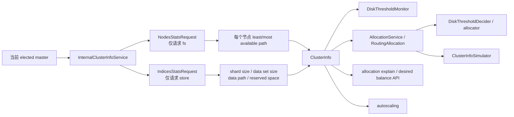
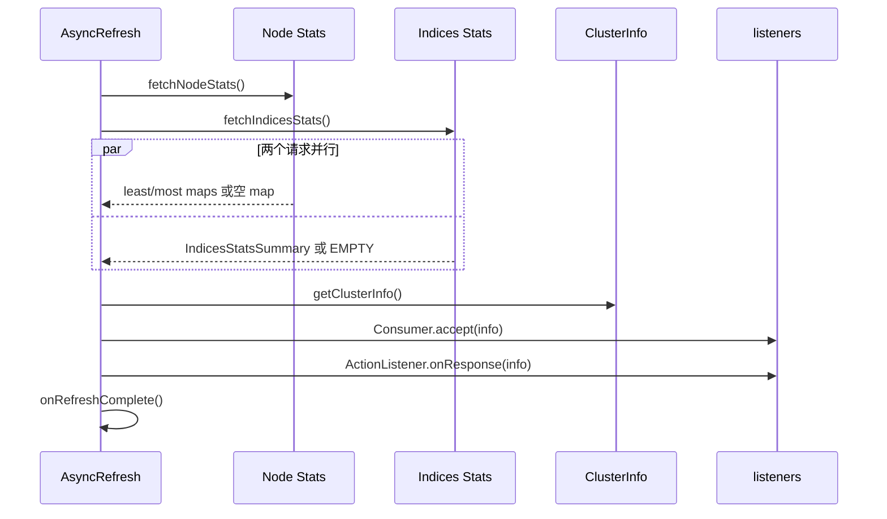
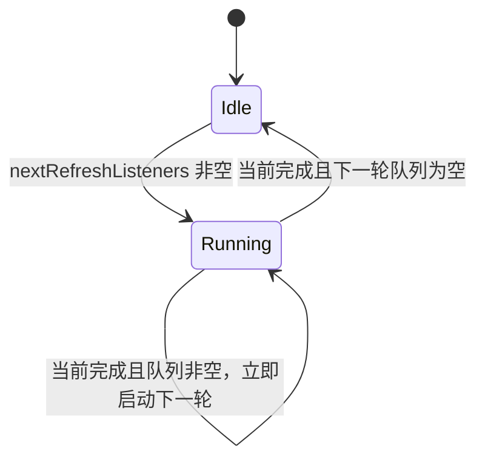

# `ClusterInfo` 源码跟踪：从统计采集到分片分配消费

> 仓库：`elasticsearch-didi`
>
> 基线提交：`db41ec0c4e78`
>
> 核心数据对象：[`ClusterInfo.java`](../../server/src/main/java/org/elasticsearch/cluster/ClusterInfo.java#L42-L418)
>
> 核心生产服务：[`InternalClusterInfoService.java`](../../server/src/main/java/org/elasticsearch/cluster/InternalClusterInfoService.java#L54-L509)

## 1. 先建立整体认识

`ClusterInfo` 不是一个主动查询集群状态的服务，而是一次磁盘与 shard store 统计结果的只读载体。真正负责采集的是 `InternalClusterInfoService`：它在当前 elected master 上并行请求 `NodeStats` 和 `IndicesStats`，把结果整理成 `ClusterInfo`，再交给磁盘监控、allocation、explain、desired balance 和 autoscaling 等消费者。

完整主线如下：



阅读时先记住四个结论：

1. `ClusterInfo` 中包含两类来源不同的数据：节点文件系统统计和 shard store 统计。
2. `leastAvailableSpaceUsage`、`mostAvailableSpaceUsage` 记录的是原始 available bytes，尚未扣除 `reservedSpace`。
3. 定时刷新只由 elected master 驱动；普通节点虽然也创建服务实例，但不会启动刷新调度。
4. `getClusterInfo()` 返回“最近已发布的数据组合”，不是一次同步、实时、跨所有字段原子采集的结果。

## 2. 类型关系与职责边界

### 2.1 三个服务/对象角色

| 类型 | 角色 | 是否采集数据 |
| --- | --- | --- |
| `ClusterInfoService` | 提供最新 `ClusterInfo`，允许注册更新监听器 | 由实现决定 |
| `InternalClusterInfoService` | master 上的真实采集、调度和发布实现 | 是 |
| `EmptyClusterInfoService` | 永远返回 `ClusterInfo.EMPTY` 的空实现 | 否 |
| `ClusterInfo` | 保存一次已整理的统计快照 | 否 |
| `ClusterInfoSimulator` | 在 desired balance 模拟过程中修改快照副本 | 不访问真实节点 |

接口本身非常小：

[`ClusterInfoService.java`](../../server/src/main/java/org/elasticsearch/cluster/ClusterInfoService.java#L13-L29)

```java
@FunctionalInterface
public interface ClusterInfoService {
    ClusterInfo getClusterInfo();

    default void addListener(Consumer<ClusterInfo> clusterInfoConsumer) {
        throw new UnsupportedOperationException();
    }
}
```

这里没有公开的强制刷新 API。`InternalClusterInfoService#refreshAsync()` 是包级方法，生产代码只在服务内部使用；测试通过同包的 `ClusterInfoServiceUtils` 触发并等待刷新。

### 2.2 空实现的语义

[`EmptyClusterInfoService.java`](../../server/src/main/java/org/elasticsearch/cluster/EmptyClusterInfoService.java#L13-L27) 始终返回 `ClusterInfo.EMPTY`，注册的监听器会被直接丢弃，因为永远不会有新数据。

它主要用于不关心磁盘信息的测试、benchmark 或构造 allocation 基础设施。它并不表示“磁盘空间无限”，而是表示消费者拿不到任何 usage/shard size；具体消费者如何降级，由消费者自己决定。

## 3. `ClusterInfo` 的六组核心数据

构造器位于 [`ClusterInfo.java`](../../server/src/main/java/org/elasticsearch/cluster/ClusterInfo.java#L55-L91)：

```java
private final Map<String, DiskUsage> leastAvailableSpaceUsage;
private final Map<String, DiskUsage> mostAvailableSpaceUsage;
final Map<String, Long> shardSizes;
final Map<ShardId, Long> shardDataSetSizes;
final Map<NodeAndShard, String> dataPath;
final Map<NodeAndPath, ReservedSpace> reservedSpace;
```

### 3.1 字段含义

| 字段 | key | value | 来源 | 典型消费者 |
| --- | --- | --- | --- | --- |
| `leastAvailableSpaceUsage` | node ID | 节点上 available bytes 最少的 path | `NodeStats.fs` | `canRemain()`、`DiskThresholdMonitor` |
| `mostAvailableSpaceUsage` | node ID | 节点上 available bytes 最多的 path | `NodeStats.fs` | `canAllocate()`、模拟器 |
| `shardSizes` | `ShardId + [p/r]` 字符串 | 当前 store 本地占用字节数 | `IndicesStats.store` | expected shard size、allocator |
| `shardDataSetSizes` | `ShardId` | shard 逻辑数据集大小 | `IndicesStats.store` | frozen autoscaling |
| `dataPath` | `NodeAndShard` | shard 的实际数据根路径 | `ShardStats` | relocation 修正、`canRemain()` |
| `reservedSpace` | `NodeAndPath` | path 上恢复中 shard 预计还会增长的总字节数和 shard 集合 | `StoreStats.reservedSize` | 磁盘决策、磁盘监控 |

### 3.2 `least` 与 `most` 指的是什么

名称描述的是“可用空间”，不是“已用比例”：

```text
least available path = available bytes 最少的 path = 最拥挤 path
most available path  = available bytes 最多的 path = 最空闲 path
```

源码比较的是 available bytes，不比较百分比。假设一个节点有两个 path：

```text
/data1: total=1TB, available=100GB
/data2: total=10TB, available=200GB
```

那么 `/data1` 是 `least`，`/data2` 是 `most`，即使二者的使用率结论可能不同。

`ClusterInfo` getter 的 Javadoc 还特别强调：两张 map 都没有考虑 reserved space。因此不能把 `mostAvailableSpaceUsage` 理解成“扣完预留空间后最空闲的 path”。

### 3.3 shard size key 为什么区分 `[p]` 和 `[r]`

[`ClusterInfo#shardIdentifierFromRouting()`](../../server/src/main/java/org/elasticsearch/cluster/ClusterInfo.java#L279-L289) 生成：

```text
[indexName][shardId][p]
[indexName][shardId][r]
```

主分片和副本可能具有不同的本地 store size，所以要分开保存。多个副本共用同一个 `[r]` key；采集遍历中后写入的副本值会覆盖先前值，因此它不是“每个 allocation copy 一条记录”。

相比之下，`shardDataSetSizes` 只按 `ShardId` 保存，不区分 primary/replica。构建时会从所有 copy 中保留最大值。

### 3.4 两个复合 key

`NodeAndShard(nodeId, shardId)` 用于回答“某个节点上的这个 shard 位于哪个 path”。它不包含 primary 标志和 `AllocationId`，因为同一个 shard copy 在同一节点上只需要对应一个实际路径。

`NodeAndPath(nodeId, path)` 用于聚合同一节点、同一 path 上所有 shard 的 reserved bytes。只用 path 做 key 不够，因为不同节点可能具有相同路径字符串。

两个 record 都在紧凑构造器中执行非空校验，并实现 `Writeable`：

- [`NodeAndShard`](../../server/src/main/java/org/elasticsearch/cluster/ClusterInfo.java#L319-L339)
- [`NodeAndPath`](../../server/src/main/java/org/elasticsearch/cluster/ClusterInfo.java#L341-L360)

### 3.5 `ReservedSpace` 表示“未来增长量”

[`StoreStats#getReservedSize()`](../../server/src/main/java/org/elasticsearch/index/store/StoreStats.java#L110-L115) 的语义是：当前 store 预计还会增长多少。例如 peer recovery 或 snapshot restore 尚未传输完成的部分。

`ReservedSpace` 同时保存：

```text
total    = 该 node/path 上所有已知 reserved bytes 之和
shardIds = 已经计入 total 的 shard 集合
```

集合很重要。`DiskThresholdDecider` 在估算 initializing shard 时，会先检查 shard 是否已包含在 reserved space 中，避免重复扣除。

`ReservedSpace.Builder` 是一次性 builder：`build()` 后将内部 `shardIds` 置为 `null`，再次 `add()` 或 `build()` 会在启用 assertions 时失败。

### 3.6 不可变性的准确边界

`ClusterInfo` 构造器对六张 map 全部执行 `Map.copyOf()`，所以快照的 map 结构不能增删改，生产端后续修改 builder map 也不会影响已发布对象。

但这是 map 层面的不可变性，不是严格的递归深拷贝：构造器不会复制每一个 value；`ReservedSpace` 内部的 `Set<ShardId>` 也没有在 record 构造时再次 `Set.copyOf()`。正常生产路径通过一次性 builder 构造后不再修改它，但阅读类型契约时应区分“正常使用上的快照”与“类型系统保证的深不可变对象”。

## 4. 服务在哪里创建、如何接入集群生命周期

### 4.1 节点启动时创建

[`NodeConstruction.java`](../../server/src/main/java/org/elasticsearch/node/NodeConstruction.java#L623-L663) 先创建 `ClusterInfoService`，再把它交给 `ClusterModule`，最后注册磁盘监控监听器：

```java
final ClusterInfoService clusterInfoService =
    serviceProvider.newClusterInfoService(...);

clusterInfoService.addListener(
    new DiskThresholdMonitor(...)::onNewInfo
);
```

这形成两个方向：

```text
AllocationService  --主动 getClusterInfo()--> ClusterInfoService
ClusterInfoService --更新回调-------------> DiskThresholdMonitor.onNewInfo()
```

allocation 在执行时主动拿当前快照；磁盘监控则在每次刷新完成后被动收到通知。

### 4.2 只有 master-eligible 节点注册状态监听器

[`NodeServiceProvider#newClusterInfoService()`](../../server/src/main/java/org/elasticsearch/node/NodeServiceProvider.java#L67-L80)：

```java
final InternalClusterInfoService service =
    new InternalClusterInfoService(...);
if (DiscoveryNode.isMasterNode(settings)) {
    clusterService.addListener(service);
}
```

每个节点都会创建 `InternalClusterInfoService`，但只有具备 master 角色的节点才把它注册为 `ClusterStateListener`。即使具备 master 角色，也只有成为 elected master 后才真正调度刷新。

### 4.3 三个动态设置

构造函数在 [`InternalClusterInfoService.java`](../../server/src/main/java/org/elasticsearch/cluster/InternalClusterInfoService.java#L71-L122) 读取并监听：

| 设置 | 默认值 | 最小值 | 作用 |
| --- | ---: | ---: | --- |
| `cluster.info.update.interval` | `30s` | `10s` | 周期刷新间隔 |
| `cluster.info.update.timeout` | `15s` | 正数 | 两类 stats request 的 timeout |
| `cluster.routing.allocation.disk.threshold_enabled` | `true` | - | 是否实际采集磁盘信息 |

三个字段都是 `volatile`，动态更新后后续刷新直接看到新值。

注意：更新 `cluster.info.update.interval` 不会取消当前已经安排的 delay；下一次调度时会使用最新值。

## 5. 刷新是怎样被触发的

### 5.1 成为 elected master：立即刷新

入口是 [`InternalClusterInfoService#clusterChanged()`](../../server/src/main/java/org/elasticsearch/cluster/InternalClusterInfoService.java#L136-L162)。

当 `event.localNodeMaster()` 为 `true` 且 `refreshScheduler == null` 时：

1. 创建新的 `RefreshScheduler`。
2. 把 scheduler 的 listener 放入 `nextRefreshListeners`。
3. `getNewRefresh()` 创建 `AsyncRefresh`。
4. 在退出 `synchronized (mutex)` 后执行刷新。

因此成为 master 后不是先等待 `30s`，而是立即采集一次；第一次完成后才延迟一个 interval 安排下一次。

### 5.2 失去 master：停止后续调度

如果本节点不再是 master，`clusterChanged()` 将 `refreshScheduler` 设为 `null` 并返回。

已安排的延迟任务不一定能从线程池队列中物理移除，但运行前会调用 `shouldRefresh()`：只有 `refreshScheduler == this` 才继续。因此旧 master 的旧 scheduler 会自然失效。

正在执行的刷新不会被强制取消；它可能完成当前请求，但不会再形成有效的周期链。

### 5.3 新增 data node：再请求一次刷新

`clusterChanged()` 遍历 `event.nodesDelta().addedNodes()`。只要发现 `canContainData()` 的新节点，就调用：

```java
refreshAsync(new PlainActionFuture<>());
```

如果 master 刚刚启动的刷新还在运行，这个请求不会加入当前刷新，而会排队成为紧接着的下一次刷新。这样第二次采集更有机会包含刚加入节点的完整统计。

### 5.4 周期刷新：listener 串起下一轮

[`RefreshScheduler#getListener()`](../../server/src/main/java/org/elasticsearch/cluster/InternalClusterInfoService.java#L389-L408) 返回一个 listener。每次刷新完成后，这个 listener：

1. 检查自己仍是当前 scheduler。
2. 延迟 `updateFrequency`。
3. 延迟结束后再次检查。
4. 调用 `refreshAsync(getListener())`，把下一代 listener 交给下一轮。

这是“完成后再延迟”的 fixed-delay 语义，而不是固定时刻触发的 fixed-rate：

```text
refresh N 完成 --等待 interval--> refresh N+1 开始
```

一次采集耗时 8 秒、interval 为 30 秒时，相邻两次开始时间大约相隔 38 秒，而不是强制 30 秒。

## 6. `AsyncRefresh`：两条异步请求如何汇合

### 6.1 单次刷新流程

[`AsyncRefresh#execute()`](../../server/src/main/java/org/elasticsearch/cluster/InternalClusterInfoService.java#L164-L193) 的执行结构是：



两个请求都在清除了 trace context 的上下文中发起，避免周期后台任务错误继承触发它的请求 trace。

### 6.2 `RefCountingRunnable` 是汇合点

`fetchRefs` 初始化时持有一个基础引用。`fetchNodeStats()` 和 `fetchIndicesStats()` 各通过 `fetchRefs.acquire()` 获取一个 callback 引用；`execute()` 的 try-with-resources 结束时释放基础引用。只有两个 callback 都完成并释放引用后，引用计数才归零并调用 `callListeners()`。

因此 listener 看见的是“两条请求均已结束”之后的对象，而不是第一条返回时的半成品。

### 6.3 同一时刻最多一个刷新

核心状态位于 [`getNewRefresh()`](../../server/src/main/java/org/elasticsearch/cluster/InternalClusterInfoService.java#L350-L387)：

```text
currentRefresh        当前正在执行的刷新，最多一个
nextRefreshListeners  当前刷新开始后到达的新请求
```

状态机如下：



关键语义不是“所有并发请求共享当前结果”，而是：

- 当前刷新开始前已经排队的 listener，共享当前刷新。
- 当前刷新开始后才来的 listener，等待下一次新刷新。

这样能保证调用者请求刷新后拿到的是“请求发出之后重新采集”的结果，而不是恰好即将完成的旧采集。

`assertRefreshInvariant()` 检查：只要 `nextRefreshListeners` 非空，就必须已经有 `currentRefresh` 正在执行，不能把 listener 永久留在无人处理的队列里。

### 6.4 关闭磁盘阈值时

当 `enabled == false`，`execute()` 不发任何 stats request，而是立即清空：

```java
leastAvailableSpaceUsages = Map.of();
mostAvailableSpaceUsages = Map.of();
indicesStatsSummary = IndicesStatsSummary.EMPTY;
callListeners();
```

listener 仍然收到一次 `ClusterInfo`，只是其中所有 map 都为空。周期 scheduler 仍可继续运转，所以以后动态重新开启设置后能恢复采集。

## 7. 第一条采集支路：`NodeStats.fs`

### 7.1 请求只取文件系统信息

[`fetchNodeStats()`](../../server/src/main/java/org/elasticsearch/cluster/InternalClusterInfoService.java#L286-L323) 构造：

```java
final NodesStatsRequest request = new NodesStatsRequest("data:true");
request.setIncludeShardsStats(false);
request.clear();
request.addMetric(NodesStatsRequestParameters.Metric.FS.metricName());
request.timeout(fetchTimeout);
```

含义是：

- 目标仅为 data nodes。
- 不附带 shard stats。
- 清空默认 metrics，只请求 `fs`。
- 使用动态的 `cluster.info.update.timeout`。

### 7.2 每个节点只保留两个极值 path

[`fillDiskUsagePerNode()`](../../server/src/main/java/org/elasticsearch/cluster/InternalClusterInfoService.java#L483-L498) 对每个 `NodeStats` 调用：

```java
DiskUsage.findLeastAvailablePath(nodeStats);
DiskUsage.findMostAvailable(nodeStats);
```

`DiskUsage` 是五元 record：

```text
nodeId, nodeName, path, totalBytes, freeBytes
```

`findLeastAvailablePath()` 与 `findMostAvailable()` 分别遍历节点的全部 `FsInfo.Path`，按 `getAvailable().getBytes()` 选最小值和最大值。

源码：

- [`DiskUsage#findLeastAvailablePath()`](../../server/src/main/java/org/elasticsearch/cluster/DiskUsage.java#L126-L178)
- [`DiskUsage#findMostAvailable()`](../../server/src/main/java/org/elasticsearch/cluster/DiskUsage.java#L180-L232)

### 7.3 无效统计如何处理

以下情况返回 `null`，该节点不会进入对应 usage map：

- `nodeStats.getFs() == null`
- `FsInfo` 中没有 path
- 被选中 path 的 `totalBytes < 0`

`totalBytes == 0` 不会被过滤。`DiskUsage#getFreeDiskAsPercentage()` 对它返回 `100%`，按注释这是 fail-open：无效分母被视作不知道磁盘使用情况，而不是直接判满盘。

### 7.4 NodeStats 的部分失败与整体失败

- `NodesStatsResponse` 含部分 node failure 时：记录 warning，仍使用成功节点构建 map。
- 整个 request `onFailure()` 时：least/most 两张 map 都被置为空。

成功结果最终通过 `Map.copyOf()` 发布，之后不再修改。

## 8. 第二条采集支路：`IndicesStats.store`

### 8.1 请求覆盖 open、closed、hidden 索引

[`fetchIndicesStats()`](../../server/src/main/java/org/elasticsearch/cluster/InternalClusterInfoService.java#L195-L284)：

```java
final IndicesStatsRequest request = new IndicesStatsRequest();
request.clear();
request.store(true);
request.indicesOptions(IndicesOptions.STRICT_EXPAND_OPEN_CLOSED_HIDDEN);
request.timeout(fetchTimeout);
```

只请求 store stats，并显式覆盖 open、closed、hidden 索引。response 处理被切换到 `MANAGEMENT` executor，避免在 transport callback 线程上执行较重的整理逻辑。

### 8.2 `buildShardLevelInfo()` 的真实构建顺序

核心循环位于 [`InternalClusterInfoService#buildShardLevelInfo()`](../../server/src/main/java/org/elasticsearch/cluster/InternalClusterInfoService.java#L447-L481)：

```java
for (ShardStats s : stats) {
    ShardRouting routing = routingTable.deduplicate(s.getShardRouting());
    dataPathByShard.put(NodeAndShard.from(routing), s.getDataPath());

    StoreStats storeStats = s.getStats().getStore();
    if (storeStats == null) {
        continue;
    }

    // shardSizes / shardDataSetSizes / reservedSpace
}
```

每个字段的构建规则如下：

| 目标 | 构建规则 |
| --- | --- |
| `dataPath` | 在检查 `storeStats` 之前写入，所以缺少 store metric 时仍可能有 path |
| `shardSizes` | `storeStats.sizeInBytes()`；以 `[p]`/`[r]` key 写入 |
| `shardDataSetSizes` | `storeStats.totalDataSetSizeInBytes()`；同一 `ShardId` 保留最大值 |
| `reservedSpace` | `reserved != UNKNOWN_RESERVED_BYTES` 时，按 node/path 聚合并累加 |

### 8.3 为什么先调用 `RoutingTable#deduplicate()`

stats response 中反序列化得到的 `ShardRouting` 与 master 当前 routing table 中的对象可能值相等但不是同一实例。

[`RoutingTable#deduplicate()`](../../server/src/main/java/org/elasticsearch/cluster/routing/RoutingTable.java#L151-L175) 尝试返回 routing table 内已有的相等实例。当前 `dataPath` key 已经是 `NodeAndShard`，不再直接以 `ShardRouting` 为 key，但这里仍统一使用 master 视角的 routing 实例，并兼容围绕该逻辑演进而来的调用路径。

找不到对应 index/shard/copy 时，方法原样返回 response 中的 `ShardRouting`，不会丢弃这条 stats。

### 8.4 `sizeInBytes` 与 `totalDataSetSizeInBytes`

两者不能混为一谈：

```text
sizeInBytes             当前节点本地 store 实际占用
totalDataSetSizeInBytes shard 完整逻辑数据集大小
```

对于普通本地 store，两者通常相近；对于使用 shared cache 的 searchable snapshot，本地 footprint 可以小于完整数据集大小。因此：

- 磁盘分配通常使用 `shardSizes`。
- frozen autoscaling 使用 `shardDataSetSizes`。

### 8.5 reserved space 如何累加且避免重复估算

假设采集到：

```text
node-a /data1 shard-0 reserved=30GB
node-a /data1 shard-1 reserved=20GB
node-a /data2 shard-2 reserved=10GB
```

结果为：

```text
(node-a,/data1) -> total=50GB, shardIds={shard-0, shard-1}
(node-a,/data2) -> total=10GB, shardIds={shard-2}
```

`UNKNOWN_RESERVED_BYTES` 表示节点无法提供这个预测，该 shard 不进入 `ReservedSpace`。已知值 `0` 则会加入 shard 集合，但不增加 total；这仍有意义，因为消费者知道该 shard 已被 stats 覆盖，不必再使用 expected size 重复估算。

### 8.6 IndicesStats 的失败行为

- response 中只有部分 shard failure：记录失败节点/shard，继续用成功的 shard 构建结果。
- 整个 request `onFailure()`：`indicesStatsSummary = IndicesStatsSummary.EMPTY`。

`ClusterBlockException` 只按 trace 记录，其他异常按 warn 记录，但二者都把这一支路清空。

## 9. 两条支路如何发布成一个 `ClusterInfo`

### 9.1 为什么有 `IndicesStatsSummary`

四张 shard 相关 map 被包装在一个 record 中：

```java
private record IndicesStatsSummary(
    Map<String, Long> shardSizes,
    Map<ShardId, Long> shardDataSetSizes,
    Map<NodeAndShard, String> dataPath,
    Map<NodeAndPath, ReservedSpace> reservedSpace
) {}
```

response handler 完成所有四张 map 后，只做一次 volatile 赋值：

```java
indicesStatsSummary = new IndicesStatsSummary(...);
```

`getClusterInfo()` 也先执行一次 volatile read，再从这个局部变量读取四个字段：

[`InternalClusterInfoService#getClusterInfo()`](../../server/src/main/java/org/elasticsearch/cluster/InternalClusterInfoService.java#L410-L421)

```java
final IndicesStatsSummary summary = this.indicesStatsSummary;
return new ClusterInfo(
    leastAvailableSpaceUsages,
    mostAvailableSpaceUsages,
    summary.shardSizes,
    summary.shardDataSetSizes,
    summary.dataPath,
    summary.reservedSpace
);
```

这保证四张 shard map 来自同一个 `IndicesStats` response，不会发生 `shardSizes` 已更新而 `dataPath` 仍来自上一轮的组合。

### 9.2 整个对象不是单一 volatile 原子快照

least map、most map、`IndicesStatsSummary` 是三个独立 volatile 字段。NodeStats 和 IndicesStats 又是并行完成的。因此任意线程在刷新进行到一半时直接调用 `getClusterInfo()`，理论上可能得到：

```text
本轮 NodeStats + 上轮 IndicesStats
或
上轮 NodeStats + 本轮 IndicesStats
```

least 与 most 也分别赋值，直接读取者在极短窗口内可能看到两者跨代。

但刷新 listener 不会在半途调用：`RefCountingRunnable` 等两支都结束后才执行 `callListeners()`。所以 listener 收到的对象是本轮两条请求都已终结后的组合；主动调用 `getClusterInfo()` 则只承诺“最新可见值”，不承诺等待当前刷新。

### 9.3 发布顺序与 listener 隔离

[`callListeners()`](../../server/src/main/java/org/elasticsearch/cluster/InternalClusterInfoService.java#L325-L347) 的顺序是：

1. 调用 `getClusterInfo()` 创建快照。
2. 依次通知长期注册的 `Consumer<ClusterInfo>`。
3. 单个 consumer 抛异常时记录日志，继续通知其他 consumer。
4. 完成这一轮的 `ActionListener<ClusterInfo>`。
5. 在 `finally` 中执行 `onRefreshComplete()`。

长期 consumer 的异常被隔离；但代码没有逐个捕获 `thisRefreshListeners` 的 `onResponse()` 异常。无论如何，`finally` 都会释放当前刷新状态并尝试启动排队的下一轮。

方法还通过 assertion 要求至少存在一个长期 consumer。生产启动链由 `NodeConstruction` 注册 `DiskThresholdMonitor`，调度单测则显式注册一个空 consumer，从而满足这个内部约束。

### 9.4 “超时”不一定意味着全空

stats action 可以返回带部分成功结果的 response：例如远端节点超时，而 master 本地节点成功。这种情况下服务保留成功节点/shard 的数据。

只有整个支路进入 `onFailure()`，该支路才被清空。集成测试 [`testClusterInfoServiceInformationClearOnError()`](../../server/src/internalClusterTest/java/org/elasticsearch/cluster/ClusterInfoServiceIT.java#L200-L321) 验证了三种情况：

- 健康采集：两类数据完整。
- transport timeout 导致部分 response：保留本地成功结果。
- action 整体抛异常：对应 map 清空；解除异常后下一轮恢复。

因此“刷新失败时继续保留上一次好数据”并不是这里的一般策略。整体失败会用空数据覆盖上一轮结果。

## 10. `ClusterInfo` 对外查询 API

### 10.1 节点 usage

```java
getNodeLeastAvailableDiskUsages()
getNodeMostAvailableDiskUsages()
```

返回构造时已复制的 map。调用者不应再自行猜测 path 极值，也不要忘记这两个值尚未扣 reserved space。

### 10.2 shard size

有四个 overload：

```java
Long getShardSize(ShardId shardId, boolean primary)
Long getShardSize(ShardRouting shardRouting)
long getShardSize(ShardRouting shardRouting, long defaultValue)
long getShardSize(ShardId shardId, boolean primary, long defaultValue)
```

返回 `Long` 的版本用 `null` 表示未知；primitive 版本由调用者指定 fallback。不同消费者的 fallback 语义不同，例如：

- `0L`：把未知大小当作不额外占空间。
- `ShardRouting.UNAVAILABLE_EXPECTED_SHARD_SIZE`：继续传播“未知”。
- snapshot restore：优先从 `SnapshotShardSizeInfo` 取值，而不是直接使用 `ClusterInfo`。

### 10.3 data path 与 reserved space

```java
String getDataPath(ShardRouting routing)
String getDataPath(NodeAndShard key)
ReservedSpace getReservedSpace(String nodeId, String dataPath)
```

`getDataPath()` 未知时返回 `null`。`getReservedSpace()` 未知时返回 `ReservedSpace.EMPTY`，而不是 `null`，方便消费者直接读取 `getTotal()` 或 `containsShardId()`。

### 10.4 data set size

```java
Optional<Long> getShardDataSetSize(ShardId shardId)
```

使用 `Optional` 明确区分未知和已知的 `0`。

## 11. transport 序列化与 XContent 输出

### 11.1 wire 版本门槛

[`ClusterInfo(StreamInput)` 与 `writeTo()`](../../server/src/main/java/org/elasticsearch/cluster/ClusterInfo.java#L93-L124) 对三个演进字段做兼容：

| 字段/格式 | 起始 transport version | 老版本行为 |
| --- | --- | --- |
| `shardDataSetSizes` | `V_7_13_0` | 不读不写，反序列化为空 map |
| `dataPath` 使用 `NodeAndShard` key | `V_8_6_0` | 使用旧 `ShardRouting` key 格式 |
| `reservedSpace` | `V_7_9_0`，即 `StoreStats.RESERVED_BYTES_VERSION` | 不读不写，反序列化为空 map |

为了向 `V_8_6_0` 之前的节点写 data path，`createFakeShardRoutingFromNodeAndShard()` 根据有限信息创建一个假的 started primary routing。

这不会参与 allocation。源码注释明确限定：兼容数据只在滚动升级期间处理带 `includeDiskInfo` 的 allocation explain，最终用于展示，不被业务逻辑消费。

### 11.2 shard size 的 `null` 兼容细节

写 `shardSizes` 时使用：

```java
o.writeLong(v == null ? -1 : v)
```

正常生产路径不会构造 `null` value，因为 `Map.copyOf()` 本身也拒绝 null key/value；该分支保留了旧数据/历史调用语义中的未知值编码方式。

### 11.3 XContent 的五个输出块

[`toXContentChunked()`](../../server/src/main/java/org/elasticsearch/cluster/ClusterInfo.java#L142-L208) 输出大致结构：

```json
{
  "nodes": {
    "node-id": {
      "node_name": "node-a",
      "least_available": {
        "path": "/data1",
        "total_bytes": 1000,
        "used_bytes": 900,
        "free_bytes": 100,
        "free_disk_percent": 10.0,
        "used_disk_percent": 90.0
      },
      "most_available": {
        "path": "/data2"
      }
    }
  },
  "shard_sizes": {},
  "shard_data_set_sizes": {},
  "shard_paths": {},
  "reserved_sizes": []
}
```

实际启用 human-readable 参数时，size 字段还会同时输出可读单位。`ClusterInfo#toString()` 也复用该 XContent 表达。

实现使用 chunked XContent，避免大集群一次性构造庞大的中间 JSON。chunk 数量为：

```text
least node 数
+ shardSizes 数
+ shardDataSetSizes 数
+ dataPath 数
+ reservedSpace 数
+ 6 个结构 chunk
```

`ClusterInfoTests#testChunking()` 对这个公式进行校验。

## 12. allocation 如何消费 `ClusterInfo`

### 12.1 `AllocationService` 把快照注入 `RoutingAllocation`

[`AllocationService#createRoutingAllocation()`](../../server/src/main/java/org/elasticsearch/cluster/routing/allocation/AllocationService.java#L619-L628)：

```java
return new RoutingAllocation(
    allocationDeciders,
    clusterState.mutableRoutingNodes(),
    clusterState,
    clusterInfoService.getClusterInfo(),
    snapshotsInfoService.snapshotShardSizes(),
    currentNanoTime
);
```

同一次 allocation 运算后续都通过 `allocation.clusterInfo()` 读取这个对象，避免每个 decider 再去查询服务。

`adaptAutoExpandReplicas()` 也在真正需要构造 `RoutingAllocation` 时通过 supplier 获取当前 `ClusterInfo`。

### 12.2 `DiskThresholdDecider`：最直接的消费者

它对两种 path 使用不同：

| 判断 | 使用哪张 map | 原因 |
| --- | --- | --- |
| `canAllocate()` | `mostAvailableSpaceUsage` | 新 shard 尚不知道最终 path，以最空闲 path 判断是否有机会放入 |
| `canRemain()` | `leastAvailableSpaceUsage` | 节点超水位时只驱逐位于最拥挤 path 的 shard |
| `canForceAllocateDuringReplace()` | `mostAvailableSpaceUsage` | replacement 目标仍以可容纳新 shard 的 path 判断 |

在 [`sizeOfUnaccountedShards()`](../../server/src/main/java/org/elasticsearch/cluster/routing/allocation/decider/DiskThresholdDecider.java#L107-L167) 中：

1. 先从 `getReservedSpace(node,path).total` 开始。
2. 遍历 initializing shards。
3. 已包含在 `ReservedSpace.shardIds` 中的 shard 跳过，避免重复计算。
4. path 未知时保守地认为它会落到当前被检查的 path。
5. 根据场景决定是否减去正在搬离该 path 的 shard。

`canRemain()` 还通过 `getDataPath(shardRouting)` 判断当前 shard 是否真的位于节点最拥挤 path；不在该 path 时返回 `YES_NOT_MOST_UTILIZED_DISK`，因为移走它不能缓解当前瓶颈。

### 12.3 `ExpectedShardSizeEstimator`

[`ExpectedShardSizeEstimator#getExpectedShardSize()`](../../server/src/main/java/org/elasticsearch/cluster/routing/ExpectedShardSizeEstimator.java#L21-L85) 的选择顺序是：

```text
resize shard     -> 汇总 source primary shard sizes
snapshot restore -> SnapshotShardSizeInfo
其他 shard       -> ClusterInfo.getShardSize()
```

所以 `ClusterInfo.shardSizes` 是普通 peer recovery、relocation 和 allocator 估算的主要来源，但不是所有 recovery 类型的唯一来源。

### 12.4 allocator 与 reconciler

`BalancedShardsAllocator` 使用 shard size 估计 index 总磁盘量、单 shard weight 以及 relocation 的 expected size。

`DesiredBalanceReconciler` 在真正发起 move/rebalance 时，将 `ClusterInfo` 中的大小作为 `RoutingNodes#relocateShard()` 的 expected size；未知时传 `UNAVAILABLE_EXPECTED_SHARD_SIZE`。

### 12.5 `RoutingAllocation` 对 searchable snapshot 的补偿

构造 `RoutingAllocation` 时，[`unaccountedSearchableSnapshotSizes()`](../../server/src/main/java/org/elasticsearch/cluster/routing/allocation/RoutingAllocation.java#L158-L179) 会寻找：

- 已 started 的 searchable snapshot shard；
- `expectedShardSize > 0`；
- 当前 reserved space 未包含它；
- `ClusterInfo` 还没有它的实际 shard size。

满足条件的 expected size 按 node 累加，交给磁盘决策补偿“routing 已更新、ClusterInfo 仍滞后”的窗口。

## 13. `DiskThresholdMonitor`：刷新完成后的主动动作

`NodeConstruction` 把 [`DiskThresholdMonitor#onNewInfo()`](../../server/src/main/java/org/elasticsearch/cluster/routing/allocation/DiskThresholdMonitor.java#L127-L260) 注册为长期 listener。

它使用 `leastAvailableSpaceUsage` 检查每个节点最拥挤 path，并可能：

- 新节点出现或超过 high watermark 时请求 reroute。
- 超过 flood-stage 时把节点上相关索引标记为 read-only。
- 空间恢复后解除自动设置的 read-only block。
- 维护 low/high threshold 节点集合，限制 reroute 频率。

一个容易忽略的细节：flood-stage 的第一轮检查直接使用原始 `DiskUsage.freeBytes`；随后 high/low 判断才构造 `usageWithReservedSpace`，将 free bytes 减去 `ClusterInfo.getReservedSpace(node,path).total`。

因此 `ClusterInfo` 只提供事实和预测，何时扣 reserved、触发什么动作由 monitor/decider 决定。

## 14. 对外展示与其他消费者

### 14.1 allocation explain

[`TransportClusterAllocationExplainAction#masterOperation()`](../../server/src/main/java/org/elasticsearch/action/admin/cluster/allocation/TransportClusterAllocationExplainAction.java#L87-L115) 总是把 `ClusterInfo` 注入 `RoutingAllocation`，供 decider 生成解释。

只有请求设置 `includeDiskInfo=true` 时，response 才额外携带完整 `ClusterInfo`；否则它只影响决策，不在 response 中展开磁盘详情。

### 14.2 desired balance 查询

[`TransportGetDesiredBalanceAction`](../../server/src/main/java/org/elasticsearch/action/admin/cluster/allocation/TransportGetDesiredBalanceAction.java#L80-L103) 读取当前 `ClusterInfo`：

- 用于构造 `ClusterBalanceStats`。
- 作为 response 的 cluster info 部分返回。

这里拿到的是请求执行时服务中最近的真实快照，不是 desired balance 计算内部的模拟快照。

### 14.3 frozen autoscaling

[`FrozenStorageDeciderService#estimateSize()`](../../x-pack/plugin/autoscaling/src/main/java/org/elasticsearch/xpack/autoscaling/storage/FrozenStorageDeciderService.java#L56-L65) 对 frozen index 的所有 `ShardId` 调用 `getShardDataSetSize()`，再乘副本数，估算完整逻辑数据集大小。

这说明 `shardDataSetSizes` 的目标不是回答“当前本地磁盘用了多少”，而是回答“这个 shard 背后的数据集有多大”。

`ReactiveStorageDeciderService` 还会包装原 `ClusterInfo`，覆盖部分 shard size 估算，同时把 data set size、data path 和 reserved space 委托回原对象。

## 15. `ClusterInfoSimulator`：desired balance 中的模拟快照

### 15.1 为什么需要模拟

desired balance 会在一次计算中反复调用 delegate allocator，并假设 initializing recovery 最终完成。如果始终使用计算开始时的真实 `ClusterInfo`，后续迭代就看不到前一轮模拟分配已经占用的磁盘，可能把过多 shard 继续放向同一节点。

[`DesiredBalanceComputer#compute()`](../../server/src/main/java/org/elasticsearch/cluster/routing/allocation/allocator/DesiredBalanceComputer.java#L73-L100) 因此创建：

```java
final var clusterInfoSimulator =
    new ClusterInfoSimulator(routingAllocation.clusterInfo());
```

每轮 delegate allocation 前再调用：

```java
routingAllocation.setSimulatedClusterInfo(
    clusterInfoSimulator.getClusterInfo()
);
```

### 15.2 `simulateShardStarted()` 的三种 size 来源

[`ClusterInfoSimulator.java`](../../server/src/main/java/org/elasticsearch/cluster/ClusterInfoSimulator.java#L35-L71)：

| initializing shard 类型 | 估算来源 |
| --- | --- |
| relocation target | 当前 routing 对应的 source shard size |
| 新 replica | 同 `ShardId` 的 primary size |
| 新 primary | `ShardRouting#getExpectedShardSize()` |

应用规则：

```text
relocation:
  source node free += size
  target node free -= size

new primary/replica:
  target node free -= size
  把该 shard size 写入模拟 shardSizes
```

size 未知、等于 0 或小于 0 时不修改磁盘统计。

### 15.3 多 data path 时为什么只改 `most`

模拟器不知道新 shard 最终落在哪个具体 path，所以总是修改节点的 `mostAvailableSpaceUsage`，即 `canAllocate()` 会读取的 path。

只有 `least` 和 `most` 指向同一个 path——典型的单 data path 节点——才同步修改 `leastAvailableSpaceUsage`。多 path 时不修改 least，避免伪造已有 shard 的真实落盘位置。

更新后的 free bytes 被限制在 `[0,totalBytes]`，防止多 path 的保守估算把 free 推到负数或超过容量。

### 15.4 模拟快照有意丢弃 reserved space

`ClusterInfoSimulator#getClusterInfo()` 最后传入：

```java
reservedSpace = Map.of()
```

这是因为模拟器已经直接修改 free bytes 来反映假定完成的 recovery。如果继续保留真实快照中的 reserved space，后续 `DiskThresholdDecider` 可能再次扣除同一批未来增长量。

模拟器保留原始 `shardDataSetSizes` 和 `dataPath`，但不会为新模拟 shard 推断实际 path。

## 16. 一个端到端例子

假设 `node-a` 有两个 path：

```text
/data1 total=1TB available=100GB
/data2 total=1TB available=300GB
```

并有：

```text
shard X primary 位于 node-a:/data1，size=40GB
shard Y 正在恢复到 node-a:/data2，reserved=60GB
```

### 16.1 采集结果

NodeStats 支路：

```text
leastAvailableSpaceUsage[node-a] = /data1, free=100GB
mostAvailableSpaceUsage[node-a]  = /data2, free=300GB
```

IndicesStats 支路：

```text
shardSizes[X[p]] = 40GB
dataPath[(node-a,X)] = /data1
reservedSpace[(node-a,/data2)] = 60GB, {Y}
```

注意 most 仍是原始 `300GB`，不会在 `ClusterInfo` 构建阶段变成 `240GB`。

### 16.2 新 shard 分配

`DiskThresholdDecider#canAllocate()` 读取 most path `/data2`，再通过 `sizeOfUnaccountedShards()` 将 reserved `60GB` 纳入修正：

```text
corrected free = 300GB - 60GB = 240GB
```

然后再扣候选 shard expected size，与 low/high watermark 比较。

### 16.3 已有 shard 是否能留下

`canRemain(X)` 读取 least path `/data1`，并查询 `getDataPath(X)`：二者相同，所以 X 确实位于最拥挤 path，需要执行 high watermark 判断。

如果 X 实际位于 `/data2`，即使节点的 `/data1` 超 high watermark，移动 X 也不能释放 `/data1`，所以该方法允许 X 留下，allocator 应寻找 `/data1` 上的 shard 迁移。

### 16.4 下一次采集

当 Y 恢复完成后：

- 文件系统 available bytes 会在新的 NodeStats 中体现实际占用。
- reserved size 通常归零。
- `ClusterInfo` 通过下一轮刷新替换旧快照。

这就是系统处理统计滞后的基本方式：当前轮通过 reserved/expected size 保守补偿，后续轮再用真实 FS/store stats 收敛。

## 17. 容易误读的边界与故障语义

### 17.1 `ClusterInfo.EMPTY` 不等于磁盘为空

空 map 表示信息不可用。`DiskThresholdDecider` 的 `earlyTerminate()` 在 usage map 为空时通常 fail-open，不因缺少统计而拒绝所有分配。

### 17.2 快照与 cluster state 可能短暂不同步

Cluster state 和 stats request 没有事务边界。可能出现：

- routing 中已有 shard，但 stats 尚未出现。
- stats 中仍有 shard，但 routing 已移除或 recovery 已取消。
- 新节点已进入 cluster state，但尚无 usage。
- shard path 已知，但 store metric 缺失。

消费者通过 expected size、reserved shard 集合、保守 path 假设和周期刷新来缓解，而不是要求二者绝对同步。

### 17.3 采集 timeout 是每类 request 的 timeout

NodeStats 和 IndicesStats 并行发起，各自携带同一个 `fetchTimeout`。它不是“整个 `AsyncRefresh` 共用一份倒计时后立即取消一切”的外层 deadline。

### 17.4 部分结果会发布

部分 node/shard failure 不会让整轮作废。map 可以只覆盖成功的节点和 shard。消费者必须把 key 缺失理解为未知，而不是 0。

### 17.5 shard size 不是实时写入量

它来自周期性 `IndicesStats.store`，写入增长、merge、recovery 或删除发生后，要等下一次刷新才反映。allocator 使用的是估算值，不是容量预占事务。

### 17.6 注册 listener 不会立即回放当前值

`addListener()` 只把 consumer 加入 `CopyOnWriteArrayList`；它不会立刻调用一次 `getClusterInfo()`。consumer 要等下一轮刷新完成才收到通知。

## 18. 测试如何覆盖这条链路

| 测试 | 覆盖重点 |
| --- | --- |
| [`ClusterInfoTests`](../../server/src/test/java/org/elasticsearch/cluster/ClusterInfoTests.java#L19-L118) | wire 往返、随机六张 map、chunk 数量 |
| [`DiskUsageTests`](../../server/src/test/java/org/elasticsearch/cluster/DiskUsageTests.java#L37-L300) | 百分比计算、least/most path、无效 FS 值、shard-level 信息构建 |
| [`InternalClusterInfoServiceSchedulingTests`](../../server/src/test/java/org/elasticsearch/cluster/InternalClusterInfoServiceSchedulingTests.java#L43-L155) | 成为/失去 master、周期调度、每轮两类请求、旧 scheduler 停止 |
| [`ClusterInfoServiceIT`](../../server/src/internalClusterTest/java/org/elasticsearch/cluster/ClusterInfoServiceIT.java#L66-L330) | 真实集群采集、path、reserved、部分 timeout、整体异常及恢复 |
| [`ClusterInfoSimulatorTests`](../../server/src/test/java/org/elasticsearch/cluster/routing/allocation/allocator/ClusterInfoSimulatorTests.java#L47-L353) | 新 primary、replica、relocation、单/多 path 和磁盘决策联动 |

测试需要同步刷新时使用 [`ClusterInfoServiceUtils#refresh()`](../../test/framework/src/main/java/org/elasticsearch/cluster/ClusterInfoServiceUtils.java#L18-L38)：它构造 `PlainActionFuture`，调用包级 `refreshAsync()`，最多等待 10 秒。

调试采集问题时，建议按以下顺序定位：

1. 本节点是否为 elected master，服务是否注册为 cluster-state listener。
2. `cluster.routing.allocation.disk.threshold_enabled` 是否开启。
3. NodeStats 与 IndicesStats 是整体失败还是部分失败。
4. 缺失的是 node usage，还是 shard summary。
5. consumer 读取的是 least 还是 most path。
6. reserved space 是否已经覆盖目标 shard，避免把 expected size 再扣一次。
7. cluster state 与统计快照是否处于短暂错位窗口。

## 19. 关键源码索引

| 主题 | 源码入口 |
| --- | --- |
| 数据模型、getter、wire、XContent | [`ClusterInfo.java`](../../server/src/main/java/org/elasticsearch/cluster/ClusterInfo.java#L42-L418) |
| usage 值对象与 path 极值选择 | [`DiskUsage.java`](../../server/src/main/java/org/elasticsearch/cluster/DiskUsage.java#L26-L232) |
| 服务接口 | [`ClusterInfoService.java`](../../server/src/main/java/org/elasticsearch/cluster/ClusterInfoService.java#L13-L29) |
| 空实现 | [`EmptyClusterInfoService.java`](../../server/src/main/java/org/elasticsearch/cluster/EmptyClusterInfoService.java#L13-L27) |
| master 生命周期与并发刷新 | [`InternalClusterInfoService.java`](../../server/src/main/java/org/elasticsearch/cluster/InternalClusterInfoService.java#L54-L445) |
| shard-level map 构建 | [`InternalClusterInfoService#buildShardLevelInfo()`](../../server/src/main/java/org/elasticsearch/cluster/InternalClusterInfoService.java#L447-L481) |
| 服务创建 | [`NodeServiceProvider.java`](../../server/src/main/java/org/elasticsearch/node/NodeServiceProvider.java#L67-L80) |
| listener 接线 | [`NodeConstruction.java`](../../server/src/main/java/org/elasticsearch/node/NodeConstruction.java#L623-L663) |
| 注入 allocation | [`AllocationService.java`](../../server/src/main/java/org/elasticsearch/cluster/routing/allocation/AllocationService.java#L619-L628) |
| allocation 上下文 | [`RoutingAllocation.java`](../../server/src/main/java/org/elasticsearch/cluster/routing/allocation/RoutingAllocation.java#L127-L179) |
| 磁盘分配消费 | [`DiskThresholdDecider.java`](../../server/src/main/java/org/elasticsearch/cluster/routing/allocation/decider/DiskThresholdDecider.java#L107-L570) |
| 磁盘监控消费 | [`DiskThresholdMonitor.java`](../../server/src/main/java/org/elasticsearch/cluster/routing/allocation/DiskThresholdMonitor.java#L127-L360) |
| expected size 选择 | [`ExpectedShardSizeEstimator.java`](../../server/src/main/java/org/elasticsearch/cluster/routing/ExpectedShardSizeEstimator.java#L21-L85) |
| desired balance 模拟 | [`ClusterInfoSimulator.java`](../../server/src/main/java/org/elasticsearch/cluster/ClusterInfoSimulator.java#L19-L113) |

## 20. 一句话总结

`InternalClusterInfoService` 在 elected master 上以 fixed-delay 方式并行采集 `NodeStats.fs` 和 `IndicesStats.store`，将节点 path 极值、shard 大小、逻辑数据集大小、实际路径和预留增长量整理成 `ClusterInfo`；allocation 和磁盘监控再结合当前 routing state 对这份可能滞后的快照进行保守修正，从而完成磁盘准入、迁移、只读保护、容量估算和 desired balance 模拟。
