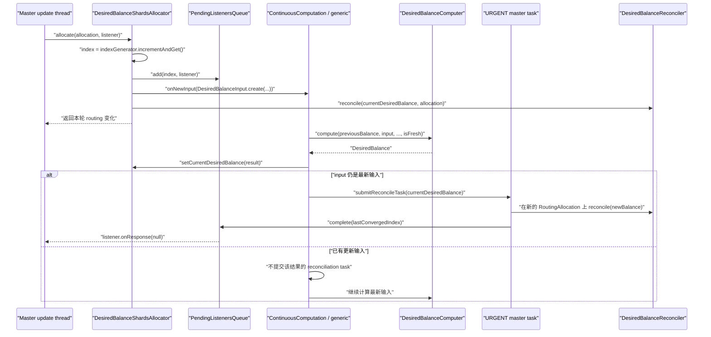
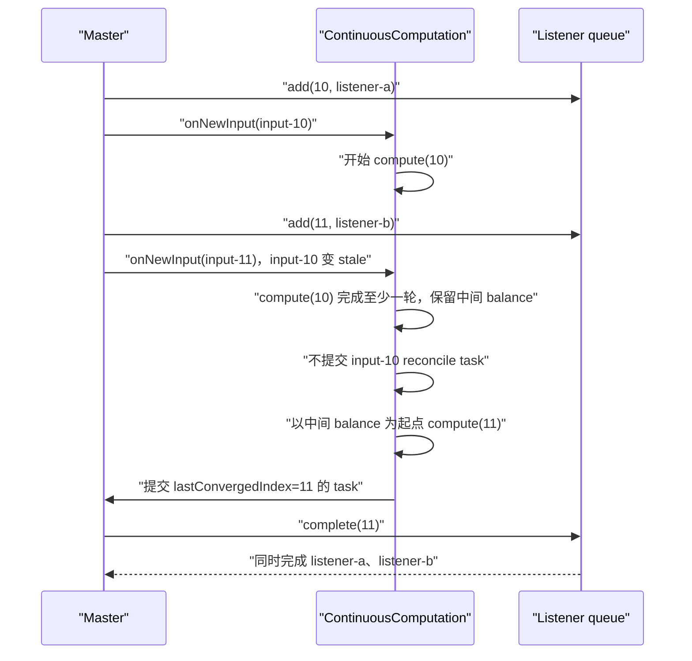
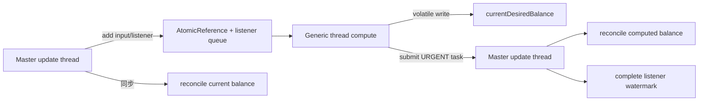

# `DesiredBalanceShardsAllocator.allocate` 源码跟踪

> 仓库：`elasticsearch-didi`
>
> 基线提交：`46ea11c9535f`
>
> 目标方法：`DesiredBalanceShardsAllocator#allocate(RoutingAllocation, ActionListener<Void>)`
>
> 目标源码：[`DesiredBalanceShardsAllocator.java`](../server/src/main/java/org/elasticsearch/cluster/routing/allocation/allocator/DesiredBalanceShardsAllocator.java#L178-L194)

## 1. 结论先行

`DesiredBalanceShardsAllocator.allocate()` 是 desired-balance 分配架构的“输入提交与即时推进”入口。它自己不执行完整的 balance 计算，而是在 master update 线程中完成六件事：

1. 验证当前线程和 `RoutingAllocation` 状态。
2. 为本次 reroute 生成单调递增的 input index。
3. 把调用者 listener 与 input index 绑定后加入等待队列。
4. 从当前 `RoutingAllocation` 创建不可变输入快照。
5. 把快照提交给 generic 线程上的 `ContinuousComputation`；尚未开始的旧输入可以被新输入覆盖。
6. 不等待后台结果，立即使用当前可见的 `currentDesiredBalance` 对本轮 routing state 做一次 reconciliation。

后台计算完成后会走另一条路径：

```text
generic thread 计算 DesiredBalance
  -> 更新 allocator 内存中的 currentDesiredBalance
  -> 提交 URGENT master task
  -> master thread 再次执行 AllocationService reroute
  -> 用新 DesiredBalance 做 reconciliation
  -> cluster state task 成功后完成所有 index <= lastConvergedIndex 的 listener
```

所以 `allocate()` 同时启动两种推进：

- 同步、低延迟：使用当前 balance 推进一步。
- 异步、最终收敛：计算更新的 balance，再回到 master 推进一步。

最重要的三个概念不能混淆：

| 概念 | 含义 |
| --- | --- |
| `currentDesiredBalance` | allocator 内存里的目标节点集合，不是 cluster state |
| `reconcile()` | 根据目标状态修改当前 `RoutingNodes`，形成实际 routing 变化 |
| `lastConvergedIndex` | 已完整计算收敛到的最新输入序号，也是 listener 完成水位 |

## 2. 类在整体分配架构中的位置

`DesiredBalanceShardsAllocator` 实现 `ShardsAllocator`。类注释给出的定位是：异步刷新 desired balance，再由 reconciler 逐步靠近这个目标。

默认 allocator 由 `ClusterModule` 创建：

```java
new DesiredBalanceShardsAllocator(
    clusterSettings,
    new BalancedShardsAllocator(clusterSettings, writeLoadForecaster),
    threadPool,
    clusterService,
    reconciler,
    telemetryProvider
)
```

也就是说：

- 外层 `DesiredBalanceShardsAllocator` 负责异步计算、输入合并、发布 reconciliation task 和 listener 生命周期。
- 内层 `BalancedShardsAllocator` 是 `DesiredBalanceComputer` 在模拟 routing state 上反复调用的 delegate，用来寻找最终目标布局。
- `DesiredBalanceReconciler` 不重新计算全局最优布局，只负责把真实 cluster routing 向已经算出的目标推进一小步。

节点设置 `cluster.routing.allocation.type` 的默认值是 `desired_balance`；旧的 `balanced` 值仍存在，但该设置已经标记 deprecated。

相关源码：

- [`ClusterModule` allocator 设置](../server/src/main/java/org/elasticsearch/cluster/ClusterModule.java#L98-L109)
- [`ClusterModule#createShardsAllocator`](../server/src/main/java/org/elasticsearch/cluster/ClusterModule.java#L379-L418)
- [`DesiredBalanceShardsAllocator` 类与字段](../server/src/main/java/org/elasticsearch/cluster/routing/allocation/allocator/DesiredBalanceShardsAllocator.java#L42-L69)

## 3. 总体时序



## 4. 从 `AllocationService` 到 `allocate()`

标准 reroute 入口最终把一个 lambda 传给 `AllocationService#executeWithRoutingAllocation()`：

```java
routingAllocation -> shardsAllocator.allocate(routingAllocation, listener)
```

[`AllocationService#reroute(RoutingAllocation, RerouteStrategy)`](../server/src/main/java/org/elasticsearch/cluster/routing/allocation/AllocationService.java#L523-L532) 的执行顺序为：

```java
rerouteStrategy.removeDelayMarkers(allocation);
allocateExistingUnassignedShards(allocation);
rerouteStrategy.execute(allocation);
```

因此进入目标方法前，已经发生：

1. 清理本轮已过期的 delayed marker。
2. 运行 `allocateExistingUnassignedShards()`，优先处理 gateway/searchable-snapshot 已有副本。
3. gateway 已初始化的 shard 已进入 routing nodes。
4. gateway 认领但仍在 fetching/delayed 的 shard 已进入 `ignored`。
5. gateway 返回 `NOT_TAKEN` 的 shard 仍留在主 `unassigned` 列表，等待 desired-balance。

这也是 `DesiredBalanceInput` 必须额外保存 ignored shard 的原因。详细的 existing allocator 前置链路见：[`allocateExistingUnassignedShards` 源码跟踪](<allocateExistingUnassignedShards 源码跟踪.md>)。

常见调用位置：

- 普通 reroute：[`AllocationService#reroute(ClusterState, String, ActionListener)`](../server/src/main/java/org/elasticsearch/cluster/routing/allocation/AllocationService.java#L392-L398)
- allocation command 后 reroute：[`AllocationService.java`](../server/src/main/java/org/elasticsearch/cluster/routing/allocation/AllocationService.java#L370-L380)
- shard failure 后 reroute：[`AllocationService#applyFailedShards`](../server/src/main/java/org/elasticsearch/cluster/routing/allocation/AllocationService.java#L191-L270)

## 5. 目标方法完整源码

```java
@Override
public void allocate(RoutingAllocation allocation, ActionListener<Void> listener) {
    assert MasterService.assertMasterUpdateOrTestThread() : Thread.currentThread().getName();
    assert allocation.ignoreDisable() == false;

    computationsSubmitted.inc();

    var index = indexGenerator.incrementAndGet();
    logger.debug("Executing allocate for [{}]", index);
    queue.add(index, listener);
    desiredBalanceComputation.onNewInput(DesiredBalanceInput.create(index, allocation));

    // Starts reconciliation towards desired balance that might have not been updated with a recent calculation yet.
    // This is fine as balance should have incremental rather than radical changes.
    // This should speed up achieving the desired balance in cases current state is still different from it (due to THROTTLING).
    reconcile(currentDesiredBalance, allocation);
}
```

该类故意不支持无 listener 的重载：

```java
@Override
public void allocate(RoutingAllocation allocation) {
    throw new UnsupportedOperationException();
}
```

原因是 desired-balance 是异步 allocator，调用方需要通过带 listener 的重载表达“等待哪一个计算水位”。普通同步 allocator 的接口默认实现会在 `allocate()` 返回后立即回调 listener，这不适用于这里。

接口定义：[`ShardsAllocator`](../server/src/main/java/org/elasticsearch/cluster/routing/allocation/allocator/ShardsAllocator.java#L27-L88)

## 6. 第一行断言：线程约束

```java
assert MasterService.assertMasterUpdateOrTestThread()
    : Thread.currentThread().getName();
```

目标方法必须在 master update 线程或测试线程运行。这一约束同时保证：

- input index 按 master 处理 cluster-state update 的顺序生成。
- `PendingListenersQueue` 中 listener 的插入顺序与 index 顺序一致。
- 同步 `reconcile()` 对当前 `RoutingAllocation` 的修改仍处于 cluster-state update 上下文。

`indexGenerator` 虽然是 `AtomicLong`，但正常调用并不依赖多线程并发生成 index；原子类型还用于 master 身份变化时安全地重置为 `-1`。

## 7. 第二行断言：不能残留 `ignoreDisable`

```java
assert allocation.ignoreDisable() == false;
```

`ShardsAllocator#execute()` 在执行显式 allocation commands 时，会临时执行：

```text
allocation.ignoreDisable(true)
commands.execute(...)
allocation.ignoreDisable(false)
```

`allocate()` 是命令执行完成后的普通 reroute 阶段，必须重新尊重 allocation enable/disable 设置。如果该标记没有恢复，desired-balance 可能绕过集群的 allocation disable 配置。

## 8. 记录提交计数并生成 input index

```java
computationsSubmitted.inc();
var index = indexGenerator.incrementAndGet();
```

`indexGenerator` 初始值为 `-1`，因此当前 master 的第一次输入 index 为 `0`。之后每次调用目标方法递增一次。

index 有三种用途：

1. 标识 `DesiredBalanceInput` 的新旧顺序。
2. 把 reroute listener 与对应输入绑定。
3. 计算完成后通过 `lastConvergedIndex` 批量释放已经被覆盖或已经收敛的 listener。

index 不是 cluster-state version，也不是 routing-table version。它只在当前 `DesiredBalanceShardsAllocator` 的 master 生命周期内有意义；失去 master 时会重置为 `-1`。

## 9. listener 入队

```java
queue.add(index, listener);
```

[`PendingListenersQueue`](../server/src/main/java/org/elasticsearch/cluster/routing/allocation/allocator/PendingListenersQueue.java#L26-L83) 内部保存：

```java
private record PendingListener(long index, ActionListener<Void> listener) {}
private final Queue<PendingListener> pendingListeners = new LinkedList<>();
private volatile long completedIndex = -1;
```

### 9.1 为什么不立即回调

目标方法返回时，通常只完成了旧 desired balance 的一次 reconciliation，新输入的 balance 可能还没有开始计算。因此 listener 必须等待：

```text
input 被计算到收敛水位
  -> 对应 desired balance 在 master task 中完成 reconciliation
  -> cluster-state task 成功
```

### 9.2 `complete()` 的水位语义

```java
public void complete(long convergedIndex) {
    if (convergedIndex > completedIndex) {
        completedIndex = convergedIndex;
    }
    executeListeners(completedIndex, true);
}
```

`pollListeners(maxIndex)` 从队头连续取出所有：

```text
listener.index <= maxIndex
```

所以一次计算可以完成多个 listener。比如输入 `10`、`11` 被连续的输入 `12` 覆盖，只要最终 balance 的 `lastConvergedIndex` 达到 `12`，三个 listener 都会成功。

`completedIndex` 只前进不后退。即使之后误传更小值，已经完成的水位不会下降。

## 10. 创建 `DesiredBalanceInput`

目标方法执行：

```java
DesiredBalanceInput.create(index, allocation)
```

[`DesiredBalanceInput`](../server/src/main/java/org/elasticsearch/cluster/routing/allocation/allocator/DesiredBalanceInput.java#L25-L34) 是一个 record：

```java
public record DesiredBalanceInput(
    long index,
    RoutingAllocation routingAllocation,
    List<ShardRouting> ignoredShards
) {}
```

创建时保存：

```java
new DesiredBalanceInput(
    index,
    routingAllocation.immutableClone(),
    List.copyOf(routingAllocation.routingNodes().unassigned().ignored())
)
```

### 10.1 为什么必须 clone

原始 `RoutingAllocation` 属于当前 master update 线程，并会在目标方法后继续构造 cluster state。后台 generic 线程不能直接持有和修改它。

[`RoutingAllocation#immutableClone`](../server/src/main/java/org/elasticsearch/cluster/routing/allocation/RoutingAllocation.java#L419-L431) 会：

- 复用 deciders、cluster info、snapshot shard size info 和本轮时间。
- 如果本轮 routing nodes 已变化，先用当前 routing nodes 构造新的 routing table/cluster state。
- 否则直接复用原 cluster state。

后台计算开始后，再调用 `mutableCloneForSimulation()` 创建只用于模拟的可变 routing nodes。

### 10.2 为什么 ignored shard 单独复制

`RoutingTable` 只表示 shard 的 routing 状态，并不完整保存当前 reroute 内临时的 `unassigned().ignored()` 队列。existing allocator 已认领的 shard 必须显式复制，才能阻止后台 delegate allocator 把它们当成普通 unassigned shard。

ignored 列表通常包含：

- gateway 仍在 `FETCHING_SHARD_DATA` 的 primary/replica。
- `NO_VALID_SHARD_COPY` 的 existing primary。
- delayed replica。
- searchable snapshot allocator 正在等待的信息。

## 11. 提交到 `ContinuousComputation`

```java
desiredBalanceComputation.onNewInput(input);
```

`desiredBalanceComputation` 是构造函数中创建的匿名 `ContinuousComputation<DesiredBalanceInput>`，executor 是：

```java
threadPool.generic()
```

因此耗时的全局 balance 计算不会阻塞 master update 线程。

### 11.1 `onNewInput()` 的覆盖语义

[`ContinuousComputation#onNewInput`](../server/src/main/java/org/elasticsearch/cluster/routing/allocation/allocator/ContinuousComputation.java#L41-L48) 使用单个 `AtomicReference<T>`：

```java
if (enqueuedInput.getAndSet(input) == null) {
    executor.execute(processor);
}
```

含义是：

- 当前没有输入：保存输入并调度 processor。
- 已有等待或正在处理的输入：用新输入覆盖 reference，不再额外并发启动 processor。
- 多个输入快速到达时，中间尚未开始处理的输入可以被跳过。

这不是普通 FIFO 队列，而是 latest-value coalescing。

### 11.2 processor 保证单实例串行计算

`Processor#doRun()`：

```java
final T input = enqueuedInput.get();
try {
    processInput(input);
} finally {
    if (enqueuedInput.compareAndSet(input, null) == false) {
        executor.execute(this);
    }
}
```

如果计算期间没有新输入，CAS 成功，processor 变为空闲；如果 reference 已被新输入替换，CAS 失败，同一个 processor 再次入 executor，下一轮读取最新输入。

由此得到两个保证：

- `processInput()` 不会并发执行多个实例。
- 最新输入最终会被处理，但每一个中间输入不保证单独计算。

### 11.3 `isFresh()`

```java
protected boolean isFresh(T input) {
    return enqueuedInput.get() == input;
}
```

它使用对象 identity 判断当前计算输入是否仍是最新输入。`DesiredBalanceComputer` 会在每轮模拟后检查该 predicate，以便新 cluster state 到达时尽快停止旧计算。

完整实现：[`ContinuousComputation`](../server/src/main/java/org/elasticsearch/cluster/routing/allocation/allocator/ContinuousComputation.java#L26-L107)

## 12. 为什么提交后台计算后还要立即 `reconcile()`

目标方法最后执行：

```java
reconcile(currentDesiredBalance, allocation);
```

这里读取到的是当时最新可见的 volatile `currentDesiredBalance`：

- 通常是之前输入算出的 balance。
- 第一次调用时是 `DesiredBalance.INITIAL`。
- 如果 generic 线程恰好刚完成计算，也可能已经是更新后的 balance。

这么做的原因是 reconciliation 本身是增量的。受 recovery throttle 等约束影响，一个 balance 往往需要多个 reroute 才能真正落地；即使新 balance 还没算完，继续向旧目标前进一步通常仍有价值。

例如旧 balance 已经要求：

```text
shard A -> node-1
shard B -> node-2
```

上一轮只因 throttle 初始化了 shard A。本轮新 cluster state 到达后，无须等全局 balance 重算，立即 reconciliation 就可以尝试 shard B。

### 12.1 旧 balance 不认识新 shard 时

新建索引首次触发 reroute 时，旧 balance 中没有新 `ShardId` 的 assignment。`DesiredBalanceReconciler` 会把对应 unassigned shard 视为 `NO_ATTEMPT` 并保持未分配。后台新 balance 算出并回到 master 后，第二次 reconciliation 才会分配它。

### 12.2 `DesiredBalance.INITIAL`

```java
new DesiredBalance(-1, Map.of())
```

如果 assignment map 为空，reconciler 在有 data node 时直接返回，等待后台计算；没有 data node 时会特殊处理新 primary，使健康状态能够正确显示 red。

## 13. `reconcile()` 包装层

[`DesiredBalanceShardsAllocator#reconcile`](../server/src/main/java/org/elasticsearch/cluster/routing/allocation/allocator/DesiredBalanceShardsAllocator.java#L233-L245) 做三件事：

1. 按 trace/debug 级别记录 balance。
2. 用 `recordTime()` 累计 reconciliation 耗时。
3. 调用 `desiredBalanceReconciler.reconcile(desiredBalance, allocation)`。

```java
recordTime(
    cumulativeReconciliationTime,
    () -> desiredBalanceReconciler.reconcile(desiredBalance, allocation)
);
```

`recordTime()` 在 `finally` 中记时，因此即使 action 抛异常，已消耗的时间仍会计入 metric。

## 14. 后台 `processInput()`

匿名 `ContinuousComputation` 的核心逻辑位于构造函数：[`DesiredBalanceShardsAllocator` 构造函数](../server/src/main/java/org/elasticsearch/cluster/routing/allocation/allocator/DesiredBalanceShardsAllocator.java#L94-L166)

等价流程为：

```java
DesiredBalance result = desiredBalanceComputer.compute(
    getInitialDesiredBalance(),
    desiredBalanceInput,
    pendingDesiredBalanceMoves,
    this::isFresh
);
setCurrentDesiredBalance(result);
computationsExecuted.inc();

if (isFresh(desiredBalanceInput)) {
    computationsConverged.inc();
    submitReconcileTask(currentDesiredBalance);
}
```

### 14.1 旧输入的中间结果也会更新内存 balance

顺序上，`setCurrentDesiredBalance(result)` 发生在最终 `isFresh()` 判断之前。这意味着：

- 旧输入如果在计算中途变 stale，会返回一个中间 `DesiredBalance`。
- 该中间结果仍写入 `currentDesiredBalance`，供下一次计算作为起点。
- 但旧输入不会提交 reconciliation task。
- `ContinuousComputation` 随后处理最新输入。

这避免旧计算已经完成的模拟工作全部浪费，同时不会把 stale 结果单独发布到真实 routing state。

### 14.2 `currentDesiredBalance` 只是进程内状态

字段定义为：

```java
private volatile DesiredBalance currentDesiredBalance = DesiredBalance.INITIAL;
```

`setCurrentDesiredBalance()`：

- 可选记录 assignment diff。
- 统计新旧目标之间预计的 shard movement 数。
- 用 volatile 写替换当前对象。

它不会直接更新 cluster state。真正 routing 修改必须由同步 `reconcile()` 或后续 master reconciliation task 完成。

## 15. `DesiredBalanceComputer.compute()` 输入

后台计算接收四个参数：

| 参数 | 作用 |
| --- | --- |
| `previousDesiredBalance` | 上一轮/中间 desired balance，帮助保持目标稳定并减少无谓移动 |
| `desiredBalanceInput` | 本次 cluster routing、decider 信息和 ignored shard 快照 |
| `pendingDesiredBalanceMoves` | 显式 move command 队列 |
| `isFresh` | 检测是否已有更新输入，以便提前停止 |

核心源码：[`DesiredBalanceComputer#compute`](../server/src/main/java/org/elasticsearch/cluster/routing/allocation/allocator/DesiredBalanceComputer.java#L73-L362)

## 16. `DesiredBalanceComputer` 的模拟过程

### 16.1 创建独立 simulation

```java
var routingAllocation = input.routingAllocation().mutableCloneForSimulation();
var routingNodes = routingAllocation.routingNodes();
var clusterInfoSimulator = new ClusterInfoSimulator(routingAllocation.clusterInfo());
```

后续 initialize/start/relocate 都只发生在 simulation 中，不直接修改真实 cluster state。

### 16.2 假设当前 recovery 最终都会完成

计算器先把 simulation 中所有 `INITIALIZING` shard 模拟为 `STARTED`，并同步更新 simulated cluster info。

desired balance 描述的是 recovery 完成后的长期目标，而不是把当前瞬时 recovery 状态固化为目标。

### 16.3 尊重 existing allocator 的 ignored shard

计算器把输入中 copied ignored shard 的 `AllocationStatus` 去掉后做 identity 匹配，避免状态差异导致匹配失败。

对 existing primary 和 gateway 仍负责的 replica：

- 如果其 `lastAllocatedNodeId` 仍存在，可以把历史节点作为初始目标。
- 否则保持 ignored，不允许 delegate allocator 擅自分配。
- ignored primary 的同一 shard replica 也不能越过 primary 被模拟启动。

### 16.4 先恢复上一轮目标

对每个 `ShardId`：

1. 取上一轮 `ShardAssignment.nodeIds()` 中仍存在的节点。
2. 加入 unassigned shard 的有效 `lastAllocatedNodeId`。
3. 保留已经位于目标节点的 started shard。
4. 尽量先把位置不匹配的 started shard 移到旧目标。
5. 再把 unassigned shard 初始化到剩余旧目标。

这样 delegate allocator 看到的 simulation 已经尽量实现上一轮目标，可以在稳定起点上继续优化，而不是每次从当前瞬时布局重新随机寻找平衡。

### 16.5 应用显式 move commands

`DesiredBalanceShardsAllocator#execute()` 会照常在真实 `RoutingAllocation` 上执行 allocation commands，同时把其中的 `MoveAllocationCommand` 加入并发队列：

```java
pendingDesiredBalanceMoves.add(moves);
```

`DesiredBalanceComputer` 在 simulation 中 drain 这些命令并执行，使人工 move 结果进入未来 desired balance，避免后续 reconciliation 又把 shard 搬回旧目标。

单个 move 在 simulation 中失败只记录 debug，不中止整个 balance 计算。

### 16.6 反复运行 delegate allocator

主循环执行：

```text
恢复上一轮 iteration 的 ignored shard
  -> 重新保护不属于 desired-balance 职责的 ignored shard
  -> 注入 simulated cluster info
  -> delegateAllocator.allocate(simulation)
  -> 把所有新 INITIALIZING shard 模拟为 STARTED
  -> 如果还有变化则继续下一轮
```

默认 delegate 是 `BalancedShardsAllocator`。循环直到：

- 没有新的 initialize/relocate，认为 simulation 收敛；或
- 输入已 stale，在至少完成一轮后提前退出。

### 16.7 stale 输入为什么至少执行一轮

代码先运行 delegate 并模拟 started，然后才检查 `isFresh`。这样即使新 input 到达，旧计算也会产出可作为下一轮起点的中间 assignment，而不是完全空转。

[`DesiredBalanceComputerTests#testStopsComputingWhenStale`](../server/src/test/java/org/elasticsearch/cluster/routing/allocation/allocator/DesiredBalanceComputerTests.java#L102-L131) 验证：第一次 stale 计算可以只完成 primary，下一次计算以此结果为基础继续完成 replica。

## 17. `lastConvergedIndex` 的计算

计算结束时：

```java
long lastConvergedIndex = hasChanges
    ? previousDesiredBalance.lastConvergedIndex()
    : desiredBalanceInput.index();
```

### 17.1 完整收敛

如果 simulation 没有更多变化：

```text
lastConvergedIndex = 当前 input.index
```

表示这份 assignment 完整覆盖了当前输入以及所有更早输入。

### 17.2 中途被新输入打断

如果还有变化但 input 已 stale：

```text
lastConvergedIndex = previousDesiredBalance.lastConvergedIndex
```

中间 assignment 可以作为下一轮计算起点，但不能提升 listener 完成水位。

### 17.3 decider 暂缺信息

如果 simulation 停止只是因为某些 decider 仍在 fetching，例如 frozen cache 信息未准备好，代码会重新把 `hasChanges` 置为 true，同样不提升 converged index。后续真实 reroute 获取新信息后再计算。

这解释了为什么：

> “计算返回了一个 `DesiredBalance`”不等于“本次 input 已收敛”。

## 18. 提交 reconciliation master task

只有 `processInput()` 结束时 input 仍 fresh，才执行：

```java
submitReconcileTask(currentDesiredBalance);
```

实现为：

```java
masterServiceTaskQueue.submitTask(
    "reconcile-desired-balance",
    new ReconcileDesiredBalanceTask(desiredBalance),
    null
);
```

task queue 在构造函数中创建，优先级为 `Priority.URGENT`：

```java
clusterService.createTaskQueue(
    "reconcile-desired-balance",
    Priority.URGENT,
    new ReconcileDesiredBalanceExecutor()
)
```

这样 generic 线程只负责纯计算，真实 routing 修改重新回到 master service 串行执行。

## 19. reconciliation task 如何回到 `AllocationService`

`ClusterModule` 注入的 `DesiredBalanceReconcilerAction` 是：

```java
private ClusterState reconcile(
    ClusterState clusterState,
    RerouteStrategy rerouteStrategy
) {
    return allocationService.executeWithRoutingAllocation(
        clusterState,
        "reconcile-desired-balance",
        rerouteStrategy
    );
}
```

源码：[`ClusterModule#reconcile`](../server/src/main/java/org/elasticsearch/cluster/ClusterModule.java#L182-L184)

因此第二次 reconciliation 不是直接操作 cluster state，而是重新进入标准 `AllocationService` 框架：

```text
创建最新 RoutingAllocation
  -> allocateExistingUnassignedShards()
  -> 自定义 RerouteStrategy.execute()
  -> reconcile(desiredBalance, allocation)
  -> 构造并发布新的 cluster state
```

这保证后台计算期间发生的节点变化、gateway fetch 结果和最新 routing state 都会被重新纳入。

## 20. 为什么 reconciliation task 不清除 delayed marker

`createReconcileAllocationAction()` 返回定制 `RerouteStrategy`，其中：

```java
@Override
public void removeDelayMarkers(RoutingAllocation allocation) {
    // intentionally empty
}
```

原因是 balance 可能在 delayed allocation 过期前计算，reconciliation 却在过期后执行。如果此时清除 delayed 标记：

- 当前 balance 没有为该 shard 算目标，所以本次仍不会分配。
- delayed 标记又已经清除，可能没有后续 delayed reroute 来重新触发计算。

因此 reconciliation task 保留标记，等正常 reroute 负责到期清理并提交新 input。

源码：[`DesiredBalanceShardsAllocator#createReconcileAllocationAction`](../server/src/main/java/org/elasticsearch/cluster/routing/allocation/allocator/DesiredBalanceShardsAllocator.java#L247-L263)

## 21. master task 批处理与旧任务丢弃

[`ReconcileDesiredBalanceExecutor#execute`](../server/src/main/java/org/elasticsearch/cluster/routing/allocation/allocator/DesiredBalanceShardsAllocator.java#L323-L360) 会处理同一 batch 中的多个 task：

1. `findLatest()` 选择 `lastConvergedIndex` 最大的 desired balance。
2. 只用它执行一次 reconciliation。
3. 其他 superseded task 标记 success，但 success callback 为空。

```java
taskContexts.stream()
    .max(comparing(context -> context.getTask().desiredBalance.lastConvergedIndex()))
```

这进一步合并了后台计算完成与 master task 执行之间积累的重复工作。

### 21.1 为什么按 `lastConvergedIndex` 而不是提交顺序

提交时间较晚的计算不一定具有更高收敛水位。例如它可能因新输入或 decider fetching 只产生中间 balance。选择最大 `lastConvergedIndex` 能保证不会用较低完成水位覆盖更高水位。

### 21.2 apply 期间丢弃 task headers

`applyBalance()` 使用 `batchExecutionContext.dropHeadersContext()`。desired-balance reconciliation 是系统内部计算结果，不应继承某个触发 reroute 请求的 thread-context headers。

## 22. `DesiredBalanceReconciler` 的三阶段执行

[`DesiredBalanceReconciler.Reconciliation#run`](../server/src/main/java/org/elasticsearch/cluster/routing/allocation/allocator/DesiredBalanceReconciler.java#L153-L187) 在 `allocation.withReconcilingFlag()` 范围内执行：

```text
1. allocateUnassigned()
2. moveShards()
3. balance()
```

### 22.1 阶段一：分配 unassigned shard

[`allocateUnassigned()`](../server/src/main/java/org/elasticsearch/cluster/routing/allocation/allocator/DesiredBalanceReconciler.java#L250-L361) 的排序和公平性策略为：

- primary 先于 replica。
- 同一索引内按 shard ID。
- 跨索引使用 `PriorityComparator`。
- 相同 shard 的多份 replica 分轮处理，让不同 shard/index 的 replica 交错分配。

节点选择顺序由 `NodeIdsIterator` 提供，大体包括：

- desired node。
- forced initial allocation 节点。
- 必要时 fallback 节点。

对每个节点调用 allocation deciders：

- `YES`：初始化 shard。
- `THROTTLE`：记录 `DECIDERS_THROTTLED`，继续看其他候选。
- `NO`：继续看其他候选。
- 没有可用节点：放入 ignored，并记录对应 allocation status。

### 22.2 阶段二：移动不能留在原节点的 shard

[`moveShards()`](../server/src/main/java/org/elasticsearch/cluster/routing/allocation/allocator/DesiredBalanceReconciler.java#L441-L489) 只处理 started shard，并要求：

- 当前节点不在 desired assignment 中。
- shard 可以被分配到某处。
- `canRemain()` 明确返回 `NO`。

这类必须迁移的 shard 优先于普通均衡移动，例如节点下线或 allocation filter 变化。

### 22.3 阶段三：普通 balance relocation

[`balance()`](../server/src/main/java/org/elasticsearch/cluster/routing/allocation/allocator/DesiredBalanceReconciler.java#L491-L561) 处理仍在非目标节点、但技术上可以继续留在当前位置的 started shard。

它要求：

- 全局 `canRebalance` 为 `YES`。
- 当前 shard 的 `canRebalance` 为 `YES`。
- shard 可以分配到目标节点。

同时更新：

- unassigned shard 数量。
- total allocation 数量。
- undesired allocation 数量。
- undesired allocation 过多的告警。

## 23. listener 何时真正完成

master task 的 `applyBalance()` 注册：

```java
latest.success(
    () -> queue.complete(
        latest.getTask().desiredBalance.lastConvergedIndex()
    )
);
```

listener 完成链路是：

```text
DesiredBalanceComputer 提升 lastConvergedIndex
  -> submit URGENT reconciliation task
  -> task 基于最新 cluster state 执行 reconcile
  -> cluster-state task success callback
  -> queue.complete(lastConvergedIndex)
  -> 所有 index <= 水位的 listener.onResponse(null)
```

因此 listener 代表的不是：

- 所有 shard recovery 已完成；
- 集群已经物理达到绝对均衡；
- 每个触发 input 都单独执行过计算。

它代表：对应 input 已被一个不低于其 index 的收敛 desired balance 覆盖，并且该 balance 的一次 reconciliation cluster-state task 已成功。

受 recovery throttling 影响，cluster 仍可能需要后续 reroute 才逐步达到目标。

## 24. 两次快速 reroute 的合并示例

假设：

```text
input 10：创建 index-a
input 11：紧接着创建 index-b
```

可能时序：



对应测试 [`testCallListenersOnlyAfterProducingFreshInput`](../server/src/test/java/org/elasticsearch/cluster/routing/allocation/allocator/DesiredBalanceShardsAllocatorTests.java#L329-L430) 构造慢计算和两个连续 cluster-state update，验证最终只进行一次新 balance reconciliation，但两个 listener 都会在 shard 已初始化后完成。

## 25. 与 `allocateExistingUnassignedShards()` 的边界

每次普通 reroute 和后台 reconciliation task 都先执行 existing allocator，再执行 desired-balance reconciliation。

交接矩阵：

| existing allocator 结果 | 进入 `DesiredBalanceInput` 的状态 | desired-balance 行为 |
| --- | --- | --- |
| `YES` | shard 已经 `INITIALIZING` | simulation 假设其最终 start，并把位置纳入目标计算 |
| `removeAndIgnore(FETCHING/DELAYED/NO...)` | 单独复制到 `ignoredShards` | 保护该 shard，不让 delegate 绕过 existing allocator |
| `NOT_TAKEN` | 仍在普通 `unassigned` | 由 desired-balance 计算和 reconciliation 分配 |

`DesiredBalanceComputer` 注释明确规定：

- 不负责 existing primary 的强行初始分配。
- replica 只有在 `ReplicaShardAllocator` 放弃后才由 desired-balance 负责。

`DesiredBalanceShardsAllocatorTests` 中的三个 gateway 测试验证：

- `testGatewayAllocatorPreemptsAllocation`
- `testGatewayAllocatorStillFetching`
- `testGatewayAllocatorDoesNothing`

## 26. allocation commands 如何进入未来目标

`DesiredBalanceShardsAllocator#execute()` 先调用 `ShardsAllocator.super.execute()`，因此显式命令立即修改当前 `RoutingAllocation`。

然后只提取 `MoveAllocationCommand`：

```java
if (moves.isEmpty() == false) {
    pendingDesiredBalanceMoves.add(moves);
}
```

下一次 `DesiredBalanceComputer.compute()` drain 并在 simulation 中重放这些 move。这样达到两层一致：

```text
当前 routing state 立即执行人工 move
未来 desired balance 也吸收这次人工选择
```

否则全局 balance 可能认为人工目标不是 desired location，之后又把 shard 移走。

源码：

- [`DesiredBalanceShardsAllocator#execute`](../server/src/main/java/org/elasticsearch/cluster/routing/allocation/allocator/DesiredBalanceShardsAllocator.java#L196-L204)
- [`DesiredBalanceShardsAllocator#getMoveCommands`](../server/src/main/java/org/elasticsearch/cluster/routing/allocation/allocator/DesiredBalanceShardsAllocator.java#L206-L214)

## 27. reset 与 master 身份变化

### 27.1 手动 reset desired balance

`resetDesiredBalance()` 只设置 volatile flag：

```java
resetCurrentDesiredBalance = true;
```

下一次 generic computation 的 `getInitialDesiredBalance()` 消费该 flag，并返回：

```java
new DesiredBalance(
    currentDesiredBalance.lastConvergedIndex(),
    Map.of()
)
```

它清空旧 assignment，但保留 listener 完成水位，避免 reset 让 index 倒退。

### 27.2 失去 master

cluster listener 检测 `event.localNodeMaster() == false` 后调用 `onNoLongerMaster()`：

```java
indexGenerator.getAndSet(-1);
currentDesiredBalance = DesiredBalance.INITIAL;
queue.completeAllAsNotMaster();
pendingDesiredBalanceMoves.clear();
desiredBalanceReconciler.clear();
```

所有 pending listener 会收到：

```text
NotMasterException("no longer master")
```

同时清空：

- current desired assignments。
- 待吸收的 move commands。
- reconciler 的节点排序状态。
- reconciliation gauges。

下一次本节点成为 master 并收到 reroute 时，从 input index `0` 和 `DesiredBalance.INITIAL` 重新开始。

源码：[`DesiredBalanceShardsAllocator#onNoLongerMaster`](../server/src/main/java/org/elasticsearch/cluster/routing/allocation/allocator/DesiredBalanceShardsAllocator.java#L290-L301)

## 28. 异常和关闭路径

### 28.1 后台计算异常

`ContinuousComputation.Processor#onFailure()`：

- 记录 unexpected error。
- 执行 `assert false`，在启用 assertions 的测试/开发环境中立即暴露。
- `doRun()` 的 `finally` 仍负责清除当前输入或调度更新输入。

该路径没有直接把某个 input listener 标记失败；listener 仍依赖之后更高水位的成功计算，或 master 身份变化时统一失败。

### 28.2 executor rejection

generic executor 使用无界队列，正常运行不应 rejection。`onRejection()` 断言只有 executor shutdown 导致的 `EsRejectedExecutionException`，然后记录 debug。

### 28.3 reconciliation task failure

`ReconcileDesiredBalanceTask#onFailure()` 断言异常属于 master publish failure。task 未成功时不会调用 `queue.complete()`；如果节点随之失去 master，cluster listener 会通过 `completeAllAsNotMaster()` 失败 pending listener。

## 29. 并发字段与所有权

| 字段 | 并发机制 | 主要访问方 |
| --- | --- | --- |
| `indexGenerator` | `AtomicLong` | master thread；失去 master 时重置 |
| `currentDesiredBalance` | `volatile` | generic thread 更新，master thread 读取/reconcile |
| `resetCurrentDesiredBalance` | `volatile` | 外部/master 设置，generic thread 消费 |
| `pendingDesiredBalanceMoves` | `ConcurrentLinkedQueue` | master command 路径写，generic compute drain |
| `ContinuousComputation.enqueuedInput` | `AtomicReference` | master 提交，generic processor 读取/清除 |
| `PendingListenersQueue.pendingListeners` | `synchronized` | master 加入/完成，master-loss 路径失败 |
| `PendingListenersQueue.completedIndex` | `volatile` | master 更新，stats/tests 读取 |

线程所有权图：



## 30. 指标

`getStats()` 汇总：

| 指标 | 更新位置 | 含义 |
| --- | --- | --- |
| `computationsSubmitted` | 每次 `allocate()` | 提交的 reroute input 数 |
| `computationsExecuted` | 每次 `processInput()` 返回 | 实际执行的计算数；可少于 submitted |
| `computationsConverged` | input 在计算结束时仍 fresh | 未被更新输入丢弃并提交了 reconcile task 的计算数 |
| `iterations` | `DesiredBalanceComputer` | delegate simulation 总迭代数 |
| `computedShardMovements` | 更新 current balance | 新旧目标之间估算的 movement 数 |
| `cumulativeComputationTime` | generic compute | 累计计算毫秒数 |
| `cumulativeReconciliationTime` | master reconciliation | 累计 reconciliation 毫秒数 |
| `unassignedShards` | reconciler | 最近 reconciliation 观察到的未分配数 |
| `totalAllocations` | reconciler | 最近 reconciliation 的 allocation 总数 |
| `undesiredAllocations` | reconciler | 当前不在 desired node 的 allocation 数 |

源码：[`DesiredBalanceShardsAllocator#getStats`](../server/src/main/java/org/elasticsearch/cluster/routing/allocation/allocator/DesiredBalanceShardsAllocator.java#L273-L288)

注意 `computationsConverged` 的代码条件是“input 仍 fresh”，而 listener 水位是否提升仍由返回值的 `lastConvergedIndex` 决定。排障时应同时观察两者，而不是只看 metric 名称。

## 31. 关键测试映射

### 31.1 `allocate()` 端到端

[`DesiredBalanceShardsAllocatorTests#testAllocate`](../server/src/test/java/org/elasticsearch/cluster/routing/allocation/allocator/DesiredBalanceShardsAllocatorTests.java#L114-L211) 使用 deterministic task queue 验证：

- reroute listener 最终被调用。
- routing table 中的 assigned shard 位于 desired assignment 中。
- gateway allocator 与 desired allocator 可以正确交接。
- stats 字段保持合法。

### 31.2 新输入合并与 listener 水位

[`testCallListenersOnlyAfterProducingFreshInput`](../server/src/test/java/org/elasticsearch/cluster/routing/allocation/allocator/DesiredBalanceShardsAllocatorTests.java#L329-L430) 验证两个连续 cluster-state update 在慢计算期间合并，最终只需一次 fresh reconciliation 即完成两个 listener。

### 31.3 失去 master

[`testFailListenersOnNoLongerMasterException`](../server/src/test/java/org/elasticsearch/cluster/routing/allocation/allocator/DesiredBalanceShardsAllocatorTests.java#L432-L528) 验证计算未完成时切换 master，pending listener 走失败回调。

[`testResetDesiredBalanceOnNoLongerMaster`](../server/src/test/java/org/elasticsearch/cluster/routing/allocation/allocator/DesiredBalanceShardsAllocatorTests.java#L599-L646) 验证内存 desired balance 重置为 `INITIAL`。

### 31.4 delayed marker

[`testShouldNotRemoveAllocationDelayMarkersOnReconcile`](../server/src/test/java/org/elasticsearch/cluster/routing/allocation/allocator/DesiredBalanceShardsAllocatorTests.java#L222-L327) 验证计算发生在 delay 到期前、reconciliation 发生在到期后时，内部 reconciliation 不会错误清除 delayed flag。

### 31.5 `ContinuousComputation`

[`ContinuousComputationTests`](../server/src/test/java/org/elasticsearch/cluster/routing/allocation/allocator/ContinuousComputationTests.java) 覆盖：

- `testConcurrency`：多个 submit thread 下 `processInput()` 仍串行。
- `testSkipsObsoleteValues`：尚未执行的中间输入可以被更新输入跳过。
- `testFailureHandling`：计算异常后的 processor 状态处理。

### 31.6 listener queue

[`PendingListenersQueueTests`](../server/src/test/java/org/elasticsearch/cluster/routing/allocation/allocator/PendingListenersQueueTests.java) 覆盖：

- 只完成 `index <= convergedIndex` 的 listener。
- completed index 只前进不后退。
- 失去 master 时全部以 `NotMasterException` 失败。

### 31.7 computer 与 reconciler

[`DesiredBalanceComputerTests`](../server/src/test/java/org/elasticsearch/cluster/routing/allocation/allocator/DesiredBalanceComputerTests.java) 的高价值用例：

- `testStopsComputingWhenStale`
- `testSimulatesAchievingDesiredBalanceBeforeDelegating`
- `testRespectsAssignmentByGatewayAllocators`
- `testIgnoresOutOfScopePrimaries`
- `testIgnoresOutOfScopeReplicas`
- `testAppliesMoveCommands`

[`DesiredBalanceReconcilerTests`](../server/src/test/java/org/elasticsearch/cluster/routing/allocation/allocator/DesiredBalanceReconcilerTests.java) 的高价值用例：

- `testUnassignedPrimariesBeforeUnassignedReplicas`
- `testUnassignedShardsInterleaving`
- `testUnassignedShardsPriority`
- `testDoNotAllocateIgnoredShards`
- `testMoveShards`
- `testRebalance`
- `testNoChangesOnEmptyDesiredBalance`
- `testFailsNewPrimariesIfNoDataNodes`

## 32. 排障观察点

### 32.1 `allocate()` 被调用但没有立即分配新 shard

检查：

- `currentDesiredBalance.assignments()` 是否仍为空或不包含新 `ShardId`。
- 后台 `desiredBalanceComputation.isActive()` 是否为 true。
- `computationsSubmitted` 与 `computationsExecuted` 差值是否持续扩大。
- generic thread pool 是否阻塞。
- existing allocator 是否把 shard 放进 ignored。

第一次输入使用 `INITIAL` 做同步 reconcile 时不分配新 shard是正常的；应等待新 balance 的 master task。

### 32.2 listener 长时间不完成

重点比较：

```text
listener 对应 input index
currentDesiredBalance.lastConvergedIndex
PendingListenersQueue.completedIndex
```

可能原因：

- 新输入不断到达，旧计算持续 stale。
- decider 仍在 fetching，`lastConvergedIndex` 没有提升。
- generic computation 异常。
- reconciliation task 尚未执行或 cluster-state publication 失败。
- 本节点已不再是 master，listener 应走 `NotMasterException`。

### 32.3 submitted 很高、executed 较低

这是 latest-value coalescing 的预期结果，不一定是丢任务。只要最终 input 被处理且 listener 水位前进，中间输入无需逐个计算。

### 32.4 undesired allocation 长期偏高

检查：

- recovery/rebalance throttling。
- `canRemain`、`canAllocate`、`canRebalance` decider。
- desired node 是否已离开。
- shard 是否仍 initializing，reconciler 只移动 started shard。
- 是否存在 must-move shard 持续抢占普通 balance relocation 额度。

### 32.5 desired balance 与人工 move 不一致

检查 allocation command 是否经过 `DesiredBalanceShardsAllocator#execute()`，以及 `pendingDesiredBalanceMoves` 是否被下一次 compute drain。直接修改 routing 而没有把 move 纳入该队列，未来计算可能重新选择其他目标。

## 33. 设计上的关键取舍

### 33.1 为什么不在 master 线程计算全局 balance

大型集群的 balance 计算可能需要多轮 delegate simulation。放在 generic thread：

- 减少 master cluster-state update 阻塞。
- 允许新输入打断旧计算。
- 允许合并高频 reroute。

代价是必须维护输入快照、volatile 目标状态、master task 回切和 listener 水位。

### 33.2 为什么 reconciliation 是增量的

真实集群有 recovery 并发、磁盘、tier、shutdown、awareness 等 decider 约束。即使全局目标已算出，也不能在一次 cluster-state update 中启动无限多 relocation。

增量 reconciliation 让每次 reroute 只做当前允许的动作，后续 shard started/failed、node change 或 throttle 释放再继续推进。

### 33.3 为什么保留上一轮 desired balance

以上一轮目标为 simulation 起点可以：

- 减少因输入微小变化产生的大规模目标抖动。
- 避免当前 recovery 中间态改变最终布局。
- 让 stale 计算的中间成果可以被下一次计算复用。

## 34. 源码索引

| 主题 | 源码 |
| --- | --- |
| 目标方法、字段与后台闭包 | [`DesiredBalanceShardsAllocator.java`](../server/src/main/java/org/elasticsearch/cluster/routing/allocation/allocator/DesiredBalanceShardsAllocator.java) |
| allocator 接口 | [`ShardsAllocator.java`](../server/src/main/java/org/elasticsearch/cluster/routing/allocation/allocator/ShardsAllocator.java) |
| input 快照 | [`DesiredBalanceInput.java`](../server/src/main/java/org/elasticsearch/cluster/routing/allocation/allocator/DesiredBalanceInput.java) |
| desired balance 模型 | [`DesiredBalance.java`](../server/src/main/java/org/elasticsearch/cluster/routing/allocation/allocator/DesiredBalance.java) |
| 后台输入合并框架 | [`ContinuousComputation.java`](../server/src/main/java/org/elasticsearch/cluster/routing/allocation/allocator/ContinuousComputation.java) |
| 全局目标计算 | [`DesiredBalanceComputer.java`](../server/src/main/java/org/elasticsearch/cluster/routing/allocation/allocator/DesiredBalanceComputer.java) |
| 真实 routing 推进 | [`DesiredBalanceReconciler.java`](../server/src/main/java/org/elasticsearch/cluster/routing/allocation/allocator/DesiredBalanceReconciler.java) |
| listener 水位 | [`PendingListenersQueue.java`](../server/src/main/java/org/elasticsearch/cluster/routing/allocation/allocator/PendingListenersQueue.java) |
| allocation 上下文 clone | [`RoutingAllocation.java`](../server/src/main/java/org/elasticsearch/cluster/routing/allocation/RoutingAllocation.java) |
| reroute 编排 | [`AllocationService.java`](../server/src/main/java/org/elasticsearch/cluster/routing/allocation/AllocationService.java) |
| allocator 创建与回切 action | [`ClusterModule.java`](../server/src/main/java/org/elasticsearch/cluster/ClusterModule.java) |
| 主类测试 | [`DesiredBalanceShardsAllocatorTests.java`](../server/src/test/java/org/elasticsearch/cluster/routing/allocation/allocator/DesiredBalanceShardsAllocatorTests.java) |
| 计算器测试 | [`DesiredBalanceComputerTests.java`](../server/src/test/java/org/elasticsearch/cluster/routing/allocation/allocator/DesiredBalanceComputerTests.java) |
| reconciler 测试 | [`DesiredBalanceReconcilerTests.java`](../server/src/test/java/org/elasticsearch/cluster/routing/allocation/allocator/DesiredBalanceReconcilerTests.java) |
| 合并计算测试 | [`ContinuousComputationTests.java`](../server/src/test/java/org/elasticsearch/cluster/routing/allocation/allocator/ContinuousComputationTests.java) |
| listener 队列测试 | [`PendingListenersQueueTests.java`](../server/src/test/java/org/elasticsearch/cluster/routing/allocation/allocator/PendingListenersQueueTests.java) |

## 35. 一句话心智模型

`DesiredBalanceShardsAllocator.allocate()` 不负责当场算出并落地全局平衡；它给当前 routing state 拍快照并提交一个可合并、可被新输入打断的后台计算，同时立即用现有目标推进真实 routing。后台结果随后回到 master 再做 reconciliation，并以 `lastConvergedIndex` 为水位批量完成等待中的 reroute listener。
