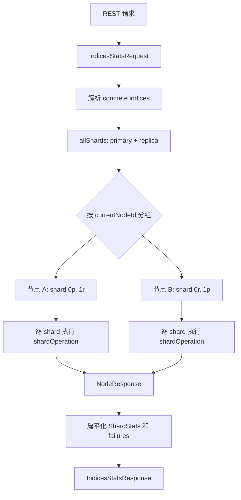

# `IndicesStats` 源码跟踪

> 基于 `elasticsearch-didi` 当前分支 `update_package`、提交 `db41ec0c4e78` 梳理。本文跟踪 Indices Stats API 从 REST 参数、索引与 shard 解析、按节点分组执行，到响应聚合和 JSON 输出的完整链路。

## 1. 先建立整体认识

`IndicesStats` 回答的问题是：**指定索引的每个 shard copy 当前有哪些索引统计，并怎样汇总成 primary、total、index 和 cluster 视图？**

执行单位是 shard copy。协调节点不会为每个 shard 单独建立一个跨节点请求，而是先按所在节点分组：



核心结论：

- `RoutingTable#allShards()` 选择所有 shard copy，包括 primary 和 replica。
- 跨节点请求并发；同一目标节点收到一批 shard 后，当前实现逐 shard 执行 `shardOperation()`。
- `total` 汇总所有成功 shard copy，`primaries` 只汇总 primary copy。
- 节点请求失败会转换成该节点上每个目标 shard 的失败，所以 `_shards.failed` 可能一次增加多个。
- `level=cluster|indices|shards` 改变 JSON 展开程度，不改变底层需要获取的 `ShardStats[]`。

主链源码：[`RestIndicesStatsAction`](../../server/src/main/java/org/elasticsearch/rest/action/admin/indices/RestIndicesStatsAction.java#L41) → [`IndicesStatsRequest`](../../server/src/main/java/org/elasticsearch/action/admin/indices/stats/IndicesStatsRequest.java#L30) → [`TransportIndicesStatsAction`](../../server/src/main/java/org/elasticsearch/action/admin/indices/stats/TransportIndicesStatsAction.java#L37) → [`TransportBroadcastByNodeAction`](../../server/src/main/java/org/elasticsearch/action/support/broadcast/node/TransportBroadcastByNodeAction.java#L72) → [`CommonStats#getShardLevelStats()`](../../server/src/main/java/org/elasticsearch/action/admin/indices/stats/CommonStats.java#L150) → [`ShardStats`](../../server/src/main/java/org/elasticsearch/action/admin/indices/stats/ShardStats.java#L29) → [`IndicesStatsResponse`](../../server/src/main/java/org/elasticsearch/action/admin/indices/stats/IndicesStatsResponse.java#L43)。

## 2. REST 入口怎样构造请求

### 2.1 路由

[`RestIndicesStatsAction#routes()`](../../server/src/main/java/org/elasticsearch/rest/action/admin/indices/RestIndicesStatsAction.java#L46) 注册：

```text
GET /_stats
GET /_stats/{metric}
GET /{index}/_stats
GET /{index}/_stats/{metric}
```

- `index` 可包含索引名、alias、通配符或 data stream。
- `metric` 来自 `CommonStatsFlags.Flag`，例如 `docs`、`store`、`indexing`、`search`、`segments`。
- handler 默认允许访问 system index，真正的可见范围仍由授权与索引解析规则约束。

### 2.2 `prepareRequest()` 的关键步骤

[`prepareRequest()`](../../server/src/main/java/org/elasticsearch/rest/action/admin/indices/RestIndicesStatsAction.java#L77) 按以下顺序工作：

1. 新建 `IndicesStatsRequest`。
2. 根据 `forbid_closed_indices` 选择默认 `IndicesOptions`：禁止 closed index 时使用 `strictExpandOpenAndForbidClosed`，否则使用 `strictExpandOpen`。
3. 继续用通用请求参数覆盖 `IndicesOptions`，解析 `index`。
4. 解析并校验 `level=cluster|indices|shards`，默认 `indices`。
5. 若 metric 为 `_all`，禁止同时出现其他 metric；否则先 `clear()` 再逐项打开 flags。
6. 仅在相关指标已开启时应用 `groups`、`fielddata_fields`、`completion_fields`、segment file sizes 和 unloaded segments 等过滤项。
7. 用 `RestCancellableNodeClient` 执行，响应分块输出。

这里的 `level` 只保留在 XContent params 中，供响应阶段选择输出层次；不像 Node Stats 的 `level=node` 那样改变 `includeShardsStats`。

## 3. `IndicesStatsRequest` 与 `CommonStatsFlags`

### 3.1 请求继承的通用字段

[`IndicesStatsRequest`](../../server/src/main/java/org/elasticsearch/action/admin/indices/stats/IndicesStatsRequest.java#L30) 继承 [`BroadcastRequest`](../../server/src/main/java/org/elasticsearch/action/support/broadcast/BroadcastRequest.java#L22)，因此天然携带：

- `indices[]`；
- `IndicesOptions`；
- 可选 `timeout`；
- `includeDataStreams() = true`。

默认 `IndicesOptions` 是 `strictExpandOpenAndForbidClosed`。wire 格式先写索引数组和 options，再写 optional timeout；与 7.x 通信时走兼容分支，不传 timeout。

### 3.2 指标 flags

[`CommonStatsFlags`](../../server/src/main/java/org/elasticsearch/action/admin/indices/stats/CommonStatsFlags.java#L27) 默认全选，`IndicesStatsRequest#clear()` 才会全部关闭。flags 包含：

| 类别 | flags |
| --- | --- |
| 文档与存储 | `docs`、`store`、`translog` |
| 读写流量 | `indexing`、`get`、`search`、`bulk` |
| 后台维护 | `merge`、`refresh`、`flush`、`warmer`、`recovery` |
| 缓存与内存 | `query_cache`、`request_cache`、`fielddata`、`completion` |
| Lucene/结构 | `segments`、`mappings`、`dense_vector` |
| 计数 | `shards` |

[`Flag`](../../server/src/main/java/org/elasticsearch/action/admin/indices/stats/CommonStatsFlags.java#L245) 为每项指定稳定 bit index，序列化为一个 `long` bitset。编号 14 的空洞是历史 `Suggest` 指标留下的兼容位置，不能随意重排。

`SHARD_LEVEL` 等于除 `mappings` 外的全部 flags。`mappings` 是索引/节点层面统计，不从单个 `IndexShard` 采集。

### 3.3 flags 之外的过滤条件

`CommonStatsFlags` 还携带：

- search `groups`；
- `fieldDataFields`；
- `completionDataFields`；
- `includeSegmentFileSizes`；
- `includeUnloadedSegments`。

`all()` 和 `clear()` 不仅改变 bitset，也会重置这些附加过滤条件。因此常见安全写法是先 `clear()`，再打开 flag，最后设置对应 fields/groups。

## 4. 协调节点：从索引解析到按节点分组

### 4.1 为什么顶层 action 先切线程

[`TransportBroadcastByNodeAction#doExecute()`](../../server/src/main/java/org/elasticsearch/action/support/broadcast/node/TransportBroadcastByNodeAction.java#L228) 先增加请求引用，再把真正工作提交到指定 executor。`TransportIndicesStatsAction` 使用 `MANAGEMENT`，避免 concrete index 解析、遍历 routing table 和大响应聚合占用 transport 线程。

### 4.2 固定本轮 `ClusterState`

[`doExecuteForked()`](../../server/src/main/java/org/elasticsearch/action/support/broadcast/node/TransportBroadcastByNodeAction.java#L235) 获取一次 `ClusterState`，随后：

1. 检查 global block；
2. 用 `IndexNameExpressionResolver` 解析 concrete indices；
3. 检查 index-level block；
4. 调用子类 `shards()` 选择 shard routing；
5. 按 `ShardRouting#currentNodeId()` 分组。

只有已分配且当前节点仍存在的 shard 才能放入节点分组；其余计入 unavailable 数量。整个请求基于这一份状态快照，不会在中途按新 cluster state 重新规划。

### 4.3 为什么是所有 copy

[`TransportIndicesStatsAction#shards()`](../../server/src/main/java/org/elasticsearch/action/admin/indices/stats/TransportIndicesStatsAction.java#L65) 调用：

```java
clusterState.routingTable().allShards(concreteIndices)
```

因此目标包含 primary 和所有 replica copy。这正是响应能同时给出：

- `primaries`：只加 `routing.primary()==true` 的 copy；
- `total`：加入全部 copy。

它不同于只需要任一可用 copy 的读请求。

## 5. 跨节点 fan-out 与节点内 shard 执行

### 5.1 每个节点只发送一个 `NodeRequest`

协调端的 `CancellableFanOut` 为每个目标节点构造一个内部 [`NodeRequest`](../../server/src/main/java/org/elasticsearch/action/support/broadcast/node/TransportBroadcastByNodeAction.java#L464)。它包含：

- 原始 `IndicesStatsRequest`；
- 该节点承担的 `List<ShardRouting>`；
- 节点 ID。

每节点只有一个 transport request，从而避免 O(shards) 个网络请求。不同节点的请求可并发执行。

请求继承原始 timeout，并设置父 task。原始 request 采用引用计数，在所有节点子请求结束前保持存活。

### 5.2 节点内当前是逐 shard 执行

目标节点收到 `NodeRequest` 后，再用一个 `CancellableFanOut` 遍历其中的 shard。基类在 [`sendItemRequest()` 调用处](../../server/src/main/java/org/elasticsearch/action/support/broadcast/node/TransportBroadcastByNodeAction.java#L405) 调用子类 `shardOperation()`。

`TransportIndicesStatsAction#shardOperation()` 使用 `ActionListener.completeWith(...)` 同步计算并立即完成 listener。因此当前实现的实际效果是：

- 节点之间并行；
- 单节点的一批 shard 逐个采集；
- 不会为同一节点的每个 shard 再并行占满线程池。

这限制了单节点瞬时并发压力，但一个持有很多 shard 的节点，其本地 stats 耗时会随 shard 数量增长。

## 6. 单个 shard 到底采集什么

[`TransportIndicesStatsAction#shardOperation()`](../../server/src/main/java/org/elasticsearch/action/admin/indices/stats/TransportIndicesStatsAction.java#L107) 的步骤是：

1. 用 `IndicesService#indexServiceSafe()` 找到 `IndexService`。
2. 根据 routing 的 shard ID 获取 `IndexShard`。
3. 调用 [`CommonStats#getShardLevelStats()`](../../server/src/main/java/org/elasticsearch/action/admin/indices/stats/CommonStats.java#L150)。
4. 额外读取 `CommitStats`、`SeqNoStats`、`RetentionLeaseStats`。
5. 带上 shard routing、数据路径、状态路径、search idle 状态和时间，构造 `ShardStats`。

### 6.1 flag 到 `IndexShard` 的映射

| flag | 主要调用 |
| --- | --- |
| `docs` | `IndexShard#docStats()` |
| `store` | `IndexShard#storeStats()` |
| `indexing` | `IndexShard#indexingStats()` |
| `get` | `IndexShard#getStats()` |
| `search` | `IndexShard#searchStats(groups)` |
| `merge` | `IndexShard#mergeStats()` |
| `refresh` | `IndexShard#refreshStats()` |
| `flush` | `IndexShard#flushStats()` |
| `warmer` | `IndexShard#warmerStats()` |
| `query_cache` | `IndicesQueryCache#getStats(shardId)` |
| `fielddata` | `IndexShard#fieldDataStats(fields)` |
| `completion` | `IndexShard#completionStats(fields)` |
| `segments` | `IndexShard#segmentStats(fileSizes, unloaded)` |
| `translog` | `IndexShard#translogStats()` |
| `request_cache` | `IndexShard#requestCacheStats()` |
| `recovery` | `IndexShard#recoveryStats()` |
| `bulk` | `IndexShard#bulkStats()` |
| `shards` | 创建值为 1 的 `ShardCountStats` |
| `dense_vector` | `IndexShard#denseVectorStats()` |

方法先克隆 flags 并与 `SHARD_LEVEL` 求交，因此 `mappings` 不会误入 shard 采集。

每项采集分别处理 `AlreadyClosedException`，使 shard 在并发关闭时尽可能返回仍然可读的指标，而不是因某一项关闭异常丢弃全部 `CommonStats`。

额外的 commit/seq-no/retention lease 三项放在同一个 `try` 中；若这里遇到 `AlreadyClosedException`，三项均保持 `null`，已有的 `CommonStats` 仍可返回。

## 7. `ShardStats` 的含义和 wire 格式

[`ShardStats`](../../server/src/main/java/org/elasticsearch/action/admin/indices/stats/ShardStats.java#L29) 不只是指标容器，还保存定位与运行状态：

- `ShardRouting`：index、shard ID、primary/replica、routing state、节点；
- `CommonStats`：按 flags 采集的指标；
- `CommitStats`、`SeqNoStats`、`RetentionLeaseStats`；
- `dataPath`、`statePath`、是否 custom data path；
- `searchIdle`、`searchIdleTime`。

wire 兼容点包括：

- 新版本在 data path 与 state path 相同的情况下省略重复 data path，读取端再恢复；
- search idle 字段受 transport version 控制；
- 反序列化断言不在 transport thread 上执行，避免较大 shard stats 对象在 I/O 线程创建。

路径信息也是 `InternalClusterInfoService` 选择 Indices Stats 的关键原因：单靠 store 字节数无法把 shard 占用映射到具体磁盘 data path。

## 8. 节点失败怎样变成 shard 失败

节点正常返回时，[`NodeResponse`](../../server/src/main/java/org/elasticsearch/action/support/broadcast/node/TransportBroadcastByNodeAction.java#L545) 包含：

- 该节点的目标 shard 总数；
- 成功的 `ShardStats`；
- 节点内 shard 异常。

节点 transport 请求整体失败时，协调端为这个节点请求中每个 shard 创建 `DefaultShardOperationFailedException`，其 cause 是 `FailedNodeException`。因此一个节点故障会展开为多个 shard failure。

对于被判定为 shard unavailable 的异常，节点侧只做 trace 记录，不一定加入显式 failure 列表；但 total 与 successful 的差值仍反映未成功的 shard。最终计数结合：

- 路由阶段 unavailable 数量；
- 各 `NodeResponse.totalShards`；
- 成功结果数；
- 显式 shard failures。

客户端应同时检查 `_shards.total/successful/failed` 和 `failures`，不要只枚举 failure 数组来推断完整性。

## 9. 协调节点怎样构造 `IndicesStatsResponse`

[`TransportIndicesStatsAction` 的 response factory](../../server/src/main/java/org/elasticsearch/action/admin/indices/stats/TransportIndicesStatsAction.java#L84) 把各节点结果扁平化为一个 `ShardStats[]`，并把请求开始时的 metadata 与 routing table 用于计算 index health/state。

[`IndicesStatsResponse` 构造器](../../server/src/main/java/org/elasticsearch/action/admin/indices/stats/IndicesStatsResponse.java#L65) 只为成功返回过 shard stats 的 index 建立 health/state map。

### 9.1 惰性视图与聚合

响应保存的事实数据是 `ShardStats[]`，其他视图按需惰性构建：

| 方法 | 结果 | 聚合方式 |
| --- | --- | --- |
| `asMap()` | `ShardRouting → ShardStats` | 遍历数组建立不可变 map |
| `getIndices()` | index name → `IndexStats` | 按 index 分组 |
| `getTotal()` | 全部 copy 的 `CommonStats` | 每个 `ShardStats` 都调用 `add()` |
| `getPrimaries()` | primary copy 的 `CommonStats` | 仅 `routing.primary()` 为真时相加 |

[`CommonStats#add()`](../../server/src/main/java/org/elasticsearch/action/admin/indices/stats/CommonStats.java#L353) 对每一种非空统计做 null-safe 合并。未请求的 metric 保持 `null`，不会在聚合时凭空出现零值对象。

[`IndexStats`](../../server/src/main/java/org/elasticsearch/action/admin/indices/stats/IndexStats.java#L21) 再按 index 提供 `getTotal()` 与 `getPrimaries()`；[`IndexShardStats`](../../server/src/main/java/org/elasticsearch/action/admin/indices/stats/IndexShardStats.java#L22) 将同一逻辑 shard ID 的 primary/replica copy 放在一起。

## 10. 三种输出层级

[`ClusterStatsLevel`](../../server/src/main/java/org/elasticsearch/action/ClusterStatsLevel.java#L13) 定义：`cluster`、`indices`、`shards`。输出分支位于 [`IndicesStatsResponse#customXContentChunks()`](../../server/src/main/java/org/elasticsearch/action/admin/indices/stats/IndicesStatsResponse.java#L183)。

### `level=cluster`

只输出全局聚合：

```text
_shards
_all
  ├─ primaries
  └─ total
```

### `level=indices`（默认）

在 `_all` 外，再输出每个 index 的：

- `uuid`；
- `health`；
- `status`；
- `primaries`；
- `total`。

### `level=shards`

在 index 汇总外，再按 shard ID 输出一个数组。数组成员对应该逻辑 shard 的 primary/replica copy，每项带 routing、指标、路径及额外状态。

无论哪种 level，底层 transport 都已经收集 `ShardStats[]`。所以 `level=cluster` 主要减少 JSON 聚合与输出体积，不等于避免 shard stats 采集。

## 11. JSON 外层与分块输出

[`ChunkedBroadcastResponse`](../../server/src/main/java/org/elasticsearch/action/support/broadcast/ChunkedBroadcastResponse.java#L18) 先通过 `RestActions#buildBroadcastShardsHeader()` 输出：

```json
{
  "_shards": {
    "total": 4,
    "successful": 3,
    "failed": 1,
    "failures": []
  },
  "_all": {},
  "indices": {}
}
```

之后 `IndicesStatsResponse` 分 index、分 shard 生成 chunk。这样即使响应包含大量 shard，也不需要先拼成一个完整的大型 JSON 树。

`IndicesStatsResponse` 的 wire 格式先写 broadcast 计数和 failures，再写 `ShardStats[]`；index health/state 从 transport version `8.1.0` 起传输。

## 12. Block、超时和取消

### 12.1 Cluster block

`TransportIndicesStatsAction` 检查 `METADATA_READ`：

- global `METADATA_READ` block 会在解析 shards 前失败；
- concrete index 上的同类 block 也会阻止执行。

### 12.2 超时

`BroadcastRequest.timeout` 被用于每个节点 transport 子请求。它不是为每个 shard 的每一项 `IndexShard` getter 设置独立 deadline。节点超时会按该节点负责的 shard 数展开成 failures，其他节点结果仍可返回。

### 12.3 取消

`IndicesStatsRequest` 创建 `CancellableTask`，协调节点请求和节点内 shard fan-out 都沿父 task 传播取消。`CancellableFanOut` 通过引用计数及时释放已累积结果；已开始的同步 shard 采集仍需走到可观察取消或自然返回的位置。

## 13. `InternalClusterInfoService` 的典型调用

[`InternalClusterInfoService#fetchIndicesStats()`](../../server/src/main/java/org/elasticsearch/cluster/InternalClusterInfoService.java#L195) 构造：

```text
new IndicesStatsRequest()
  → clear()
  → store(true)
  → indicesOptions(STRICT_EXPAND_OPEN_CLOSED_HIDDEN)
  → timeout(fetchTimeout)
```

它只请求 `store`，但仍得到每个 shard copy 的 routing 与 path。响应被转换为 shard size/path/reserved-space 摘要，并与 Node Stats 提供的每块磁盘容量合并。

失败处理也体现了 broadcast-by-node 语义：若 failure cause 是 `FailedNodeException`，服务先按 node ID 去重打印节点级 warning，再对具体 shard 做 trace；否则按 shard 打 warning。

这条调用链是 DiskThresholdDecider 所依赖磁盘模型的重要上游：

```text
NodeStats(fs)                    IndicesStats(store)
    │                                  │
    ├─ 节点/路径容量与可用空间          ├─ shard 大小、routing、data path
    └──────────────────┬───────────────┘
                       ▼
                  ClusterInfo
                       ▼
               DiskThresholdDecider
```

## 14. 与 `NodeStats.indices` 的区别

| 维度 | `NodeStats` 的 `indices` | 独立 `IndicesStats` |
| --- | --- | --- |
| 首要执行单位 | 节点 | shard copy |
| fan-out | 目标节点各一次 `NodeService#stats()` | 先选 all shards，再按节点批量发送 |
| 节点内数据 | 本节点全部 index/shard | 请求指定 concrete indices 的目标 shards |
| 响应主键 | node ID | index / shard routing |
| 失败头 | `_nodes` | `_shards` |
| primary/total | 主要是节点总量/明细 | 明确区分 primaries 与全部 copies |
| 路径/commit/seq-no | `NodeIndicesStats` 侧重统计层级 | `ShardStats` 明确携带这些信息 |
| 常见用途 | 节点运行状态、节点索引负载 | 索引/shard 观测、ClusterInfo、rollover 等 |

两条链都会调用 `CommonStats#getShardLevelStats()`，但编排方式和输出模型完全不同。

## 15. 常见误区

1. **以为一次 shard 一个网络请求。** 实际是按节点合并，一个节点一个 `NodeRequest`。
2. **以为只统计 primary。** `allShards()` 包含 primary 和 replica；只有 `primaries` 聚合时才过滤。
3. **把 `total` 理解为逻辑数据量。** `total` 会包含 replica copy，通常大于 `primaries`。
4. **以为 `level=cluster` 能避免 shard 采集。** 它只减少输出展开。
5. **忽略节点失败的放大。** 一个失败节点会对应多个 shard failure。
6. **认为 failure 数组一定覆盖所有未成功 shard。** unavailable shard 可能只体现在计数差异中。
7. **裸用默认请求却只想要一个指标。** `CommonStatsFlags` 默认全选，应先 `clear()`。

## 16. 主要调用者

- `InternalClusterInfoService`：只取 `store`，建立 shard size/path 信息。
- `TransportRolloverAction`：读取索引统计以评估 rollover 条件。
- `TransportResizeAction`：为 shrink/split/clone 相关判断获取统计。
- Cat Shards：结合 routing 和 stats 输出 shard 视图。
- Monitoring `IndexStatsCollector`：收集索引级监控数据。
- CCR：读取 leader/follower shard 的 seq-no、retention lease 等状态。
- Transform、ML、ILM、Enterprise Search、Autoscaling：按各自需求选择索引或 shard 指标。

内部调用者通常用 `clear()` + 最小 flag 集，避免默认全量统计造成不必要的 CPU、锁竞争和响应体开销。

## 17. 建议的源码阅读顺序

1. [`RestIndicesStatsAction`](../../server/src/main/java/org/elasticsearch/rest/action/admin/indices/RestIndicesStatsAction.java#L41)：理解 REST 参数和默认语义。
2. [`IndicesStatsRequest`](../../server/src/main/java/org/elasticsearch/action/admin/indices/stats/IndicesStatsRequest.java#L30) 与 [`CommonStatsFlags`](../../server/src/main/java/org/elasticsearch/action/admin/indices/stats/CommonStatsFlags.java#L27)：理解请求选择器。
3. [`TransportIndicesStatsAction`](../../server/src/main/java/org/elasticsearch/action/admin/indices/stats/TransportIndicesStatsAction.java#L37)：理解具体的 shards、block 和 shard operation。
4. [`TransportBroadcastByNodeAction`](../../server/src/main/java/org/elasticsearch/action/support/broadcast/node/TransportBroadcastByNodeAction.java#L228)：理解按节点分组的 broadcast 模板。
5. [`CommonStats#getShardLevelStats()`](../../server/src/main/java/org/elasticsearch/action/admin/indices/stats/CommonStats.java#L150)：逐项对照真实采集源。
6. [`ShardStats`](../../server/src/main/java/org/elasticsearch/action/admin/indices/stats/ShardStats.java#L29)：理解单 shard 返回对象。
7. [`IndicesStatsResponse`](../../server/src/main/java/org/elasticsearch/action/admin/indices/stats/IndicesStatsResponse.java#L43)、[`IndexStats`](../../server/src/main/java/org/elasticsearch/action/admin/indices/stats/IndexStats.java#L21)、[`IndexShardStats`](../../server/src/main/java/org/elasticsearch/action/admin/indices/stats/IndexShardStats.java#L22)：理解分组、聚合和输出。

## 18. 测试入口

- `RestIndicesStatsActionTests`：未知 metric、拼写建议、`_all` 冲突和非法 level。
- `IndicesStatsTests`：segments、commit、refresh listener、index UUID、health 和 state。
- `IndicesStatsResponseTests`：非法 level、按 index 分组和 chunked encoding。
- `TransportBroadcastByNodeActionTests`：按节点 broadcast、部分失败、取消和引用计数等通用行为。
- `IndexStatsIT`：真实集群中多种索引指标的端到端行为。
- `IndicesStatsBlocksIT`：cluster/index block 对 API 的约束。

## 19. 一句话总结

`IndicesStats` 的本质是：**协调节点从一次 cluster-state 快照中找出所有目标 shard copy，按节点批量并发请求；各节点逐 shard 构造 `ShardStats`，协调节点再把结果惰性聚合为 primaries、total、index 和 shard 多层视图，并以 `_shards` 明确表达部分成功。**
