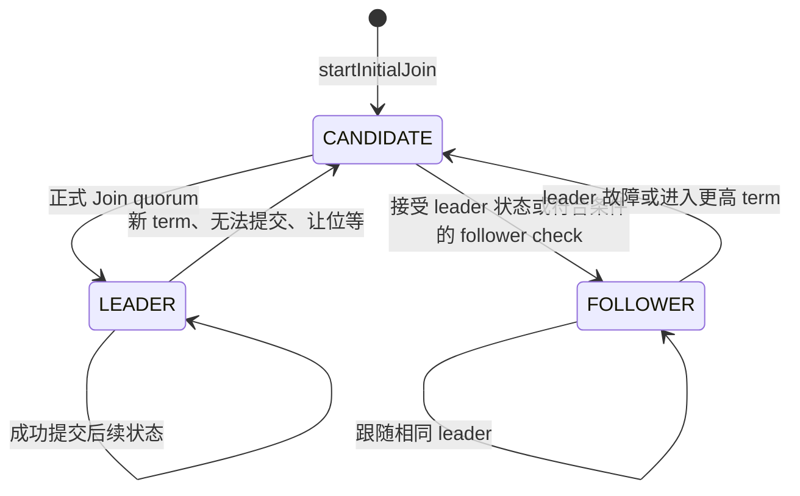
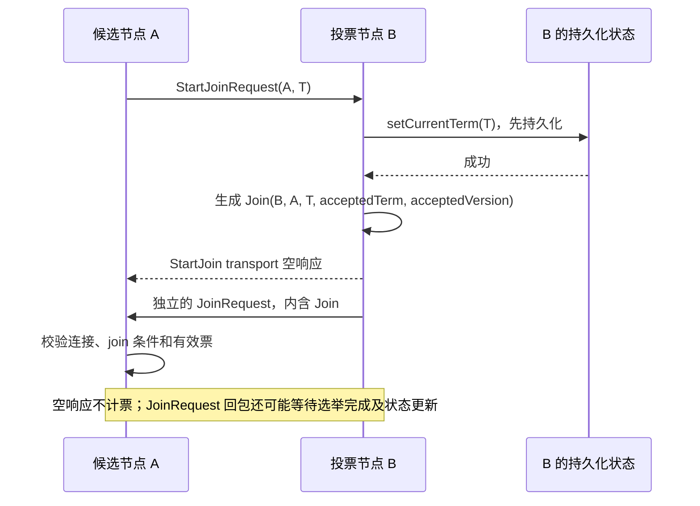
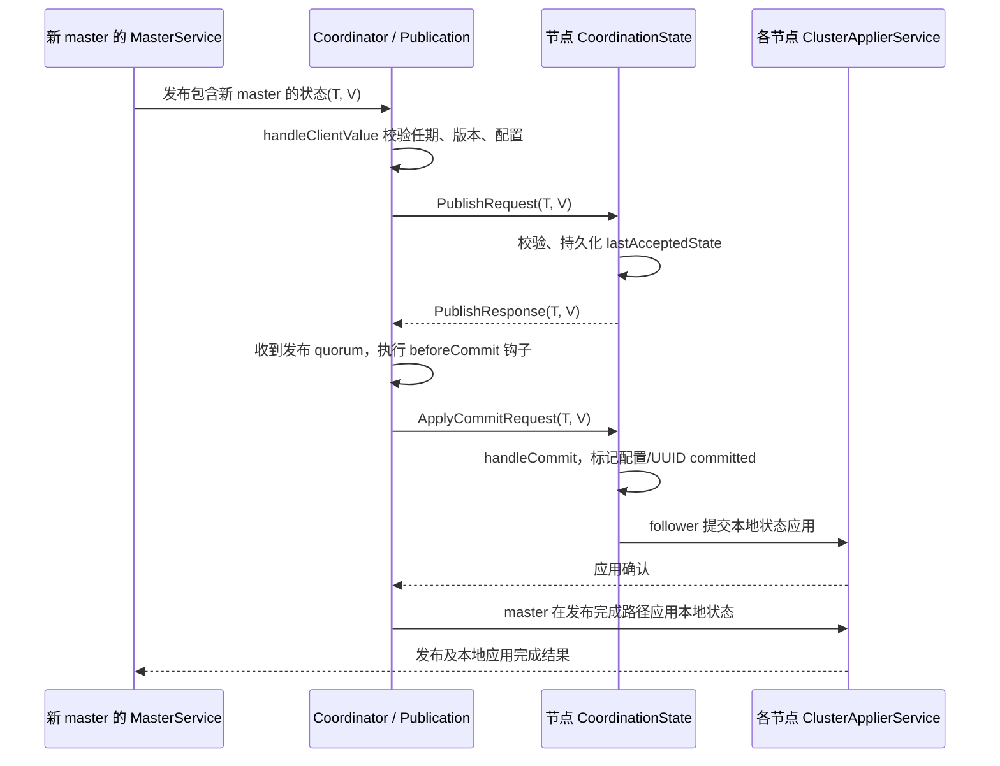
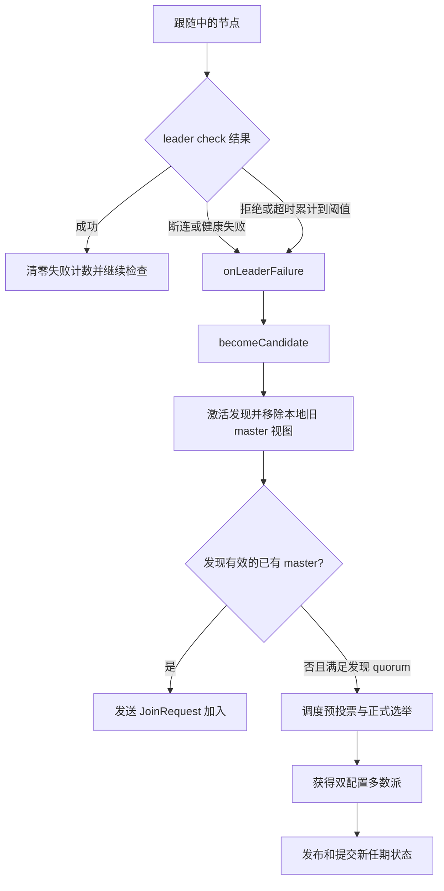

# Master 选举源码跟踪：从节点启动到选举、发布与故障重选

> 仓库：`elasticsearch-didi`；源码基准：`305a150474d`；梳理日期：2026-10-07。
>
> 本文依据当前工作区源码及相邻测试进行静态跟踪。主线是普通有状态集群使用的 `StatefulPreVoteCollector` 和协调协议；单节点、`voting_only`、可插拔协调实现单独说明。未启动集群或运行测试，不把源码推导写成线上实测。
>
> 链接指向本地源码的具体声明行；`→` 表示调用、异步回调或消息传递，相关段落会说明是哪一种。集群整体服务地图见 [Service 源码梳理](/Users/didi/zyk/code/IDEAProjects/elasticsearch-didi/local-docs/services-source-guide.md)。

## 阅读导航

- [1. 主线与关键结论](#overview)
- [2. 核心类、状态与术语](#model)
- [3. 从启动入口到候选状态](#startup)
- [4. 节点发现：发现的是谁，何时直接加入 master](#discovery)
- [5. 首次引导：怎样得到初始投票配置](#bootstrap)
- [6. 选举调度与预投票](#prevote)
- [7. 正式选举：提升 term、发送 Join、统计票数](#election)
- [8. 当选后的首个状态发布与本地应用](#publication)
- [9. 故障检测与重新选举](#failure)
- [10. 投票配置变化与多数派安全](#quorum)
- [11. 特殊路径：voting-only、single-node、插件](#special)
- [12. 线程、锁、消息与持久化](#concurrency)
- [13. 三节点完整例子](#example)
- [14. 当前分支配置与 DiDi 差异](#settings)
- [15. 断点和故障定位](#debug)
- [16. 对应测试与阅读路线](#tests)
- [17. 文档核验与边界](#verification)

<a id="overview"></a>

## 1. 主线与关键结论

### 1.1 一条能沿源码逐层走通的路径

```text
Node.start()
  ├─ GatewayMetaState.start()                         加载持久化协调状态
  ├─ Coordinator.start() → doStart()                  创建 CoordinationState
  ├─ ClusterService.start()                           启动更新与应用线程
  ├─ TransportService.acceptIncomingRequests()
  └─ Coordinator.startInitialJoin()
       └─ becomeCandidate()
            └─ PeerFinder.activate()                 节点发现循环
                 ├─ 发现已有 master → sendJoinRequest() → 加入
                 └─ 需要形成新 master
                      ├─ 首次启动：ClusterBootstrapService 设置初始配置
                      └─ 已有配置：发现节点足以形成预期 quorum
                           └─ startElectionScheduler()
                                └─ StatefulPreVoteCollector.start()
                                     └─ 收到足够且状态不比候选者新的预投票响应
                                          └─ Coordinator.startElection()
                                               └─ 广播 StartJoinRequest
                                                    └─ 各节点 handleStartJoin()
                                                         └─ 持久化新 term，生成 Join
                                                              └─ JoinRequest 回候选节点
                                                                   └─ CoordinationState.handleJoin()
                                                                        └─ electionWon = true
                                                                             └─ becomeLeader()
                                                                                  └─ completingElection JoinTask
                                                                                       └─ NodeJoinExecutor
                                                                                            └─ MasterService 发布
                                                                                                 └─ publish → quorum → commit → apply
```

源码起点：`Node.start()`（[源码](/Users/didi/zyk/code/IDEAProjects/elasticsearch-didi/server/src/main/java/org/elasticsearch/node/Node.java:268)）、`Coordinator.startInitialJoin()`（[源码](/Users/didi/zyk/code/IDEAProjects/elasticsearch-didi/server/src/main/java/org/elasticsearch/cluster/coordination/Coordinator.java:1083)）、`CoordinationState.handleJoin()`（[源码](/Users/didi/zyk/code/IDEAProjects/elasticsearch-didi/server/src/main/java/org/elasticsearch/cluster/coordination/CoordinationState.java:219)）。

### 1.2 阅读时必须分开的六个概念

| 概念 | 实际含义 | 不能直接推出什么 |
| --- | --- | --- |
| master-eligible | `DiscoveryNode.isMasterNode()` 返回真，具有 master 角色 | 不表示此刻是当选 master |
| `CANDIDATE` | 协调器暂未跟随已确认 leader 的模式 | 不表示此节点必然可以发起/赢得选举；普通数据节点也会进入该模式 |
| 发现预期 quorum | 找到的 master 节点 ID 能覆盖投票配置的多数派 | 不代表这些节点已同意投票 |
| 预投票 quorum | 当前条件下看起来有足够节点支持一次选举尝试 | 不代表已持久化新 term 或正式当选 |
| `electionWon` / `LEADER` | 收到正式选票并满足选举判定，进入 leader 路径 | 不代表第一个新状态已提交并对所有节点可见 |
| commit / apply | 状态获得提交条件 / 状态在某节点资源上生效 | 二者不是同一时刻；提交也不要求全部节点均已应用 |

源码没有“把所有候选节点按 node ID 排序，然后选第一名”的通用选主步骤。实际结果由节点发现、随机调度、状态新旧、任期推进、消息时序和 quorum 决定。`Reconfigurator` 中存在 node ID 排序，但那是选择投票配置成员的稳定排序，不是选举 master 的排序。

<a id="model"></a>

## 2. 核心类、状态与术语

### 2.1 类与职责

| 类 | 在选举中的责任 | 入口 |
| --- | --- | --- |
| `DiscoveryModule` | 选择 seed provider、选举策略、预投票器和协调扩展，构造协调器 | `DiscoveryModule`（[源码](/Users/didi/zyk/code/IDEAProjects/elasticsearch-didi/server/src/main/java/org/elasticsearch/discovery/DiscoveryModule.java:67)） |
| `Coordinator` | 协调状态机、发现、选举、加入、发布和故障检测的总控 | `Coordinator`（[源码](/Users/didi/zyk/code/IDEAProjects/elasticsearch-didi/server/src/main/java/org/elasticsearch/cluster/coordination/Coordinator.java:108)） |
| `CoordinationState` | 执行 term、选票、状态新旧与 quorum 等协议规则 | `CoordinationState`（[源码](/Users/didi/zyk/code/IDEAProjects/elasticsearch-didi/server/src/main/java/org/elasticsearch/cluster/coordination/CoordinationState.java:32)） |
| `PeerFinder` | 探测节点、交换 peer 信息、发现已存在的 master | `PeerFinder`（[源码](/Users/didi/zyk/code/IDEAProjects/elasticsearch-didi/server/src/main/java/org/elasticsearch/discovery/PeerFinder.java:47)） |
| `ClusterBootstrapService` | 首次集群引导，产生初始投票配置 | `ClusterBootstrapService`（[源码](/Users/didi/zyk/code/IDEAProjects/elasticsearch-didi/server/src/main/java/org/elasticsearch/cluster/coordination/ClusterBootstrapService.java:46)） |
| `ElectionSchedulerFactory` | 随机延迟与线性退避，反复安排选举尝试 | `ElectionSchedulerFactory`（[源码](/Users/didi/zyk/code/IDEAProjects/elasticsearch-didi/server/src/main/java/org/elasticsearch/cluster/coordination/ElectionSchedulerFactory.java:38)） |
| `StatefulPreVoteCollector` | 收集预投票响应，达到条件才发起正式选举 | `StatefulPreVoteCollector`（[源码](/Users/didi/zyk/code/IDEAProjects/elasticsearch-didi/server/src/main/java/org/elasticsearch/cluster/coordination/StatefulPreVoteCollector.java:37)） |
| `JoinHelper` | 注册/发送选举和 join 消息，积累候选期的加入请求 | `JoinHelper`（[源码](/Users/didi/zyk/code/IDEAProjects/elasticsearch-didi/server/src/main/java/org/elasticsearch/cluster/coordination/JoinHelper.java:72)） |
| `ElectionStrategy` | 判定选举/发布 quorum，提供扩展约束 | `ElectionStrategy`（[源码](/Users/didi/zyk/code/IDEAProjects/elasticsearch-didi/server/src/main/java/org/elasticsearch/cluster/coordination/ElectionStrategy.java:20)） |
| `NodeJoinExecutor` | 把选举完成和节点加入转换为 master 的集群状态更新 | `NodeJoinExecutor`（[源码](/Users/didi/zyk/code/IDEAProjects/elasticsearch-didi/server/src/main/java/org/elasticsearch/cluster/coordination/NodeJoinExecutor.java:50)） |
| `Publication` / `PublicationTransportHandler` | 跟踪发布各阶段 / 发送序列化状态、处理接收 | `Publication`（[源码](/Users/didi/zyk/code/IDEAProjects/elasticsearch-didi/server/src/main/java/org/elasticsearch/cluster/coordination/Publication.java:30)）、`PublicationTransportHandler`（[源码](/Users/didi/zyk/code/IDEAProjects/elasticsearch-didi/server/src/main/java/org/elasticsearch/cluster/coordination/PublicationTransportHandler.java:70)） |
| `LeaderChecker` / `FollowersChecker` | follower 检查 master / master 检查各 follower | `LeaderChecker`（[源码](/Users/didi/zyk/code/IDEAProjects/elasticsearch-didi/server/src/main/java/org/elasticsearch/cluster/coordination/LeaderChecker.java:61)）、`FollowersChecker`（[源码](/Users/didi/zyk/code/IDEAProjects/elasticsearch-didi/server/src/main/java/org/elasticsearch/cluster/coordination/FollowersChecker.java:65)） |
| `Reconfigurator` | 计算投票配置变更 | `Reconfigurator`（[源码](/Users/didi/zyk/code/IDEAProjects/elasticsearch-didi/server/src/main/java/org/elasticsearch/cluster/coordination/Reconfigurator.java:29)） |
| `GatewayMetaState` | 提供协调协议的持久化状态实现 | `GatewayMetaState`（[源码](/Users/didi/zyk/code/IDEAProjects/elasticsearch-didi/server/src/main/java/org/elasticsearch/gateway/GatewayMetaState.java:71)） |

`MasterService` 负责执行集群状态任务和调用发布者，**具体选举规则由 `Coordinator` 与 `CoordinationState` 实现**。

### 2.2 调试中要盯住的字段

| 字段或读接口 | 含义 | 持久化性质 |
| --- | --- | --- |
| `Coordinator.mode` | `CANDIDATE`、`LEADER`、`FOLLOWER` | 内存 |
| `CoordinationState.getCurrentTerm()` | 当前已进入的任期 | 通过 `PersistedState` 保存 |
| `getLastAcceptedTerm()` / `getLastAcceptedVersion()` | 本节点最后接受的集群状态 `(term, version)` | 来自持久化的最后接受状态 |
| `lastAcceptedConfiguration` | 最后接受状态中的投票配置 | 集群元数据 |
| `lastCommittedConfiguration` | 最近已提交的投票配置 | 集群元数据 |
| `joinVotes` | 本次任期收集的正式 join 票，按节点 ID 去重 | 内存 |
| `publishVotes` | 当前发布收到的接受响应 | 内存 |
| `electionWon` | 正式 join 票是否满足选举条件 | 内存，重启重新建立 |
| `startedJoinSinceLastReboot` | 本次启动后是否执行过提升任期的 start-join | 内存，初始为假 |
| `Coordinator.maxTermSeen` | 从其他消息观察到的最大任期，用来计算下一任期 | 内存；不等价于已持久化的当前任期 |
| `Coordinator.lastJoin` | 本节点最近生成的正式票，可在符合目标和 term 时重新携带 | 内存 |
| `Coordinator.applierState` | 将暴露给本地状态应用器的状态视图 | 内存，可能含 no-master/未恢复屏蔽 |

`currentTerm` 可以大于 `lastAcceptedState.term()`：节点可能已经参加新任期，却尚未收到新任期状态。不能把这两个 term 当成同一字段。

### 2.3 状态机



`becomeFollower()` 明确断言不允许直接从 `LEADER` 切换到 `FOLLOWER`；遇到新任期会先经候选状态。**发现已有 master 并发送 join 请求本身，也不等于已切换为 follower**；后续接受状态或检查消息才完成相应转换。

<a id="startup"></a>

## 3. 从启动入口到候选状态

### 3.1 `Node.start()`：先建立可用基础设施

源码：`Node.start()`（[源码](/Users/didi/zyk/code/IDEAProjects/elasticsearch-didi/server/src/main/java/org/elasticsearch/node/Node.java:268)）、`NodeConstruction.createDiscoveryModule()`（[源码](/Users/didi/zyk/code/IDEAProjects/elasticsearch-didi/server/src/main/java/org/elasticsearch/node/NodeConstruction.java:1410)）。

相关顺序如下：

1. 将 `Coordinator` 交给 `MasterService.setClusterStatePublisher()`，后续 master 状态更新使用它发布。
2. 启动 `TransportService`，确定本地节点对象和发布地址。
3. `GatewayMetaState.start()` 加载持久化状态，供协调器读取。
4. `coordinator.start()` 触发 `Coordinator.doStart()`，随后启动 `clusterService`。
5. `transportService.acceptIncomingRequests()` 后调用 `coordinator.startInitialJoin()`。
6. 启动入口按配置等待发现到 master 的状态，再继续 HTTP 入口启动；这段等待不是投票算法本身。

### 3.2 `Coordinator.doStart()`：协议状态与应用状态是两份视图

源码：`Coordinator.doStart()`（[源码](/Users/didi/zyk/code/IDEAProjects/elasticsearch-didi/server/src/main/java/org/elasticsearch/cluster/coordination/Coordinator.java:1032)）。

关键动作：

- 从 `persistedStateSupplier` 获取持久化状态，构造 `CoordinationState`。
- 将已恢复的 `currentTerm` 传给 `PeerFinder`，启动 seed resolver。
- 读取最后接受状态，用于后续选举资格、配置与新旧比较。
- 创建仅包含本地节点的初始应用状态，加入 `STATE_NOT_RECOVERED_BLOCK` 和 no-master block。
- 调用 `clusterApplier.setInitialState()`。

这解释了启动时的一种现象：磁盘里有完整历史元数据，协调层也读到了，但 `ClusterService.state()` 暴露的初始应用状态仍处于未恢复、无 master 状态。

### 3.3 `startInitialJoin()` → `becomeCandidate()`

源码：`Coordinator.startInitialJoin()`（[源码](/Users/didi/zyk/code/IDEAProjects/elasticsearch-didi/server/src/main/java/org/elasticsearch/cluster/coordination/Coordinator.java:1083)）、`Coordinator.becomeCandidate()`（[源码](/Users/didi/zyk/code/IDEAProjects/elasticsearch-didi/server/src/main/java/org/elasticsearch/cluster/coordination/Coordinator.java:832)）。

`startInitialJoin()` 在协调器互斥锁内转为候选，之后安排可能的未配置自动 bootstrap。候选转换的主要副作用是：

- 取消进行中的发布，关闭旧 join accumulator，换成 `CandidateJoinAccumulator`。
- 用最后接受状态中的节点集合激活 `PeerFinder`，启动集群形成失败诊断。
- 停止原 leader 跟踪、follower 检查和 lag 跟踪，更新 fast-response 状态。
- 若此前是 leader，则清理/唤醒 master 更新路径，使旧任期任务不能继续作为 master 执行。
- 若应用状态还标记旧 master，则移除 master ID 并添加 no-master block，交给应用器处理。
- 更新预投票器的响应状态，leader 置空。

`becomeCandidate()` 本身没有无条件加一 term。进入新任期的决定发生在后续正式 start-join 路径。

<a id="discovery"></a>

## 4. 节点发现：发现的是谁，何时直接加入 master

### 4.1 seed 配置只是发现入口

源码：`DiscoveryModule`（[源码](/Users/didi/zyk/code/IDEAProjects/elasticsearch-didi/server/src/main/java/org/elasticsearch/discovery/DiscoveryModule.java:67)）、`SettingsBasedSeedHostsProvider`（[源码](/Users/didi/zyk/code/IDEAProjects/elasticsearch-didi/server/src/main/java/org/elasticsearch/discovery/SettingsBasedSeedHostsProvider.java:29)）、`SeedHostsResolver.resolveConfiguredHosts()`（[源码](/Users/didi/zyk/code/IDEAProjects/elasticsearch-didi/server/src/main/java/org/elasticsearch/discovery/SeedHostsResolver.java:175)）。

`DiscoveryModule` 聚合 settings/file/插件提供的 seed 地址；`SeedHostsResolver` 做地址解析。`discovery.seed_hosts` 用于寻找节点，并不直接定义正式投票成员。

真正的投票成员由集群元数据中的 `VotingConfiguration` 决定。一个 seed 地址可连通，并不意味着其对应节点在投票配置中，也不意味着双方已成功加入同一集群。

### 4.2 `PeerFinder.activate()` → 探测 → peers 交换

源码：`PeerFinder.activate()`（[源码](/Users/didi/zyk/code/IDEAProjects/elasticsearch-didi/server/src/main/java/org/elasticsearch/discovery/PeerFinder.java:122)）、`PeerFinder.handleWakeUp()`（[源码](/Users/didi/zyk/code/IDEAProjects/elasticsearch-didi/server/src/main/java/org/elasticsearch/discovery/PeerFinder.java:293)）、`PeerFinder.startProbe()`（[源码](/Users/didi/zyk/code/IDEAProjects/elasticsearch-didi/server/src/main/java/org/elasticsearch/discovery/PeerFinder.java:336)）、`HandshakingTransportAddressConnector.connectToRemoteMasterNode()`（[源码](/Users/didi/zyk/code/IDEAProjects/elasticsearch-didi/server/src/main/java/org/elasticsearch/discovery/HandshakingTransportAddressConnector.java:74)）。

发现循环会探测两类地址：最后接受状态里的 master 节点地址、配置解析得到的 seed 地址。每个地址通过 connector 执行：

1. 建立临时 probe 连接并 handshake。
2. handshake 校验包含集群名称和版本兼容；返回真实的 `DiscoveryNode`。
3. 排除本地节点和 master-ineligible 节点。
4. 对返回节点的 publish address 建立完整连接，再把它加入已发现 peer 集合。

因此“seed 地址握手成功，但 followup connection 失败”通常卡在 publish address 连接阶段，尚未进入正式投票。

建立连接后发送 `PeersRequest`，对方返回已知 peers、可选 master 和 term。收到新地址后继续探测，实现从 seed 扩展到其他节点。

### 4.3 发现已有 master：优先加入，而非每次启动都重选

源码：`PeerFinder.Peer.requestPeers()`（[源码](/Users/didi/zyk/code/IDEAProjects/elasticsearch-didi/server/src/main/java/org/elasticsearch/discovery/PeerFinder.java:471)）、`Coordinator.CoordinatorPeerFinder.onActiveMasterFound()`（[源码](/Users/didi/zyk/code/IDEAProjects/elasticsearch-didi/server/src/main/java/org/elasticsearch/cluster/coordination/Coordinator.java:1694)）、`Coordinator.joinWithDestination()`（[源码](/Users/didi/zyk/code/IDEAProjects/elasticsearch-didi/server/src/main/java/org/elasticsearch/cluster/coordination/Coordinator.java:493)）。

如果 peers 响应声称“响应节点自身就是 master”，`PeerFinder` 调用 `onActiveMasterFound(masterNode, term)`。协调器随后：

```text
ensureTermAtLeast(masterNode, term)
  → 必要时提升本地 term，生成投给该 master 的 Join
joinHelper.sendJoinRequest(masterNode, currentTerm, optionalJoin)
  → 发送加入请求
```

`optionalJoin` 只在 `lastJoin` 的候选目标和 term 匹配时携带。普通 `JoinRequest` 可能不带正式选票，因此“收到 join 请求数量”和“收到有效选票数量”必须分开看。

### 4.4 发现足够节点才安排选举尝试

源码：`Coordinator.CoordinatorPeerFinder.onFoundPeersUpdated()`（[源码](/Users/didi/zyk/code/IDEAProjects/elasticsearch-didi/server/src/main/java/org/elasticsearch/cluster/coordination/Coordinator.java:1709)）、`Coordinator.startElectionScheduler()`（[源码](/Users/didi/zyk/code/IDEAProjects/elasticsearch-didi/server/src/main/java/org/elasticsearch/cluster/coordination/Coordinator.java:1736)）。

`CoordinatorPeerFinder.onFoundPeersUpdated()` 在 `CANDIDATE` 模式中构造 `expectedVotes`：加入已发现节点，再加入本节点；按当前两份 voting configuration 检查预期 quorum。

- 找到 quorum 且尚无 scheduler：启动选举调度器。
- 找不到 quorum：关闭预投票轮次和已有 scheduler。
- 随后通知 bootstrap 等 peer finder listener。

这里是用“预期能拿到的票”决定是否值得尝试；每一张正式票仍需后续收取与校验。首次未 bootstrap 的空配置无法形成 quorum，会由下一节先安装初始配置。

<a id="bootstrap"></a>

## 5. 首次引导：怎样得到初始投票配置

### 5.1 显式配置路径

源码：`ClusterBootstrapService.onFoundPeersUpdated()`（[源码](/Users/didi/zyk/code/IDEAProjects/elasticsearch-didi/server/src/main/java/org/elasticsearch/cluster/coordination/ClusterBootstrapService.java:163)）、`ClusterBootstrapService.checkRequirements()`（[源码](/Users/didi/zyk/code/IDEAProjects/elasticsearch-didi/server/src/main/java/org/elasticsearch/cluster/coordination/ClusterBootstrapService.java:288)）、`ClusterBootstrapService.startBootstrap()`（[源码](/Users/didi/zyk/code/IDEAProjects/elasticsearch-didi/server/src/main/java/org/elasticsearch/cluster/coordination/ClusterBootstrapService.java:241)）。

`cluster.initial_master_nodes` 仅用于初始集群引导。检查包含：

- 本节点必须 master-eligible，尚未设置初始配置，且允许 bootstrap。
- 配置项不可重复；一个 requirement 不可匹配多个节点，一个节点不可匹配多个 requirements。
- requirement 匹配节点名称、publish address 字符串或其 IP 地址。
- 本地节点必须在匹配结果内。
- 已匹配节点数须满足 `matched * 2 > requirements.size()`。

未匹配项会变为带 `{bootstrap-placeholder}-` 前缀的占位 ID。以 `[A, B, C]` 为例，仅发现 A、B 也可以形成初始多数；配置仍保留第三个占位，不会直接删除缺席的引导要求；三节点配置在这里仍需要两票。

### 5.2 安装配置，不是直接指定 master

源码：`Coordinator.setInitialConfiguration()`（[源码](/Users/didi/zyk/code/IDEAProjects/elasticsearch-didi/server/src/main/java/org/elasticsearch/cluster/coordination/Coordinator.java:1213)）、`CoordinationState.setInitialState()`（[源码](/Users/didi/zyk/code/IDEAProjects/elasticsearch-didi/server/src/main/java/org/elasticsearch/cluster/coordination/CoordinationState.java:135)）。

`setInitialConfiguration()` 再检查本节点资格、是否在配置中、已知节点是否覆盖该配置 quorum，然后：

1. 把初始配置同时写入 `lastAcceptedConfiguration` 与 `lastCommittedConfiguration`。
2. 必要时生成 cluster UUID。
3. 调用 `CoordinationState.setInitialState()`，通过持久化状态保存。
4. 更新预投票状态并启动选举 scheduler。

配置里先写谁并不等于谁当选。真正的获胜仍需预投票和正式 join 票。已有非空初始配置时不会重新安装；已有集群重启依赖磁盘恢复的配置。

### 5.3 自动引导与单节点例外

`ClusterBootstrapService.scheduleUnconfiguredBootstrap()` 仅在没有显式发现配置的条件下安排 best-effort bootstrap，当前默认等待 `3s`。设置了 seed provider、seed hosts 或初始 master 配置时，不应再按“总会三秒自动组成集群”理解。

`discovery.type=single-node` 使用本地节点名作为 bootstrap requirement，禁止同时设置 `cluster.initial_master_nodes`，并要求本节点 master-eligible。若磁盘已有投票配置，而本节点单独无法形成该配置 quorum，`Coordinator.doStart()` 会拒绝按 single-node 启动。

<a id="prevote"></a>

## 6. 选举调度与预投票

### 6.1 随机调度与线性退避

源码：`ElectionSchedulerFactory.startElectionScheduler()`（[源码](/Users/didi/zyk/code/IDEAProjects/elasticsearch-didi/server/src/main/java/org/elasticsearch/cluster/coordination/ElectionSchedulerFactory.java:130)）、`ElectionSchedulerFactory.ElectionScheduler.scheduleNextElection()`（[源码](/Users/didi/zyk/code/IDEAProjects/elasticsearch-didi/server/src/main/java/org/elasticsearch/cluster/coordination/ElectionSchedulerFactory.java:168)）。

令第 `n` 次尝试从 `n=0` 开始：

```text
随机延迟上限 = min(max_timeout, initial_timeout + n * back_off_time)
实际安排延迟 = (0, 随机延迟上限] 内的毫秒数 + gracePeriod
```

首次 `gracePeriod=0`；每次唤醒先安排下一次尝试，下一次以 `duration` 作为 grace period，然后执行本次回调。默认 `initial_timeout=100ms`、`back_off_time=100ms`、`max_timeout=10s`、`duration=500ms`。

因此 `duration` 在这里体现为再次尝试前留出的时间，不是“整个系统必须在 500ms 内选出 master”的承诺。随机等待降低同时竞争概率，线性退避缓解反复碰撞，最大值限制长期故障恢复后的等待范围。

### 6.2 scheduler 每次唤醒并不直接发送正式选票

源码：`Coordinator.startElectionScheduler()`（[源码](/Users/didi/zyk/code/IDEAProjects/elasticsearch-didi/server/src/main/java/org/elasticsearch/cluster/coordination/Coordinator.java:1736)）。

启动 scheduler 要求本节点 master-eligible。每次回调在 `Coordinator.mutex` 内检查：

- 当前仍是 `CANDIDATE`。
- `localNodeMayWinElection()` 满足策略限制，例如 voting exclusions 的影响。
- 本节点健康状态不是 `UNHEALTHY`。

条件满足才关闭旧预投票轮次，并调用：

```java
prevotingRound = preVoteCollector.start(lastAcceptedState, getDiscoveredNodes());
```

`getDiscoveredNodes()` 包含本节点，因此 self 也参与相应消息路径。节点角色/健康/配置任何一层不满足，都可能表现为“持续发现节点，但没有正式选举”。

### 6.3 收到预投票请求的节点如何回答

源码：`StatefulPreVoteCollector.handlePreVoteRequest()`（[源码](/Users/didi/zyk/code/IDEAProjects/elasticsearch-didi/server/src/main/java/org/elasticsearch/cluster/coordination/StatefulPreVoteCollector.java:89)）、`PreVoteResponse`（[源码](/Users/didi/zyk/code/IDEAProjects/elasticsearch-didi/server/src/main/java/org/elasticsearch/cluster/coordination/PreVoteResponse.java:18)）。

请求携带来源节点和其当前 term；响应携带接收者的 `currentTerm`、`lastAcceptedTerm`、`lastAcceptedVersion`。

接收端先调用 `updateMaxTermSeen` 记录观察到的 term，再判断：

| 接收节点条件 | 处理 |
| --- | --- |
| 节点不健康 | 抛出 `NodeHealthCheckFailureException` |
| 没有已知 leader | 返回本地预投票响应 |
| 已有 leader，且请求者恰是这个 leader | 允许返回，支持原 leader 提升 term 后快速重选 |
| 已有其他 leader | 拒绝，理由是 already a leader |

这是避免正常集群被持续预投票扰动的一道门。预投票不产生 `Join` 正式选票；候选者通常只收集信息，不在此处无条件推进持久化 term。但不能写成“处理预投票永远不影响 term”：`updateMaxTermSeen()` 对正在领导且看到更高任期的节点可能触发 term bump，见第 9 节。

### 6.4 候选者如何处理预投票响应

源码：`StatefulPreVoteCollector.PreVotingRound.handlePreVoteResponse()`（[源码](/Users/didi/zyk/code/IDEAProjects/elasticsearch-didi/server/src/main/java/org/elasticsearch/cluster/coordination/StatefulPreVoteCollector.java:175)）、`ElectionStrategy.isElectionQuorum()`（[源码](/Users/didi/zyk/code/IDEAProjects/elasticsearch-didi/server/src/main/java/org/elasticsearch/cluster/coordination/ElectionStrategy.java:40)）。

接收顺序：

1. 轮次已关闭则忽略迟到响应。
2. 更新已观察到的最大 term。
3. 若响应者最后接受的状态比候选者更新，忽略它对本轮的支持。
4. 将有效响应放入按节点记录的集合，构造临时 `VoteCollection`。
5. 用 `ElectionStrategy.isElectionQuorum()` 判断两份配置及附加条件。
6. `electionStarted.compareAndSet(false, true)` 保证本轮只调用一次 `startElection.run()`。

状态新旧按照二元组比较：

```text
响应者更新 ⇔
  remote.lastAcceptedTerm > candidate.lastAcceptedTerm
  或
  term 相同且 remote.lastAcceptedVersion > candidate.lastAcceptedVersion
```

比较优先级是 **term 在前，version 在后**，不是只比 version，也不是只比当前选举 term。候选者不必证明自己比全体节点更新；它必须拿到足够多、满足新旧条件的有效票。

<a id="election"></a>

## 7. 正式选举：提升 term、发送 Join、统计票数

### 7.1 候选者发起 start-join

源码：`Coordinator.startElection()`（[源码](/Users/didi/zyk/code/IDEAProjects/elasticsearch-didi/server/src/main/java/org/elasticsearch/cluster/coordination/Coordinator.java:536)）、`Coordinator.getTermForNewElection()`（[源码](/Users/didi/zyk/code/IDEAProjects/elasticsearch-didi/server/src/main/java/org/elasticsearch/cluster/coordination/Coordinator.java:531)）、`Coordinator.broadcastStartJoinRequest()`（[源码](/Users/didi/zyk/code/IDEAProjects/elasticsearch-didi/server/src/main/java/org/elasticsearch/cluster/coordination/Coordinator.java:553)）。

`startElection()` 再次检查模式和资格，因为预投票响应与模式变化可能并发。新任期为：

```java
Math.max(getCurrentTerm(), maxTermSeen) + 1
```

随后通过 `ElectionStrategy.onNewElection()` 构造 `StartJoinRequest(candidate, term)`，并调用 `JoinHelper.sendStartJoinRequest()` 发送给已发现节点列表（含自身）。默认策略直接返回该请求；扩展策略可增加步骤。

注意：**计算 election term 并广播，尚不等于本节点已经持久化该 term**。推进发生在接收到 start-join、执行 `handleStartJoin()` 时。

### 7.2 接收者先持久化 term，再生成投票

源码：`JoinHelper`（[源码](/Users/didi/zyk/code/IDEAProjects/elasticsearch-didi/server/src/main/java/org/elasticsearch/cluster/coordination/JoinHelper.java:72)） 中的 `START_JOIN_ACTION_NAME` handler、`Coordinator.joinLeaderInTerm()`（[源码](/Users/didi/zyk/code/IDEAProjects/elasticsearch-didi/server/src/main/java/org/elasticsearch/cluster/coordination/Coordinator.java:602)）、`CoordinationState.handleStartJoin()`（[源码](/Users/didi/zyk/code/IDEAProjects/elasticsearch-didi/server/src/main/java/org/elasticsearch/cluster/coordination/CoordinationState.java:168)）。

```text
收到 StartJoinRequest(candidate=A, term=T)
  → Coordinator.joinLeaderInTerm()
     → CoordinationState.handleStartJoin()
        1. 要求 T > currentTerm
        2. persistedState.setCurrentTerm(T)
        3. 清空 joinVotes / publishVotes，重置 electionWon
        4. startedJoinSinceLastReboot = true
        5. 返回 Join(本节点, A, T, lastAcceptedTerm, lastAcceptedVersion)
     → 更新 lastJoin、PeerFinder.currentTerm、预投票与故障检测视图
     → 需要时退回 CANDIDATE
  → JoinHelper.sendJoinRequest(A, ..., Optional.of(join))
```

`StartJoinRequest.term <= currentTerm` 会被拒绝。这一门槛配合持久化，防止同一节点在同一 term 为不同候选者重新生成选票。重复发送同一个已有 `Join` 与“重新给另一个候选者投票”是两件事。

当前实现通过持久化 `currentTerm` 配合上述单调规则实现约束；不能套用其他协议实现的字段名，宣称这里保存了一个并不存在的 `votedFor` 字段。

`JoinRequest.getTerm()` 返回 `max(minimumTerm, optionalJoin.term)`，源码注释明确允许两个值来自不同同步时刻；正式票中的 term 不会因为外层 minimum term 较旧而丢失。

### 7.3 StartJoin 的空响应不是选票



空响应与反向 join 请求是两条异步消息路径，图不要求它们在网络上按固定先后到达。看见 start-join 请求成功，只能确认该请求被处理，不能把它计入候选者的 `joinVotes`。

### 7.4 Join 发送路径中的等待与保护

源码：`JoinHelper.sendJoinRequest()`（[源码](/Users/didi/zyk/code/IDEAProjects/elasticsearch-didi/server/src/main/java/org/elasticsearch/cluster/coordination/JoinHelper.java:246)）。

`sendJoinRequest()` 会检查发送节点健康，按目标和请求去重，并做 in-flight breaker 的小额预检查。建立/持有目标连接后，它还向 `ClusterApplier` 提交一个无状态变更的动作，等待应用线程经过这个位置，再真正发送 join。

这么做是为了避免本节点仍卡在旧集群状态应用中，却先被 master 加入、随即又因为应用不及时被移除。调试时 `waiting for cluster state applier` 一类阶段应先排查应用线程，而不是直接归因于选票不足。

### 7.5 候选者收到 JoinRequest 后，先校验再计票

源码：`Coordinator.handleJoinRequest()`（[源码](/Users/didi/zyk/code/IDEAProjects/elasticsearch-didi/server/src/main/java/org/elasticsearch/cluster/coordination/Coordinator.java:618)）、`Coordinator.validateJoinRequest()`（[源码](/Users/didi/zyk/code/IDEAProjects/elasticsearch-didi/server/src/main/java/org/elasticsearch/cluster/coordination/Coordinator.java:674)）、`Coordinator.processJoinRequest()`（[源码](/Users/didi/zyk/code/IDEAProjects/elasticsearch-didi/server/src/main/java/org/elasticsearch/cluster/coordination/Coordinator.java:757)）。

调用链：

```text
JoinHelper 的 JOIN handler
  → Coordinator.handleJoinRequest()
     → 反向 connectToNode(joiner)
     → validateJoinRequest()
        ├─ 已建立 master 状态时运行 join validators / 版本与状态校验
        └─ PING 与 STATE 两类通道探测
     → processJoinRequest()
        ├─ updateMaxTermSeen(joinRequest.getTerm())
        ├─ 有 optionalJoin 时调用 handleJoin()
        ├─ joinAccumulator.handleJoinRequest() 保存/提交节点加入
        └─ 从未赢到 electionWon=true 时调用 becomeLeader()
```

首次候选期可能还没有适合发送的当前 master 状态，不能说每个 join 都执行完全相同的状态验证。后续 `NodeJoinExecutor` 还会进行节点/索引版本和 feature 等校验。`JoinValidationService` 会拒绝已经锁定其他 cluster UUID 的节点加入。

### 7.6 `handleJoin()` 的两层职责

外层 `Coordinator.handleJoin()`（[源码](/Users/didi/zyk/code/IDEAProjects/elasticsearch-didi/server/src/main/java/org/elasticsearch/cluster/coordination/Coordinator.java:1383)）：如果来票 term 高于本地，通过 `ensureTermAtLeast()` 先推进 term，并处理生成的 self join；再调用协议层。若已经赢得选举，后来的部分无效票可被忽略，且新节点可能触发重配置。

内层 `CoordinationState.handleJoin()`（[源码](/Users/didi/zyk/code/IDEAProjects/elasticsearch-didi/server/src/main/java/org/elasticsearch/cluster/coordination/CoordinationState.java:219)） 的关键检查：

| 检查 | 不满足的结果 |
| --- | --- |
| 来票目标为本候选者 | 代码以断言表达该内部不变量 |
| `join.term == currentTerm` | 拒绝过期/不匹配任期选票 |
| 本次启动后执行过 start-join | 拒绝重启后直接复用旧任期票取胜 |
| 投票者 `lastAcceptedTerm` 不高于本候选者 | 拒绝用较旧状态竞选 |
| 若 accepted term 相同，投票者 version 不高于本候选者 | 同上 |
| 初始投票配置非空 | 未 bootstrap 时拒绝计票 |

检查通过后调用 `joinVotes.addJoinVote()`。该集合只计入 `isMasterNode()` 为真的节点，并以节点 ID 去重。data-only 节点可以加入集群，但它的加入不贡献 master 选举 quorum。

### 7.7 获胜判定

源码：`CoordinationMetadata.VotingConfiguration.hasQuorum()`（[源码](/Users/didi/zyk/code/IDEAProjects/elasticsearch-didi/server/src/main/java/org/elasticsearch/cluster/coordination/CoordinationMetadata.java:347)）、`ElectionStrategy.isElectionQuorum()`（[源码](/Users/didi/zyk/code/IDEAProjects/elasticsearch-didi/server/src/main/java/org/elasticsearch/cluster/coordination/ElectionStrategy.java:40)）。

对投票配置 `C` 和已投票节点集合 `V`：

```text
hasQuorum(C, V) ⇔ 2 × |C ∩ V| > |C|

electionWon ⇔
  hasQuorum(lastCommittedConfiguration, V)
  AND hasQuorum(lastAcceptedConfiguration, V)
  AND satisfiesAdditionalQuorumConstraints(...)
```

第一次由未赢变为获胜时，`CoordinationState` 还设置 `lastPublishedVersion = lastAcceptedVersion`；外层 `processJoinRequest()` 调用 `becomeLeader()`。此时协议上的票已够，下一步才是建立可使用的新 master 状态。

<a id="publication"></a>

## 8. 当选后的首个状态发布与本地应用

### 8.1 `becomeLeader()`：切模式，同时触发完成选举任务

源码：`Coordinator.becomeLeader()`（[源码](/Users/didi/zyk/code/IDEAProjects/elasticsearch-didi/server/src/main/java/org/elasticsearch/cluster/coordination/Coordinator.java:874)）、`JoinHelper.CandidateJoinAccumulator`（[源码](/Users/didi/zyk/code/IDEAProjects/elasticsearch-didi/server/src/main/java/org/elasticsearch/cluster/coordination/JoinHelper.java:495)）。

关键顺序：

1. `mode = LEADER`。
2. 关闭候选 join accumulator，传入新模式 `LEADER`。
3. accumulator 把积累的节点加入信息转换为 `JoinTask.completingElection(...)`，向 master 队列提交 `elected-as-master (...)` 任务。
4. 替换为 `LeaderJoinAccumulator`，后续 join 直接提交普通节点加入任务。
5. 停用主动发现、停止形成失败告警、关闭当前预投票轮次，更新已知 leader 和故障检测状态。

`getLatestStoredStateAfterWinningAnElection()` 为可插拔持久化提供“取最新存储状态”钩子；普通 `PersistedState` 的默认实现返回 `null`，不能据此描述为“每次获胜都重新从磁盘加载完整元数据”。钩子失败会使协调器重新成为 candidate。

此时关闭的是当前预投票轮次；选举 scheduler 的彻底关闭在成功应用状态后的 `onClusterStateApplied()` 中处理，二者时机不同。

### 8.2 `NodeJoinExecutor` 建立新任期的 master 状态

源码：`NodeJoinExecutor.execute()`（[源码](/Users/didi/zyk/code/IDEAProjects/elasticsearch-didi/server/src/main/java/org/elasticsearch/cluster/coordination/NodeJoinExecutor.java:81)）、`NodeJoinExecutor.becomeMasterAndTrimConflictingNodes()`（[源码](/Users/didi/zyk/code/IDEAProjects/elasticsearch-didi/server/src/main/java/org/elasticsearch/cluster/coordination/NodeJoinExecutor.java:264)）、`NodeJoinExecutor.runOnlyOnMaster()`（[源码](/Users/didi/zyk/code/IDEAProjects/elasticsearch-didi/server/src/main/java/org/elasticsearch/cluster/coordination/NodeJoinExecutor.java:336)）。

`MasterService` 的 `node-join` 队列执行任务时：

- 拒绝过时的 join task term，遇更高已知状态 term 则拒绝旧任期操作。
- 当当前状态没有 master 且任务表示完成选举时，进入 `becomeMasterAndTrimConflictingNodes()`。
- 把 master node ID 设为本地节点，移除与新加入节点冲突的旧节点记录。
- 移除 no-master block，在协调元数据中写入当前 term。
- 处理失效节点对应的持久任务/路由，加入经版本、索引兼容和 feature 检查的节点。
- 把计算出的新状态交给 master 更新/发布流程。

`runOnlyOnMaster()` 返回 `false` 很关键：这个 executor 必须能执行“让本节点成为 master”的特殊任务，因此在自己的 `execute()` 内检查是否具备合法的完成选举条件，而不能被一般 master 检查提前挡住。

### 8.3 从“赢得选票”到“状态获得提交”

连接状态计算与协调发布的中间层是 `MasterService.executeAndPublishBatch()`（[源码](/Users/didi/zyk/code/IDEAProjects/elasticsearch-didi/server/src/main/java/org/elasticsearch/cluster/service/MasterService.java:204)）、`MasterService.patchVersions()`（[源码](/Users/didi/zyk/code/IDEAProjects/elasticsearch-didi/server/src/main/java/org/elasticsearch/cluster/service/MasterService.java:503)）、`MasterService.publishClusterStateUpdate()`（[源码](/Users/didi/zyk/code/IDEAProjects/elasticsearch-didi/server/src/main/java/org/elasticsearch/cluster/service/MasterService.java:308)）、`MasterService.publish()`（[源码](/Users/didi/zyk/code/IDEAProjects/elasticsearch-didi/server/src/main/java/org/elasticsearch/cluster/service/MasterService.java:470)）：先执行包含 `NodeJoinExecutor` 的批次，给发生变化的状态递增 version，再构造 `ClusterStatePublicationEvent` 并调用启动时注入的 `Coordinator`。发布完成监听器重新调度回 master service 线程后，才继续处理后续批次。这说明 master 队列积压与网络投票等待是两个不同的耗时来源。

源码：`Coordinator.publish()`（[源码](/Users/didi/zyk/code/IDEAProjects/elasticsearch-didi/server/src/main/java/org/elasticsearch/cluster/coordination/Coordinator.java:1500)）、`CoordinationState.handleClientValue()`（[源码](/Users/didi/zyk/code/IDEAProjects/elasticsearch-didi/server/src/main/java/org/elasticsearch/cluster/coordination/CoordinationState.java:303)）、`Publication.start()`（[源码](/Users/didi/zyk/code/IDEAProjects/elasticsearch-didi/server/src/main/java/org/elasticsearch/cluster/coordination/Publication.java:54)）、`CoordinationState.handlePublishRequest()`（[源码](/Users/didi/zyk/code/IDEAProjects/elasticsearch-didi/server/src/main/java/org/elasticsearch/cluster/coordination/CoordinationState.java:370)）、`CoordinationState.handlePublishResponse()`（[源码](/Users/didi/zyk/code/IDEAProjects/elasticsearch-didi/server/src/main/java/org/elasticsearch/cluster/coordination/CoordinationState.java:413)）。



发布是单独的一轮 quorum，不会拿之前的 `Join` 票当成这次状态已被保存的证明。

`handleClientValue()` 要求已赢选举、新状态 term 等于当前任期、version 递增，并且配置变更满足限制。接收节点的 `handlePublishRequest()` 要求 term 匹配，拒绝同 term 下旧/重复 version，然后保存最后接受状态并回复。

协调器接收来自其他 master 的状态时还会检查 cluster UUID、推进到所需 term，随后转为 follower。**接受 publish 与应用 commit 分开**：前者首先保存协议状态，后者才驱动通常的本地应用。

### 8.4 commit 和 apply 的具体落点

源码：`CoordinationState.handleCommit()`（[源码](/Users/didi/zyk/code/IDEAProjects/elasticsearch-didi/server/src/main/java/org/elasticsearch/cluster/coordination/CoordinationState.java:464)）、`CoordinationState.PersistedState.markLastAcceptedStateAsCommitted()`（[源码](/Users/didi/zyk/code/IDEAProjects/elasticsearch-didi/server/src/main/java/org/elasticsearch/cluster/coordination/CoordinationState.java:565)）、`Coordinator.handleApplyCommit()`（[源码](/Users/didi/zyk/code/IDEAProjects/elasticsearch-didi/server/src/main/java/org/elasticsearch/cluster/coordination/Coordinator.java:400)）、`Coordinator.onClusterStateApplied()`（[源码](/Users/didi/zyk/code/IDEAProjects/elasticsearch-didi/server/src/main/java/org/elasticsearch/cluster/coordination/Coordinator.java:420)）。

`handleCommit()` 校验 commit 的 term/version 与当前及最后接受状态一致，然后将最后接受配置标为已提交，并锁定 cluster UUID。普通 master-eligible 节点的持久化实现会把需要改变的状态写盘。

`Coordinator.handleApplyCommit()` 更新 `applierState`。对远端 leader 发来的 commit，调用 `clusterApplier.onNewClusterState()`；对 leader 自身的 commit，不在此立即应用，而是在 `CoordinatorPublication.onCompletion()` 中通过本地确认事件继续应用。

成功应用后，`onClusterStateApplied()` 在非 candidate 模式下释放 join 临时连接、关闭选举 scheduler、释放发现连接；连接维护交给 `NodeConnectionsService`。

“存在 leader 模式”“master ID 进入已提交状态”“本节点看到新 master”“集群恢复并可以处理全部业务”是不同里程碑。即使 master 已选出，启动恢复的 `STATE_NOT_RECOVERED_BLOCK`、分片恢复等仍有独立流程，入口见 `GatewayService.clusterChanged()`（[源码](/Users/didi/zyk/code/IDEAProjects/elasticsearch-didi/server/src/main/java/org/elasticsearch/gateway/GatewayService.java:128)）。

### 8.5 首次发布失败为什么会重新选举

源码：`Publication.cancel()`（[源码](/Users/didi/zyk/code/IDEAProjects/elasticsearch-didi/server/src/main/java/org/elasticsearch/cluster/coordination/Publication.java:64)）、`Publication.onPossibleCommitFailure()`（[源码](/Users/didi/zyk/code/IDEAProjects/elasticsearch-didi/server/src/main/java/org/elasticsearch/cluster/coordination/Publication.java:141)）、`Coordinator.CoordinatorPublication.removePublicationAndPossiblyBecomeCandidate()`（[源码](/Users/didi/zyk/code/IDEAProjects/elasticsearch-didi/server/src/main/java/org/elasticsearch/cluster/coordination/Coordinator.java:1921)）。

当剩余可能成功节点都无法覆盖发布 quorum，或超时发生在尚未 commit 的阶段，publication 失败；若仍属于当前 leader/term，协调器退回 candidate。

如果状态已经 commit，只是部分节点尚未应用，`Publication.cancel()` 的处理不同：它不会把已经提交的事实改成未提交；可走 `onCompletion(true)`，再结合 master 本地应用与 lag 检测处理。不能把所有 publish timeout 都直接翻译为“这次选举失败”，应同时查看 `committed`、本地应用结果与未完成节点。

<a id="failure"></a>

## 9. 故障检测与重新选举

### 9.1 follower 发现 master 故障

源码：`LeaderChecker.updateLeader()`（[源码](/Users/didi/zyk/code/IDEAProjects/elasticsearch-didi/server/src/main/java/org/elasticsearch/cluster/coordination/LeaderChecker.java:177)）、`LeaderChecker.CheckScheduler.handleWakeUp()`（[源码](/Users/didi/zyk/code/IDEAProjects/elasticsearch-didi/server/src/main/java/org/elasticsearch/cluster/coordination/LeaderChecker.java:260)）、`LeaderChecker.CheckScheduler.leaderFailed()`（[源码](/Users/didi/zyk/code/IDEAProjects/elasticsearch-didi/server/src/main/java/org/elasticsearch/cluster/coordination/LeaderChecker.java:375)）、`Coordinator.onLeaderFailure()`（[源码](/Users/didi/zyk/code/IDEAProjects/elasticsearch-didi/server/src/main/java/org/elasticsearch/cluster/coordination/Coordinator.java:346)）。

正常跟随 master 时，`LeaderChecker` 周期性发送 leader check。成功会清空连续拒绝/超时计数，然后安排下一次检查。故障有三条主要路径：

| 观察到的情况 | 检测行为 | 协调器下一步 |
| --- | --- | --- |
| transport 断连事件或连接异常 | 可立即判定失败，不必等待重试次数耗尽 | `onLeaderFailure()` → `becomeCandidate()` |
| master 明确报告健康检查失败 | 立即失败 | 同上 |
| 普通拒绝、请求超时 | 连续失败总数达到 `retry_count`；中途成功会清零 | 同上 |

`becomeCandidate()` 重新激活发现、启动形成失败诊断、清理旧 leader 的检查器，并在本地应用视图中移除旧 master、加入 no-master block。随后通过发现回调、scheduler、pre-vote 再进入正式选举。

这里不存在“检测失败就直接指定次优节点为 master”的分支。候选者仍需完整的 term、状态新旧及 quorum 校验。

### 9.2 master 发现 follower 故障

源码：`FollowersChecker`（[源码](/Users/didi/zyk/code/IDEAProjects/elasticsearch-didi/server/src/main/java/org/elasticsearch/cluster/coordination/FollowersChecker.java:65)）、`Coordinator.onFollowerCheckRequest()`（[源码](/Users/didi/zyk/code/IDEAProjects/elasticsearch-didi/server/src/main/java/org/elasticsearch/cluster/coordination/Coordinator.java:370)）、`Coordinator.removeNode()`（[源码](/Users/didi/zyk/code/IDEAProjects/elasticsearch-didi/server/src/main/java/org/elasticsearch/cluster/coordination/Coordinator.java:361)）、`NodeLeftExecutor.execute()`（[源码](/Users/didi/zyk/code/IDEAProjects/elasticsearch-didi/server/src/main/java/org/elasticsearch/cluster/coordination/NodeLeftExecutor.java:54)）。

master 维护每个 follower 的检查任务。接收端若处于 `FOLLOWER` 且 term 与请求相同，走快速响应；否则进入协调线程的慢路径，检查任期和跟随关系。

慢路径有一个有助于选举收敛的分支：若 follower 的最后接受状态任期小于当前任期，可以在首个新任期状态到达之前跟随发起检查的节点。旧 term 请求会被拒绝，不能凭一条旧检查把节点拉回旧 master。

master 判定某 follower 失效后，将其标记为 faulty，经 `Coordinator.removeNode()` 提交 `NodeLeftExecutor.Task`，更新集群成员并触发路由调整。**删除 follower 本身不会立即让 master 重新选举**；但如果余下节点无法支撑后续发布的 quorum，publication 会失败并使 leader 退回 candidate。

### 9.3 应用状态太慢与心跳失败不同

源码：`LagDetector.startLagDetector()`（[源码](/Users/didi/zyk/code/IDEAProjects/elasticsearch-didi/server/src/main/java/org/elasticsearch/cluster/coordination/LagDetector.java:127)）、`LagDetector.NodeAppliedStateTracker.checkForLag()`（[源码](/Users/didi/zyk/code/IDEAProjects/elasticsearch-didi/server/src/main/java/org/elasticsearch/cluster/coordination/LagDetector.java:189)）、`Coordinator.CoordinatorPublication.onCompletion()`（[源码](/Users/didi/zyk/code/IDEAProjects/elasticsearch-didi/server/src/main/java/org/elasticsearch/cluster/coordination/Coordinator.java:1940)）。

`LagDetector` 比较节点已应用 version 与预期 version。节点能响应 transport 检查，但长期不能应用已提交状态，也可能被以 `lagging` 原因移出。当前分支默认 lag 等待是 90 秒，不能把它当成 leader election timeout。

### 9.4 看到更高 term 与主动让位

源码：`Coordinator.updateMaxTermSeen()`（[源码](/Users/didi/zyk/code/IDEAProjects/elasticsearch-didi/server/src/main/java/org/elasticsearch/cluster/coordination/Coordinator.java:508)）、`Coordinator.ensureTermAtLeast()`（[源码](/Users/didi/zyk/code/IDEAProjects/elasticsearch-didi/server/src/main/java/org/elasticsearch/cluster/coordination/Coordinator.java:594)）、`Coordinator.abdicateTo()`（[源码](/Users/didi/zyk/code/IDEAProjects/elasticsearch-didi/server/src/main/java/org/elasticsearch/cluster/coordination/Coordinator.java:575)）、`Coordinator.becomeFollower()`（[源码](/Users/didi/zyk/code/IDEAProjects/elasticsearch-didi/server/src/main/java/org/elasticsearch/cluster/coordination/Coordinator.java:930)）。

- 看到更高 term 时，协调器更新 `maxTermSeen`；leader 若正在 publication 中，可能推迟任期推进，待 publication 完成后再处理，避免无序打断提交过程。
- 接收更高 term 的 start-join，或合法新任期 publish，会走任期推进和角色变更路径。高 term 本身仍不替代 cluster UUID、状态版本等校验。
- `abdicateTo()` 向发现到的节点广播以目标节点为候选者的新任期 start-join，然后本地退回 candidate。目标节点还要获取选票和发布状态；这不是直接修改一个全局 master 指针。
- `becomeFollower()` 的前提不是 `LEADER`；leader 切向另一 leader 的正常路径先通过任期推进退为 candidate。



<a id="quorum"></a>

## 10. 投票配置变化与多数派安全

### 10.1 三种集合不要混用

| 集合 | 表示什么 | 是否直接决定 quorum |
| --- | --- | --- |
| 当前发现或连接到的节点 | 网络上暂时可见的节点 | 否，只提供潜在投票者 |
| 集群状态中的节点集合 | 已加入的集群成员，含 data-only 等节点 | 否 |
| `VotingConfiguration` 中的节点 ID | 本轮多数派计算涉及的投票身份 | 是 |

源码：`CoordinationMetadata.VotingConfiguration.hasQuorum()`（[源码](/Users/didi/zyk/code/IDEAProjects/elasticsearch-didi/server/src/main/java/org/elasticsearch/cluster/coordination/CoordinationMetadata.java:347)）、`CoordinationState.VoteCollection`（[源码](/Users/didi/zyk/code/IDEAProjects/elasticsearch-didi/server/src/main/java/org/elasticsearch/cluster/coordination/CoordinationState.java:591)）。

一个节点即使具备 `master` 角色，若其 ID 不在某个配置中，它的票也不会帮助满足该配置的多数派。反之，暂时离线的配置成员仍计入分母，不能在每个节点上按“自己能看到的人数”重新计算多数派。

### 10.2 为什么 accepted 和 committed 两个配置都要过半

假设旧配置为 `{A,B,C}`，已接受但尚未提交的新配置为 `{B,C,D}`。候选者获得 `{A,B}` 的票，只满足旧配置，不能当选；获得 `{B,C}` 的票同时满足两个配置，才可能当选。

源码中的判断是两个 `hasQuorum()` 的逻辑与。它并不要求所有票都来自配置交集，也不是先合并两个配置再算一次过半。比如另一组配置 `{A,B,C}`、`{C,D,E}`，`{A,B,D,E}` 可以分别达到两个配置的多数派，虽然不包含交集节点 `C`。

发布同样需要同时满足旧 committed 配置与本次最后发布的配置。提交后，`markLastAcceptedStateAsCommitted()` 将 committed 推进到 accepted，才结束这一轮配置迁移。`handleClientValue()` 拒绝在前一次重配置未完成时再引入另一轮不同的配置变化。

### 10.3 配置由谁调整

源码：`Coordinator.improveConfiguration()`（[源码](/Users/didi/zyk/code/IDEAProjects/elasticsearch-didi/server/src/main/java/org/elasticsearch/cluster/coordination/Coordinator.java:1276)）、`Coordinator.scheduleReconfigurationIfNeeded()`（[源码](/Users/didi/zyk/code/IDEAProjects/elasticsearch-didi/server/src/main/java/org/elasticsearch/cluster/coordination/Coordinator.java:1347)）、`Reconfigurator.reconfigure()`（[源码](/Users/didi/zyk/code/IDEAProjects/elasticsearch-didi/server/src/main/java/org/elasticsearch/cluster/coordination/Reconfigurator.java:88)）。

当前 leader 根据获得 join 票的存活 master-eligible 节点、本节点、投票排除项等，调用 `Reconfigurator` 计算候选配置；先更新 accepted 配置，通过正常 publication 提交。`cluster.auto_shrink_voting_configuration` 控制自动收缩行为，默认开启。

`Reconfigurator` 倾向选择奇数规模，并考虑当前 master、存活状态、现有配置与稳定排序。因此四个存活 master-eligible 节点的投票配置可能只包含三个。这一排序用于选配置成员，**不是按节点 ID 排序选出 master**。

收缩也有最小规模与 live quorum 约束，不会在失去多数派后自动把分母缩成孤立节点，以使它单方面重新取得控制权。

### 10.4 安全性约束分别在哪里生效

| 需要防止的问题 | 对应约束 | 主要代码 |
| --- | --- | --- |
| 同一节点在相同 term 重复投给不同候选者 | start-join 必须严格增加 term；持久化后才返回 join | `CoordinationState.handleStartJoin()` |
| 重启后丢失已投票任期 | master-eligible 节点同步保存 current term | `GatewayMetaState.LucenePersistedState.setCurrentTerm()` |
| 本地状态旧于某投票者仍计入该票 | 按 accepted term、再按同 term 的 version 比较 | `CoordinationState.handleJoin()` |
| 候选者只取得旧/新配置一侧多数派 | 两个配置分别校验 quorum | `ElectionStrategy.isElectionQuorum()` |
| 将赢选举误当成新状态已提交 | 独立 publish votes；commit 匹配 term/version | `handlePublishResponse()`、`handleCommit()` |
| 不同历史集群被错误合并 | committed cluster UUID 校验 | `Coordinator.handlePublishRequest()` 与 join 校验 |

这些检查还意味着：拥有最新状态的节点不一定立即获胜，它仍需健康、可连接、可获选且能拿到多数派；拥有最大节点 ID 也不提供优先当选的保证。

<a id="special"></a>

## 11. 特殊路径：voting-only、single-node、插件

### 11.1 `voting_only` 不只是一个简单的“拒绝当选”判断

源码：`VotingOnlyNodePlugin`（[源码](/Users/didi/zyk/code/IDEAProjects/elasticsearch-didi/x-pack/plugin/voting-only-node/src/main/java/org/elasticsearch/cluster/coordination/votingonly/VotingOnlyNodePlugin.java:55)）、`VotingOnlyNodePlugin.VotingOnlyNodeElectionStrategy.satisfiesAdditionalQuorumConstraints()`（[源码](/Users/didi/zyk/code/IDEAProjects/elasticsearch-didi/x-pack/plugin/voting-only-node/src/main/java/org/elasticsearch/cluster/coordination/votingonly/VotingOnlyNodePlugin.java:119)）、`VotingOnlyNodePlugin.VotingOnlyNodeAsyncSender.sendRequest()`（[源码](/Users/didi/zyk/code/IDEAProjects/elasticsearch-didi/x-pack/plugin/voting-only-node/src/main/java/org/elasticsearch/cluster/coordination/votingonly/VotingOnlyNodePlugin.java:175)）。

`voting_only` 节点同时具有 `master` 角色，所以能参与 quorum。插件替换 `ElectionStrategy` 并拦截状态发布，实现“可以贡献投票、不能成为稳定提供 master 服务的节点”。

详细阅读时需要保留内部例外：

1. 若本地是 voting-only，且选票全部来自 voting-only 节点，额外选举约束拒绝获胜。
2. 若已有 full-master 投票者持有同样的非初始状态，且没有 full-master 投票者落后，voting-only 候选者也不应获胜。
3. 为引导初始状态或把更新状态传给落后的 full-master，内部协议允许特定条件下推进临时获胜路径。
4. voting-only 发往 full-master 的 publish 可以真正传送状态，但成功响应会被改写为失败；发往其他节点的 publish 被跳过并返回失败。因此它不能靠这一轮发布取得正常提交成功，更新后的 full-master 节点再继续选举。

所以调试时看见 voting-only 节点短暂经过内部 leader 路径，不能立即断言它成为了集群稳定 master。需要接着看 publication 和最终提交状态。这也解释了测试验证的是稳定集群的 leader 不能是 voting-only。

### 11.2 `discovery.type=single-node`

源码：`ClusterBootstrapService`（[源码](/Users/didi/zyk/code/IDEAProjects/elasticsearch-didi/server/src/main/java/org/elasticsearch/cluster/coordination/ClusterBootstrapService.java:46)）、`Coordinator.doStart()`（[源码](/Users/didi/zyk/code/IDEAProjects/elasticsearch-didi/server/src/main/java/org/elasticsearch/cluster/coordination/Coordinator.java:1032)）、`Coordinator.handleJoinRequest()`（[源码](/Users/didi/zyk/code/IDEAProjects/elasticsearch-didi/server/src/main/java/org/elasticsearch/cluster/coordination/Coordinator.java:618)）。

单节点模式使用本地节点建立引导要求，不进行通常的外部节点探测；节点必须具备 master 资格，不能同时配置 `cluster.initial_master_nodes`。若磁盘已有投票配置，仍需验证本节点是否能满足它的 quorum，不能用单节点选项绕过已有集群的配置约束。

该模式拒绝其他节点的 join，并对 publication 超时设置采用特殊处理；内部仍使用协调状态和本地发布/提交流程。

### 11.3 插件可能替换协议部件

源码：`DiscoveryModule`（[源码](/Users/didi/zyk/code/IDEAProjects/elasticsearch-didi/server/src/main/java/org/elasticsearch/discovery/DiscoveryModule.java:67)）。

`DiscoveryModule` 汇总插件提供的选举策略、预投票器、持久化状态、重配置以及 leader heartbeat 等扩展。本文主线针对默认有状态路径；默认 `LeaderHeartbeatService` 是 `NO_OP`，不能把这个名字直接等同于前述 `LeaderChecker` / `FollowersChecker` 的 transport 故障检测。

若部署启用了替代协调实现，应首先确认实际注入的实现类，再套用本文断点。voting-only 插件是本仓库中直接相关的一个实际例子。

<a id="concurrency"></a>

## 12. 线程、锁、消息与持久化

### 12.1 调用链跨越四类执行上下文

源码：`Coordinator`（[源码](/Users/didi/zyk/code/IDEAProjects/elasticsearch-didi/server/src/main/java/org/elasticsearch/cluster/coordination/Coordinator.java:108)）、`JoinHelper`（[源码](/Users/didi/zyk/code/IDEAProjects/elasticsearch-didi/server/src/main/java/org/elasticsearch/cluster/coordination/JoinHelper.java:72)）、`LeaderChecker`（[源码](/Users/didi/zyk/code/IDEAProjects/elasticsearch-didi/server/src/main/java/org/elasticsearch/cluster/coordination/LeaderChecker.java:61)）、`NodeJoinExecutor`（[源码](/Users/didi/zyk/code/IDEAProjects/elasticsearch-didi/server/src/main/java/org/elasticsearch/cluster/coordination/NodeJoinExecutor.java:50)）。

| 上下文 | 典型工作 | 阅读时的注意点 |
| --- | --- | --- |
| transport 接收/回调线程 | 消息解码、健康检查、部分快速响应 | 收到响应不等于后续协调或应用动作已完成 |
| `CLUSTER_COORDINATION` 执行器与调度任务 | 协调消息处理、选举回调、故障通知 | 并非所有入口都只在同一条线程上运行 |
| `MasterService` 更新队列 | 完成选举、加入/删除节点、重配置、计算新集群状态 | candidate 的 join 请求可以等到选举完成任务才得到结果 |
| `ClusterApplierService` | 将已提交状态应用到节点本地服务 | 与 master 计算/发布状态是不同阶段 |

`Coordinator` 的核心状态转换用 `mutex` 保护；`PeerFinder`、故障检测器、预投票轮次有各自的同步或关闭标记。异步回调回来时还会判断当前 mode、term、轮次或 publication 是否仍有效。不要把日志打印顺序当成所有节点之间的全局执行顺序。

### 12.2 消息名称与业务含义

| Transport action | 请求/含义 | 入口类 |
| --- | --- | --- |
| `internal:discovery/request_peers` | 交换已知 master 和 peer | `PeerFinder` |
| `internal:cluster/request_pre_vote` | 询问预投票条件 | `StatefulPreVoteCollector` |
| `internal:cluster/coordination/start_join` | 请求节点在新 term 向指定候选者投票 | `JoinHelper` |
| `internal:cluster/coordination/join` | 节点加入请求，可携带 `Join` 选票 | `JoinHelper` → `Coordinator` |
| `internal:cluster/coordination/join/ping` | join 连接验证 | `JoinHelper` |
| `internal:cluster/coordination/join/validate` | 校验加入节点与 master 状态的兼容性、cluster UUID | `JoinValidationService` |
| `internal:cluster/coordination/publish_state` | 发送待接受的集群状态 | `PublicationTransportHandler` |
| `internal:cluster/coordination/commit_state` | 通知已接受的状态提交 | `PublicationTransportHandler` |
| `internal:coordination/fault_detection/leader_check` | follower 检查 master | `LeaderChecker` |
| `internal:coordination/fault_detection/follower_check` | master 检查 follower | `FollowersChecker` |

`JoinRequest` 与 `Join` 要分开：前者是加入消息封装，后者携带投票者、目标候选者、term 和投票者最后接受的 term/version。`optionalJoin` 为空的加入请求本身不能被当成一张新的正式选票。`JoinRequest.getTerm()` 综合请求 term 与可选选票 term，避免错误使用较旧的封装 term。

源码补充：`JoinRequest.getTerm()`（[源码](/Users/didi/zyk/code/IDEAProjects/elasticsearch-didi/server/src/main/java/org/elasticsearch/cluster/coordination/JoinRequest.java:123)）、`Join`（[源码](/Users/didi/zyk/code/IDEAProjects/elasticsearch-didi/server/src/main/java/org/elasticsearch/cluster/coordination/Join.java:34)）、`JoinValidationService`（[源码](/Users/didi/zyk/code/IDEAProjects/elasticsearch-didi/server/src/main/java/org/elasticsearch/cluster/coordination/JoinValidationService.java:68)）、`PublicationTransportHandler`（[源码](/Users/didi/zyk/code/IDEAProjects/elasticsearch-didi/server/src/main/java/org/elasticsearch/cluster/coordination/PublicationTransportHandler.java:70)）。

### 12.3 真正写盘的边界

源码：`GatewayMetaState.LucenePersistedState.setCurrentTerm()`（[源码](/Users/didi/zyk/code/IDEAProjects/elasticsearch-didi/server/src/main/java/org/elasticsearch/gateway/GatewayMetaState.java:566)）、`GatewayMetaState.LucenePersistedState.setLastAcceptedState()`（[源码](/Users/didi/zyk/code/IDEAProjects/elasticsearch-didi/server/src/main/java/org/elasticsearch/gateway/GatewayMetaState.java:594)）、`CoordinationState.handleStartJoin()`（[源码](/Users/didi/zyk/code/IDEAProjects/elasticsearch-didi/server/src/main/java/org/elasticsearch/cluster/coordination/CoordinationState.java:168)）、`CoordinationState.handlePublishRequest()`（[源码](/Users/didi/zyk/code/IDEAProjects/elasticsearch-didi/server/src/main/java/org/elasticsearch/cluster/coordination/CoordinationState.java:370)）。

默认有状态实现中，master-eligible 节点使用同步的 `LucenePersistedState`：

- `setCurrentTerm()` 先调用写盘逻辑，成功后才更新内存 term；`handleStartJoin()` 完成此调用才返回 `Join`。
- `setLastAcceptedState()` 保存收到的状态，成功后才推进内存中的最后接受状态并让发布响应继续。
- commit 根据需要持久化 committed voting configuration 和 cluster UUID 标记。
- data-only 节点可以使用异步持久化包装；它不计入 master 投票 quorum，因此不能拿该路径推导 master 投票的落盘保证。

这里没有一个和 term 并列持久化的通用 `votedFor` 字段。拒绝相同/更低 term 的 start-join，加上重启后 `startedJoinSinceLastReboot=false` 等规则，共同约束投票恢复路径。不要把其他共识实现的字段名直接套到本代码。

<a id="example"></a>

## 13. 三节点完整例子

以下是由源码规则推导的简化场景，不代表固定的调度结果。设 `A/B/C` 都是普通 master-eligible 节点，accepted 与 committed 配置均为 `{A,B,C}`，最后接受状态均为 `(term=7, version=42)`，当前 term 为 7。

### 13.1 `A` 故障后 `B` 当选

| 步骤 | `B` 的动作 | `C` 的动作 | 协议含义 |
| --- | --- | --- | --- |
| 1 | 检测 `A` 失败，退为 candidate | 同样检测失败 | 重新发现；还没有任期 8 的 master |
| 2 | 随机调度先唤醒，向包括自身的发现节点发 pre-vote | 返回可接受的预投票状态 | `B+C` 同时覆盖两个配置的多数派 |
| 3 | 发起 term 8 的 start-join | 保存 current term 8，并生成投给 `B` 的 `Join` | 正式投票开始 |
| 4 | 保存本地 term 8；收集自身及 `C` 的有效票 | 发送带选票的 join 请求 | `B` 的 `electionWon=true` |
| 5 | 进入 leader；完成选举任务生成新状态 | 等待 publication / 接受 follower check | 内部赢票不等于已提交 |
| 6 | 发布任期 8 的首个状态并收集 `B+C` 的 publish 响应 | 保存最后接受状态，回复 publish | 独立满足发布 quorum |
| 7 | 发 commit，完成本地应用 | 标记 committed，并本地应用 | 新 master 状态完成收敛 |

如果 `C` 的 scheduler 更早执行，或两者争用导致提高任期，结果可能不同。随机退避和预投票降低反复冲突，但不按名称预先指定胜者。

### 13.2 `B` 落后于 `C`

改设 `B` 的最后接受状态为 `(7,41)`，`C` 为 `(7,42)`：

- 在 pre-vote 阶段，`B` 不能把 `C` 的更新状态响应算作支持自己当选的预投票。
- 即使正式 join 到达，`CoordinationState.handleJoin()` 也会拒绝对方比本地更新的票。
- `C` 可以使用自己较新的状态竞选，并接受来自较旧状态节点的有效票；仍须满足 term 和双配置 quorum 等其他条件。

比较规则先看 accepted term，再看同一 accepted term 的 version。比如 `(8,1)` 比 `(7,1000)` 更新；version 不能脱离 term 单独排序。

### 13.3 网络分为 `{A}` 与 `{B,C}`

`A` 只有自身一票，不能按三节点配置形成新的有效多数派；`B/C` 一侧有机会完成选举与发布。旧 `A` 即使短时间仍保留 leader 内部状态，也无法仅靠自己的 publish 响应完成新的多数派提交。网络恢复后，它必须遵守更高 term 和状态新旧检查重新收敛。

因此排查“两个节点日志都曾显示 leader”时，要同时检查任期、消息时刻、最终 committed 状态及各自是否真的获得发布 quorum，不能只比一条角色切换日志。

<a id="settings"></a>

## 14. 当前分支配置与 DiDi 差异

下表是此工作区的源码默认值。部署中的显式节点配置或动态设置可能覆盖默认值；“动态”表示源码声明并接入更新，不表示配置已经在线修改。

| 设置 | 默认值 | 动态 | 作用/源码 |
| --- | --- | --- | --- |
| `cluster.initial_master_nodes` | 空列表 | 否 | 首次引导要求；`ClusterBootstrapService`（[源码](/Users/didi/zyk/code/IDEAProjects/elasticsearch-didi/server/src/main/java/org/elasticsearch/cluster/coordination/ClusterBootstrapService.java:46)） |
| `discovery.unconfigured_bootstrap_timeout` | 3s | 否 | 未显式配置发现时的自动引导等待；`ClusterBootstrapService`（[源码](/Users/didi/zyk/code/IDEAProjects/elasticsearch-didi/server/src/main/java/org/elasticsearch/cluster/coordination/ClusterBootstrapService.java:46)） |
| `discovery.find_peers_interval` | 1s | 否 | 发现循环间隔；`PeerFinder`（[源码](/Users/didi/zyk/code/IDEAProjects/elasticsearch-didi/server/src/main/java/org/elasticsearch/discovery/PeerFinder.java:47)） |
| `discovery.request_peers_timeout` | 3s | 否 | peers 请求超时；`PeerFinder`（[源码](/Users/didi/zyk/code/IDEAProjects/elasticsearch-didi/server/src/main/java/org/elasticsearch/discovery/PeerFinder.java:47)） |
| `discovery.find_peers_warning_timeout` | 3min | 否 | 发现失败日志升级详细程度；`PeerFinder`（[源码](/Users/didi/zyk/code/IDEAProjects/elasticsearch-didi/server/src/main/java/org/elasticsearch/discovery/PeerFinder.java:47)） |
| `discovery.cluster_formation_warning_timeout` | 10s | 否 | 周期性输出集群形成诊断；`ClusterFormationFailureHelper`（[源码](/Users/didi/zyk/code/IDEAProjects/elasticsearch-didi/server/src/main/java/org/elasticsearch/cluster/coordination/ClusterFormationFailureHelper.java:45)） |
| `cluster.election.initial_timeout` | 100ms | 否 | 初次随机等待上界；`ElectionSchedulerFactory`（[源码](/Users/didi/zyk/code/IDEAProjects/elasticsearch-didi/server/src/main/java/org/elasticsearch/cluster/coordination/ElectionSchedulerFactory.java:38)） |
| `cluster.election.back_off_time` | 100ms | 否 | 每次尝试增加的等待上界；`ElectionSchedulerFactory`（[源码](/Users/didi/zyk/code/IDEAProjects/elasticsearch-didi/server/src/main/java/org/elasticsearch/cluster/coordination/ElectionSchedulerFactory.java:38)） |
| `cluster.election.max_timeout` | 10s | 否 | 随机等待上界的最大值；`ElectionSchedulerFactory`（[源码](/Users/didi/zyk/code/IDEAProjects/elasticsearch-didi/server/src/main/java/org/elasticsearch/cluster/coordination/ElectionSchedulerFactory.java:38)） |
| `cluster.election.duration` | 500ms | 否 | 连续尝试间的 grace period；`ElectionSchedulerFactory`（[源码](/Users/didi/zyk/code/IDEAProjects/elasticsearch-didi/server/src/main/java/org/elasticsearch/cluster/coordination/ElectionSchedulerFactory.java:38)） |
| `cluster.fault_detection.leader_check.interval` | 1s | 是 | follower 检查 master 的间隔；`LeaderChecker`（[源码](/Users/didi/zyk/code/IDEAProjects/elasticsearch-didi/server/src/main/java/org/elasticsearch/cluster/coordination/LeaderChecker.java:61)） |
| `cluster.fault_detection.leader_check.timeout` | **20s** | **是** | 单次 leader check 超时；`LeaderChecker`（[源码](/Users/didi/zyk/code/IDEAProjects/elasticsearch-didi/server/src/main/java/org/elasticsearch/cluster/coordination/LeaderChecker.java:61)） |
| `cluster.fault_detection.leader_check.retry_count` | 3 | 是 | 连续失败阈值；`LeaderChecker`（[源码](/Users/didi/zyk/code/IDEAProjects/elasticsearch-didi/server/src/main/java/org/elasticsearch/cluster/coordination/LeaderChecker.java:61)） |
| `cluster.fault_detection.follower_check.interval` | 1s | 是 | master 检查 follower 的间隔；`FollowersChecker`（[源码](/Users/didi/zyk/code/IDEAProjects/elasticsearch-didi/server/src/main/java/org/elasticsearch/cluster/coordination/FollowersChecker.java:65)） |
| `cluster.fault_detection.follower_check.timeout` | **20s** | **是** | 单次 follower check 超时；`FollowersChecker`（[源码](/Users/didi/zyk/code/IDEAProjects/elasticsearch-didi/server/src/main/java/org/elasticsearch/cluster/coordination/FollowersChecker.java:65)） |
| `cluster.fault_detection.follower_check.retry_count` | 3 | 是 | 连续失败阈值；`FollowersChecker`（[源码](/Users/didi/zyk/code/IDEAProjects/elasticsearch-didi/server/src/main/java/org/elasticsearch/cluster/coordination/FollowersChecker.java:65)） |
| `cluster.publish.timeout` | 30s | 否 | 普通模式 publication 超时；`Coordinator`（[源码](/Users/didi/zyk/code/IDEAProjects/elasticsearch-didi/server/src/main/java/org/elasticsearch/cluster/coordination/Coordinator.java:108)） |
| `cluster.publish.info_timeout` | 10s | 否 | 发布较慢时的信息日志阈值；`Coordinator`（[源码](/Users/didi/zyk/code/IDEAProjects/elasticsearch-didi/server/src/main/java/org/elasticsearch/cluster/coordination/Coordinator.java:108)） |
| `cluster.follower_lag.timeout` | **90s** | 是 | 等待 follower 应用状态；`LagDetector`（[源码](/Users/didi/zyk/code/IDEAProjects/elasticsearch-didi/server/src/main/java/org/elasticsearch/cluster/coordination/LagDetector.java:54)） |
| `cluster.auto_shrink_voting_configuration` | `true` | 是 | 允许按约束自动缩小投票配置；`Reconfigurator`（[源码](/Users/didi/zyk/code/IDEAProjects/elasticsearch-didi/server/src/main/java/org/elasticsearch/cluster/coordination/Reconfigurator.java:29)） |
| `cluster.no_master_block` | `write` | 是 | 默认阻止写入和元数据写入；`NoMasterBlockService`（[源码](/Users/didi/zyk/code/IDEAProjects/elasticsearch-didi/server/src/main/java/org/elasticsearch/cluster/coordination/NoMasterBlockService.java:20)） |

`LeaderChecker`、`FollowersChecker` 的构造器在本分支接收 `ClusterSettings`，为 interval、timeout、retry count 注册更新消费者；`Coordinator` 使用的是这些构造器。历史提交 `615298aed18` 的 diff 可见两类 timeout 从 30000ms 改为 20000ms。这里以当前实际代码为准，未对全部 upstream 差异作穷尽比较。

不要将任意一个配置值当成完整切主耗时：请求失败可能立即返回，也可能等待超时；检查通常在上次结果后再安排下一次；之后还有发现、随机等待、投票、master 队列、发布和应用。`cluster.election.duration=500ms` 不意味着整个切主在 500ms 内完成。

无 master 时默认 `write` block 也不等于所有读取必定成功：依赖 master 的 API、尚未恢复的状态等还可能受到其他限制。源码中可选择的 no-master block 模式还包括 `all`、`metadata_write`。

<a id="debug"></a>

## 15. 断点和故障定位

### 15.1 按阶段设置断点

不必一次打满全部断点。先判断卡在哪个阶段，再进入下一层；多节点调试暂停协调线程会改变超时行为，优先使用条件断点或日志记录。

| 阶段 | 推荐入口 | 重点检查 |
| --- | --- | --- |
| 恢复与启动 | `Coordinator.doStart()`（[源码](/Users/didi/zyk/code/IDEAProjects/elasticsearch-didi/server/src/main/java/org/elasticsearch/cluster/coordination/Coordinator.java:1032)） | persistent term、accepted term/version、两个 voting configs、节点角色 |
| 初始引导 | `ClusterBootstrapService.onFoundPeersUpdated()`（[源码](/Users/didi/zyk/code/IDEAProjects/elasticsearch-didi/server/src/main/java/org/elasticsearch/cluster/coordination/ClusterBootstrapService.java:163)）、`Coordinator.setInitialConfiguration()`（[源码](/Users/didi/zyk/code/IDEAProjects/elasticsearch-didi/server/src/main/java/org/elasticsearch/cluster/coordination/Coordinator.java:1213)） | bootstrap requirements、匹配节点、已有配置是否非空 |
| 发现 | `Coordinator.CoordinatorPeerFinder.onFoundPeersUpdated()`（[源码](/Users/didi/zyk/code/IDEAProjects/elasticsearch-didi/server/src/main/java/org/elasticsearch/cluster/coordination/Coordinator.java:1709)）、`Coordinator.CoordinatorPeerFinder.onActiveMasterFound()`（[源码](/Users/didi/zyk/code/IDEAProjects/elasticsearch-didi/server/src/main/java/org/elasticsearch/cluster/coordination/Coordinator.java:1694)） | peer IDs、active master、是否覆盖两个配置 |
| 调度 | `Coordinator.startElectionScheduler()`（[源码](/Users/didi/zyk/code/IDEAProjects/elasticsearch-didi/server/src/main/java/org/elasticsearch/cluster/coordination/Coordinator.java:1736)） | mode、健康状态、`localNodeMayWinElection()`、当前 pre-vote round |
| 预投票 | `StatefulPreVoteCollector.PreVotingRound.handlePreVoteResponse()`（[源码](/Users/didi/zyk/code/IDEAProjects/elasticsearch-didi/server/src/main/java/org/elasticsearch/cluster/coordination/StatefulPreVoteCollector.java:175)） | 响应 accepted term/version、`maxTermSeen`、累计响应是否满足策略 |
| 新任期投票 | `CoordinationState.handleStartJoin()`（[源码](/Users/didi/zyk/code/IDEAProjects/elasticsearch-didi/server/src/main/java/org/elasticsearch/cluster/coordination/CoordinationState.java:168)） | 请求 term 是否严格增加、候选目标、持久化异常 |
| 统计正式票 | `Coordinator.processJoinRequest()`（[源码](/Users/didi/zyk/code/IDEAProjects/elasticsearch-didi/server/src/main/java/org/elasticsearch/cluster/coordination/Coordinator.java:757)）、`CoordinationState.handleJoin()`（[源码](/Users/didi/zyk/code/IDEAProjects/elasticsearch-didi/server/src/main/java/org/elasticsearch/cluster/coordination/CoordinationState.java:219)） | `optionalJoin`、voting node ID、目标、term、状态新旧、`electionWon` |
| 完成选举 | `Coordinator.becomeLeader()`（[源码](/Users/didi/zyk/code/IDEAProjects/elasticsearch-didi/server/src/main/java/org/elasticsearch/cluster/coordination/Coordinator.java:874)）、`NodeJoinExecutor.execute()`（[源码](/Users/didi/zyk/code/IDEAProjects/elasticsearch-didi/server/src/main/java/org/elasticsearch/cluster/coordination/NodeJoinExecutor.java:81)） | join accumulator、任务 term、master ID、no-master block |
| 发布多数派 | `CoordinationState.handlePublishResponse()`（[源码](/Users/didi/zyk/code/IDEAProjects/elasticsearch-didi/server/src/main/java/org/elasticsearch/cluster/coordination/CoordinationState.java:413)） | response term/version、publish votes、两个配置 |
| 提交及应用 | `Coordinator.handleApplyCommit()`（[源码](/Users/didi/zyk/code/IDEAProjects/elasticsearch-didi/server/src/main/java/org/elasticsearch/cluster/coordination/Coordinator.java:400)）、`Coordinator.CoordinatorPublication.onCompletion()`（[源码](/Users/didi/zyk/code/IDEAProjects/elasticsearch-didi/server/src/main/java/org/elasticsearch/cluster/coordination/Coordinator.java:1940)） | committed 标记、本地 apply、未完成 follower、当前 publication 是否仍有效 |
| 重选 | `Coordinator.onLeaderFailure()`（[源码](/Users/didi/zyk/code/IDEAProjects/elasticsearch-didi/server/src/main/java/org/elasticsearch/cluster/coordination/Coordinator.java:346)）、`Coordinator.becomeCandidate()`（[源码](/Users/didi/zyk/code/IDEAProjects/elasticsearch-didi/server/src/main/java/org/elasticsearch/cluster/coordination/Coordinator.java:832)） | 原因、旧 leader、当前 term、取消的轮次/发布 |

### 15.2 从现象反向定位

| 现象 | 优先查什么 | 不应直接下的结论 |
| --- | --- | --- |
| 一直报 `master not discovered` | seed 到 publish address 的连接、握手、节点角色、bootstrap 匹配、已存配置 ID | “只要节点进程都在就应当能选主” |
| 已发现多个节点却不发起选举 | 两套配置是否都有潜在 quorum、本地可获选资格、健康检查、scheduler 是否开启 | “发现节点数量就是有效票数” |
| pre-vote 响应很多仍不正式选举 | 响应是否比候选状态新、是否来自对应配置、额外策略条件 | “任何成功响应都支持候选者” |
| start-join 成功但没有足够票 | 反向 `JOIN_ACTION_NAME` 消息、term 是否已过时、join 验证、applier 是否忙、重复/旧连接 | “空响应就已计票” |
| 不断出现选举获胜却没有稳定 master | 首个 publication 的 quorum、持久化失败、cluster UUID、voting-only 状态传递、master 本地 apply | “`electionWon=true` 等于集群已经稳定” |
| master 频繁变化 | leader check 的具体失败类型、连接断开、健康检查、看到更高 term、publication 失败 | “统一增大某个选举参数就能解决” |
| follower 被以 `lagging` 移除 | 状态应用阻塞、GC/执行器停顿、本地服务应用耗时 | “一定是 TCP 心跳失败” |
| 重启旧节点后不能成集群 | 磁盘 term、UUID、accepted/committed IDs、是否有足够原配置节点 | “再次配置 initial master 列表会覆盖旧状态” |

### 15.3 日志阅读顺序

源码：`ClusterFormationFailureHelper`（[源码](/Users/didi/zyk/code/IDEAProjects/elasticsearch-didi/server/src/main/java/org/elasticsearch/cluster/coordination/ClusterFormationFailureHelper.java:45)）、`CoordinationState.handleJoin()`（[源码](/Users/didi/zyk/code/IDEAProjects/elasticsearch-didi/server/src/main/java/org/elasticsearch/cluster/coordination/CoordinationState.java:219)）、`JoinHelper.CandidateJoinAccumulator`（[源码](/Users/didi/zyk/code/IDEAProjects/elasticsearch-didi/server/src/main/java/org/elasticsearch/cluster/coordination/JoinHelper.java:495)）、`LeaderChecker`（[源码](/Users/didi/zyk/code/IDEAProjects/elasticsearch-didi/server/src/main/java/org/elasticsearch/cluster/coordination/LeaderChecker.java:61)）。

先收集相关节点同一时段日志，按节点标明 `node ID`、term、accepted term/version、两套 voting config；再连成以下证据链：

1. `ClusterFormationFailureHelper` 的 `master not discovered or elected yet` 及后续诊断：是否已引导、需要哪些票、发现了哪些节点。
2. bootstrap 日志 `setting initial configuration to {}`：确认只发生在初始配置尚未建立的路径。
3. `CoordinationState` 的 debug 日志 `handleJoin: election won in term [{}] with {}`：说明正式票达到选举条件。
4. `elected-as-master` 更新任务：说明完成选举的状态计算已提交给 master 队列；不能单凭任务名称证明状态已提交。
5. publication 的 term/version、commit 结果、本地应用结果及 lag 信息：证明新的 master 状态是否真正完成提交与应用。
6. 失败时结合 `master node ... disconnected`、连续检查失败或健康检查失败的具体原因，回溯对应故障分支。

日志中的节点名称便于阅读，多数派匹配却以节点 ID 为准。名称相同、数据目录被替换后生成的新 ID，不能自然替代旧配置中的身份。

<a id="tests"></a>

## 16. 对应测试与阅读路线

以下是本次静态阅读到的测试入口，**未在本次文档任务中执行**。表中“验证点”指测试代码所覆盖的场景，不是本次运行结果。

| 验证点 | 测试源码 |
| --- | --- |
| 未引导时拒绝选票 | `CoordinationStateTests.testJoinBeforeBootstrap()`（[源码](/Users/didi/zyk/code/IDEAProjects/elasticsearch-didi/server/src/test/java/org/elasticsearch/cluster/coordination/CoordinationStateTests.java:154)） |
| 重启后不能直接复用旧 start-join 状态计票 | `CoordinationStateTests.testJoinWithNoStartJoinAfterReboot()`（[源码](/Users/didi/zyk/code/IDEAProjects/elasticsearch-didi/server/src/test/java/org/elasticsearch/cluster/coordination/CoordinationStateTests.java:163)） |
| 拒绝 accepted term 更高的投票者 | `CoordinationStateTests.testJoinWithHigherAcceptedTerm()`（[源码](/Users/didi/zyk/code/IDEAProjects/elasticsearch-didi/server/src/test/java/org/elasticsearch/cluster/coordination/CoordinationStateTests.java:200)） |
| 拒绝同 accepted term 下 version 更高的投票者 | `CoordinationStateTests.testJoinWithSameAcceptedTermButHigherVersion()`（[源码](/Users/didi/zyk/code/IDEAProjects/elasticsearch-didi/server/src/test/java/org/elasticsearch/cluster/coordination/CoordinationStateTests.java:225)） |
| 较旧 accepted term 的节点可投给状态较新的候选者 | `CoordinationStateTests.testJoinWithLowerLastAcceptedTermWinsElection()`（[源码](/Users/didi/zyk/code/IDEAProjects/elasticsearch-didi/server/src/test/java/org/elasticsearch/cluster/coordination/CoordinationStateTests.java:244)） |
| 仅 committed 配置 quorum 不够 | `CoordinationStateTests.testJoinDoesNotWinElectionWhenOnlyCommittedConfigQuorum()`（[源码](/Users/didi/zyk/code/IDEAProjects/elasticsearch-didi/server/src/test/java/org/elasticsearch/cluster/coordination/CoordinationStateTests.java:306)） |
| 仅 accepted 配置 quorum 不够 | `CoordinationStateTests.testJoinDoesNotWinElectionWhenOnlyLastAcceptedConfigQuorum()`（[源码](/Users/didi/zyk/code/IDEAProjects/elasticsearch-didi/server/src/test/java/org/elasticsearch/cluster/coordination/CoordinationStateTests.java:320)） |
| 预投票忽略 accepted term 更高的响应 | `StatefulPreVoteCollectorTests.testIgnoresPreVotesFromLaterTerms()`（[源码](/Users/didi/zyk/code/IDEAProjects/elasticsearch-didi/server/src/test/java/org/elasticsearch/cluster/coordination/StatefulPreVoteCollectorTests.java:212)） |
| 预投票忽略同 accepted term 下更高 version | `StatefulPreVoteCollectorTests.testIgnoresPreVotesFromLaterVersionInSameTerm()`（[源码](/Users/didi/zyk/code/IDEAProjects/elasticsearch-didi/server/src/test/java/org/elasticsearch/cluster/coordination/StatefulPreVoteCollectorTests.java:224)） |
| 更早 accepted term 的 version 不妨碍预投票 | `StatefulPreVoteCollectorTests.testAcceptsPreVotesFromAnyVersionInEarlierTerms()`（[源码](/Users/didi/zyk/code/IDEAProjects/elasticsearch-didi/server/src/test/java/org/elasticsearch/cluster/coordination/StatefulPreVoteCollectorTests.java:236)） |
| 不健康节点拒绝提供预投票 | `StatefulPreVoteCollectorTests.testUnhealthyNodeDoesNotOfferPreVote()`（[源码](/Users/didi/zyk/code/IDEAProjects/elasticsearch-didi/server/src/test/java/org/elasticsearch/cluster/coordination/StatefulPreVoteCollectorTests.java:193)） |
| 已知 leader 请求的预投票特殊处理 | `StatefulPreVoteCollectorTests.testResponseToRequestFromLeader()`（[源码](/Users/didi/zyk/code/IDEAProjects/elasticsearch-didi/server/src/test/java/org/elasticsearch/cluster/coordination/StatefulPreVoteCollectorTests.java:373)） |
| 三个初始要求发现两个时引导，保留缺席占位 | `ClusterBootstrapServiceTests.testBootstrapsOnDiscoveryOfTwoOfThreeRequiredNodes()`（[源码](/Users/didi/zyk/code/IDEAProjects/elasticsearch-didi/server/src/test/java/org/elasticsearch/cluster/coordination/ClusterBootstrapServiceTests.java:207)） |
| 已完成引导时不再次 bootstrap | `ClusterBootstrapServiceTests.testDoesNotBootstrapIfAlreadyBootstrapped()`（[源码](/Users/didi/zyk/code/IDEAProjects/elasticsearch-didi/server/src/test/java/org/elasticsearch/cluster/coordination/ClusterBootstrapServiceTests.java:356)） |
| 一个初始要求匹配多个节点时取消引导 | `ClusterBootstrapServiceTests.testCancelsBootstrapIfRequirementMatchesMultipleNodes()`（[源码](/Users/didi/zyk/code/IDEAProjects/elasticsearch-didi/server/src/test/java/org/elasticsearch/cluster/coordination/ClusterBootstrapServiceTests.java:447)） |
| 选举尝试的调度时序 | `ElectionSchedulerFactoryTests.testRetriesOnCorrectSchedule()`（[源码](/Users/didi/zyk/code/IDEAProjects/elasticsearch-didi/server/src/test/java/org/elasticsearch/cluster/coordination/ElectionSchedulerFactoryTests.java:135)） |
| 非 master 节点不能当选 | `CoordinatorTests.testDoesNotElectNonMasterNode()`（[源码](/Users/didi/zyk/code/IDEAProjects/elasticsearch-didi/server/src/test/java/org/elasticsearch/cluster/coordination/CoordinatorTests.java:117)） |
| 断连事件使 leader 故障较快被检测 | `CoordinatorTests.testLeaderDisconnectionWithDisconnectEventDetectedQuickly()`（[源码](/Users/didi/zyk/code/IDEAProjects/elasticsearch-didi/server/src/test/java/org/elasticsearch/cluster/coordination/CoordinatorTests.java:224)） |
| 无响应 leader 最终被检测 | `CoordinatorTests.testUnresponsiveLeaderDetectedEventually()`（[源码](/Users/didi/zyk/code/IDEAProjects/elasticsearch-didi/server/src/test/java/org/elasticsearch/cluster/coordination/CoordinatorTests.java:295)） |
| 不健康 leader 被替换 | `CoordinatorTests.testUnhealthyLeaderIsReplaced()`（[源码](/Users/didi/zyk/code/IDEAProjects/elasticsearch-didi/server/src/test/java/org/elasticsearch/cluster/coordination/CoordinatorTests.java:353)） |
| follower 重启加入正常集群，不必重新选举 | `CoordinatorTests.testDoesNotPerformElectionWhenRestartingFollower()`（[源码](/Users/didi/zyk/code/IDEAProjects/elasticsearch-didi/server/src/test/java/org/elasticsearch/cluster/coordination/CoordinatorTests.java:1853)） |
| 发现中断恢复后的选举调度 | `CoordinatorTests.testElectionSchedulingAfterDiscoveryOutage()`（[源码](/Users/didi/zyk/code/IDEAProjects/elasticsearch-didi/server/src/test/java/org/elasticsearch/cluster/coordination/CoordinatorTests.java:1937)） |
| 较慢 publication 下的选举收敛 | `CoordinatorTests.testElectionWithSlowPublication()`（[源码](/Users/didi/zyk/code/IDEAProjects/elasticsearch-didi/server/src/test/java/org/elasticsearch/cluster/coordination/CoordinatorTests.java:2037)） |
| 稳定集群不选 voting-only 为 master | `VotingOnlyNodeCoordinatorTests.testDoesNotElectVotingOnlyMasterNode()`（[源码](/Users/didi/zyk/code/IDEAProjects/elasticsearch-didi/x-pack/plugin/voting-only-node/src/test/java/org/elasticsearch/cluster/coordination/votingonly/VotingOnlyNodeCoordinatorTests.java:43)） |

建议按以下顺序阅读源码：

1. 先读 `CoordinationState` 与 `CoordinationStateTests`，理解 term、投票、发布、commit 的局部规则。
2. 再读 `Coordinator` 的三种 mode 和 `startElection()` / `processJoinRequest()`，把协议动作串起来。
3. 补上 `PeerFinder`、`ClusterBootstrapService`、`StatefulPreVoteCollector`、`ElectionSchedulerFactory`，解释“什么时候发起”。
4. 读 `JoinHelper.CandidateJoinAccumulator`、`NodeJoinExecutor` 与 `CoordinatorPublication`，解释“如何从赢票变成实际 master 状态”。
5. 最后读故障检测、`Reconfigurator` 与 voting-only 扩展，覆盖重选和特殊拓扑。

如需后续运行验证，可从下列小范围任务开始；这是可选的复现入口，不是本次已执行命令：

```bash
./gradlew :server:test --tests org.elasticsearch.cluster.coordination.CoordinationStateTests
./gradlew :server:test --tests org.elasticsearch.cluster.coordination.StatefulPreVoteCollectorTests
./gradlew :server:test --tests 'org.elasticsearch.cluster.coordination.CoordinatorTests.testElectionWithSlowPublication'
```

<a id="verification"></a>

## 17. 文档核验与边界

- 范围覆盖默认有状态集群的发现、首次引导、预投票、正式选举、首个状态发布、故障重选与投票配置变化，并补充 voting-only、single-node 和插件替代入口。
- 文中结论以当前源码为准，具体默认值和 DiDi 动态配置行为不直接套用其他 Elasticsearch 版本。
- 源码链接按当前工作区声明行生成，并校验文件、行号和对应符号；后续源码变动可能导致行号漂移。
- 图中的跨节点箭头表示消息或完成回调，不保证网络事件按图中从上到下同步执行；正文说明了异步边界。
- 本次只增加 Markdown 文档，进行链接、结构和空白检查；未修改 Java、配置或协议行为，也未运行 Gradle/集群测试。
- 不展开状态序列化压缩、具体磁盘格式、分片恢复、HTTP API 全链路及替代协调插件的完整实现；这些不改变本文所跟踪的默认选举主线。
