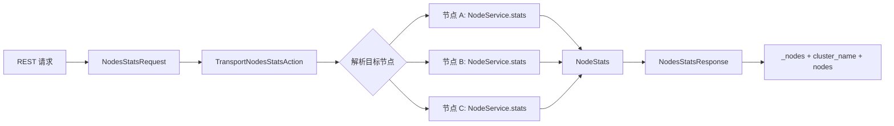

# `NodeStats` 源码跟踪

> 基于 `elasticsearch-didi` 当前分支 `update_package`、提交 `db41ec0c4e78` 梳理。本文跟踪的是 Node Stats API 从 REST 参数到节点本地采集、跨节点汇总和 JSON 输出的完整链路。

## 1. 先建立整体认识

`NodeStats` 回答的问题是：**目标节点此刻的节点级运行状态是什么？**

它的执行单位是“节点”，不是 shard：



核心结论：

- 协调节点按目标节点并发发送内部请求。
- 每个目标节点只执行一次 `NodeService#stats()`，一次性收集选中的 OS、JVM、FS、索引等指标。
- 某个节点失败不会抹掉其他节点的成功结果；失败会进入响应的 `_nodes.failed/failures`。
- `indices` 是一组特殊的节点指标：它内部仍要遍历本节点 shard，但最终首先形成的是一个 `NodeIndicesStats`。
- REST 的 `level` 只改变 `indices` 部分的明细层级，不改变 OS、JVM、FS 等其他节点指标。

主链源码：[`RestNodesStatsAction`](../../server/src/main/java/org/elasticsearch/rest/action/admin/cluster/RestNodesStatsAction.java#L40) → [`NodesStatsRequest`](../../server/src/main/java/org/elasticsearch/action/admin/cluster/node/stats/NodesStatsRequest.java#L30) → [`TransportNodesStatsAction`](../../server/src/main/java/org/elasticsearch/action/admin/cluster/node/stats/TransportNodesStatsAction.java#L34) → [`TransportNodesAction`](../../server/src/main/java/org/elasticsearch/action/support/nodes/TransportNodesAction.java#L46) → [`NodeService#stats`](../../server/src/main/java/org/elasticsearch/node/NodeService.java#L159) → [`NodeStats`](../../server/src/main/java/org/elasticsearch/action/admin/cluster/node/stats/NodeStats.java#L48) → [`NodesStatsResponse`](../../server/src/main/java/org/elasticsearch/action/admin/cluster/node/stats/NodesStatsResponse.java#L26)。

## 2. REST 入口怎样构造请求

### 2.1 路由

[`RestNodesStatsAction#routes()`](../../server/src/main/java/org/elasticsearch/rest/action/admin/cluster/RestNodesStatsAction.java#L44) 注册四类路由：

```text
GET /_nodes/stats
GET /_nodes/{nodeId}/stats
GET /_nodes/stats/{metric}
GET /_nodes/{nodeId}/stats/{metric}
GET /_nodes/stats/{metric}/{index_metric}
GET /_nodes/{nodeId}/stats/{metric}/{index_metric}
```

其中：

- `nodeId` 决定目标节点，可以是节点 ID、名称或节点选择表达式。
- `metric` 选择节点级指标；`indices` 在这里也被视为一个顶层 metric。
- `index_metric` 仅在选择了 `indices` 后才有意义，选择 `docs`、`store`、`search` 等索引指标。

### 2.2 参数解析与校验

[`prepareRequest()`](../../server/src/main/java/org/elasticsearch/rest/action/admin/cluster/RestNodesStatsAction.java#L83) 的关键步骤是：

1. 解析 `nodeId`，创建 `NodesStatsRequest`。
2. 解析 `timeout`。
3. 解析并校验 `level=node|indices|shards`。
4. 解析 `metric`；如果是 `_all`，禁止同时混用其他 metric。
5. 先 `clear()`，再逐项开启用户请求的 metric。
6. 只有 `metric` 包含 `indices` 时才解析 `index_metric`，并校验未知名称。
7. 根据已选索引指标解析 `groups`、`fielddata_fields`、`completion_fields`、segment 相关参数。
8. 用 `RestCancellableNodeClient` 发起可取消任务，响应由 `RestChunkedToXContentListener` 分块输出。

`level` 在这里不仅作为输出参数继续传递，还决定：

```java
includeShardsStats = level != NodeStatsLevel.NODE;
```

因此 REST `level=node` 会要求节点响应不要保留 shard 明细；`level=indices` 和 `level=shards` 会保留，以便后续聚合或展开。

## 3. `NodesStatsRequest` 的数据模型与默认值陷阱

### 3.1 两套相互独立的选择器

[`NodesStatsRequestParameters`](../../server/src/main/java/org/elasticsearch/action/admin/cluster/node/stats/NodesStatsRequestParameters.java#L26) 将选择项分为两类：

| 选择器 | 类型 | 控制内容 |
| --- | --- | --- |
| `indices` | `CommonStatsFlags` | `docs`、`store`、`search`、`segments` 等索引指标 |
| `requestedMetrics` | `Set<String>` | `os`、`process`、`jvm`、`fs`、`transport` 等节点指标 |
| `includeShardsStats` | `boolean` | 是否把 shard 明细装入 `NodeIndicesStats`，默认 `true` |

[`Metric`](../../server/src/main/java/org/elasticsearch/action/admin/cluster/node/stats/NodesStatsRequestParameters.java#L77) 枚举包含：`os`、`process`、`jvm`、`thread_pool`、`fs`、`transport`、`http`、`breaker`、`script`、`discovery`、`ingest`、`adaptive_selection`、`script_cache`、`indexing_pressure`、`repositories`。

注意：`indices` 不在这个枚举中，而由单独的 `CommonStatsFlags` 管理。

### 3.2 Java API 默认值与 REST `_all` 不等价

构造一个裸的 `new NodesStatsRequest()` 时：

- `CommonStatsFlags indices` 默认是全选；
- `requestedMetrics` 默认是空集合；
- `includeShardsStats` 默认是 `true`。

所以它表示“采集全部索引指标，但不采集其他节点指标”，并不等于 REST `/_nodes/stats` 的“全部指标”。REST 在 `_all` 路径上显式调用 [`NodesStatsRequest#all()`](../../server/src/main/java/org/elasticsearch/action/admin/cluster/node/stats/NodesStatsRequest.java#L61)，同时打开索引指标和节点指标。

这一区别对内部调用者很重要：若只想取 FS，应采用 `clear()` 后再添加 `fs`，不能依赖构造器默认值。

### 3.3 传输序列化

[`NodesStatsRequest#writeTo()`](../../server/src/main/java/org/elasticsearch/action/admin/cluster/node/stats/NodesStatsRequest.java#L178) 先写 `BaseNodesRequest` 的节点选择和超时，再写参数对象。参数对象依次写：

1. `CommonStatsFlags`；
2. 节点 metric 字符串集合；
3. `includeShardsStats`。

`includeShardsStats` 有 transport version 门槛；与旧版本通信时读取端回退为 `true`。这是混合版本集群中需要注意的兼容行为。

请求创建 [`CancellableTask`](../../server/src/main/java/org/elasticsearch/action/admin/cluster/node/stats/NodesStatsRequest.java#L162)，使 REST 连接断开或上层取消可以沿父子任务链传播。

## 4. 协调节点如何 fan-out

### 4.1 目标节点解析

[`TransportNodesAction#doExecute()`](../../server/src/main/java/org/elasticsearch/action/support/nodes/TransportNodesAction.java#L113) 是所有 nodes action 的通用模板。它先调用 [`resolveRequest()`](../../server/src/main/java/org/elasticsearch/action/support/nodes/TransportNodesAction.java#L218)：

- 如果请求还没有 `concreteNodes`，就在当前 `ClusterState` 上调用 `DiscoveryNodes#resolveNodes()`。
- 空节点表达式意味着全部节点。
- 解析完成后，请求持有稳定的目标节点数组，供本轮 fan-out 使用。

### 4.2 每节点并发请求

通用模板通过 [`CancellableFanOut`](../../server/src/main/java/org/elasticsearch/action/support/CancellableFanOut.java#L33) 遍历目标节点，为每个节点发送内部 action `cluster:monitor/nodes/stats[n]`：

- 每个子请求设置父 task；
- `request.timeout()` 被放进该节点传输请求的 `TransportRequestOptions`；
- 成功结果加入 `NodeStats` 列表；
- 失败包装为 `FailedNodeException`；
- 全部子请求结束后调用 `newResponseAsync()`。

“遍历发送”不等于串行等待：发送动作逐个发起，但远端请求是重叠执行的，回调也可能并发到达。

`CancellableFanOut` 通过引用计数保证：

- 取消时尽快释放已经积累的大响应对象；
- 已经发出的子任务完成或取消后，外层 listener 才最终完成；
- 不会因为主任务取消就遗留无所有者的大型 stats 响应。

### 4.3 为什么使用 `MANAGEMENT` 线程池

[`TransportNodesStatsAction` 构造器](../../server/src/main/java/org/elasticsearch/action/admin/cluster/node/stats/TransportNodesStatsAction.java#L45) 把节点 handler 放在 `MANAGEMENT` executor。基类还断言节点 handler 不能使用 `DIRECT` executor，因为 stats 采集可能遍历大量本地对象，不能占用 transport I/O 线程。

## 5. 目标节点怎样执行 `NodeService#stats()`

[`TransportNodesStatsAction#nodeOperation()`](../../server/src/main/java/org/elasticsearch/action/admin/cluster/node/stats/TransportNodesStatsAction.java#L79) 将 `requestedMetrics` 展开为一组 boolean，然后一次调用 [`NodeService#stats()`](../../server/src/main/java/org/elasticsearch/node/NodeService.java#L159)。对应关系如下：

| 请求项 | 本地采集来源 | 写入 `NodeStats` |
| --- | --- | --- |
| `indices` | `IndicesService#stats()` | `NodeIndicesStats` |
| `os` | `MonitorService#osService().stats()` | `OsStats` |
| `process` | `MonitorService#processService().stats()` | `ProcessStats` |
| `jvm` | `MonitorService#jvmService().stats()` | `JvmStats` |
| `thread_pool` | `ThreadPool#stats()` | `ThreadPoolStats` |
| `fs` | `MonitorService#fsService().stats()` | `FsInfo` |
| `transport` | `TransportService#stats()` | `TransportStats` |
| `http` | `HttpServerTransport#stats()` | `HttpStats`；未启用 HTTP 时为 `null` |
| `breaker` | `CircuitBreakerService#stats()` | `AllCircuitBreakerStats` |
| `script` | `ScriptService#stats()` | `ScriptStats` |
| `discovery` | coordinator | `DiscoveryStats` |
| `ingest` | `IngestService#stats()` | `IngestStats` |
| `adaptive_selection` | response collector + pending search requests | `AdaptiveSelectionStats` |
| `script_cache` | `ScriptService#cacheStats()` | `ScriptCacheStats` |
| `indexing_pressure` | `IndexingPressure#stats()` | `IndexingPressureStats` |
| `repositories` | `RepositoriesService#getRepositoriesStats()` | `RepositoriesStats` |

未选择的项直接写成 `null`。因此 `NodeStats` 是一个稀疏响应对象，而不是先收集全部数据再在 JSON 层过滤。

## 6. `indices` 子链路：节点内如何统计 shard

`indices` 是 `NodeStats` 中最复杂的一项。调用链为：

```text
NodeService.stats
  └─ IndicesService.stats(flags, includeShardsStats)
       ├─ 汇总已关闭 shard 留下的 oldShardsStats
       ├─ statsByIndex(...)        // 当前仅用于 mappings 等索引级信息
       └─ statsByShard(...)
            └─ indexShardStats(...)
                 └─ CommonStats.getShardLevelStats(...)
```

[`IndicesService#stats()`](../../server/src/main/java/org/elasticsearch/indices/IndicesService.java#L437) 先把已经关闭 shard 留下的部分累计值加入 `CommonStats`。旧 shard 只保留适合累加的指标，例如 `get`、`indexing`、`search`、`merge`、`refresh`、`recovery`、`flush`、`bulk`，而不是所有指标。

随后 [`statsByShard()`](../../server/src/main/java/org/elasticsearch/indices/IndicesService.java#L473) 遍历本节点所有 `IndexService` 和 `IndexShard`，构造 shard 级 `CommonStats`。若 shard 正在关闭导致 `AlreadyClosedException` 或状态异常，该 shard 会被跳过，避免一次节点统计因为并发关闭而整体失败。

### `includeShardsStats=false` 并不代表不读取 shard

[`NodeIndicesStats` 构造器](../../server/src/main/java/org/elasticsearch/indices/NodeIndicesStats.java#L90) 的行为容易误解：

- `false` 时，最终保存的 `statsByShard` 是空 map；
- 但构造器仍遍历传入的当前 shard stats，把它们加到节点总量；
- 因而它主要减少响应对象和序列化中的 shard 明细，不会免除计算节点总量所需的 shard 采集。

换言之，`level=node` 是“只返回节点汇总”，不是“完全不碰 shard”。

## 7. `NodeStats` 响应对象与 wire 格式

[`NodeStats`](../../server/src/main/java/org/elasticsearch/action/admin/cluster/node/stats/NodeStats.java#L48) 继承 `BaseNodeResponse`，固定带节点身份和 `timestamp`，其他统计字段都是可选项。

[`writeTo()`](../../server/src/main/java/org/elasticsearch/action/admin/cluster/node/stats/NodeStats.java#L275) 按固定顺序写各可选字段。需要留意两个兼容点：

- `RepositoriesStats` 受 transport version 控制，旧节点不会接收这个字段。
- wire 中没有单独写 `ScriptCacheStats`；读取构造器从 `ScriptStats` 恢复关联的 cache stats。这意味着二者在传输格式上存在明确耦合，不能把它们当作完全独立的 wire 字段理解。

## 8. 响应如何聚合与输出

### 8.1 协调节点构造响应

`TransportNodesStatsAction#newResponse()` 将三部分装入 [`NodesStatsResponse`](../../server/src/main/java/org/elasticsearch/action/admin/cluster/node/stats/NodesStatsResponse.java#L26)：

- `ClusterName`；
- 成功节点的 `List<NodeStats>`；
- 失败节点的 `List<FailedNodeException>`。

`NodesStatsResponse` 是 local-only 响应：顶层对象不作为普通 transport 响应再次整体序列化；真正跨节点传输的是每个子请求返回的 `NodeStats`。

### 8.2 JSON 外层结构

[`BaseNodesXContentResponse#toXContentChunked()`](../../server/src/main/java/org/elasticsearch/action/support/nodes/BaseNodesXContentResponse.java#L37) 输出：

```json
{
  "_nodes": {
    "total": 3,
    "successful": 2,
    "failed": 1,
    "failures": []
  },
  "cluster_name": "...",
  "nodes": {
    "node-id": {}
  }
}
```

[`NodesStatsResponse`](../../server/src/main/java/org/elasticsearch/action/admin/cluster/node/stats/NodesStatsResponse.java#L42) 以 node ID 作为 `nodes` 子对象的 key；每个节点先输出名称、transport 地址、host、IP、roles、attributes、timestamp，再拼接 `NodeStats` 的各个 chunk。

使用 chunked XContent 的目的，是避免先在内存中构造一个覆盖所有节点、所有 shard 明细的巨大中间 JSON 对象。

### 8.3 `indices` 的三个 `level`

[`NodeStatsLevel`](../../server/src/main/java/org/elasticsearch/action/NodeStatsLevel.java#L13) 定义三档：

| `level` | `NodeIndicesStats` 输出 |
| --- | --- |
| `node` | 只输出该节点的 `indices` 总量 |
| `indices` | 总量之外，按 index 名输出聚合值 |
| `shards` | 总量之外，按 index 和 shard 展开当前明细 |

具体分支在 [`NodeIndicesStats#toXContentChunked()`](../../server/src/main/java/org/elasticsearch/indices/NodeIndicesStats.java#L240)。`indices` 层级通过 `createCommonStatsByIndex()` 从保留的 shard 明细重新聚合，并合并 mappings 等 index-level stats。

## 9. 超时、取消和部分失败语义

### 9.1 超时

`timeout` 被用作每个节点子请求的 transport 超时。它限制协调节点等待某个节点 transport 响应的时间，而不是 `NodeService#stats()` 内每一个采集器的独立 deadline。

超时节点进入失败列表，其他已成功节点仍可返回，因此要检查 `_nodes.failed`，不能只看 HTTP 请求是否得到了 JSON。

### 9.2 取消

取消通过父 task 传播到节点子请求。`CancellableFanOut` 负责在取消时释放累计结果，但外层完成仍要等待已经启动的子请求走完其结束路径。它提供资源安全，并不承诺任意本地采集函数都能在指令级立即中断。

### 9.3 节点在请求期间变化

目标节点来自请求开始时的一次 `ClusterState` 解析。之后节点离开、连接失败或响应超时，都会表现为该节点失败；不会在同一请求内重新解析并无限重试。

## 10. `InternalClusterInfoService` 的典型调用

`ClusterInfo` 刷新同时发起 Node Stats 和 Indices Stats。Node Stats 请求的意图非常明确：只取数据节点磁盘信息。

```text
new NodesStatsRequest("data:true")
  → clear()
  → addMetric("fs")
  → includeShardsStats(false)
  → timeout(fetchTimeout)
```

这样做有三层收敛：

1. 节点范围只选 `data:true`；
2. 指标范围只选 `fs`；
3. 不携带索引 shard 明细。

它最终消费各节点 `FsInfo.Path`，计算 least/most available space。与另一条 `IndicesStatsRequest.store(true)` 链路结合后，才形成“节点磁盘容量 + shard 占用和路径”的完整 `ClusterInfo`。这也解释了为什么 DiskThresholdDecider 不能只依赖 Node Stats。

## 11. 常见误区

1. **把 Node Stats 当成一次 cluster-wide shard broadcast。** 实际上它首先是 node fan-out，每节点执行一次 `NodeService#stats()`。
2. **认为 `level=node` 不采集 shard。** 它仍需要 shard 数据形成节点总量，只是不保留/输出 shard 明细。
3. **认为默认 Java 请求等于 REST `_all`。** 裸构造器默认开启索引 flags，但节点 metric 集合为空。
4. **忽略部分成功。** HTTP 有响应不等于所有节点成功，必须检查 `_nodes.failed`。
5. **认为 `timeout` 是每个采集器的强制中断时间。** 它首先是节点 transport 子请求的等待超时。
6. **把 `indices` 与其他 metric 放在同一枚举里。** `indices` 由 `CommonStatsFlags` 单独管理。

## 12. 主要调用者

- `InternalClusterInfoService`：只取数据节点 FS，用于磁盘分配决策。
- Cat Nodes、Cat Allocation、Cat Thread Pool、Cat Fielddata 等 REST：选择性读取对应节点指标。
- Monitoring 的 `NodeStatsCollector`：采集本地节点运行状态。
- Autoscaling：构造节点容量与使用量信息。
- ML 统计：组合节点级训练模型或运行资源信息。

调用者通常不会请求 `_all`，而是 `clear()` 后只打开所需指标，以控制节点开销和响应体大小。

## 13. 建议的源码阅读顺序

1. [`RestNodesStatsAction`](../../server/src/main/java/org/elasticsearch/rest/action/admin/cluster/RestNodesStatsAction.java#L40)：先看 REST 语义和参数约束。
2. [`NodesStatsRequest`](../../server/src/main/java/org/elasticsearch/action/admin/cluster/node/stats/NodesStatsRequest.java#L30) 与 [`NodesStatsRequestParameters`](../../server/src/main/java/org/elasticsearch/action/admin/cluster/node/stats/NodesStatsRequestParameters.java#L26)：理解两套 flags。
3. [`TransportNodesStatsAction`](../../server/src/main/java/org/elasticsearch/action/admin/cluster/node/stats/TransportNodesStatsAction.java#L34)：看 metric 到 boolean 的转换。
4. [`TransportNodesAction`](../../server/src/main/java/org/elasticsearch/action/support/nodes/TransportNodesAction.java#L113) 与 [`CancellableFanOut`](../../server/src/main/java/org/elasticsearch/action/support/CancellableFanOut.java#L47)：理解跨节点并发、失败和取消。
5. [`NodeService#stats`](../../server/src/main/java/org/elasticsearch/node/NodeService.java#L159)：看真实采集入口。
6. [`IndicesService#stats`](../../server/src/main/java/org/elasticsearch/indices/IndicesService.java#L437) 与 [`NodeIndicesStats`](../../server/src/main/java/org/elasticsearch/indices/NodeIndicesStats.java#L90)：理解 `indices` 特殊链路。
7. [`NodeStats`](../../server/src/main/java/org/elasticsearch/action/admin/cluster/node/stats/NodeStats.java#L48) 与 [`NodesStatsResponse`](../../server/src/main/java/org/elasticsearch/action/admin/cluster/node/stats/NodesStatsResponse.java#L26)：理解 wire 和最终 JSON。

## 14. 测试入口

- `NodesStatsRequestTests`：默认值、`all()`、`clear()`、metric 增删、未知 metric 和 task description。
- `RestNodesStatsActionTests`：未知 metric、名称建议、`_all` 冲突、非法 `index_metric`、`level` 校验。
- `NodeStatsTests`：`NodeStats` 的序列化和 chunked XContent。
- `TransportNodesActionTests`：nodes action 通用 fan-out、节点失败和取消行为。

## 15. 一句话总结

`NodeStats` 的本质是：**协调节点把一份“节点指标选择器”并发发送给目标节点；每个节点通过 `NodeService` 一次性构造稀疏的 `NodeStats`，协调节点再把成功节点和失败节点分别汇总成可分块输出的 `NodesStatsResponse`。**
