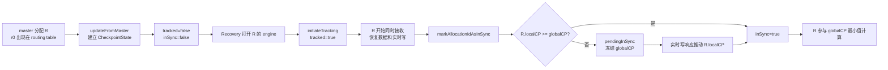
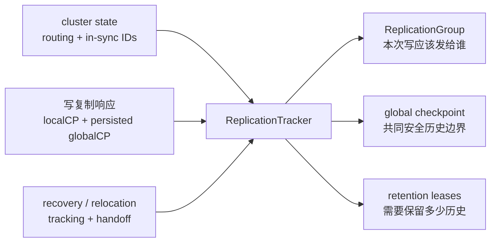
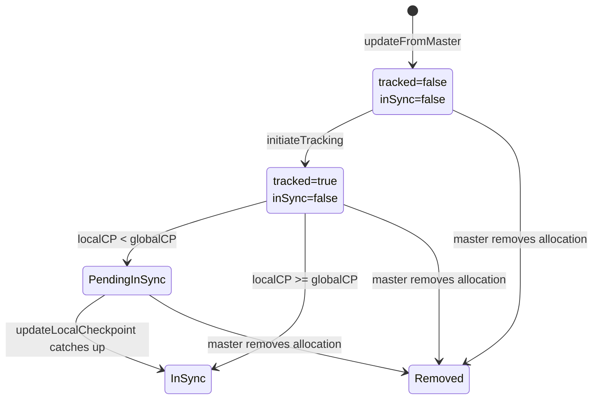
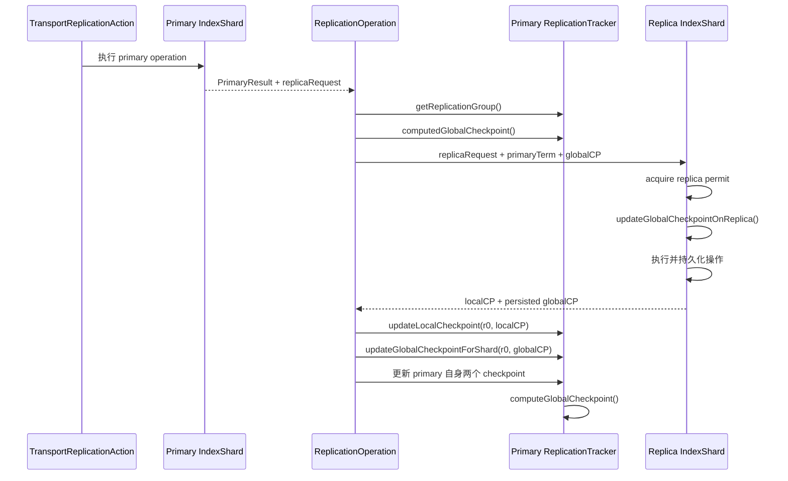
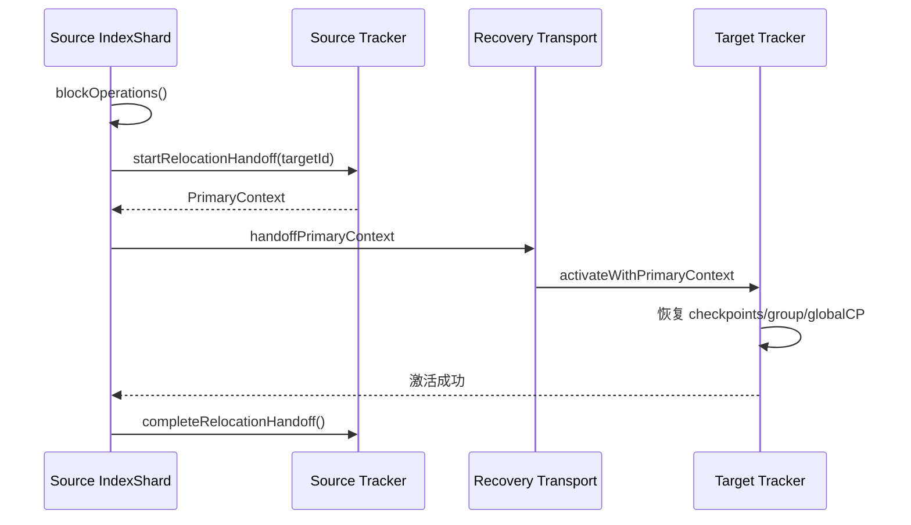

# `ReplicationTracker` 源码跟踪：从副本加入到 global checkpoint 推进

> 基于 `elasticsearch-didi` 分支 `update_package`、提交 `db41ec0c4e78` 梳理。
>
> 本文不按类中的方法顺序逐个罗列，而是使用一个副本加入复制组的连续案例，跟踪 `ReplicationTracker` 从构造、集群状态应用、正常写复制、peer recovery、primary relocation、retention lease 到 DiDi DCDR 扩展的完整状态变化。

## 阅读导航

如果只想回答某个问题，可以直接跳到对应部分：

| 想弄清的问题 | 建议阅读 |
| --- | --- |
| `ReplicationTracker` 到底负责什么 | 第 1～3 节 |
| `local checkpoint`、`global checkpoint`、`tracked`、`inSync` 的关系 | 第 4～5 节 |
| primary 如何知道有哪些 replica 要接收写 | 第 6、11 节 |
| 一次写入如何推动 global checkpoint | 第 10～14 节 |
| 新副本为什么先 `tracked`、后 `inSync` | 第 15～16 节 |
| `pendingInSync` 为什么会冻结 global checkpoint | 第 16 节 |
| primary relocation 如何交接复制状态 | 第 17～18 节 |
| retention lease 与 checkpoint 有什么关系 | 第 19～21 节 |
| DiDi DCDR 改变了哪些标准语义 | 第 22～24 节 |
| 当前源码有哪些值得复核的实现 | 第 28 节 |

---

# 第一部分：先建立一张完整地图

## 1. 贯穿全文的运行案例

假设某个 shard 当前有一个 primary `P`，之后增加一个 replica `R`：

```text
P 的 allocation ID = p0
R 的 allocation ID = r0

初始时：
P.localCheckpoint  = 12
P.globalCheckpoint = 12
R 尚未开始 recovery
```

`R` 加入复制组不会一步完成，而是经历下面的过程：



这条流程同时解释了 `ReplicationTracker` 最重要的三项职责：

1. 根据 master 下发的 routing 和 in-sync IDs，维护“哪些 copy 存在”。
2. 根据 recovery 和写复制反馈，维护“哪些 copy 已开始接收写、哪些 copy 已达到安全状态”。
3. 根据所有 in-sync copy 的持久化 local checkpoint，计算共同安全边界 global checkpoint。

后文所有字段和方法都放回这条时间线中解释。

## 2. `ReplicationTracker` 解决的核心问题

[`ReplicationTracker`](../../server/src/main/java/org/elasticsearch/index/seqno/ReplicationTracker.java#L69) 的类注释把它定义为复制组进度和安全标记的跟踪器。更具体地说，它要持续回答四个问题：

1. 当前 primary 应该把新写操作发给哪些 shard copies？
2. 每个 copy 已经持久化到哪个 local checkpoint？
3. 所有安全副本共同拥有的历史边界在哪里？
4. recovery 或 relocation 改变成员关系时，怎样避免遗漏写入或错误抬高安全边界？

它不是以下组件的替代品：

| 组件 | 自己负责什么 | 与 `ReplicationTracker` 的关系 |
| --- | --- | --- |
| master / cluster state | 决定 shard routing、分配和 metadata 中的 in-sync IDs | 给 tracker 提供成员关系的权威输入 |
| `IndexShard` | 管理 engine、translog、shard 状态、primary term 和 operation permits | 创建 tracker，并在正确生命周期调用它 |
| `ReplicationOperation` | 执行一次 primary-to-replica 写复制 | 从 tracker 取得复制目标，完成后回报 checkpoint |
| `RecoverySourceHandler` | 执行 peer recovery 各阶段 | 在 engine 打开和恢复结束时推进 tracked/in-sync 状态 |
| `LocalCheckpointTracker` | 在单个 engine 内跟踪 seq-no 连续处理与持久化边界 | copy 把结果通过响应交给 primary 的 `ReplicationTracker` |
| `ReplicationTracker` | 汇总整个 shard replication group 的状态 | 导出 `ReplicationGroup` 和 global checkpoint |

因此，`ReplicationTracker` 保存的是 **primary 对整个复制组的认识**，不是每个 replica engine 内部执行状态本身。

## 3. 谁掌握哪一种权威状态

阅读复制源码时最容易混淆的是：master、primary tracker 和 replica engine 都在保存“看起来像复制状态”的数据，但它们的权威范围不同。

| 状态 | 权威来源 | tracker 如何得到 |
| --- | --- | --- |
| shard 是否 assigned、initializing、started、relocating | cluster state routing table | `updateFromMaster()` |
| metadata 中的 in-sync allocation IDs | master | `updateFromMaster()` |
| recovery target 是否已经可以接收实时写 | primary 上的 recovery 流程 | `initiateTracking()` |
| recovery target 是否追到安全门槛 | primary 上的 recovery 流程和写响应 | `markAllocationIdAsInSync()`、`updateLocalCheckpoint()` |
| 某个 copy 的持久化 local checkpoint | 该 copy 的 engine/translog | replica response 回报给 primary |
| 复制组的 global checkpoint | primary tracker | `computeGlobalCheckpoint()` |
| replica 已持久化到哪个 global checkpoint | 该 replica | replica response 回报给 primary |
| retention leases | primary tracker | primary 修改后同步给 replicas |
| DCDR remote targets | DiDi recovery/service | tracker 的 remote-target 方法维护 |

可以把整体关系压缩成三条输入、一组派生输出：



---

# 第二部分：核心状态模型

## 4. 三种 sequence-number 边界

### 4.1 sequence number

primary 为写操作分配递增的 sequence number。特殊值定义在 [`SequenceNumbers`](../../server/src/main/java/org/elasticsearch/index/seqno/SequenceNumbers.java#L20)：

| 常量 | 值 | 含义 |
| --- | ---: | --- |
| `UNASSIGNED_SEQ_NO` | `-2` | 尚不知道或尚未初始化 |
| `NO_OPS_PERFORMED` | `-1` | 没有执行过任何操作 |

sequence number 只说明操作的编号，不说明前面的操作是否连续完成。

### 4.2 local checkpoint

某个 copy 的 local checkpoint 表示：

> 在这个 copy 上，从 `0` 到该值的所有操作都已经连续完成。

例如 copy 已处理 `{0,1,2,4}`，那么 local checkpoint 仍是 `2`，因为 `3` 是空洞。等 `3` 完成后，它才可能一次推进到 `4`。

引擎内部的 [`LocalCheckpointTracker`](../../server/src/main/java/org/elasticsearch/index/seqno/LocalCheckpointTracker.java#L28) 区分 processed checkpoint 和 persisted checkpoint。`ReplicationTracker` 正常写复制链路使用的是 copy 回报的 **持久化 local checkpoint**，因为它必须在节点崩溃后仍然成立。

### 4.3 global checkpoint

global checkpoint 表示：

> 当前所有 in-sync copies 都已经持久化拥有的共同连续历史边界。

在没有特殊冻结条件时：

```text
globalCheckpoint = min(localCheckpoint of every in-sync copy)
```

例如：

| copy | local checkpoint | in-sync |
| --- | ---: | --- |
| `P` | 20 | 是 |
| `R1` | 18 | 是 |
| `R2` | 15 | 否，仅 tracked |

global checkpoint 是 `18`，不是 `15`。`R2` 虽然接收实时写，但尚未成为安全集合成员，所以不参与最小值计算。

## 5. `CheckpointState`：每个 allocation ID 的状态

tracker 以 allocation ID 为 key，在 [`CheckpointState`](../../server/src/main/java/org/elasticsearch/index/seqno/ReplicationTracker.java#L686) 中保存四个值：

```java
long localCheckpoint;
long globalCheckpoint;
boolean inSync;
boolean tracked;
```

它们的含义不能混用：

| 字段 | primary 眼中的含义 | 主要用途 |
| --- | --- | --- |
| `localCheckpoint` | 该 copy 已持久化的连续操作边界 | 计算整个组的 global checkpoint |
| `globalCheckpoint` | 该 copy 已经持久化到本地的 global checkpoint | 判断是否需要同步，以及推进 peer-recovery lease |
| `tracked` | 该 copy 是否已经可以接收 primary 的实时写 | 构造写复制目标集合 |
| `inSync` | 该 copy 是否属于共同安全集合 | 决定是否参与 global checkpoint 计算 |

### 5.1 `tracked` 与 `inSync` 的状态机



三种有效组合是：

| `tracked` | `inSync` | 意义 | 接收新写 | 参与 global checkpoint |
| --- | --- | --- | --- | --- |
| `false` | `false` | master 知道它，但 recovery 还没准备好 engine | 否 | 否 |
| `true` | `false` | 已开始边恢复边接收实时写 | 是 | 否 |
| `true` | `true` | 已达到安全门槛 | 是 | 是 |

`tracked=false, inSync=true` 是非法状态。[`invariant()`](../../server/src/main/java/org/elasticsearch/index/seqno/ReplicationTracker.java#L920) 明确断言 `inSync` 必须蕴含 `tracked`。

### 5.2 为什么使用 allocation ID

同一个 shard copy 重新分配后会得到新的 allocation ID。tracker 用 allocation ID 而不是 node ID 作为 checkpoint key，可以避免把旧 copy 的进度错误继承给一次新的分配。

## 6. `ReplicationGroup`：由 tracker 派生的写目标快照

[`ReplicationGroup`](../../server/src/main/java/org/elasticsearch/index/shard/ReplicationGroup.java#L23) 不是第二份独立权威状态，而是下面四项输入的派生视图：

```text
routing table
+ in-sync allocation IDs
+ tracked allocation IDs
+ DiDi remote replication targets
```

[`calculateReplicationGroup()`](../../server/src/main/java/org/elasticsearch/index/seqno/ReplicationTracker.java#L1061) 的核心代码是：

```java
return new ReplicationGroup(
    routingTable,
    checkpoints.entrySet().stream()
        .filter(e -> e.getValue().inSync)
        .map(Map.Entry::getKey).collect(Collectors.toSet()),
    checkpoints.entrySet().stream()
        .filter(e -> e.getValue().tracked)
        .map(Map.Entry::getKey).collect(Collectors.toSet()),
    newVersion,
    remoteReplicationTargets
);
```

`ReplicationGroup` 再把 routing 分成：

| 派生集合 | 含义 |
| --- | --- |
| `replicationTargets` | assigned 且 tracked，本次写需要发送 |
| `skippedShards` | 尚未 tracked 或未分配，不发送本次写 |
| `unavailableInSyncShards` | metadata 仍认为 in-sync，但当前没有可用 promotable routing |
| `remoteReplicationTargets` | DiDi 远程复制目标 |

只要 tracked、in-sync、routing 或 remote target 发生变化，tracker 就通过 [`updateReplicationGroupAndNotify()`](../../server/src/main/java/org/elasticsearch/index/seqno/ReplicationTracker.java#L1054) 重建快照并增加 version。

`IndexShard` 注入的回调最终连接到 [`PendingReplicationActions`](../../server/src/main/java/org/elasticsearch/action/support/replication/PendingReplicationActions.java#L26)。当某个 allocation ID 离开复制组时，与它关联的重试写请求会被取消，防止无意义地继续重试。

---

# 第三部分：tracker 如何建立 primary 视图

## 7. 构造与本地恢复

### 7.1 `IndexShard` 只创建一个 tracker

[`IndexShard` 构造器](../../server/src/main/java/org/elasticsearch/index/shard/IndexShard.java#L367) 创建 tracker，并注入：

| 依赖/回调 | 用途 |
| --- | --- |
| 当前 shard allocation ID | 标识 tracker 所属 copy |
| operation primary term | retention lease 版本和写入代际 |
| 初始 global checkpoint | 恢复内存安全边界 |
| `onGlobalCheckpointUpdated` | 唤醒等待 checkpoint 的监听者 |
| retention-lease sync callback | 把 leases 复制到 replicas |
| safe-commit supplier | 判断历史保留成本 |
| replication-group callback | 更新 pending replication actions |

构造完成后始终是 `primaryMode=false`。即使本地 routing 写着 primary，tracker 也不能仅凭本地信息自行获得 primary authority。

### 7.2 engine 打开前恢复本地 global checkpoint

[`IndexShard#loadGlobalCheckpointToReplicationTracker()`](../../server/src/main/java/org/elasticsearch/index/shard/IndexShard.java#L2145) 从 translog checkpoint 读取已持久化 global checkpoint，然后调用 replica 更新入口：

```text
replicationTracker.updateGlobalCheckpointOnReplica(
    persistedGlobalCheckpoint,
    "read from translog checkpoint"
)
```

这个动作发生在 engine/translog 恢复的重要阶段之前，使后续 engine 初始化读取到的 supplier 已经代表磁盘上的安全边界。

retention leases 也会从 shard state path 加载，但它们是独立的 versioned snapshot，后文单独解释。

## 8. `updateFromMaster()`：把 cluster state 变成 checkpoint entries

入口来自 [`IndexShard#updateShardState()`](../../server/src/main/java/org/elasticsearch/index/shard/IndexShard.java#L500)：

```text
cluster state applier
  → IndexShard.updateShardState(...)
    → ReplicationTracker.updateFromMaster(
          clusterStateVersion,
          inSyncAllocationIds,
          routingTable)
```

[`updateFromMaster()`](../../server/src/main/java/org/elasticsearch/index/seqno/ReplicationTracker.java#L1218) 首先用版本号拒绝旧状态：

```java
if (applyingClusterStateVersion > appliedClusterStateVersion) {
    // apply membership changes
}
```

这个版本门槛对 relocation target 特别重要：target 可能先收到 source 携带的较新 `PrimaryContext`，随后本地队列又应用一份旧 cluster state。旧状态不能反过来删除刚继承的成员。

### 8.1 primary mode 之前

tracker 还不是 primary 时，master 提供的状态用来建立初始 checkpoint map：

```java
for (String initializingId : initializingAllocationIds) {
    checkpoints.put(initializingId,
        new CheckpointState(UNASSIGNED_SEQ_NO, UNASSIGNED_SEQ_NO, false, false));
}
for (String inSyncId : inSyncAllocationIds) {
    checkpoints.put(inSyncId,
        new CheckpointState(UNASSIGNED_SEQ_NO, UNASSIGNED_SEQ_NO, true, true));
}
```

回到运行案例，master 刚分配 `R` 后：

| allocation | localCP | persisted globalCP | tracked | inSync |
| --- | ---: | ---: | --- | --- |
| `p0` | `UNASSIGNED` | `UNASSIGNED` | `true` | `true` |
| `r0` | `UNASSIGNED` | `UNASSIGNED` | `false` | `false` |

`p0` 的实际 local checkpoint 要等 tracker 激活 primary mode 时填入。

### 8.2 primary mode 之后

进入 primary mode 后，master 可以：

- 增加新的 initializing allocation ID；
- 移除 stale 或已离开 routing 的 allocation ID；
- 更新 routing table。

但是 master 不能凭空把 tracker 不认识的 allocation ID 直接变为 in-sync。源码断言 master 给出的每个 in-sync ID 必须已经存在于 tracker，而且本地也已标记 `inSync=true`。

这是职责边界：master 保存最终 in-sync metadata，但一个新 recovery target 是否真正追平，要由 primary 的 recovery 流程证明。

### 8.3 移除成员为什么可能推进 global checkpoint

如果 master 移除了一个落后的 in-sync copy：

1. tracker 删除它的 `CheckpointState`；
2. 清理对应 `pendingInSync`；
3. 重建 `ReplicationGroup`；
4. 重新计算 global checkpoint；
5. 唤醒可能在等待该 copy 的 recovery 线程。

原来最小 local checkpoint 的成员消失后，剩余 in-sync 集合的共同边界可能变大，因此重新计算是必要的。

## 9. tracker 如何进入 primary mode

有三条不同路径，不能混为一谈。

### 9.1 初始化 primary 或 replica promotion

两者最终都调用 [`activatePrimaryMode()`](../../server/src/main/java/org/elasticsearch/index/seqno/ReplicationTracker.java#L1148)：

```java
primaryMode = true;
updateLocalCheckpoint(shardAllocationId,
    checkpoints.get(shardAllocationId), localCheckpoint);
updateGlobalCheckpointOnPrimary();
addPeerRecoveryRetentionLeaseForSolePrimary();
```

调用前必须满足：

- master 已经把当前 allocation ID 放进 in-sync 集合；
- 本地 checkpoint entry 已建立；
- promotion 已经通过 `IndexShard` mutex、primary term 更新和 operation permits 完成 authority 切换；
- 传入的是当前 engine 的持久化 local checkpoint。

`activatePrimaryMode()` 只接管复制组跟踪职责；translog replay、填补 seq-no 空洞和 primary-replica resync 由 `IndexShard` 外层流程完成，相关入口位于 [`IndexShard#updateShardState()`](../../server/src/main/java/org/elasticsearch/index/shard/IndexShard.java#L577)。

### 9.2 relocation target

relocation target 不能调用普通的 `activatePrimaryMode()`，因为它必须继承 source primary 对所有 copies 的认识。它调用 `activateWithPrimaryContext()`，详见第 17 节。

---

# 第四部分：一次正常写如何推进 checkpoint

## 10. 完整调用链

一次 primary 写成功后，checkpoint 相关流程如下：



这个流程中有三个不同方向的数据：

| 方向 | 数据 | 目的 |
| --- | --- | --- |
| primary tracker → replica request | primary 当前 global checkpoint | 让 replica 学到新的共同安全边界 |
| replica → primary tracker | replica persisted local checkpoint | 推进复制组 global checkpoint |
| replica → primary tracker | replica persisted global checkpoint | 判断它是否还需要 checkpoint sync，并推进 lease |

## 11. `ReplicationOperation` 如何选择目标

[`ReplicationOperation#handlePrimaryResult()`](../../server/src/main/java/org/elasticsearch/action/support/replication/ReplicationOperation.java#L136) 在 primary operation 完成后读取 `ReplicationGroup`：

```java
final ReplicationGroup replicationGroup = primary.getReplicationGroup();
...
final long globalCheckpoint = primary.computedGlobalCheckpoint();
...
markUnavailableShardsAsStale(replicaRequest, replicationGroup);
performOnReplicas(replicaRequest, globalCheckpoint, ..., replicationGroup, ...);
```

它会：

1. 向 `replicationTargets` 中除 primary 外的本地 copies 发请求；
2. 把 unavailable in-sync copies 报告给 master，请求标记 stale；
3. 把 skipped shards 计入响应统计，但不发送写请求；
4. 如果是 `BulkShardRequest`，还向 DiDi remote targets 发远程复制请求。

### 11.1 为什么必须在 primary 操作完成后获取 group

recovery 可能在这个写执行期间调用 `initiateTracking()`。如果写链路复用 primary 操作开始前的旧 group，新加入的 recovery target 就可能漏掉这次实时写。

所以源码明确要求 primary 写完成后再采样 group。

### 11.2 当前源码存在一个采样顺序疑点

同一段注释还要求：先读取 global checkpoint，再读取 replication group，确保 checkpoint 对采样到的 group 有效。

但当前代码实际顺序是：

```text
getReplicationGroup()
→ computedGlobalCheckpoint()
```

与注释描述的安全顺序相反。本文在第 28.1 节将其列为需要单独复核的源码事实；不能仅凭注释直接断言线上一定存在错误，但维护者不应忽略这个不一致。

## 12. replica 怎样接收并回报 checkpoint

### 12.1 请求到达 replica

replica request 携带：

- operation primary term；
- primary 采样到的 global checkpoint；
- `maxSeqNoOfUpdatesOrDeletes`。

[`IndexShard#innerAcquireReplicaOperationPermit()`](../../server/src/main/java/org/elasticsearch/index/shard/IndexShard.java#L3850) 在放行 replica 操作前调用 `updateGlobalCheckpointOnReplica(..., "operation")`。

tracker 的 [`updateGlobalCheckpointOnReplica()`](../../server/src/main/java/org/elasticsearch/index/seqno/ReplicationTracker.java#L1102) 只接受严格更大的值，因为网络消息可能乱序，较旧值不能让安全边界倒退。

`IndexShard` 外层还有一道保护：如果收到的 global checkpoint 大于 replica 当前 local checkpoint，并且 recovery 尚未完成，就忽略该更新，避免 replica 声称拥有自己实际上还没有的共同历史。

### 12.2 replica 响应

[`TransportReplicationAction.ReplicaResponse`](../../server/src/main/java/org/elasticsearch/action/support/replication/TransportReplicationAction.java#L1226) 返回两个数：

```text
replica persisted local checkpoint
replica persisted global checkpoint
```

[`ReplicationOperation#updateCheckPoints()`](../../server/src/main/java/org/elasticsearch/action/support/replication/ReplicationOperation.java#L421) 分别调用：

```java
primary.updateLocalCheckpointForShard(allocationId, localCheckpoint);
primary.updateGlobalCheckpointForShard(allocationId, globalCheckpoint);
```

这里最容易误解：

- 第一个值决定复制组 global checkpoint 能走多远；
- 第二个值只说明该 replica 已把哪个 global checkpoint 落盘，不直接参与共同最小值计算。

primary 自己完成 post-replication actions 后，也通过同样的路径更新自身 checkpoint entry。

## 13. global checkpoint 的核心算法

算法位于 [`computeGlobalCheckpoint()`](../../server/src/main/java/org/elasticsearch/index/seqno/ReplicationTracker.java#L1409)：

```java
long minLocalCheckpoint = Long.MAX_VALUE;
if (pendingInSync.isEmpty() == false) {
    return fallback;
}
for (CheckpointState cps : localCheckpoints) {
    if (cps.inSync) {
        if (cps.localCheckpoint == UNASSIGNED_SEQ_NO) {
            return fallback;
        }
        minLocalCheckpoint = Math.min(cps.localCheckpoint, minLocalCheckpoint);
    }
}
return minLocalCheckpoint;
```

算法可以拆成三条规则：

1. 存在 `pendingInSync`：保持旧值，不推进。
2. 任意 in-sync copy 的 local checkpoint 未知：保持旧值，不推进。
3. 否则取所有 in-sync copies 的最小 local checkpoint。

[`updateGlobalCheckpointOnPrimary()`](../../server/src/main/java/org/elasticsearch/index/seqno/ReplicationTracker.java#L1442) 再保证结果单调不减：

```java
final long computed = computeGlobalCheckpoint(
    pendingInSync, checkpoints.values(), getGlobalCheckpoint());
assert computed >= globalCheckpoint;
if (globalCheckpoint != computed) {
    globalCheckpoint = computed;
    onGlobalCheckpointUpdated.accept(computed);
}
```

### 13.1 用运行案例演算

假设 `P` 和 `R` 都已 in-sync：

| 时刻 | `P.localCP` | `R.localCP` | globalCP |
| --- | ---: | ---: | ---: |
| 写入前 | 12 | 12 | 12 |
| P 完成 seq-no 13 | 13 | 12 | 12 |
| R 处理但未持久化 | 13 | 12 | 12 |
| R 持久化并响应 | 13 | 13 | 13 |

global checkpoint 不会在 primary 单独完成时前进，因为它表达的是所有 in-sync copies 的共同安全历史。

### 13.2 为什么必须使用持久化 local checkpoint

如果使用“已处理但尚未持久化”的位置，某个 in-sync replica 崩溃后可能丢失 global checkpoint 以内的操作。故障切换后，这个所谓的“共同安全边界”便不再成立。

## 14. 为什么还需要后台 global-checkpoint sync

正常写请求会把 primary 的 global checkpoint 顺带传给 replica，但存在一个尾部窗口：

1. primary 把写和旧 global checkpoint 发给 replica；
2. replica 完成后返回新的 local checkpoint；
3. primary 因这个响应推进了 global checkpoint；
4. 之后没有新写，无法顺带传播新值。

[`IndexShard#maybeSyncGlobalCheckpoint()`](../../server/src/main/java/org/elasticsearch/index/shard/IndexShard.java#L3059) 和 [`GlobalCheckpointSyncAction`](../../server/src/main/java/org/elasticsearch/index/seqno/GlobalCheckpointSyncAction.java#L31) 用后台同步封闭这个窗口。

触发判断还会考虑：

- in-sync copy 的 persisted global checkpoint 是否落后；
- async durability 下是否需要周期获得最新 local checkpoint；
- 是否存在 pending-in-sync recovery。

---

# 第五部分：peer recovery 如何改变复制组

## 15. `initiateTracking()`：从恢复流量切换到实时写

### 15.1 调用时机

调用链是：

```text
RecoverySourceHandler.recoverToTarget()
  → target engine 已打开
  → IndexShard.initiateTracking(r0)
    → ReplicationTracker.initiateTracking(r0)
```

入口位于 [`RecoverySourceHandler`](../../server/src/main/java/org/elasticsearch/indices/recovery/RecoverySourceHandler.java#L319)。它发生在 target engine 准备好之后、采样 phase 2 结束 seq-no 之前，并持有 primary permit。

[`initiateTracking()`](../../server/src/main/java/org/elasticsearch/index/seqno/ReplicationTracker.java#L1287) 很短，但语义关键：

```java
CheckpointState cps = checkpoints.get(allocationId);
if (cps == null) {
    throw new IllegalStateException(
        "no local checkpoint tracking information available");
}
cps.tracked = true;
updateReplicationGroupAndNotify();
```

状态变化是：

```text
r0: tracked=false, inSync=false
             ↓
r0: tracked=true,  inSync=false
```

重建 `ReplicationGroup` 后，`r0` 开始出现在 `replicationTargets`，primary 的新写会同时发给它。

### 15.2 为什么不是 recovery 结束后才接收实时写

phase 2 在某个 seq-no 边界上采样历史。如果 target 在全部历史复制完之前不接收新写，那么采样之后产生的操作可能落在 recovery 数据和正常复制之间的空窗中。

先 tracked 的设计让 target 同时接收：

- recovery 正在补的历史操作；
- recovery 开始后产生的实时操作。

但它此时还不参与 global checkpoint，避免一个尚未追平的副本压低或破坏共同安全边界。

## 16. `markAllocationIdAsInSync()` 与 `pendingInSync` 屏障

recovery finalize 的调用链是：

```text
PeerRecoverySourceService.recoverWithFreshClusterState()
  → RecoverySourceHandler.recoverToTarget()
    → RecoverySourceHandler.finalizeRecovery()
      → IndexShard.markAllocationIdAsInSync(r0, targetLocalCP)
        → ReplicationTracker.markAllocationIdAsInSync(...)
```

入口位于 [`RecoverySourceHandler#finalizeRecovery()`](../../server/src/main/java/org/elasticsearch/indices/recovery/RecoverySourceHandler.java#L1272)。它在 primary operation permit 下执行，避免与 primary relocation authority handoff 交叉。

### 16.1 target 已经追平

如果：

```text
r0.localCheckpoint >= current globalCheckpoint
```

[`markAllocationIdAsInSync()`](../../server/src/main/java/org/elasticsearch/index/seqno/ReplicationTracker.java#L1308) 直接：

```text
设置 r0.inSync = true
→ 重建 ReplicationGroup
→ 重新计算 global checkpoint
```

### 16.2 target 仍然落后

假设调用时：

```text
globalCheckpoint = 12
r0.localCheckpoint = 10
```

代码把 `r0` 放进 `pendingInSync`，recovery 线程进入等待：

```java
if (cps.localCheckpoint < getGlobalCheckpoint()) {
    pendingInSync.add(allocationId);
    try {
        while (pendingInSync.contains(allocationId)) {
            waitForLocalCheckpointToAdvance();
        }
    } finally {
        pendingInSync.remove(allocationId);
    }
}
```

一旦 `pendingInSync` 非空，`computeGlobalCheckpoint()` 返回旧值 `12`。门槛被固定后，`r0` 只需要追到一个不再移动的目标。

### 16.3 谁把 pending copy 转为 in-sync

实时复制响应继续调用 [`updateLocalCheckpoint()`](../../server/src/main/java/org/elasticsearch/index/seqno/ReplicationTracker.java#L1380)：

```java
boolean pending = pendingInSync.contains(allocationId);
if (pending && cps.localCheckpoint >= getGlobalCheckpoint()) {
    pendingInSync.remove(allocationId);
    pending = false;
    cps.inSync = true;
    updateReplicationGroupAndNotify();
    notifyAllWaiters();
}
if (increasedLocalCheckpoint && pending == false) {
    updateGlobalCheckpointOnPrimary();
}
```

运行案例的完整变化是：

| 步骤 | `r0.localCP` | `pendingInSync` | `r0.inSync` | globalCP |
| --- | ---: | --- | --- | ---: |
| finalize 开始 | 10 | 空 | 否 | 12 |
| 进入等待 | 10 | `{r0}` | 否 | 冻结为 12 |
| 实时写响应 | 11 | `{r0}` | 否 | 12 |
| 再次响应 | 12 | 清空 | 是 | 可重新计算 |

### 16.4 为什么必须冻结 global checkpoint

不冻结会产生“移动门槛”：`r0` 追到 12 前，`P` 和其他 in-sync replicas 可能继续把 global checkpoint 推到 13、14、15。恢复线程可能长期追不上，甚至在错误边界加入 in-sync 集合。

`pendingInSync` 的本质不是“这个 replica 很慢”，而是一次成员变更事务的安全屏障：在新成员达到旧安全边界之前，旧安全边界不能再移动。

### 16.5 allocation 被移除时如何解除等待

如果 master 在等待期间移除 `r0`：

1. `updateFromMaster()` 删除 checkpoint entry；
2. 从 `pendingInSync` 清掉 `r0`；
3. `notifyAllWaiters()`；
4. recovery 线程醒来，发现目标不再被跟踪，退出或失败。

这避免 recovery 线程永久等待一个已经离开复制组的 copy。

---

# 第六部分：primary relocation 如何转移 authority

## 17. 为什么 relocation 不能重新构造一个空 tracker

primary source 不只知道自己的 checkpoint，还知道：

- 所有 copies 的 local/global checkpoint；
- 哪些 copies tracked、哪些 in-sync；
- 已应用到哪个 cluster-state version；
- 当前 shard routing table；
- DiDi remote replication targets。

如果 target 只用自己的 local checkpoint 激活，它会暂时失去整个复制组的进度信息，可能错误计算 global checkpoint 或漏掉远程复制目标。

因此 relocation 使用 [`PrimaryContext`](../../server/src/main/java/org/elasticsearch/index/seqno/ReplicationTracker.java#L1652) 完整交接这些状态。

## 18. relocation 的四个阶段



### 18.1 source 阻塞 operations

[`IndexShard#relocated()`](../../server/src/main/java/org/elasticsearch/index/shard/IndexShard.java#L769) 先用 operation permits 阻塞新的 shard operations，并等待在途操作完成。

网络传输不会在 `IndexShard` mutex 内执行，避免 cluster-state 线程间接阻塞在网络 I/O 上。

### 18.2 source 生成 `PrimaryContext`

[`startRelocationHandoff()`](../../server/src/main/java/org/elasticsearch/index/seqno/ReplicationTracker.java#L1457) 要求：

- 当前是 primary mode；
- 没有另一个 handoff；
- `pendingInSync` 为空；
- relocation target 仍在 checkpoint map 中。

然后：

```java
handoffInProgress = true;
Map<String, CheckpointState> copy = new HashMap<>();
for (Map.Entry<String, CheckpointState> entry : checkpoints.entrySet()) {
    copy.put(entry.getKey(), entry.getValue().copy());
}
return new PrimaryContext(
    appliedClusterStateVersion,
    copy,
    routingTable,
    replicationGroup.getRemoteReplicationTargets());
```

handoff 期间禁止再进行 mark-in-sync 和 remote-target 增删，避免 context 截取过程中出现无法表达的成员变化。

### 18.3 target 激活

本地 target 通过 [`RecoveryTarget#handoffPrimaryContext()`](../../server/src/main/java/org/elasticsearch/indices/recovery/RecoveryTarget.java#L414) 激活；远端节点通过 `RecoveryHandoffPrimaryContextRequest` 到达 [`HandoffPrimaryContextRequestHandler`](../../server/src/main/java/org/elasticsearch/indices/recovery/PeerRecoveryTargetService.java#L514)。

[`activateWithPrimaryContext()`](../../server/src/main/java/org/elasticsearch/index/seqno/ReplicationTracker.java#L1521) 的顺序非常重要：

1. 先把 target 当前 master 状态封装成稍后重放的 `Runnable`；
2. 设置 `primaryMode=true`；
3. 用 source context 替换 checkpoint map 和 routing table；
4. 恢复 remote replication targets；
5. 重建 `ReplicationGroup`；
6. 重新计算 global checkpoint；
7. 重放 target 可能已经看到的较新 cluster state；
8. 补建 sole-primary peer-recovery lease。

这解决了两条异步通道的乱序：

```text
source PrimaryContext  ──────┐
                             ├─ target 必须按版本合并
target cluster-state updates ┘
```

不能简单规定哪条消息一定先到。

### 18.4 source 完成或回滚

target 成功后，[`completeRelocationHandoff()`](../../server/src/main/java/org/elasticsearch/index/seqno/ReplicationTracker.java#L1499) 让 source：

```text
primaryMode=false
handoffInProgress=false
relocated=true
已知 checkpoints 清为 UNASSIGNED
```

如果传输或 target 激活失败，[`abortRelocationHandoff()`](../../server/src/main/java/org/elasticsearch/index/seqno/ReplicationTracker.java#L1488) 只撤销 handoff 标志，source 继续持有 primary authority。

---

# 第七部分：Retention Lease 如何把安全边界延伸到历史保留

## 19. checkpoint 与 retention lease 的关系

global checkpoint 说明“哪些操作所有 in-sync copies 都已经拥有”；retention lease 说明“Lucene merge 之前必须保留到多早的 soft-deleted history”。

两者解决的是不同问题：

| 机制 | 回答的问题 |
| --- | --- |
| global checkpoint | 哪一段历史已经对整个 in-sync 复制组安全 |
| retention lease | 为了未来恢复或外部复制，哪些旧操作暂时不能被 merge 删除 |

[`RetentionLease`](../../server/src/main/java/org/elasticsearch/index/seqno/RetentionLease.java#L23) 包含：

| 字段 | 含义 |
| --- | --- |
| `id` | lease 唯一标识 |
| `retainingSequenceNumber` | 必须保留该 seq-no 及之后的历史 |
| `timestamp` | 创建或续租时间 |
| `source` | `peer recovery`、`ccr` 等来源 |

[`RetentionLeases`](../../server/src/main/java/org/elasticsearch/index/seqno/RetentionLeases.java#L31) 是不可变、带版本的集合：

```text
(primaryTerm, version, leases)
```

[`supersedes()`](../../server/src/main/java/org/elasticsearch/index/seqno/RetentionLeases.java#L60) 先比较 primary term，再比较 version，使 replica 能忽略乱序到达的旧快照。

## 20. lease 的增删、续租、同步和持久化

### 20.1 新增、克隆和删除

[`addRetentionLease()`](../../server/src/main/java/org/elasticsearch/index/seqno/ReplicationTracker.java#L308)、`cloneRetentionLease()` 和 [`removeRetentionLease()`](../../server/src/main/java/org/elasticsearch/index/seqno/ReplicationTracker.java#L433) 使用同一模式：

1. 在 tracker monitor 内校验并生成新的不可变快照；
2. 保持 primary term，version 加一；
3. 离开 monitor；
4. 调用 `onSyncRetentionLeases` 做前台复制。

网络同步放在 synchronized 块外，避免 tracker 锁覆盖 transport I/O。

前台 [`RetentionLeaseSyncAction`](../../server/src/main/java/org/elasticsearch/index/seqno/RetentionLeaseSyncAction.java#L56) 使用接近写操作的失败语义：新增或删除同步失败可能使 replica 被判 stale，因为错误的 lease 集合可能让它提前删除恢复所需历史。

### 20.2 续租和后台同步

[`renewRetentionLease()`](../../server/src/main/java/org/elasticsearch/index/seqno/ReplicationTracker.java#L396) 不允许 retaining seq-no 倒退，但只更新内存，不立即执行强同步。

周期性 [`IndexShard#syncRetentionLeases()`](../../server/src/main/java/org/elasticsearch/index/shard/IndexShard.java#L2983) 执行：

```text
renewPeerRecoveryRetentionLeases()
→ getRetentionLeases(true) 计算过期
→ RetentionLeaseBackgroundSyncAction 同步并持久化
```

background sync 容忍偶发失败，不会像前台新增/删除那样立即把 replica 标 stale，因为它会高频重复执行，lease 生命周期远长于同步间隔。

### 20.3 持久化锁

[`persistRetentionLeases()`](../../server/src/main/java/org/elasticsearch/index/seqno/ReplicationTracker.java#L495) 使用独立的 `retentionLeasePersistenceLock`：

1. 串行化磁盘写；
2. 短暂进入 tracker monitor 比较 term/version 并复制快照；
3. 释放 tracker monitor 后写 state file；
4. 更新已持久化 term/version。

这样既不会让磁盘 I/O 长时间阻塞 checkpoint 更新，又避免旧快照在新快照之后覆盖磁盘。

## 21. peer-recovery retention lease

peer lease ID 使用：

```text
peer_recovery/<persistent-node-id>
```

而不是 allocation ID，代码在 [`getPeerRecoveryRetentionLeaseId()`](../../server/src/main/java/org/elasticsearch/index/seqno/ReplicationTracker.java#L555)。同一节点上的 shard copy 重新分配后可能复用 lease，所以代码必须容忍旧 lease 边界暂时领先于新 allocation checkpoint。

### 21.1 retaining sequence number

新建 peer lease 时使用：

```text
copy persisted global checkpoint + 1
```

也就是 global checkpoint 之后的操作必须保留，以便优先尝试 ops-based recovery。

### 21.2 续租

[`renewPeerRecoveryRetentionLeases()`](../../server/src/main/java/org/elasticsearch/index/seqno/ReplicationTracker.java#L578) 在以下任一情况触发整组续租：

- lease 已经过了一半过期时间；
- lease retaining seq-no 不高于 tracker 已知该 copy 的 persisted global checkpoint。

能够安全前进的 lease 更新为：

```text
max(0, checkpointState.globalCheckpoint + 1)
```

注意这里使用 `CheckpointState.globalCheckpoint`，不是 `localCheckpoint`：只有 copy 已经落盘确认的 global checkpoint 才适合作为可丢弃历史的边界。

### 21.3 过期

[`getRetentionLeases(true)`](../../server/src/main/java/org/elasticsearch/index/seqno/ReplicationTracker.java#L240) 只允许 primary 执行。peer lease 的保护规则包括：

- routing table 中仍有对应 assigned copy：不允许过期；
- 所有 shard copies 都 started，且 lease 不再对应当前 peer：可以立即过期；
- 仍有 shard 未 started：若保留历史成本已明显高于 file-based recovery，也可提前过期；
- 其余按 retention period 判断。

旧索引可能缺少 peer leases。[`createMissingPeerRecoveryRetentionLeases()`](../../server/src/main/java/org/elasticsearch/index/seqno/ReplicationTracker.java#L1563) 异步补齐全部 leases 后，才把 `hasAllPeerRecoveryRetentionLeases` 单向设置为 `true`。

---

# 第八部分：DiDi 扩展改变了哪些标准语义

## 22. 先区分标准路径和 DiDi 路径

| 主题 | 标准本地复制 | DiDi 扩展 |
| --- | --- | --- |
| checkpoint authority | primary 根据本地 in-sync copies 计算 | follower 可从远程 leader 接收 |
| 写复制目标 | 本地 tracked shard routings | 额外包含 remote cluster targets |
| relocation context | checkpoint map + routing | 额外携带 remote targets |
| append Lucene | 不存在这条标准写路径 | 可强制更新 global checkpoint |

阅读下面的代码时，不能把这些旁路当作标准 Elasticsearch 不变量的一部分。

## 23. `remoteReplicationMode` 与 remote targets

### 23.1 follower 的 checkpoint authority

tracker 构造器根据 `IndexMetadata#isFollower()` 设置 [`remoteReplicationMode`](../../server/src/main/java/org/elasticsearch/index/seqno/ReplicationTracker.java#L1039)。该模式放宽两类限制：

- 即使 tracker 处于 `primaryMode`，也允许通过 replica 路径接收 global checkpoint；
- 即使处于 `primaryMode`，也允许安装来自远端的 retention leases。

[`invariant()`](../../server/src/main/java/org/elasticsearch/index/seqno/ReplicationTracker.java#L879) 在 remote mode 下跳过“本地 global checkpoint 等于本地 in-sync 最小 local checkpoint”的断言。

这意味着 DCDR follower 的本地 primary 是本地写复制的 primary，但 checkpoint authority 可能仍来自远程 leader；两个概念不能等同。

### 23.2 remote target 生命周期

[`addRemoteReplicationTarget()`](../../server/src/main/java/org/elasticsearch/index/seqno/ReplicationTracker.java#L643)、`removeRemoteReplicationTarget()` 和 `clearRemoteReplicationTargets()` 把远程 cluster 名维护在 `ReplicationGroup` 中。

DCDR recovery 在 target engine 准备好后调用 [`DcdrRecoverySourceHandler`](../../modules/didi-cross-datacenter-replication/src/main/java/org/elasticsearch/dcdr/recovery/DcdrRecoverySourceHandler.java#L305)：

```text
IndexShard.addRemoteReplicationTarget(remoteCluster)
```

此后 `ReplicationOperation` 对 `BulkShardRequest` 构造 `BulkRemoteShardRequest` 并向所有 remote targets 发送实时写。

远程 rejected execution 会重试；其他远程异常会从 target 集合移除该 cluster，等待 DCDR 定时 recovery 重建增量链路，相关处理位于 [`retryPerformRemoteOn()`](../../server/src/main/java/org/elasticsearch/action/support/replication/ReplicationOperation.java#L400)。

[`DcdrService`](../../modules/didi-cross-datacenter-replication/src/main/java/org/elasticsearch/dcdr/DcdrService.java#L228) 还会根据 DCDR metadata 和 leader/follower 状态定期清理无效或明显落后的 target。

### 23.3 relocation 为什么必须携带 remote targets

如果新 primary 只继承本地 checkpoint 状态，它会丢失已建立的实时远程复制关系，DCDR 随后可能重复执行 recovery。

因此 `PrimaryContext` wire 内容额外包含 remote target 集合，target 激活时把它们恢复进新的 `ReplicationGroup`。

## 24. append-lucene 的强制 checkpoint 旁路

`append-lucene` 把外部 Lucene index 直接加入 `IndexWriter`，没有经过标准的逐操作 replication/seq-no 路径。[`TransportAppendLuceneAction`](../../modules/append-lucene/src/main/java/org/elasticsearch/appendlucene/TransportAppendLuceneAction.java#L85) 因此会：

1. 调整 engine 的 `LocalCheckpointTracker`；
2. 发起 `FlushRequest.updateCheckpoint(true)`；
3. flush 后清空 remote replication targets，让 DCDR 定时任务重新 recovery。

[`IndexShard#flush()`](../../server/src/main/java/org/elasticsearch/index/shard/IndexShard.java#L1495) 在该标志下补齐 local/max seq-no，并调用：

```text
ReplicationTracker.updateGlobalCheckpointOnPrimaryByAppendLucene(newMaxSeqNo)
```

这个方法直接赋值并通知 listener，不调用 `computeGlobalCheckpoint()`。因此它明确绕过标准的“所有 in-sync copies 取最小 local checkpoint”算法。

其安全性依赖 append-lucene 上层对 flush、checkpoint 修正和后续远程恢复的组合约束；不能在普通写入路径复用这个入口。

---

# 第九部分：并发、安全不变量与失败边界

## 25. 三层并发保护

tracker 的 `synchronized` 并不能独立保证 primary authority，完整保护由三层组成：

| 层次 | 保护对象 | 典型场景 |
| --- | --- | --- |
| `ReplicationTracker` monitor | checkpoint map、pending、group、handoff、lease 内存快照 | 单个 tracker 内部原子状态转换 |
| `IndexShard` mutex | routing、engine、primary term 与 tracker mode 的协调 | shard 状态切换、promotion |
| operation permits | 业务操作与 authority 转移的时序 | recovery finalize、promotion、relocation |

部分高频读字段同时是 `volatile`，例如 `globalCheckpoint`、`primaryMode`、`relocated`、`replicationGroup`，使无锁读路径能看到已发布结果；复合写仍由 monitor 保护。

### 25.1 `wait/notify`

`markAllocationIdAsInSync()` 在 tracker monitor 上等待。以下事件会唤醒它：

- pending copy 追到 global checkpoint；
- master 移除了该 allocation ID。

等待使用循环反复检查条件，可以处理虚假唤醒。

### 25.2 callback 的锁边界

- retention-lease transport sync 在 tracker monitor 外触发；
- global-checkpoint callback 在 synchronized 更新中触发，但 listener 自行调度实际回调；
- replication-group callback 在 monitor 内触发，因此必须轻量，批量取消动作被转交 generic executor。

## 26. `invariant()` 固化的核心安全条件

[`invariant()`](../../server/src/main/java/org/elasticsearch/index/seqno/ReplicationTracker.java#L847) 是理解状态机边界的最好索引。主要条件包括：

1. replica mode 不保留其他 copies 的 checkpoint 进度。
2. handoff 只能发生在 primary mode。
3. relocated source 不再是 primary mode。
4. primary 自己必须是 in-sync。
5. primary mode 必须已有 routing table 和 replication group。
6. `pendingInSync` 只能存在于未 handoff 的 primary。
7. 标准 primary 的 global checkpoint 必须等于算法重算值，且不超过任意 in-sync local checkpoint。
8. routing table 与 replication group 同时存在或同时为空。
9. 所有 assigned promotable routings 都在 checkpoint map 中有条目。
10. `inSync` 必须蕴含 `tracked`。
11. soft deletes 开启且 lease 集合完整时，每个 tracked promotable copy 都有来源正确的 peer lease。

这些 assertion 用于开发和测试期发现状态机破坏。生产正确性还依赖显式异常、cluster-state version、primary term、mutex 和 permits，不能只依赖 JVM assertions。

## 27. 失败场景如何收敛

| 场景 | 代码行为 | 保住的性质 |
| --- | --- | --- |
| replica response 到达时 allocation 已被移除 | `updateLocalCheckpoint()` 找不到 entry，忽略 | 旧响应不能复活成员 |
| recovery 开始 tracking 时 allocation 已被移除 | 抛 `IllegalStateException` | 不给未知 copy 发送实时写 |
| mark-in-sync 等待时 allocation 被移除 | master update 清 pending 并唤醒 | 不永久等待已消失成员 |
| replica 收到高于自身 localCP 的 globalCP | recovery 阶段由 `IndexShard` 拦截 | 不声明尚未拥有的安全历史 |
| relocation target 在 handoff 前被移除 | `startRelocationHandoff()` 抛异常 | 不向无效 target 转移 authority |
| target 激活或网络传输失败 | source `abortRelocationHandoff()` | source 继续保持唯一 primary authority |
| handoff 成功后 source 再收到操作 | `IndexShardRelocatedException` | 旧 primary 不重新接管 |
| retention lease 同步乱序 | replica 比较 term/version | 旧 lease 快照不能覆盖新快照 |
| pending replication target 离组 | `PendingReplicationActions` 取消重试 | 不向已离组 allocation 无限重试 |
| DCDR remote write 非 rejected 异常 | 移除 remote target，等待 recovery | 失败链路回到全量/增量恢复机制 |

---

# 第十部分：源码审阅发现与验证入口

## 28. 当前源码中值得复核的四处实现

本节记录源码事实和维护风险，不在本文档任务中修改 Java 实现。

### 28.1 `ReplicationOperation` 的采样顺序与注释相反

[`handlePrimaryResult()`](../../server/src/main/java/org/elasticsearch/action/support/replication/ReplicationOperation.java#L143) 当前先调用：

```text
primary.getReplicationGroup()
```

之后才读取 `primary.computedGlobalCheckpoint()`。但紧邻注释要求先取 global checkpoint、再取 replication group，以防 checkpoint 基于比采样 group 更小的成员集合。

建议单独比对 upstream 对应版本和 DiDi 合并历史，并增加并发测试验证 recovery tracking 与采样交叉时的行为。

### 28.2 `PrimaryContext#equals()` 疑似违反预期

[`PrimaryContext#equals()`](../../server/src/main/java/org/elasticsearch/index/seqno/ReplicationTracker.java#L1716) 当前包含：

```java
if (routingTable.equals(that.routingTable)) return false;
```

即 routing table 相等时返回 `false`；同时 `equals()` 没有比较 `checkpoints`，但 `hashCode()` 包含它。按常规 `equals/hashCode` 契约看，这很可能不是预期实现。

现有 handoff 测试主要验证 wire 后的行为状态，没有直接断言 `PrimaryContext` 对象相等，建议补充针对性单测后再修复。

### 28.3 remote-target 集合暴露为可变对象

[`ReplicationGroup#getRemoteReplicationTargets()`](../../server/src/main/java/org/elasticsearch/index/shard/ReplicationGroup.java#L118) 直接返回内部可变 `Set`。tracker 的 add/remove/clear 和 relocation 恢复都会原地修改它。

当前生产调用主要做遍历和 `contains`，但理论上调用者可绕过 tracker monitor 修改集合，封装和并发边界弱于本地 replication targets。后续可评估改为不可变快照或把所有写操作收口到 tracker。

### 28.4 `getRetentionLeases(true)` 不负责网络同步

方法注释容易让人理解为“计算过期后立即同步”。实际 [`getRetentionLeases(true)`](../../server/src/main/java/org/elasticsearch/index/seqno/ReplicationTracker.java#L240) 只替换内存快照。

真正的 network background sync 是调用方 `IndexShard#syncRetentionLeases()` 的后续步骤。单独调用前者的代码不能假设 replicas 已收到新 leases。

## 29. 测试如何映射到行为

### 29.1 `ReplicationTrackerTests`

[`ReplicationTrackerTests`](../../server/src/test/java/org/elasticsearch/index/seqno/ReplicationTrackerTests.java#L62) 主要覆盖：

- 基础 global checkpoint 推进；
- missing active/in-sync IDs 阻止推进；
- master update 的成员增删；
- mark-in-sync 等待、唤醒和中断；
- checkpoint 并发竞态；
- primary-context handoff 与 cluster-state 乱序；
- peer-recovery lease 创建和续租；
- persisted global checkpoint 是否需要同步。

### 29.2 retention-lease 测试

[`ReplicationTrackerRetentionLeaseTests`](../../server/src/test/java/org/elasticsearch/index/seqno/ReplicationTrackerRetentionLeaseTests.java#L50) 覆盖增删、续租、克隆、过期、版本乱序、加载和持久化并发。

[`PeerRecoveryRetentionLeaseExpiryTests`](../../server/src/test/java/org/elasticsearch/index/seqno/PeerRecoveryRetentionLeaseExpiryTests.java#L110) 专门覆盖 assigned copy 保护、超时、all-started 清理和 file-recovery 成本判断。

### 29.3 集成层入口

| 测试 | 关注点 |
| --- | --- |
| `IndexShardTests` | promotion、relocation、permits、engine 生命周期 |
| `RecoverySourceHandlerTests` | recovery phases、mark-in-sync、handoff |
| `RetentionLeaseActionsTests` | transport action 与真实 shard 行为 |
| `GlobalCheckpointSyncActionTests` | 尾部 checkpoint 后台同步 |

标准 tracker 单测主要覆盖本地复制语义。remote targets 和 append-lucene 强制 checkpoint 旁路还应结合 DCDR、append-lucene 模块测试评估。

## 30. 推荐的源码阅读顺序

按照下面顺序阅读，比从 `ReplicationTracker.java` 第一行顺序向下更容易形成完整模型：

1. [`CheckpointState`](../../server/src/main/java/org/elasticsearch/index/seqno/ReplicationTracker.java#L686)：先理解四个核心状态。
2. [`ReplicationGroup`](../../server/src/main/java/org/elasticsearch/index/shard/ReplicationGroup.java#L23)：理解 tracked 状态如何变成写目标。
3. [`updateFromMaster()`](../../server/src/main/java/org/elasticsearch/index/seqno/ReplicationTracker.java#L1218)：理解 master 输入如何建立成员。
4. [`activatePrimaryMode()`](../../server/src/main/java/org/elasticsearch/index/seqno/ReplicationTracker.java#L1148)：理解 tracker 何时获得 primary 计算权。
5. [`ReplicationOperation#handlePrimaryResult()`](../../server/src/main/java/org/elasticsearch/action/support/replication/ReplicationOperation.java#L136)：理解一次写如何取得复制组。
6. [`updateCheckPoints()`](../../server/src/main/java/org/elasticsearch/action/support/replication/ReplicationOperation.java#L421) 和 [`updateLocalCheckpoint()`](../../server/src/main/java/org/elasticsearch/index/seqno/ReplicationTracker.java#L1380)：理解 replica 反馈如何回到 tracker。
7. [`computeGlobalCheckpoint()`](../../server/src/main/java/org/elasticsearch/index/seqno/ReplicationTracker.java#L1409)：理解共同安全边界。
8. [`initiateTracking()`](../../server/src/main/java/org/elasticsearch/index/seqno/ReplicationTracker.java#L1287) 和 [`markAllocationIdAsInSync()`](../../server/src/main/java/org/elasticsearch/index/seqno/ReplicationTracker.java#L1308)：理解 recovery 状态机。
9. [`startRelocationHandoff()`](../../server/src/main/java/org/elasticsearch/index/seqno/ReplicationTracker.java#L1457) 和 [`activateWithPrimaryContext()`](../../server/src/main/java/org/elasticsearch/index/seqno/ReplicationTracker.java#L1521)：理解 authority 转移。
10. retention-lease 方法：最后把 checkpoint 安全边界连接到历史保留。
11. DCDR remote mode 和 append-lucene：在标准模型建立后再叠加仓库定制语义。
12. [`invariant()`](../../server/src/main/java/org/elasticsearch/index/seqno/ReplicationTracker.java#L847)：用断言反向检查自己的理解。

## 31. 最终心智模型

`ReplicationTracker` 可以概括为一台由事件驱动的 per-shard 状态机：

```text
master routing / in-sync IDs
            +
recovery tracking / mark-in-sync
            +
replica checkpoint responses
            +
primary relocation handoff
            ↓
  allocation ID → CheckpointState
            ↓
  ReplicationGroup + global checkpoint
            ↓
  写复制目标 + 可安全恢复的历史边界
```

理解它时应始终抓住两条主线：

1. **成员线**：`known → tracked → in-sync`，决定谁接收写、谁参与安全计算。
2. **进度线**：copy 的 persisted local checkpoint 回报给 primary，所有 in-sync copies 的最小值形成 global checkpoint。

peer recovery 用 `pendingInSync` 把两条线安全地接起来；primary relocation 用 `PrimaryContext` 把整台状态机转移给新 primary；retention leases 再把 checkpoint 边界延伸为“哪些历史不能删除”。

本仓库的 DCDR remote authority、remote targets 和 append-lucene 强制 checkpoint 是三条额外旁路。阅读或修改相关代码时，必须明确当前走的是标准本地复制模型，还是这些经过定制的语义。
