# SLM 源码跟踪详解

本文基于当前 `elasticsearch-didi` 源码，跟踪 Snapshot Lifecycle Management（SLM）的实现原理。SLM 是 Elasticsearch 对 snapshot 的自动化管理层：它管理策略、按计划触发快照、执行保留清理、记录历史和统计。它不重新实现仓库读写，真正创建、删除、恢复 snapshot 的工作仍然走 `server` 中的普通 snapshot/repository 框架。

## 1. 一句话架构

SLM 可以理解成包在普通 snapshot API 外面的一层调度和策略系统：

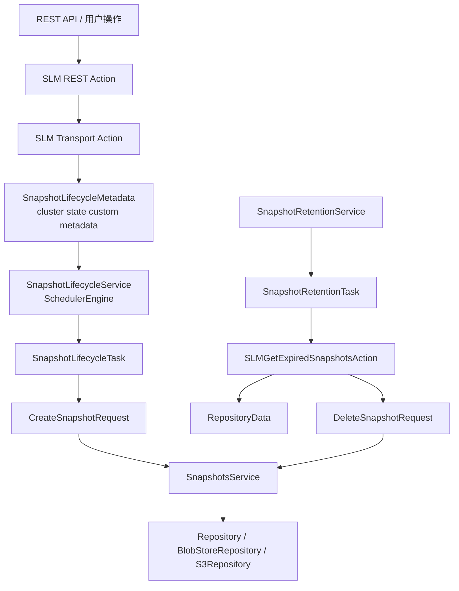

核心结论：

- `x-pack/plugin/slm` 负责 SLM 插件注册、调度、执行、retention、history、health。
- `x-pack/plugin/core/.../slm` 负责 SLM 的可序列化模型、cluster state metadata 和 action 定义。
- `server/.../snapshots` 负责普通 snapshot 的创建、删除、恢复编排。
- `server/.../repositories` 和 `modules/repository-s3` 负责仓库抽象和 S3 存储落地。

## 2. 源码入口地图

| 功能 | 关键类 | 说明 |
| --- | --- | --- |
| 插件注册 | `x-pack/plugin/slm/src/main/java/org/elasticsearch/xpack/slm/SnapshotLifecycle.java` | 注册 setting、REST handler、transport action、组件、health indicator。 |
| Policy 模型 | `x-pack/plugin/core/src/main/java/org/elasticsearch/xpack/core/slm/SnapshotLifecyclePolicy.java` | 用户提交的 SLM policy：`name`、`schedule`、`repository`、`config`、`retention`。 |
| Policy 元数据 | `x-pack/plugin/core/src/main/java/org/elasticsearch/xpack/core/slm/SnapshotLifecyclePolicyMetadata.java` | 包装 policy、执行 header、版本、修改时间、最近成功/失败。 |
| SLM cluster state | `x-pack/plugin/core/src/main/java/org/elasticsearch/xpack/core/slm/SnapshotLifecycleMetadata.java` | `Metadata.Custom`，保存所有 SLM policy、运行模式和统计。 |
| 创建/更新 policy | `x-pack/plugin/slm/src/main/java/org/elasticsearch/xpack/slm/action/TransportPutSnapshotLifecycleAction.java` | 校验 repository、schedule 间隔、保存 policy 到 cluster state。 |
| 删除 policy | `x-pack/plugin/slm/src/main/java/org/elasticsearch/xpack/slm/action/TransportDeleteSnapshotLifecycleAction.java` | 从 cluster state 移除 policy，并清理 stats 中该 policy 的指标。 |
| 自动调度 | `x-pack/plugin/slm/src/main/java/org/elasticsearch/xpack/slm/SnapshotLifecycleService.java` | master 节点监听 cluster state，根据 policy schedule 注册 `SchedulerEngine.Job`。 |
| 快照执行 | `x-pack/plugin/slm/src/main/java/org/elasticsearch/xpack/slm/SnapshotLifecycleTask.java` | 定时触发后构造 `CreateSnapshotRequest` 并调用普通 snapshot API。 |
| retention 调度 | `x-pack/plugin/slm/src/main/java/org/elasticsearch/xpack/slm/SnapshotRetentionService.java` | 根据 `slm.retention_schedule` 注册清理任务。 |
| retention 执行 | `x-pack/plugin/slm/src/main/java/org/elasticsearch/xpack/slm/SnapshotRetentionTask.java` | 找出启用 retention 的 policy，计算和删除过期 snapshot。 |
| 过期计算 | `x-pack/plugin/slm/src/main/java/org/elasticsearch/xpack/slm/SLMGetExpiredSnapshotsAction.java` | 读取 `RepositoryData`，按 policy 分组 snapshot，计算可删除列表。 |
| retention 规则 | `x-pack/plugin/core/src/main/java/org/elasticsearch/xpack/core/slm/SnapshotRetentionConfiguration.java` | 实现 `expire_after`、`min_count`、`max_count` 的判断。 |
| history | `x-pack/plugin/slm/src/main/java/org/elasticsearch/xpack/slm/history/SnapshotHistoryStore.java` | 将创建/删除历史异步写入 `.slm-history-*` data stream。 |
| health | `x-pack/plugin/slm/src/main/java/org/elasticsearch/xpack/slm/SlmHealthIndicatorService.java` | SLM 停止或连续失败过多时报告 YELLOW。 |

## 3. 插件启动和组件注册

SLM 插件入口是 `SnapshotLifecycle`，它继承 `Plugin` 并实现 `ActionPlugin`、`HealthPlugin`。

### 3.1 注册 settings

`SnapshotLifecycle#getSettings()` 注册以下 SLM setting：

- `slm.history_index_enabled`：是否写入 SLM history，默认 `true`。
- `slm.retention_schedule`：retention 定时清理 cron，默认 `0 30 1 * * ?`，即每天 1:30。
- `slm.retention_duration`：当前分支只看到 setting 注册，未在 retention 执行链路中看到消费点。
- `slm.minimum_interval`：policy schedule 最小间隔，默认 `15m`。
- `slm.health.failed_snapshot_warn_threshold`：health 中连续失败告警阈值，默认 `5`。

源码位置：

- `SnapshotLifecycle#getSettings()`：`x-pack/plugin/slm/src/main/java/org/elasticsearch/xpack/slm/SnapshotLifecycle.java`
- `LifecycleSettings` 中的 SLM setting 定义：`x-pack/plugin/core/src/main/java/org/elasticsearch/xpack/core/ilm/LifecycleSettings.java`

### 3.2 创建组件

`SnapshotLifecycle#createComponents()` 创建并初始化这些对象：

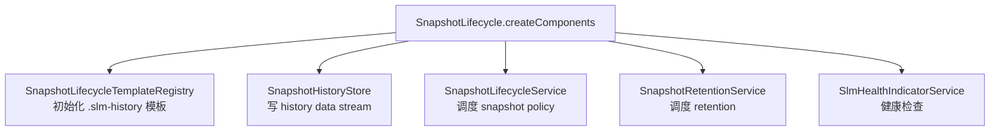

源码行为：

- 初始化 `SnapshotLifecycleTemplateRegistry`，准备 SLM history data stream 模板。
- 使用 `OriginSettingClient` 创建 `SnapshotHistoryStore`。
- 创建 `SnapshotLifecycleService`，内部持有 `SnapshotLifecycleTask`。
- 创建 `SnapshotRetentionService`，内部持有 `SnapshotRetentionTask`。
- 注册 `SlmHealthIndicatorService`。

## 4. 对外 API 面

`SnapshotLifecycle#getRestHandlers()` 注册的 REST 路由如下：

| REST API | 作用 |
| --- | --- |
| `PUT /_slm/policy/{name}` | 新增或更新 SLM policy。 |
| `GET /_slm/policy` | 查询所有 policy。 |
| `GET /_slm/policy/{name}` | 查询指定 policy。 |
| `DELETE /_slm/policy/{name}` | 删除指定 policy。 |
| `POST /_slm/policy/{name}/_execute` | 手动执行指定 policy。 |
| `PUT /_slm/policy/{name}/_execute` | 手动执行指定 policy，兼容 PUT。 |
| `GET /_slm/stats` | 查询 SLM 统计。 |
| `POST /_slm/_execute_retention` | 手动执行 retention 清理。 |
| `POST /_slm/start` | 启动 SLM 自动调度。 |
| `POST /_slm/stop` | 停止 SLM 自动调度。 |
| `GET /_slm/status` | 查询 SLM 运行模式。 |

对应 transport action 在 `SnapshotLifecycle#getActions()` 注册，包括：

- `PutSnapshotLifecycleAction -> TransportPutSnapshotLifecycleAction`
- `DeleteSnapshotLifecycleAction -> TransportDeleteSnapshotLifecycleAction`
- `GetSnapshotLifecycleAction -> TransportGetSnapshotLifecycleAction`
- `ExecuteSnapshotLifecycleAction -> TransportExecuteSnapshotLifecycleAction`
- `GetSnapshotLifecycleStatsAction -> TransportGetSnapshotLifecycleStatsAction`
- `ExecuteSnapshotRetentionAction -> TransportExecuteSnapshotRetentionAction`
- `StartSLMAction -> TransportStartSLMAction`
- `StopSLMAction -> TransportStopSLMAction`
- `GetSLMStatusAction -> TransportGetSLMStatusAction`

## 5. Policy 的数据结构

### 5.1 `SnapshotLifecyclePolicy`

`SnapshotLifecyclePolicy` 是用户提交的策略主体：

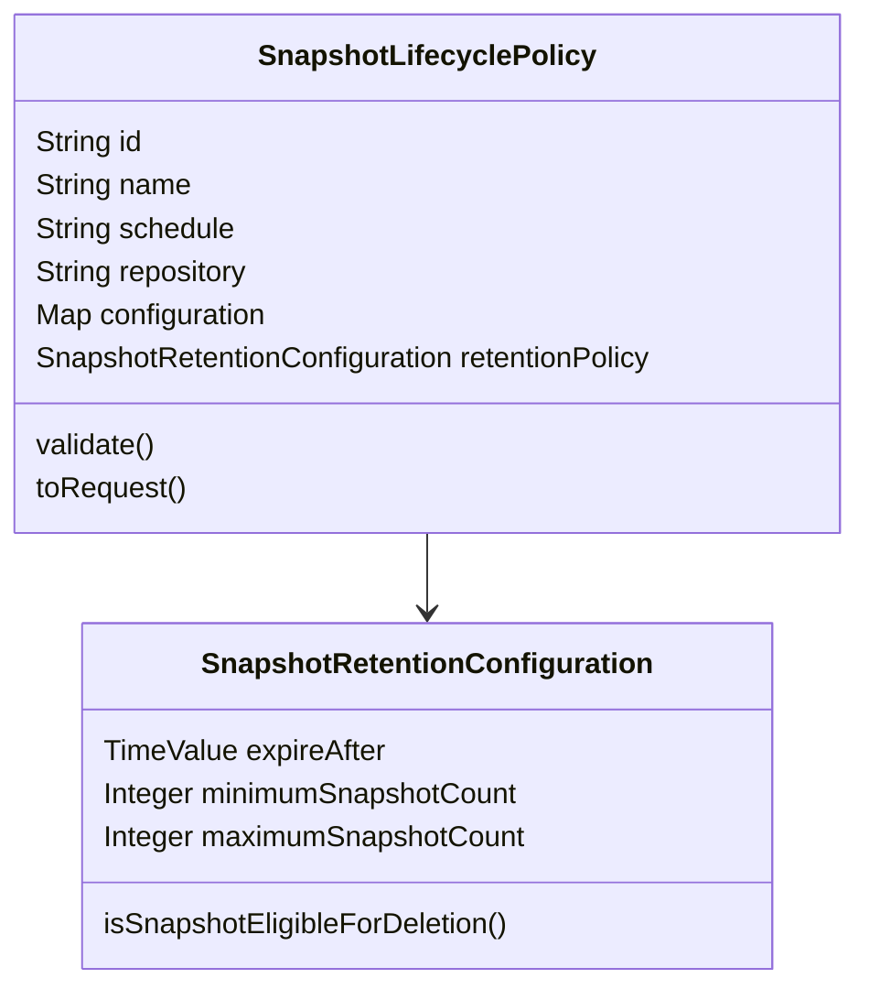

字段含义：

- `id`：policy id，来自 REST path 中的 `{name}`。
- `name`：snapshot 名称模板，支持 date math，执行时生成真实 snapshot 名。
- `schedule`：cron 表达式。
- `repository`：目标 snapshot repository。
- `configuration`：普通 `CreateSnapshotRequest` 的配置，比如 `indices`、`partial`、`include_global_state`、`feature_states`、`metadata`。
- `retentionPolicy`：快照保留规则，可为空。

### 5.2 `validate()` 做了什么

`SnapshotLifecyclePolicy#validate()` 负责静态校验：

- policy id 不能包含非法文件名字符，不能以 `_` 开头，不能超过索引名最大字节限制。
- 先根据 `name` 生成一次 snapshot 名，再调用 `validateGeneratedSnapshotName()` 校验。
- `schedule` 不能为空，且必须能被 `Cron` 解析。
- `configuration.metadata` 如果存在必须是对象。
- 用户不能自己设置 metadata 字段 `policy`，因为这是 SLM 保留字段，会由 SLM 自动写入。
- `repository` 不能为空。

是否存在 repository 不能只靠 policy 自身判断，所以放在 transport action 中结合 cluster state 校验。

### 5.3 `toRequest()` 是 SLM 接入普通 snapshot 的关键

`SnapshotLifecyclePolicy#toRequest()` 做三件关键事：

1. 用 `generateSnapshotName(this.name)` 解析 policy 中的 snapshot 名称模板。
2. 把 SLM policy id 写入 snapshot user metadata：`metadata.policy = this.id`。
3. 调 `CreateSnapshotRequest#source(mergedConfiguration)`，并设置 `waitForCompletion(true)`。

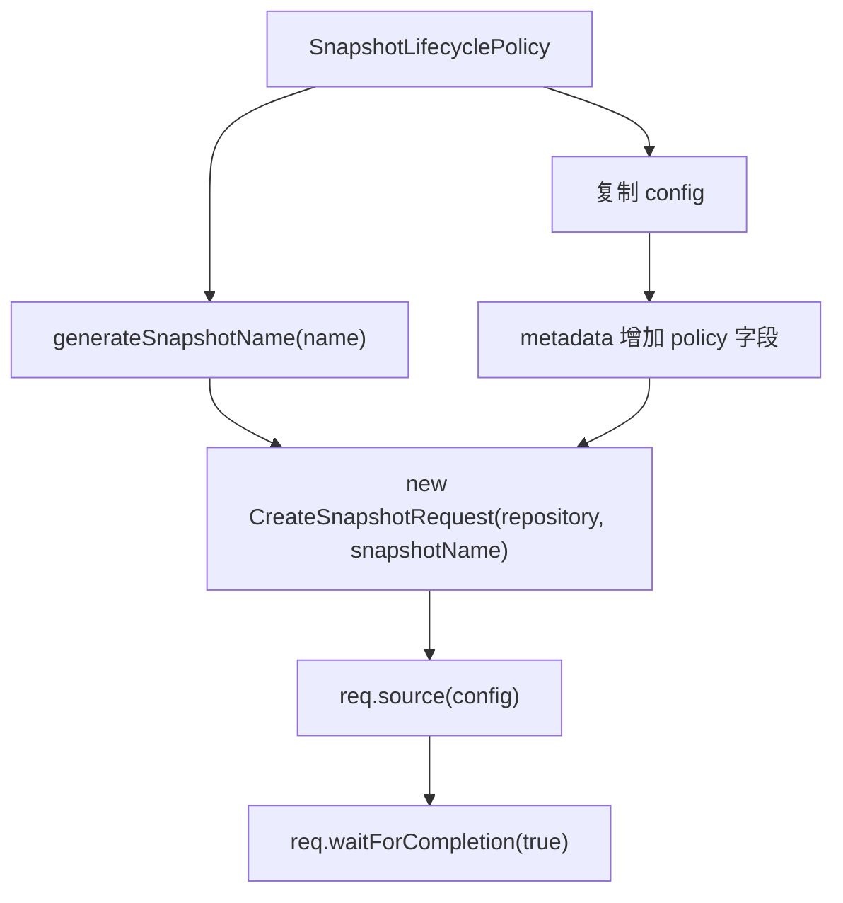

这个设计说明：SLM 创建 snapshot 并不是走另一套实现，而是把 policy 翻译成普通 `CreateSnapshotRequest`。

## 6. Policy 如何保存到 cluster state

SLM 的策略不是保存在单独业务索引里，而是放在 cluster state 的 custom metadata 中。

### 6.1 `SnapshotLifecyclePolicyMetadata`

`SnapshotLifecyclePolicyMetadata` 包装一条 policy，并额外保存：

- `headers`：创建 policy 时可持久化的安全 header，用于之后按原用户上下文执行 snapshot。
- `version`：policy 版本。每次更新 policy，版本递增。
- `modifiedDate`：最后修改时间。
- `lastSuccess`：最近一次成功记录。
- `lastFailure`：最近一次失败记录。
- `invocationsSinceLastSuccess`：自最近一次成功以来的连续失败/执行次数计数，health 会使用。

### 6.2 `SnapshotLifecycleMetadata`

`SnapshotLifecycleMetadata` 是 `Metadata.Custom`，字段包括：

- `snapshotConfigurations`：`Map<String, SnapshotLifecyclePolicyMetadata>`，保存所有 policy。
- `operationMode`：历史字段；当前代码更多通过 `LifecycleOperationMetadata.currentSLMMode()` 获取 SLM mode。
- `slmStats`：所有 policy 的统计。

### 6.3 新增/更新 policy 的源码链路

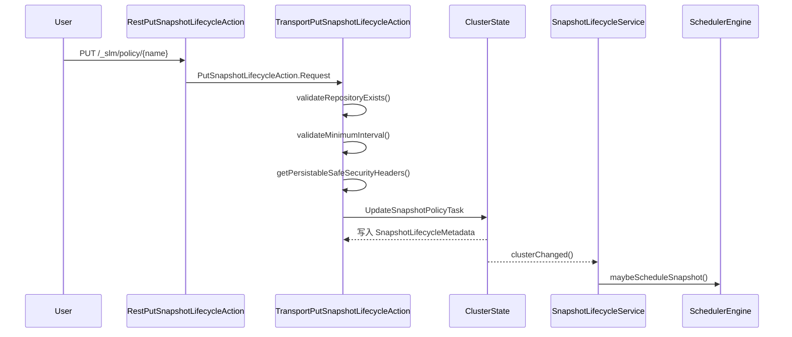

`TransportPutSnapshotLifecycleAction#masterOperation()` 主要步骤：

1. `validateRepositoryExists()`：确认 policy 指向的 repository 已注册。
2. `validateMinimumInterval()`：确认 cron 间隔不小于 `slm.minimum_interval`。
3. `ClientHelper.getPersistableSafeSecurityHeaders()`：保存可持久化的安全 header。
4. `LifecyclePolicy.validatePolicyName()`：校验 policy 名称。
5. 提交 `UpdateSnapshotPolicyTask` 更新 cluster state。

`UpdateSnapshotPolicyTask#execute()`：

- 如果当前还没有 SLM metadata，创建新的 `SnapshotLifecycleMetadata`。
- 如果已有 metadata，则复制 map，按 id 新增或更新 policy。
- 更新 policy 时 `version = oldVersion + 1`。
- 写回 `Metadata.Custom`，类型名是 `snapshot_lifecycle`。

## 7. Policy 如何被调度

调度由 `SnapshotLifecycleService` 完成。它是 `ClusterStateListener`，只在当前 master 节点注册 job。

### 7.1 master 变更

`clusterChanged()` 中：

- 如果本节点刚成为 master，则 `scheduler.register(snapshotTask)`。
- 如果本节点失去 master，则 `scheduler.unregister(snapshotTask)` 并取消所有 job。
- 如果 SLM 状态是 `STOPPING` 或 `STOPPED`，取消 job；如果是 `STOPPING`，进一步提交任务把状态改为 `STOPPED`。
- 正常情况下调用 `scheduleSnapshotJobs(state)` 和 `cleanupDeletedPolicies(state)`。

### 7.2 job id 设计

`getJobId(policyMeta)` 返回：

```text
<policy-id>-<version>
```

这样 policy 每次更新后版本递增，job id 也变化。`maybeScheduleSnapshot()` 会：

- 找出当前 policy id 对应的旧版本 job。
- 取消旧版本 job。
- 为当前版本创建 `SchedulerEngine.Job(jobId, new CronSchedule(policy.schedule))`。
- 放入 `scheduledTasks`。

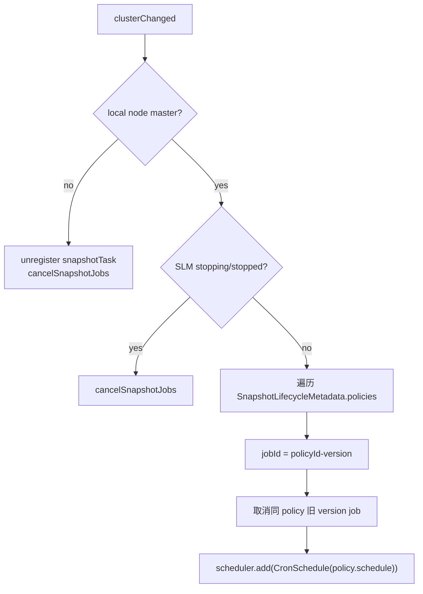

## 8. 到点后如何创建 snapshot

调度器触发 `SnapshotLifecycleTask#triggered()`：

1. 从 event 里取 job id。
2. 调用 `maybeTakeSnapshot(jobId, client, clusterService, historyStore)`。
3. 如果 job id 对应的 policy 已不存在，则不创建 snapshot。

### 8.1 找 policy

`getSnapPolicyMetadata(jobId, state)`：

- 从 cluster state 读取 `SnapshotLifecycleMetadata.TYPE`。
- 遍历所有 policy metadata。
- 通过 `SnapshotLifecycleService.getJobId(policyMeta)` 匹配当前 job id。

这也是 job id 带 version 的原因：旧 version 的 job 如果还触发，通常匹配不到最新 policy。

### 8.2 构造和执行 request

`maybeTakeSnapshot()` 关键流程：

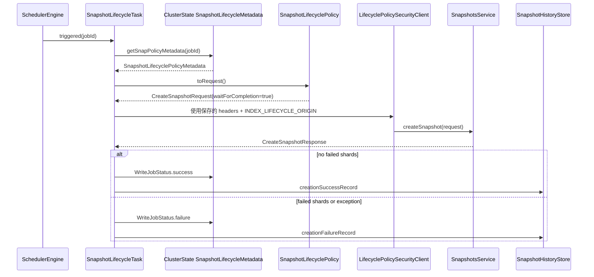

`LifecyclePolicySecurityClient` 会把保存的 security header 和 `INDEX_LIFECYCLE_ORIGIN` 绑定到 client 上。这样自动执行时仍然按创建 policy 的权限上下文运行。

### 8.3 和普通 snapshot 框架的连接

SLM 调用的是普通 `CreateSnapshotRequest`。普通 snapshot 创建入口：

- `TransportCreateSnapshotAction#masterOperation()`
- `SnapshotsService#createSnapshot()` 或 `SnapshotsService#executeSnapshot()`
- `SnapshotsService.SnapshotTaskExecutor#createSnapshot()`

其中 `SnapshotsService.SnapshotTaskExecutor#createSnapshot()` 会调用：

```java
indexNameExpressionResolver.concreteIndexNames(currentState, request)
```

这意味着 `config.indices` 中的通配符是在每次 snapshot 执行时按当时 cluster state 解析的。比如 policy 配置 `indices: ["order-*"]`，新增或删除匹配索引后，下一次 SLM 执行会自动反映。

## 9. 执行结果如何记录

`SnapshotLifecycleTask.WriteJobStatus` 是一个 cluster state update task，用来把本次执行结果写回 policy metadata 和 stats。

成功时：

- `stats.snapshotTaken(policyName)`。
- `lastSuccess = new SnapshotInvocationRecord(snapshotName, snapshotStartTime, snapshotFinishTime, null)`。
- `invocationsSinceLastSuccess = 0`。
- 写入 `SnapshotHistoryItem.creationSuccessRecord()`。

失败时：

- `stats.snapshotFailed(policyName)`。
- `lastFailure = new SnapshotInvocationRecord(snapshotName, null, finishTime, errorDetails)`。
- `invocationsSinceLastSuccess + 1`。
- 写入 `SnapshotHistoryItem.creationFailureRecord()`。

`SnapshotHistoryStore#putAsync()` 会检查：

- `slm.history_index_enabled` 是否开启。
- `.slm-history-*` data stream 或对应模板是否存在。
- 然后以 `CREATE` op 写入 history item。

注意：cluster state 中保存的是最新状态和统计，history data stream 保存的是可查询的历史流水。

## 10. retention 的整体实现

retention 分两段：

1. `SnapshotRetentionService` 负责调度 retention job。
2. `SnapshotRetentionTask` 负责扫描、计算、删除。

### 10.1 retention 调度

`SnapshotRetentionService`：

- 构造时读取 `slm.retention_schedule`。
- 注册 `SnapshotRetentionTask` 到 `SchedulerEngine`。
- 作为 `LocalNodeMasterListener`，只在 master 节点上调度。
- setting 更新时调用 `setUpdateSchedule()` 重新调度。
- 如果 schedule 为空，则取消 retention job。

默认 schedule 在 `LifecycleSettings` 中：

```text
slm.retention_schedule = 0 30 1 * * ?
```

也就是每天 1:30。

手动接口 `POST /_slm/_execute_retention` 走 `TransportExecuteSnapshotRetentionAction#masterOperation()`，最终调用 `SnapshotRetentionService#triggerRetention()`。

### 10.2 retention 执行主流程

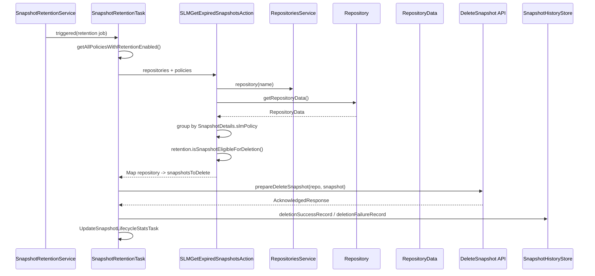

`SnapshotRetentionTask#triggered()` 关键点：

- 自动 job 在 SLM `STOPPING/STOPPED` 时跳过。
- 手动 retention job 不受这个限制，会继续执行。
- 只选择 `retentionPolicy != null` 且不等于 `SnapshotRetentionConfiguration.EMPTY` 的 policy。
- 按这些 policy 所在 repository 去拉 snapshot 信息。
- 删除完成后通过 `UpdateSnapshotLifecycleStatsTask` 合并本轮 stats。

### 10.3 为什么有 `SLMGetExpiredSnapshotsAction`

`SLMGetExpiredSnapshotsAction` 是一个 local-only transport action。源码注释说明它被单独拆出来，是为了能直接访问 `RepositoriesService`。

它做了这些事：

- 对每个 repository：
    - 如果 repository 不存在，跳过。
    - 如果 repository 是 read-only，跳过。
    - 调用 `repository.getRepositoryData()`。
    - 从 `RepositoryData` 收集 snapshot details。
    - 如果老仓库缺少 details，则回退读取 `SnapshotInfo`。
    - 按 `SnapshotDetails.getSlmPolicy()` 分组。
- 对每个 policy 分组：
    - policy 已不存在：不删。
    - policy 没有 retention：不删。
    - policy 当前 repository 和 snapshot 所在 repository 不一致：不删。
    - 调 `retention.isSnapshotEligibleForDeletion()` 判断。

这里也解释了一个重要现象：SLM retention 只处理带 SLM policy metadata 的 snapshot。普通手工 snapshot 如果没有 `metadata.policy`，不会进入 SLM retention 分组。

## 11. retention 规则细节

`SnapshotRetentionConfiguration` 支持三个字段：

- `expire_after`
- `min_count`
- `max_count`

判断函数是 `isSnapshotEligibleForDeletion(snapshotId, snapshotDetails, allSnapshots)`。

### 11.1 可参与判断的 snapshot 状态

SLM 过期计算关注的状态集合是：

- `SUCCESS`
- `FAILED`
- `PARTIAL`

`SLMGetExpiredSnapshotsAction.SnapshotDetailsByPolicy#add()` 只会把带 `slmPolicy` 的 snapshot 加入分组。

### 11.2 判断顺序

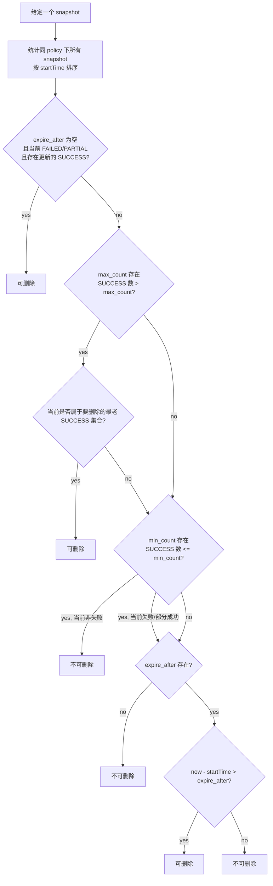

关键语义：

- `max_count` 优先让最老的成功 snapshot 可删除。
- `min_count` 是保护线，成功 snapshot 数不能被删到低于该值。
- `expire_after` 是最后的时间判断，而且源码用的是严格大于：`snapshotAge > expireAfter.getMillis()`。
- 如果没有 `expire_after`，但失败/部分成功 snapshot 后面已经有更新的成功 snapshot，则失败/部分成功 snapshot 可以被删。

## 12. 删除 snapshot 如何落到普通 snapshot 框架

`SnapshotRetentionTask#deleteSnapshot()` 并不直接删 S3 对象，而是调用：

```java
client.admin()
    .cluster()
    .prepareDeleteSnapshot(repo, snapshot.getName())
    .setMasterNodeTimeout(TimeValue.MAX_VALUE)
    .execute(...)
```

后续链路进入普通删除：

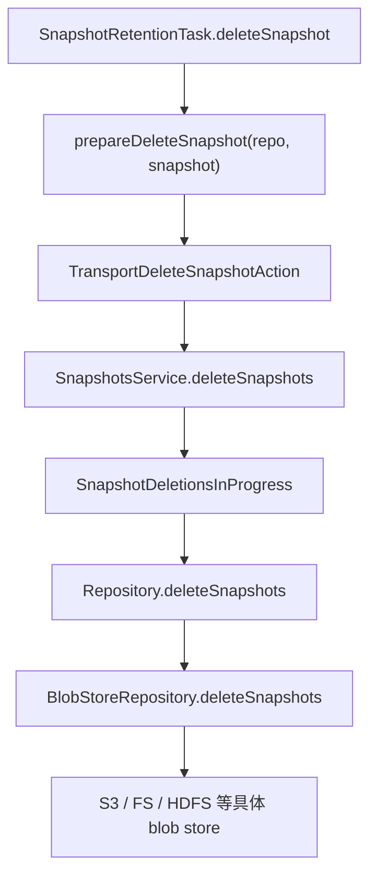

这说明 SLM retention 负责“什么时候删、删哪些”，不负责“怎么删仓库文件”。仓库 generation、`index-N`、blob 清理等一致性逻辑仍由 `SnapshotsService` 和 `BlobStoreRepository` 负责。

## 13. 查询、状态和统计

### 13.1 查询 policy

`TransportGetSnapshotLifecycleAction`：

- 从 `SnapshotLifecycleMetadata` 读取 policy。
- 从 `SnapshotsInProgress` 中找 user metadata 里带 `policy` 字段的 in-progress snapshot。
- 把 `SnapshotLifecyclePolicyMetadata`、当前 in-progress 状态、policy stats 包装成 `SnapshotLifecyclePolicyItem` 返回。

因此 `GET /_slm/policy/{name}` 能看到：

- policy 内容。
- 最近成功/失败。
- 下次执行时间。
- 当前是否有该 policy 创建的 snapshot 正在执行。
- policy 维度 stats。

### 13.2 查询 stats

`TransportGetSnapshotLifecycleStatsAction` 直接从 cluster state 的 `SnapshotLifecycleMetadata.getStats()` 返回统计。如果 SLM metadata 不存在，则返回空的 `SnapshotLifecycleStats`。

### 13.3 查询 status

`TransportGetSLMStatusAction` 返回 `LifecycleOperationMetadata.currentSLMMode(state)`。

`POST /_slm/start` 和 `POST /_slm/stop` 不会停止普通 snapshot 服务，只是改 SLM 自动化调度模式：

- start：提交 `OperationMode.RUNNING`。
- stop：提交 `OperationMode.STOPPING`。
- `SnapshotLifecycleService#clusterChanged()` 看到 `STOPPING` 后取消 job，并提交 `OperationMode.STOPPED`。

## 14. health 实现

`SlmHealthIndicatorService` 提供名为 `slm` 的 health indicator。

判断逻辑：

- 没有 SLM policy：`GREEN`，说明没有配置自动快照。
- 有 policy 但 SLM mode 不是 `RUNNING`：`YELLOW`，提示自动 snapshot 不会运行。
- SLM running，但某些 policy 连续失败次数达到 `slm.health.failed_snapshot_warn_threshold`：`YELLOW`。
- 其他情况：`GREEN`。

连续失败判断使用：

- `SnapshotLifecyclePolicyMetadata.lastFailure`
- `SnapshotLifecyclePolicyMetadata.lastSuccess`
- `SnapshotLifecyclePolicyMetadata.invocationsSinceLastSuccess`

## 15. 和普通 snapshot 创建流程的关系

SLM 创建 snapshot 后，后续完全进入普通 snapshot 框架。

普通创建流程简化如下：

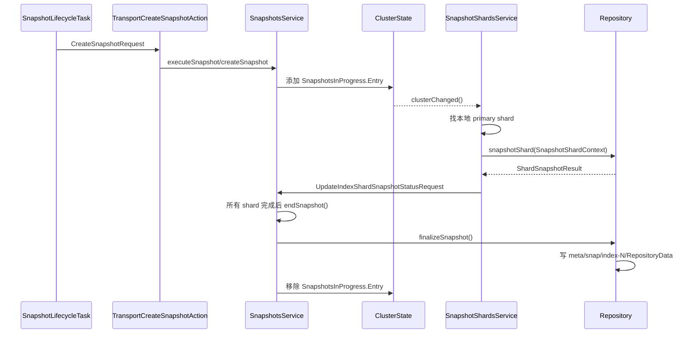

源码入口：

- `TransportCreateSnapshotAction#masterOperation()`
- `SnapshotsService#createSnapshot()`
- `SnapshotsService.SnapshotTaskExecutor#createSnapshot()`
- `SnapshotShardsService#snapshot()`
- `Repository#snapshotShard()`
- `Repository#finalizeSnapshot()`

SLM 关注的是 request 构造和执行结果记录，普通 snapshot 框架关注 shard 数据和仓库元数据。

## 16. SLM 与 S3 冷备的关系

S3 冷备的存储路径不在 SLM 中实现。SLM policy 的 `repository` 字段只写 repository 名：

```json
{
  "repository": "s3_repo"
}
```

当普通 snapshot 框架执行到 repository 层时，`RepositoriesService` 根据 repository metadata 找到具体实现。如果 repository 类型是 `s3`，则由 `S3RepositoryPlugin` 注册的 `S3Repository` 处理 blob 读写。

因此分层是：

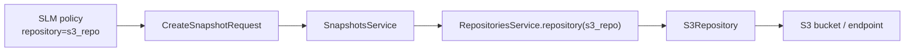

SLM 不关心 bucket、endpoint、client、credentials，也不关心 S3 multipart upload。那些都属于 `modules/repository-s3` 和 `BlobStoreRepository` 层。

## 17. 一个完整例子

下面的 policy 每天 2 点备份 `order-*`，写入 `s3_repo`，保留至少 7 个成功 snapshot，最多 60 个，超过 30 天的可删除。

```json
PUT /_slm/policy/order_daily
{
  "schedule": "0 0 2 * * ?",
  "name": "<order-daily-{now/d}>",
  "repository": "s3_repo",
  "config": {
    "indices": ["order-*"],
    "ignore_unavailable": true,
    "include_global_state": false
  },
  "retention": {
    "expire_after": "30d",
    "min_count": 7,
    "max_count": 60
  }
}
```

执行后的源码层状态变化：

1. `TransportPutSnapshotLifecycleAction` 写入 `SnapshotLifecycleMetadata.policies.order_daily`。
2. `SnapshotLifecycleService` 在 master 上调度 job：`order_daily-1`。
3. 到点后 `SnapshotLifecycleTask` 调 `SnapshotLifecyclePolicy#toRequest()`。
4. `CreateSnapshotRequest` 的 metadata 自动带上：

```json
{
  "policy": "order_daily"
}
```

5. 普通 snapshot 框架在执行时解析 `order-*`，把当时存在的匹配索引纳入 snapshot。
6. 成功后 `WriteJobStatus` 更新 `last_success` 和 stats，`SnapshotHistoryStore` 写入 `.slm-history-*`。
7. retention 任务下一次运行时，从 `RepositoryData.SnapshotDetails.slmPolicy` 找到属于 `order_daily` 的 snapshot，按 retention 规则判断并删除。

## 18. 常见理解误区

### 18.1 SLM 停止不等于 snapshot 服务停止

`POST /_slm/stop` 只是停止 SLM 自动调度。手工调用普通 snapshot API 仍可使用。当前源码里手动执行 policy 和手动 retention 也没有被自动调度状态完全阻断。

### 18.2 `expire_after` 到点不代表马上删除

`expire_after` 只让 snapshot 在 retention 计算时变成 eligible。真正删除发生在下一次 `slm.retention_schedule` 触发，或者手动 `POST /_slm/_execute_retention`。

### 18.3 删除 SLM policy 不会自动删除历史 snapshot

retention 计算中，如果 snapshot 的 `policy` 指向一个已不存在的 policy，会被认为是 unknown policy，源码选择不删除。也就是说删 policy 只是停止后续自动管理，不等于删除该 policy 创建过的 snapshot。

### 18.4 readonly repository 会跳过 retention

`SLMGetExpiredSnapshotsAction` 遇到 `repository.isReadOnly()` 会跳过，不会尝试删除。这和“只读仓库可能有其他集群在写”的一致性假设一致。

### 18.5 `metadata.policy` 是保留字段

用户在 policy `config.metadata` 中不能手动写 `policy` 字段。`SnapshotLifecyclePolicy#validate()` 会拒绝，因为 SLM 要用该字段标识 snapshot 归属。

### 18.6 当前分支的 `slm.retention_duration`

当前源码中可以看到 `slm.retention_duration` 被注册为 dynamic node setting，但通过源码搜索只发现注册点，没有在 `SnapshotRetentionTask` 或 `SLMGetExpiredSnapshotsAction` 中看到实际消费。分析当前分支时，不应把它理解为 retention 执行循环的硬性超时。

## 19. 调试和源码跟踪建议

定位 SLM 问题时可以按下面顺序查：

1. `GET /_slm/status`：确认 SLM 是否 `RUNNING`。
2. `GET /_slm/policy/{id}?human`：看 policy、最近成功/失败、next execution、in-progress。
3. `GET /_slm/stats`：看 policy stats 和 retention stats。
4. 查看 cluster state 中 `snapshot_lifecycle` custom metadata：确认 policy 是否存在、version 是否变化。
5. 若定时不触发，看 `SnapshotLifecycleService#clusterChanged()` 和 `maybeScheduleSnapshot()`。
6. 若创建失败，看 `SnapshotLifecycleTask#maybeTakeSnapshot()` 和普通 `SnapshotsService#createSnapshot()`。
7. 若 retention 不删除，看 `SnapshotRetentionTask#getAllPoliciesWithRetentionEnabled()`、`SLMGetExpiredSnapshotsAction#getSnapshotsToDelete()`、`SnapshotRetentionConfiguration#isSnapshotEligibleForDeletion()`。
8. 若 S3 上没有变化，继续进入 `SnapshotsService.deleteSnapshots()`、`BlobStoreRepository.deleteSnapshots()`、`S3Repository`。

## 20. 总结

SLM 的核心设计是“策略元数据放 cluster state，调度只在 master，执行复用普通 snapshot API，retention 复用普通 delete snapshot API”。这让 SLM 本身保持较薄：它只决定何时创建、何时删除、用哪个用户上下文执行、如何记录历史和统计；真正的数据一致性、仓库 generation、对象存储读写都由已有 snapshot/repository 框架承担。
