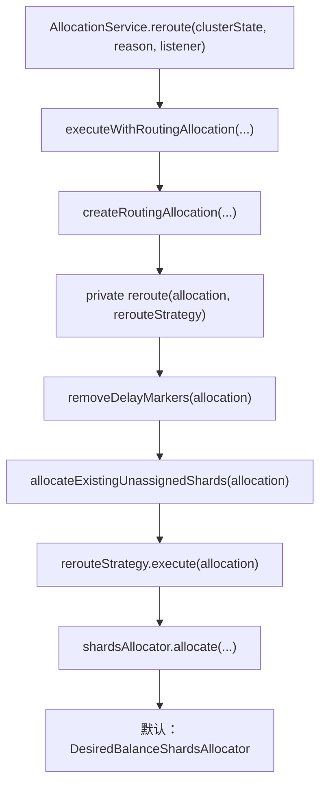
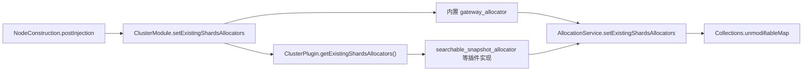
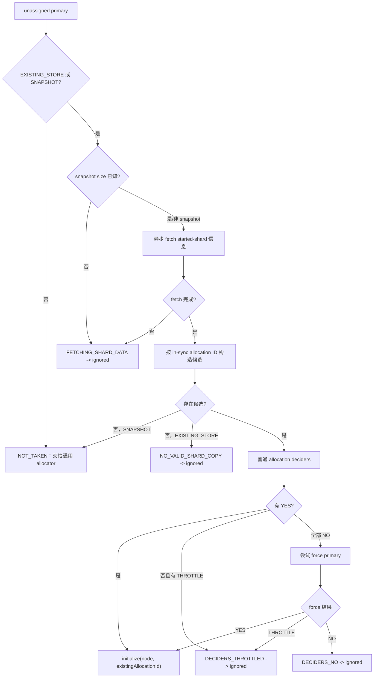
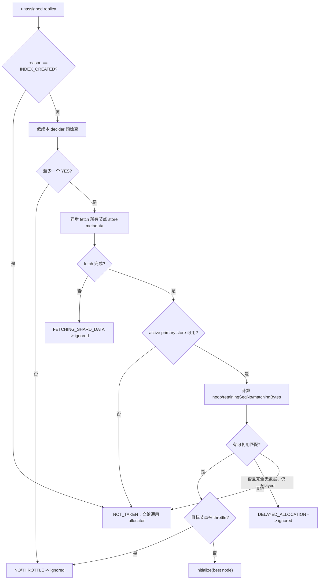
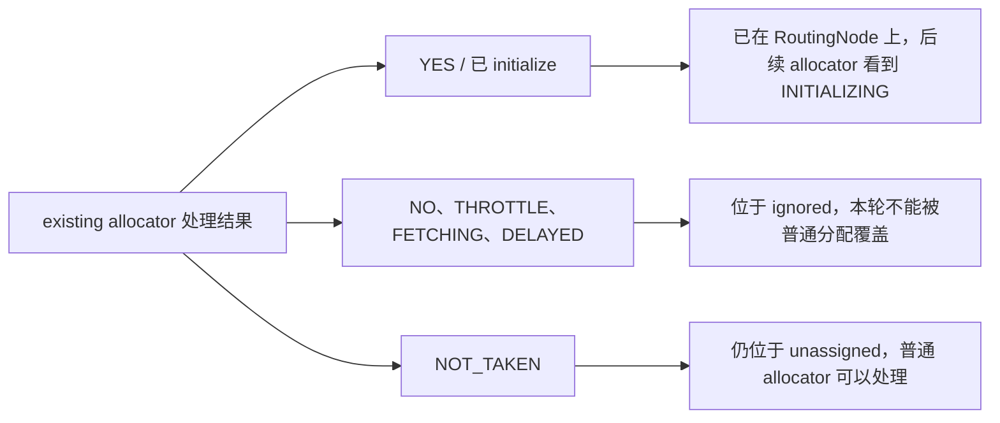
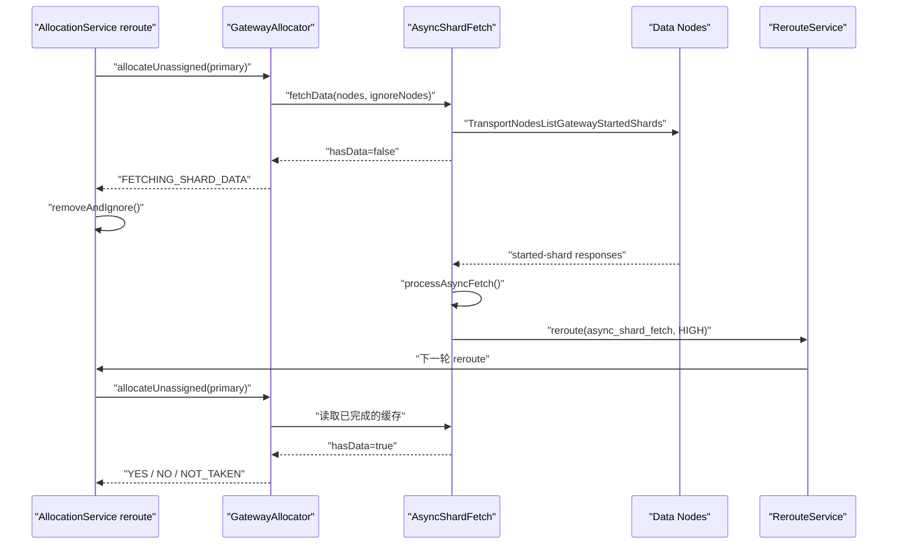

# `allocateExistingUnassignedShards` 源码跟踪

> 仓库：`elasticsearch-didi`
>
> 基线提交：`d781f5026b34`
>
> 目标方法：`AllocationService#allocateExistingUnassignedShards(RoutingAllocation)`
>
> 目标源码：[`AllocationService.java`](../server/src/main/java/org/elasticsearch/cluster/routing/allocation/AllocationService.java#L534-L560)

## 1. 结论先行

`allocateExistingUnassignedShards()` 不是一个完整的通用分片分配器，而是普通分配/均衡之前的一层“已有数据优先”处理器。它的职责可以概括为：

1. 按索引优先级整理本轮的未分配分片。
2. 让所有 `ExistingShardsAllocator` 做本轮开始前的准备。
3. 先处理全部 primary，再处理 replica。
4. 针对每个分片，根据索引私有设置选择唯一的 `ExistingShardsAllocator`。
5. allocator 如果找到值得复用的已有数据，就直接初始化分片；如果仍在抓取数据、需要延迟、被限流或明确不能分配，就把分片移入本轮 `ignored` 队列；如果返回 `NOT_TAKEN`，则把分片留给后续通用 `ShardsAllocator`。

它最关键的语义不是“把所有未分配分片都分出去”，而是决定每个分片在本轮走向哪一条路径：

```text
找到合适的已有副本/缓存  -> initialize()       -> 本轮直接进入 INITIALIZING
暂时不能做出安全决定      -> removeAndIgnore()  -> 本轮禁止通用 allocator 接手
不属于自己的职责          -> NOT_TAKEN          -> 留在 unassigned，交给通用 allocator
```

默认情况下，已有数据查找由 `GatewayAllocator` 完成；挂载的 searchable snapshot 索引则可以由插件提供的 `SearchableSnapshotAllocator` 完成。该阶段结束后，普通 reroute 会继续调用默认的 `DesiredBalanceShardsAllocator`，或节点配置中选择的其他 `ShardsAllocator`。

## 2. 总体调用链

标准 reroute 的关键调用关系如下：



入口源码位于：

- [`AllocationService#reroute(ClusterState, String, ActionListener)`](../server/src/main/java/org/elasticsearch/cluster/routing/allocation/AllocationService.java#L392-L398)
- [`AllocationService#executeWithRoutingAllocation`](../server/src/main/java/org/elasticsearch/cluster/routing/allocation/AllocationService.java#L409-L417)
- [`AllocationService#reroute(RoutingAllocation, RerouteStrategy)`](../server/src/main/java/org/elasticsearch/cluster/routing/allocation/AllocationService.java#L523-L532)

私有 `reroute()` 的执行顺序是：

```java
rerouteStrategy.removeDelayMarkers(allocation);
allocateExistingUnassignedShards(allocation);
rerouteStrategy.execute(allocation);
```

这里有两个顺序保证：

- 已经过期的 delayed marker 先被清除，因此 existing allocator 看到的是本轮最新的延迟状态。
- existing allocator 先于通用 `ShardsAllocator` 执行，因此已有磁盘副本、已有 replica store、searchable snapshot 缓存具有优先选择权。

## 3. 目标方法完整源码

```java
private void allocateExistingUnassignedShards(RoutingAllocation allocation) {
    allocation.routingNodes().unassigned().sort(PriorityComparator.getAllocationComparator(allocation));

    for (final ExistingShardsAllocator existingShardsAllocator : existingShardsAllocators.values()) {
        existingShardsAllocator.beforeAllocation(allocation);
    }

    final RoutingNodes.UnassignedShards.UnassignedIterator primaryIterator =
        allocation.routingNodes().unassigned().iterator();
    while (primaryIterator.hasNext()) {
        final ShardRouting shardRouting = primaryIterator.next();
        if (shardRouting.primary()) {
            getAllocatorForShard(shardRouting, allocation)
                .allocateUnassigned(shardRouting, allocation, primaryIterator);
        }
    }

    for (final ExistingShardsAllocator existingShardsAllocator : existingShardsAllocators.values()) {
        existingShardsAllocator.afterPrimariesBeforeReplicas(allocation);
    }

    final RoutingNodes.UnassignedShards.UnassignedIterator replicaIterator =
        allocation.routingNodes().unassigned().iterator();
    while (replicaIterator.hasNext()) {
        final ShardRouting shardRouting = replicaIterator.next();
        if (shardRouting.primary() == false) {
            getAllocatorForShard(shardRouting, allocation)
                .allocateUnassigned(shardRouting, allocation, replicaIterator);
        }
    }
}
```

方法只有 27 行，但包含四轮遍历：

| 轮次 | 遍历对象 | 作用 |
| --- | --- | --- |
| 1 | `existingShardsAllocators.values()` | 执行所有 allocator 的 `beforeAllocation()` |
| 2 | 当前 `unassigned` 主队列 | 只处理 primary |
| 3 | `existingShardsAllocators.values()` | 执行所有 allocator 的 `afterPrimariesBeforeReplicas()` |
| 4 | 更新后的 `unassigned` 主队列 | 只处理 replica |

第二轮和第四轮不是对同一份静态快照遍历。primary allocator 可以在第二轮中把分片初始化、移入 ignored，第三轮回调还可以取消既有 replica recovery 并产生新的 unassigned replica；第四轮会基于这些变化重新创建 iterator。

## 4. 第一步：未分配分片排序

目标方法首先执行：

```java
allocation.routingNodes()
    .unassigned()
    .sort(PriorityComparator.getAllocationComparator(allocation));
```

`PriorityComparator` 的比较顺序为：

1. system index 优先于非 system index。
2. `index.priority` 较大的索引优先。
3. 创建时间较新的索引优先。
4. 如果仍相同，索引名按逆字典序排列。
5. 同一索引的两个分片返回相等的比较结果。

源码：[`PriorityComparator`](../server/src/main/java/org/elasticsearch/gateway/PriorityComparator.java#L30-L69)

排序只改变 `RoutingNodes.UnassignedShards` 中主 `unassigned` 列表的遍历顺序，并不直接做任何分配。底层调用 `CollectionUtil.timSort()`：

```java
public void sort(Comparator<ShardRouting> comparator) {
    nodes.ensureMutable();
    CollectionUtil.timSort(unassigned, comparator);
}
```

这样做的目的，是让有限的 recovery 并发额度优先被高优先级索引使用。`AllocationServiceTests#testAssignsPrimariesInPriorityOrderThenReplicas()` 通过把每个节点的 incoming recovery 限制为 1，验证了 high-priority primary 会先于 medium/low-priority primary 得到处理。

## 5. 第二步：`beforeAllocation()` 生命周期回调

排序完成后，方法会对所有已注册的 `ExistingShardsAllocator` 调用：

```java
existingShardsAllocator.beforeAllocation(allocation);
```

这不是“选择 allocator”的步骤。即使本轮没有任何索引使用某个 allocator，它也会收到回调。接口约定允许实现清理或刷新本轮需要的缓存。

### 5.1 `GatewayAllocator#beforeAllocation()`

[`GatewayAllocator#beforeAllocation`](../server/src/main/java/org/elasticsearch/gateway/GatewayAllocator.java#L111-L116) 调用 `ensureAsyncFetchStorePrimaryRecency()`：

- 对比当前 data node 的 ephemeral ID 与上一轮记录。
- 如果出现新 data node，清除 replica store async-fetch 缓存中当前 primary 节点的条目。
- 这样可以避免节点离开、数据继续写入、节点再次加入后，allocator 使用过期的 primary store 元数据错误地取消 recovery。

这里选择的是“新节点出现时失效”而不是每轮全量清空，兼顾了数据新鲜度与远程 store metadata 请求成本。

### 5.2 `SearchableSnapshotAllocator#beforeAllocation()`

[`SearchableSnapshotAllocator#beforeAllocation`](../x-pack/plugin/searchable-snapshots/src/main/java/org/elasticsearch/xpack/searchablesnapshots/allocation/SearchableSnapshotAllocator.java#L105-L125) 会检查集群是否包含 partial searchable snapshot index：

- 存在 partial index：让 `FrozenCacheInfoService` 更新当前 routing nodes。
- 不存在 partial index：用空节点集清除既有条目并停止后续重试。

### 5.3 allocator 间的回调顺序

`ClusterModule` 用 `HashMap` 汇总内置和插件 allocator，`AllocationService` 只把它包装为不可修改 map。因此不同 allocator 之间的 `beforeAllocation()` 和 `afterPrimariesBeforeReplicas()` 调用顺序不应被视为稳定契约；allocator 实现不能依赖另一个 allocator 一定先执行。

## 6. 第三步：先遍历 primary

primary 阶段创建第一个 `UnassignedIterator`：

```java
while (primaryIterator.hasNext()) {
    final ShardRouting shardRouting = primaryIterator.next();
    if (shardRouting.primary()) {
        getAllocatorForShard(shardRouting, allocation)
            .allocateUnassigned(shardRouting, allocation, primaryIterator);
    }
}
```

注意以下行为：

- iterator 仍会经过 replica，只是通过 `primary()` 判断跳过它们。
- primary allocator 返回 `NOT_TAKEN` 时，该 primary 仍留在主 `unassigned` 列表中。
- primary allocator 调用 `initialize()` 时，该 primary 从 `unassigned` 移除并加入目标 `RoutingNode`，状态变为 `INITIALIZING`。
- primary allocator 调用 `removeAndIgnore()` 时，该 primary 从主列表移入 `ignored`，后续通用 allocator 在本轮看不到它。

先 primary 后 replica 是强语义，而不仅是性能优化。replica 的已有数据选择依赖 active primary 的 store metadata、retention lease 和 sync ID；如果把两者混在一起处理，replica 可能基于尚未稳定的 primary 状态做决定。

## 7. 每个分片如何选择 allocator

[`AllocationService#getAllocatorForShard`](../server/src/main/java/org/elasticsearch/cluster/routing/allocation/AllocationService.java#L672-L679) 的逻辑是：

```java
final String allocatorName = ExistingShardsAllocator.EXISTING_SHARDS_ALLOCATOR_SETTING.get(
    routingAllocation.metadata().getIndexSafe(shardRouting.index()).getSettings()
);
final ExistingShardsAllocator existingShardsAllocator = existingShardsAllocators.get(allocatorName);
return existingShardsAllocator != null
    ? existingShardsAllocator
    : new NotFoundAllocator(allocatorName);
```

选择维度是“分片所属索引”，设置定义为：

```text
index.allocation.existing_shards_allocator
```

该设置具有 `IndexScope` 和 `PrivateIndex` 属性，默认值是：

```text
gateway_allocator
```

定义位置：[`ExistingShardsAllocator#EXISTING_SHARDS_ALLOCATOR_SETTING`](../server/src/main/java/org/elasticsearch/cluster/routing/allocation/ExistingShardsAllocator.java#L30-L36)

因此，同一轮 reroute 中可以出现：

```text
普通索引 A -> gateway_allocator
普通索引 B -> gateway_allocator
searchable snapshot 索引 C -> searchable_snapshot_allocator
```

每个分片只会被设置所指定的一个 existing allocator 处理，不会依次尝试 map 中的所有 allocator。

### 7.1 allocator 的注册过程

注册链如下：



关键点：

- 内置 `GatewayAllocator` 总是以 `gateway_allocator` 注册。
- 每个 `ClusterPlugin` 可以返回额外的 `Map<String, ExistingShardsAllocator>`。
- allocator name 重复会直接抛出 `IllegalArgumentException`。
- `AllocationService#setExistingShardsAllocators()` 断言只能设置一次且 map 不能为空。
- 注入发生在 [`NodeConstruction#postInjection`](../server/src/main/java/org/elasticsearch/node/NodeConstruction.java#L1236-L1272)，用于闭合“allocator 异步完成后需要触发 reroute，而 reroute 又依赖 allocation service”的循环依赖。

注册源码：

- [`ClusterModule#setExistingShardsAllocators`](../server/src/main/java/org/elasticsearch/cluster/ClusterModule.java#L445-L465)
- [`ClusterPlugin#getExistingShardsAllocators`](../server/src/main/java/org/elasticsearch/plugins/ClusterPlugin.java#L55-L63)
- [`SearchableSnapshots#getExistingShardsAllocators`](../x-pack/plugin/searchable-snapshots/src/main/java/org/elasticsearch/xpack/searchablesnapshots/SearchableSnapshots.java#L518-L521)

### 7.2 allocator 名称不存在

如果索引设置引用了当前节点未注册的 allocator，`getAllocatorForShard()` 不抛异常，而是临时创建 `NotFoundAllocator`。

[`AllocationService.NotFoundAllocator`](../server/src/main/java/org/elasticsearch/cluster/routing/allocation/AllocationService.java#L691-L749) 的分配行为是：

```java
unassignedAllocationHandler.removeAndIgnore(
    AllocationStatus.NO_VALID_SHARD_COPY,
    allocation.changes()
);
```

这会阻止后续通用 allocator 绕过缺失插件直接分配该分片。allocation explain 会为每个节点返回标签为 `allocator_plugin` 的 `NO` 决策，并提示所需 allocator 可能对应未安装的插件。

## 8. `ExistingShardsAllocator` 接口契约

接口定义：[`ExistingShardsAllocator`](../server/src/main/java/org/elasticsearch/cluster/routing/allocation/ExistingShardsAllocator.java#L25-L122)

它包含三组能力：

### 8.1 reroute 内部生命周期

```text
beforeAllocation(allocation)
allocateUnassigned(primary...)
afterPrimariesBeforeReplicas(allocation)
allocateUnassigned(replica...)
```

### 8.2 集群事件与缓存生命周期

- `cleanCaches()`：master 身份开始或结束时清理在途活动。
- `applyStartedShards()`：分片启动后清理对应 fetch cache。
- `applyFailedShards()`：分片失败后清理对应 fetch cache。
- `getNumberOfInFlightFetches()`：报告 allocator 控制的在途请求数。

`AllocationService` 会把 started/failed shard 事件广播给所有 registered allocator，并对在途 fetch 数求和。

### 8.3 受限的队列修改接口

allocator 得到的不是任意 `RoutingNodes` 写权限，而是 `UnassignedAllocationHandler`：

- `initialize(nodeId, existingAllocationId, expectedShardSize, observer)`
- `removeAndIgnore(allocationStatus, observer)`
- `updateUnassigned(unassignedInfo, recoverySource, observer)`

该限制让 allocator 只能操作 iterator 当前指向的未分配分片，减少直接破坏 routing invariants 的风险。

## 9. `UnassignedIterator` 如何落实分配结果

实现位置：[`RoutingNodes.UnassignedShards.UnassignedIterator`](../server/src/main/java/org/elasticsearch/cluster/routing/RoutingNodes.java#L1036-L1130)

### 9.1 `initialize()`

```java
innerRemove();
return nodes.initializeShard(
    current,
    nodeId,
    existingAllocationId,
    expectedShardSize,
    routingChangesObserver
);
```

执行效果：

1. 从主 `unassigned` 列表移除当前分片。
2. 如果是 primary，递减 `primaries` 计数。
3. 在目标 `RoutingNode` 上初始化分片。
4. existing primary 可以复用 allocator 选出的 allocation ID；replica 通常传 `null` 生成新 allocation ID。

### 9.2 `removeAndIgnore()`

```java
innerRemove();
ignoreShard(current, attempt, changes);
```

执行效果：

1. 从主 `unassigned` 列表移除当前分片。
2. 放入单独的 `ignored` 列表。
3. 后续 allocator 在本轮不会再次尝试该分片。

`ignoreShard()` 有一个容易忽略的实现细节：

- primary：递增 `ignoredPrimaries`，并在状态变化时重建 `UnassignedInfo`，写入本次 `AllocationStatus`。
- replica：直接加入 `ignored` 列表，不在这里重建 `UnassignedInfo`，因此它可能保留之前的 `lastAllocationStatus`。

源码：[`UnassignedShards#ignoreShard`](../server/src/main/java/org/elasticsearch/cluster/routing/RoutingNodes.java#L1003-L1028)

这个差异不影响“本轮屏蔽”语义，但分析 replica 的 explain/status 时不能简单假设传入 `removeAndIgnore()` 的状态一定已经写回 replica 的 `UnassignedInfo`。

### 9.3 `updateUnassigned()`

该操作不移出主队列，而是原位替换当前 `ShardRouting` 的 `UnassignedInfo` 和 `RecoverySource`，并通知 `RoutingChangesObserver`。

`SearchableSnapshotAllocator` 使用它把 primary 的 recovery source 修正为当前 repository/snapshot 对应的 `SnapshotRecoverySource`，随后继续在同一个 iterator 位置做 allocation decision。

### 9.4 禁止普通 `remove()`

`UnassignedIterator#remove()` 直接抛出 `UnsupportedOperationException`。调用方必须明确选择：

- `initialize()`：真正分配；
- `removeAndIgnore()`：本轮认领但暂不分配。

这避免分片被无状态地从未分配列表中删除。

## 10. 决策与队列状态矩阵

`BaseGatewayShardAllocator#allocateUnassigned()` 把 `AllocateUnassignedDecision` 转换为 iterator 操作：

| decision | handler 操作 | 主 `unassigned` | `ignored` | 通用 allocator 本轮是否接手 |
| --- | --- | --- | --- | --- |
| `NOT_TAKEN` | 不操作，直接返回 | 保留 | 不加入 | 是 |
| `YES` | `initialize()` | 移除 | 不加入 | 否，已经开始恢复 |
| `NO` | `removeAndIgnore()` | 移除 | 加入 | 否 |
| `THROTTLE` | `removeAndIgnore()` | 移除 | 加入 | 否 |
| `FETCHING_SHARD_DATA` 对应的 `NO` | `removeAndIgnore()` | 移除 | 加入 | 否 |
| `DELAYED_ALLOCATION` 对应的 `NO` | `removeAndIgnore()` | 移除 | 加入 | 否 |

源码：[`BaseGatewayShardAllocator#allocateUnassigned`](../server/src/main/java/org/elasticsearch/gateway/BaseGatewayShardAllocator.java#L45-L67)

`NOT_TAKEN` 和 `NO` 的区别至关重要：

- `NOT_TAKEN` 表示“这不是我的职责，允许下游正常分配”。
- `NO` 表示“这是我的职责，而且当前不能安全分配，禁止下游绕过我”。

## 11. 默认实现：`GatewayAllocator`

`GatewayAllocator` 是一个门面，内部组合：

- `PrimaryShardAllocator`
- `ReplicaShardAllocator`
- primary 的 `asyncFetchStarted` 缓存
- replica 的 `asyncFetchStore` 缓存

[`GatewayAllocator#allocateUnassigned`](../server/src/main/java/org/elasticsearch/gateway/GatewayAllocator.java#L127-L152) 只根据 `shardRouting.primary()` 转发：

```text
primary == true  -> PrimaryShardAllocator.allocateUnassigned()
primary == false -> ReplicaShardAllocator.allocateUnassigned()
```

两个内部 allocator 都继承 `BaseGatewayShardAllocator`，因此最终使用上一节的统一决策到队列状态映射。

## 12. primary 详细路径：`PrimaryShardAllocator`

核心方法：[`PrimaryShardAllocator#makeAllocationDecision`](../server/src/main/java/org/elasticsearch/gateway/PrimaryShardAllocator.java#L66-L230)

### 12.1 是否属于 primary allocator

只有同时满足以下条件才处理：

```text
是 primary
且处于 UNASSIGNED
且 RecoverySource.Type 是 EXISTING_STORE 或 SNAPSHOT
```

`EMPTY_STORE`、`LOCAL_SHARDS` 等其他 recovery source 返回 `NOT_TAKEN`，由后续通用 allocator 选择节点。

### 12.2 snapshot shard size 是否已经取得

如果 recovery source 是 `SNAPSHOT`，但 `SnapshotShardSizeInfo` 还没有该 shard 的大小：

```text
decision = NO(FETCHING_SHARD_DATA)
```

该 primary 被移入 `ignored`，等待 snapshot size 获取完成后的下一轮 reroute。

### 12.3 异步获取各节点的 started-shard 信息

`GatewayAllocator.InternalPrimaryShardAllocator#fetchData()` 为 shard 创建或复用：

```text
AsyncShardFetch<NodeGatewayStartedShards>
```

它通过 `TransportNodesListGatewayStartedShards` 向 data nodes 获取：

- allocation ID
- 该 store 是否曾是 primary
- store 是否能打开及相关异常

如果任一目标节点仍在异步抓取：

```text
allocation.setHasPendingAsyncFetch()
decision = NO(FETCHING_SHARD_DATA)
```

cluster-state update 线程不会同步等待网络结果。异步响应处理完成后，`InternalAsyncFetch#reroute()` 以 `Priority.HIGH` 调度原因是 `async_shard_fetch` 的新一轮 reroute。

相关源码：

- [`GatewayAllocator.InternalPrimaryShardAllocator#fetchData`](../server/src/main/java/org/elasticsearch/gateway/GatewayAllocator.java#L242-L278)
- [`AsyncShardFetch#fetchData`](../server/src/main/java/org/elasticsearch/gateway/AsyncShardFetch.java#L92-L153)
- [`AsyncShardFetch#processAsyncFetch`](../server/src/main/java/org/elasticsearch/gateway/AsyncShardFetch.java#L161-L238)
- [`GatewayAllocator.InternalAsyncFetch#reroute`](../server/src/main/java/org/elasticsearch/gateway/GatewayAllocator.java#L219-L231)

### 12.4 根据 in-sync allocation ID 筛选有效副本

fetch 完成后，从 `IndexMetadata.inSyncAllocationIds(shardId)` 读取 in-sync allocation ID 集合，再调用 `buildNodeShardsResult()`。

普通 `EXISTING_STORE` 恢复只接受 allocation ID 位于 in-sync 集合中的 store。处理 store exception 时：

- `ShardLockObtainFailedException`：store 可能只是暂时被锁，仍按有效副本处理。
- 其他打开 store 的异常：把 allocation ID 当作无效。

候选排序偏好：

1. 能正常打开 store 的节点优先于 store 被锁的节点。
2. 之前持有 primary 的副本优先。

snapshot restore 使用 `matchAnyShard = true`，本地任意 shard data 都可以作为候选，但仍优先匹配 in-sync allocation ID 的副本，再比较 store exception 和 previous-primary 标记。

源码：[`PrimaryShardAllocator#buildNodeShardsResult`](../server/src/main/java/org/elasticsearch/gateway/PrimaryShardAllocator.java#L294-L379)

### 12.5 找不到候选副本

这里分两种情况：

| recovery source | 结果 | 原因 |
| --- | --- | --- |
| `SNAPSHOT` | `NOT_TAKEN` | 本地无可复用副本，允许通用 allocator 选择节点并从 snapshot 恢复 |
| `EXISTING_STORE` | `NO_VALID_SHARD_COPY` | 不能创建空 primary 覆盖可能仍会回来的有效数据，必须等待有效副本出现或人工处理 |

这是 existing allocator 与普通 allocator 的最重要安全边界之一。

### 12.6 对候选节点执行 allocation deciders

存在有效副本后，先以普通 `canAllocate` 规则划分候选：

- `yesNodeShards`
- `throttleNodeShards`
- `noNodeShards`

如果有 `YES`，选择排序后的第一个节点，并携带它原来的 allocation ID 初始化 primary。

如果所有候选都是 `NO` 且没有 `THROTTLE`，再尝试 force-primary allocation。强制分配仍会调用 decider 的 force-primary 路径，并不是无条件绕过所有规则。

如果普通或强制路径出现 `THROTTLE`，返回 `DECIDERS_THROTTLED`；如果最终全部拒绝，返回 `DECIDERS_NO`。

方法末尾还检查全局的 `allocation.hasPendingAsyncFetch()`。如果本轮 `RoutingAllocation` 已被标记仍有异步 fetch，结果会优先退化为 `FETCHING_SHARD_DATA`，避免在信息尚不完整时提交节点选择。

### 12.7 primary 路径流程图



## 13. primary 与 replica 之间：`afterPrimariesBeforeReplicas()`

所有 primary 尝试完成后，目标方法对所有 allocator 调用：

```java
existingShardsAllocator.afterPrimariesBeforeReplicas(allocation);
```

### 13.1 `GatewayAllocator` 会检查正在进行的 replica recovery

[`GatewayAllocator#afterPrimariesBeforeReplicas`](../server/src/main/java/org/elasticsearch/gateway/GatewayAllocator.java#L118-L125) 在存在 inactive replica 时调用：

```java
replicaShardAllocator.processExistingRecoveries(allocation);
```

[`ReplicaShardAllocator#processExistingRecoveries`](../server/src/main/java/org/elasticsearch/gateway/ReplicaShardAllocator.java#L48-L129) 扫描所有 routing node 上的 shard，只关注：

- replica；
- `INITIALIZING`；
- 不是 relocation target；
- 不是因为 `INDEX_CREATED` 而分配。

它获取 primary 与各 replica store 信息。如果发现另一个节点能够执行 noop recovery，而当前 recovery 连 operation-based recovery 都无法执行，则取消当前 recovery：

```text
INITIALIZING replica on node A
    -> failShard(REASON = REALLOCATED_REPLICA)
    -> 重新进入 unassigned
    -> 随后的 replica iterator 可在同一轮考虑 node B
```

为避免遍历 routing nodes 时发生并发修改，取消动作先收集为 `Runnable`，扫描完成后再统一执行。

### 13.2 `SearchableSnapshotAllocator` 当前为空实现

`SearchableSnapshotAllocator#afterPrimariesBeforeReplicas()` 当前不做任何操作。

## 14. 第四步：遍历 replica

回调完成后重新创建 iterator：

```java
final UnassignedIterator replicaIterator =
    allocation.routingNodes().unassigned().iterator();
```

此时主 `unassigned` 列表可能包含：

- primary 阶段返回 `NOT_TAKEN` 的 primary；
- 原本未处理的 replica；
- `processExistingRecoveries()` 刚取消 recovery 后重新生成的 replica。

replica 循环只处理 `primary() == false`，所以仍留在列表中的 primary 会被跳过，稍后交给通用 allocator。

## 15. replica 详细路径：`ReplicaShardAllocator`

核心方法：[`ReplicaShardAllocator#makeAllocationDecision`](../server/src/main/java/org/elasticsearch/gateway/ReplicaShardAllocator.java#L141-L242)

### 15.1 是否属于 replica allocator

只有以下分片会被处理：

```text
是 replica
且处于 UNASSIGNED
且 unassigned reason 不是 INDEX_CREATED
```

新建索引的 replica 不可能有历史副本，因此直接返回 `NOT_TAKEN`，避免无意义的全节点 store fetch。

### 15.2 先做低成本 decider 预检查

`canBeAllocatedToAtLeastOneNode()` 遍历 data nodes，调用：

```java
canAllocateReplicaWhenThereIsRetentionLease(...)
```

聚合优先级是：

```text
任一 YES > 任一 THROTTLE > 全部 NO
```

普通分配模式下，如果没有任何 `YES`，会直接返回对应的 `DECIDERS_NO` 或 `DECIDERS_THROTTLED`，避免为注定不能分配的 shard 发起 store metadata 请求。

explain 模式为了提供完整 store 信息，在之前已经启动过 fetch 的情况下可能继续执行，而不是立即短路。

### 15.3 异步获取 shard store metadata

`GatewayAllocator.InternalReplicaShardAllocator#fetchData()` 使用：

```text
AsyncShardFetch<NodeStoreFilesMetadata>
TransportNodesListShardStoreMetadata
```

fetch 尚未完成时：

```text
allocation.setHasPendingAsyncFetch()
decision = NO(FETCHING_SHARD_DATA)
```

fetch 完成后，`FetchResult#processAllocation()` 还会把 fetch 过程中的 ignore-node 信息写入 `RoutingAllocation`，避免本轮立即选择被临时忽略的节点。

### 15.4 必须存在 active primary 及其 store metadata

replica store 的可复用程度需要相对于当前 active primary 计算。

- 没有 active primary：普通模式通常已在预检查阶段退出；explain 模式返回之前的 decider 结果。
- 找不到 primary store metadata：返回 `NOT_TAKEN`，让普通分配继续，以便实际 peer recovery 暴露 primary store 损坏等真实问题。

### 15.5 计算每个 replica store 的匹配质量

`findMatchingNodes()` 会跳过：

- 空 store；
- 已不在 `RoutingNodes` 中的节点；
- allocation decider 返回 `NO` 的节点。

对剩余节点计算三个指标：

1. `isNoopRecovery`：retention lease 覆盖完整恢复范围，或 sync ID 与 primary 相同。
2. `retainingSeqNo`：primary 为该 replica 保留的 sequence number 起点。
3. `matchingBytes`：与 primary 具有相同文件名和 checksum 的可复用字节数。

节点只要满足以下任一条件，就被视为“有匹配”：

```text
isNoopRecovery == true
或 retainingSeqNo >= 0
或 matchingBytes > 0
```

候选优先级依次是：

```text
noop recovery > 更大的 retainingSeqNo > 更多 matchingBytes
```

源码：

- [`ReplicaShardAllocator#findMatchingNodes`](../server/src/main/java/org/elasticsearch/gateway/ReplicaShardAllocator.java#L342-L422)
- [`ReplicaShardAllocator.MatchingNode`](../server/src/main/java/org/elasticsearch/gateway/ReplicaShardAllocator.java#L482-L491)

### 15.6 找到最高匹配节点

找到最高匹配节点后，再针对该目标调用 `canAllocateReplicaWhenThereIsRetentionLease()`：

- `THROTTLE`：返回 throttled，移入 `ignored`，等待下轮。
- 允许：`YES`，以 allocation ID 为 `null` 初始化 replica，并标记为复用已有 store 的决策。

### 15.7 没有匹配节点

分支如下：

- 所有候选都没有任何 store data，且 shard 因 node-left 被标记 delayed：返回 `DELAYED_ALLOCATION`。
- searchable data 不可复用，或没有必要继续等待：返回 `NOT_TAKEN`，让通用 allocator 选择节点做正常 peer recovery。

`DELAYED_ALLOCATION` 的剩余时间只在 explain 模式计算，用索引的 `index.unassigned.node_left.delayed_timeout` 和 node shutdown metadata 得出。

### 15.8 replica 路径流程图



## 16. 插件实现：`SearchableSnapshotAllocator`

searchable snapshots 插件注册的名称是：

```text
searchable_snapshot_allocator
```

挂载 searchable snapshot 时，`TransportMountSearchableSnapshotAction` 把该值写入索引的 `index.allocation.existing_shards_allocator`。

关键源码：

- [`SearchableSnapshotAllocator`](../x-pack/plugin/searchable-snapshots/src/main/java/org/elasticsearch/xpack/searchablesnapshots/allocation/SearchableSnapshotAllocator.java#L73-L542)
- [`TransportMountSearchableSnapshotAction#buildIndexSettings`](../x-pack/plugin/searchable-snapshots/src/main/java/org/elasticsearch/xpack/searchablesnapshots/action/TransportMountSearchableSnapshotAction.java#L119-L150)

### 16.1 primary recovery source 修正

处理 primary 时，allocator 根据 index settings 与 restore metadata 获取 recovery UUID，并构造 `SnapshotRecoverySource`。

如果索引记录的是 repository UUID：

- 在当前 `RepositoriesMetadata` 中反查 repository name。
- 找不到对应 repository 时，返回 `DECIDERS_NO` 并移入 `ignored`。

如果 recovery source 与构造结果不同，先调用 `updateUnassigned()` 原位更新，再继续做节点选择。

### 16.2 等待 snapshot/frozen-cache 元数据

以下情况返回 `FETCHING_SHARD_DATA`：

- snapshot shard size 尚未取得；
- partial searchable snapshot 的 `FrozenCacheInfoService` 仍在抓取节点信息；
- 非 partial index 的 persistent cache size 异步请求尚未完成。

### 16.3 选择可复用缓存最多的节点

非 partial index 会通过 `TransportSearchableSnapshotCacheStoresAction` 获取各 data node 已缓存的字节数。

`findMatchingNodes()`：

1. 跳过 cached bytes 为 0 的节点。
2. 跳过已经不在 routing nodes 中的节点。
3. 跳过 decider 返回 `NO` 的节点。
4. 从剩余节点选择 cached bytes 最大者。

如果目标节点被 `THROTTLE`，本轮移入 `ignored`；否则直接初始化到该节点。

partial index 的缓存不是持久缓存，因此不会发起 persistent cache size fetch，而是返回空 fetch 结果。

### 16.4 没有可复用缓存

- 如果分片仍因“节点计划重启”处于 delayed 状态，返回 `DELAYED_ALLOCATION`。
- 其他情况返回 `NOT_TAKEN`，让通用 allocator 选择节点；从 snapshot 读取数据仍然可以正常完成，只是没有已有 persistent cache 可优先复用。

核心方法：

- [`SearchableSnapshotAllocator#allocateUnassigned`](../x-pack/plugin/searchable-snapshots/src/main/java/org/elasticsearch/xpack/searchablesnapshots/allocation/SearchableSnapshotAllocator.java#L130-L208)
- [`SearchableSnapshotAllocator#decideAllocation`](../x-pack/plugin/searchable-snapshots/src/main/java/org/elasticsearch/xpack/searchablesnapshots/allocation/SearchableSnapshotAllocator.java#L257-L331)
- [`SearchableSnapshotAllocator#fetchData`](../x-pack/plugin/searchable-snapshots/src/main/java/org/elasticsearch/xpack/searchablesnapshots/allocation/SearchableSnapshotAllocator.java#L379-L433)
- [`SearchableSnapshotAllocator#findMatchingNodes`](../x-pack/plugin/searchable-snapshots/src/main/java/org/elasticsearch/xpack/searchablesnapshots/allocation/SearchableSnapshotAllocator.java#L435-L485)

## 17. existing allocator 如何与 `DesiredBalanceShardsAllocator` 交接

`allocateExistingUnassignedShards()` 返回后，私有 `reroute()` 立即执行：

```java
rerouteStrategy.execute(allocation);
```

标准 reroute 中，这等价于：

```java
shardsAllocator.allocate(allocation, listener);
```

节点设置 `cluster.routing.allocation.type` 的默认值是 `desired_balance`；旧的 `balanced` 实现仍可被选择，但该设置本身已经标记 deprecated。

### 17.1 三类分片的交接结果



### 17.2 desired-balance 显式保存 ignored shard

[`DesiredBalanceShardsAllocator#allocate`](../server/src/main/java/org/elasticsearch/cluster/routing/allocation/allocator/DesiredBalanceShardsAllocator.java#L178-L194) 调用：

```java
DesiredBalanceInput.create(index, allocation)
```

[`DesiredBalanceInput#create`](../server/src/main/java/org/elasticsearch/cluster/routing/allocation/allocator/DesiredBalanceInput.java#L27-L33) 除了保存 `RoutingAllocation` 的 immutable clone，还会单独复制：

```java
List.copyOf(routingAllocation.routingNodes().unassigned().ignored())
```

`DesiredBalanceComputer` 在 simulation 中重新识别这些 ignored shard。源码注释明确说明：

- 它不负责 existing primary 的初始分配。
- replica 只有在 `ReplicaShardAllocator` 放弃、即返回 `NOT_TAKEN` 后才由它负责。
- 因此必须尊重 existing allocator 标记的 ignored shard。

计算时会丢弃 `AllocationStatus` 后再匹配 shard identity，避免 gateway allocator 写入的状态与 simulation 中的 routing entry 状态不同导致匹配失败。

相关源码：[`DesiredBalanceComputer#compute`](../server/src/main/java/org/elasticsearch/cluster/routing/allocation/allocator/DesiredBalanceComputer.java#L73-L362)

### 17.3 为什么 ignored 只屏蔽本轮

`ExistingShardsAllocator.UnassignedAllocationHandler` 的契约说明，ignored shard 会在 routing metadata 再次构造时回到 unassigned。desired-balance simulation 自己需要重复迭代时，也会通过 `resetIgnored()` 把 shard 放回主列表，然后再次把“不属于通用 allocator 职责”的 shard 移回 ignored。

因此 `removeAndIgnore()` 不是永久丢弃，而是：

```text
本轮认领 -> 等待外部状态变化/异步结果/下一轮 reroute -> 再次评估
```

## 18. 异步 fetch 的完整时序

以 gateway primary 为例：



`AsyncShardFetch` 还有以下保护：

- 用递增 round ID 忽略旧轮次响应。
- 任一节点仍在 fetching 时，不暴露不完整的数据 map。
- rejected execution、transport receive timeout、Elasticsearch timeout 会重置为待重试。
- 失败节点或 ignore-node 存在时，会安排保护性 reroute。
- fetch 成功后把 ignore-node 写回 `RoutingAllocation`，本轮节点选择继续尊重这些排除项。

## 19. 状态变化示例

假设初始主队列是：

```text
unassigned = [P0, R0, P1, R1]
ignored    = []
```

primary 阶段：

- `P0` 找到有效 store，返回 `YES`。
- `P1` 的 async fetch 未完成，返回 `FETCHING_SHARD_DATA`。

状态变为：

```text
assigned   = [P0(INITIALIZING)]
unassigned = [R0, R1]
ignored    = [P1(FETCHING_SHARD_DATA)]
```

replica 阶段：

- `R0` 是 `INDEX_CREATED`，返回 `NOT_TAKEN`。
- `R1` 找到可 noop recovery 的 store，返回 `YES`。

状态变为：

```text
assigned   = [P0(INITIALIZING), R1(INITIALIZING)]
unassigned = [R0]
ignored    = [P1(FETCHING_SHARD_DATA)]
```

随后通用 `ShardsAllocator`：

- 可以为 `R0` 选择普通 peer-recovery 节点。
- 不能在本轮处理 `P1`。
- 会把已经初始化的 `P0`、`R1` 作为当前 routing state 的一部分。

## 20. 关键测试映射

### 20.1 目标方法编排行为

[`AllocationServiceTests#testAssignsPrimariesInPriorityOrderThenReplicas`](../server/src/test/java/org/elasticsearch/cluster/routing/allocation/AllocationServiceTests.java#L106-L230) 验证：

- 索引优先级排序生效。
- 所有 primary 先于 replica。
- 索引可以选择自定义 existing allocator。
- 未知 allocator 会阻止分片下落到通用 allocator。

[`AllocationServiceTests#testExplainsNonAllocationOfShardWithUnknownAllocator`](../server/src/test/java/org/elasticsearch/cluster/routing/allocation/AllocationServiceTests.java#L232-L295) 验证未知 allocator 的 `NO_VALID_SHARD_COPY` 和 explain 文案。

### 20.2 primary gateway 决策

[`PrimaryShardAllocatorTests`](../server/src/test/java/org/elasticsearch/gateway/PrimaryShardAllocatorTests.java) 覆盖：

- `testNoProcessPrimaryNotAllocatedBefore`
- `testNoAsyncFetchData`
- `testNoMatchingAllocationIdFound`
- `testFoundAllocationAndAllocating`
- `testFoundAllocationButThrottlingDecider`
- `testForceAllocatePrimary`
- `testPreferAllocatingPreviousPrimary`
- `testRestoreDoesNotAssignIfShardSizeNotAvailable`
- `testShardLockObtainFailedExceptionPreferOtherValidCopies`

### 20.3 replica gateway 决策

[`ReplicaShardAllocatorTests`](../server/src/test/java/org/elasticsearch/gateway/ReplicaShardAllocatorTests.java) 覆盖：

- `testNoAsyncFetchOnIndexCreation`
- `testNoAsyncFetchData`
- `testSimpleFullMatchAllocation`
- `testPreferCopyWithHighestMatchingOperations`
- `testThrottleWhenAllocatingToMatchingNode`
- `testDelayedAllocation`
- `testCancelRecoveryBetterSyncId`
- `testCancelRecoveryIfFoundCopyWithNoopRetentionLease`
- `testNoPrimaryData`

### 20.4 与 desired-balance 的边界

[`DesiredBalanceShardsAllocatorTests`](../server/src/test/java/org/elasticsearch/cluster/routing/allocation/allocator/DesiredBalanceShardsAllocatorTests.java) 中三个测试直接描述交接契约：

- `testGatewayAllocatorPreemptsAllocation`：gateway 调用 `initialize()` 后，其节点选择不会被 desired-balance 覆盖。
- `testGatewayAllocatorStillFetching`：gateway 调用 `removeAndIgnore(FETCHING_SHARD_DATA)` 后，分片保持未分配。
- `testGatewayAllocatorDoesNothing`：gateway 不做操作，相当于 `NOT_TAKEN`，后续 reconciliation 会分配该 primary。

### 20.5 searchable snapshot

[`SearchableSnapshotAllocatorTests`](../x-pack/plugin/searchable-snapshots/src/test/java/org/elasticsearch/xpack/searchablesnapshots/allocation/SearchableSnapshotAllocatorTests.java) 覆盖：

- `testAllocateToNodeWithLargestCache`
- `testNoFetchesOnDeciderNo`
- `testNoFetchesForPartialIndex`
- `testFrozenCacheSizeService`

## 21. 阅读和排障时的观察点

### 21.1 分片为什么没有进入通用 allocator

先看它是否已经被 existing allocator 调用了 `removeAndIgnore()`。重点检查：

- `UnassignedInfo.lastAllocationStatus`
- `RoutingNodes.UnassignedShards.ignored()`
- `RoutingAllocation.hasPendingAsyncFetch()`
- gateway 的 `asyncFetchStarted` / `asyncFetchStore`
- `AllocationService#getNumberOfInFlightFetches()`

### 21.2 primary 一直是 `NO_VALID_SHARD_COPY`

检查：

- recovery source 是否为 `EXISTING_STORE`。
- `IndexMetadata.inSyncAllocationIds()` 是否包含现存 store 的 allocation ID。
- 节点是否被 `allocation.getIgnoreNodes(shardId)` 排除。
- store 是否报告了非 `ShardLockObtainFailedException` 的打开异常。
- 持有有效副本的节点是否尚未加入集群。

### 21.3 replica 没有选择数据最多的节点

候选优先级并非单纯比较 bytes：

```text
noop recovery
  > retention lease retainingSeqNo
  > matchingBytes
```

还应检查目标节点上的 allocation decider。返回 `NO` 的节点在匹配排序前已经被过滤。

### 21.4 分片反复出现 `FETCHING_SHARD_DATA`

检查：

- 是否持续有节点加入，导致 gateway store cache 失效。
- transport fetch 是否超时或被线程池拒绝，从而不断重启 fetch。
- snapshot shard size 是否尚未取得。
- searchable snapshot cache-size 请求是否持续失败。
- async fetch 完成后触发的高优先级 reroute 是否成功执行。

### 21.5 自定义 allocator 的实现约束

新增 `ExistingShardsAllocator` 时，应明确遵守：

- 真正认领但暂时不能分配的 shard，必须 `removeAndIgnore()`，防止通用 allocator 绕过它。
- 不属于自身职责的 shard 应保持不变，相当于 `NOT_TAKEN`。
- 异步请求不能阻塞 cluster-state update 线程，完成后必须触发 reroute。
- `beforeAllocation()` / `afterPrimariesBeforeReplicas()` 应可重复调用，且不能依赖其他 allocator 的 map 遍历顺序。
- `applyStartedShards()`、`applyFailedShards()`、`cleanCaches()` 必须正确释放异步资源。
- `explainUnassignedShardAllocation()` 应与真实分配路径使用相同的核心决策逻辑。

## 22. 源码索引

| 主题 | 源码 |
| --- | --- |
| 目标方法与 reroute 主链 | [`AllocationService.java`](../server/src/main/java/org/elasticsearch/cluster/routing/allocation/AllocationService.java) |
| existing allocator 接口 | [`ExistingShardsAllocator.java`](../server/src/main/java/org/elasticsearch/cluster/routing/allocation/ExistingShardsAllocator.java) |
| 未分配队列与 iterator | [`RoutingNodes.java`](../server/src/main/java/org/elasticsearch/cluster/routing/RoutingNodes.java) |
| 索引优先级排序 | [`PriorityComparator.java`](../server/src/main/java/org/elasticsearch/gateway/PriorityComparator.java) |
| gateway 门面与 async fetch 绑定 | [`GatewayAllocator.java`](../server/src/main/java/org/elasticsearch/gateway/GatewayAllocator.java) |
| gateway 决策到队列操作 | [`BaseGatewayShardAllocator.java`](../server/src/main/java/org/elasticsearch/gateway/BaseGatewayShardAllocator.java) |
| existing primary 选择 | [`PrimaryShardAllocator.java`](../server/src/main/java/org/elasticsearch/gateway/PrimaryShardAllocator.java) |
| existing replica 选择 | [`ReplicaShardAllocator.java`](../server/src/main/java/org/elasticsearch/gateway/ReplicaShardAllocator.java) |
| gateway 异步抓取框架 | [`AsyncShardFetch.java`](../server/src/main/java/org/elasticsearch/gateway/AsyncShardFetch.java) |
| allocator 注册 | [`ClusterModule.java`](../server/src/main/java/org/elasticsearch/cluster/ClusterModule.java) |
| 注册时机与循环依赖闭合 | [`NodeConstruction.java`](../server/src/main/java/org/elasticsearch/node/NodeConstruction.java) |
| searchable snapshot allocator | [`SearchableSnapshotAllocator.java`](../x-pack/plugin/searchable-snapshots/src/main/java/org/elasticsearch/xpack/searchablesnapshots/allocation/SearchableSnapshotAllocator.java) |
| desired-balance 输入 | [`DesiredBalanceInput.java`](../server/src/main/java/org/elasticsearch/cluster/routing/allocation/allocator/DesiredBalanceInput.java) |
| desired-balance simulation | [`DesiredBalanceComputer.java`](../server/src/main/java/org/elasticsearch/cluster/routing/allocation/allocator/DesiredBalanceComputer.java) |
| desired-balance reconciliation | [`DesiredBalanceReconciler.java`](../server/src/main/java/org/elasticsearch/cluster/routing/allocation/allocator/DesiredBalanceReconciler.java) |

## 23. 一句话心智模型

`allocateExistingUnassignedShards()` 是通用分配之前的“数据复用优先仲裁层”：它先让 primary 找回安全的已有副本，再让 replica 选择恢复成本最低的已有 store/cache；能安全下放的返回 `NOT_TAKEN`，不能被绕过的移入 `ignored`，最后才把剩余工作交给 `DesiredBalanceShardsAllocator`。
