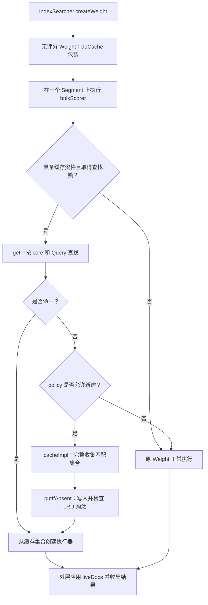

# LRUQueryCache 实现跟踪

## 1. 职责与整体调用链

`LRUQueryCache` 缓存的是 **一个 Query 在一个 Segment core 上匹配的文档编号集合**。重复执行同一个无评分条件时，可以直接遍历集合，省去原查询重新计算匹配结果的过程。它不保存文档内容、相关性分数或最终 TopN。

先区分流程中的几个对象：

| 对象 | 职责 |
| --- | --- |
| `Query` | 描述查询条件，是全局缓存识别查询的依据 |
| `Weight` | 为当前搜索准备执行逻辑，按 Segment 创建执行器 |
| `Scorer` / `BulkScorer` | 分别提供文档推进与批量收集能力 |
| `CachingWrapperWeight` | 包装原 Weight，决定使用缓存还是调用原实现 |
| `LeafCache` | 保存一个 Segment core 上各 Query 的结果 |
| `CacheAndCount` | 保存匹配集合 `DocIdSet` 及其数量 |

整体调用关系如下。普通搜索的 Segment 批量收集从 `IndexSearcher.java:763` 进入包装 Weight；组合查询也可能通过 supplier 创建子执行器。



下面按“入口 → 查找 → 构建 → 写入 → 淘汰”的顺序阅读源码，再补其他执行入口与生命周期。

## 2. 调用入口：哪些 Weight 会被包装

### 2.1 IndexSearcher 只为无评分执行添加缓存

源码：`IndexSearcher.java:898`（节选）。

```java
public Weight createWeight(Query query, ScoreMode scoreMode, float boost) throws IOException {
  final QueryCache queryCache = this.queryCache;
  Weight weight = query.createWeight(this, scoreMode, boost);
  if (scoreMode.needsScores() == false && queryCache != null) {
    weight = queryCache.doCache(weight, queryCachingPolicy);
  }
  return weight;
}
```

这里先调用 Query 创建原 Weight，再根据 `scoreMode` 决定是否包装。**是否需要评分决定能不能进入这层缓存；进入以后是否真的缓存，还要看后续策略。** `queryCache == null` 则直接关闭这条入口。

外层查询需要评分，并不意味着所有子条件都需要评分。BooleanQuery 为子句创建 Weight 时有如下选择：

源码：`BooleanWeight.java:59`（节选）。

```java
for (BooleanClause c : query) {
  Weight w =
      searcher.createWeight(
          c.getQuery(), c.isScoring() ? scoreMode : ScoreMode.COMPLETE_NO_SCORES, boost);
  weightedClauses.add(new WeightedBooleanClause(c, w));
}
```

`FILTER`、`MUST_NOT` 属于非评分子句，因此传入 `COMPLETE_NO_SCORES`；评分子句沿用外层模式。这样关键词可以继续计算相关性，价格范围过滤则可以独立缓存。`ConstantScoreQuery` 也会以无评分模式创建内部 Weight，再按外层需要提供常量分数，见 `ConstantScoreQuery.java:125`。

### 2.2 doCache 只加包装，不计算结果

源码：`LRUQueryCache.java:474`（节选）。

```java
public Weight doCache(Weight weight, QueryCachingPolicy policy) {
  while (weight instanceof CachingWrapperWeight) {
    weight = ((CachingWrapperWeight) weight).in;
  }

  return new CachingWrapperWeight(weight, policy);
}
```

循环先剥离已有的同类包装，避免嵌套重复包装，然后建立新的 `CachingWrapperWeight`。包装类保留原 Weight `in`、策略 `policy` 和一个 `AtomicBoolean used`；结果集合尚未生成。源码：`LRUQueryCache.java:675`。

后面凡是无法使用缓存，都回到 `in` 执行。缓存改变的是执行路径，不改变 Query 的匹配语义。

## 3. 数据结构：Query 管全局，结果按 Segment 分开存

### 3.1 三张 Map 分别解决什么问题

源码：`LRUQueryCache.java:93`（节选）。

```java
private final Map<Query, Query> uniqueQueries;
private final Set<Query> mostRecentlyUsedQueries;
private final Map<IndexReader.CacheKey, LeafCache> cache;
private final ReentrantLock lock;
private final float skipCacheFactor;
```

源码：`LRUQueryCache.java:132`（节选）。

```java
uniqueQueries = new LinkedHashMap<>(16, 0.75f, true);
mostRecentlyUsedQueries = uniqueQueries.keySet();
cache = new IdentityHashMap<>();
lock = new ReentrantLock();
ramBytesUsed = 0;
```

`uniqueQueries` 是按访问顺序排列的 `LinkedHashMap`：既统一等价 Query 的对象，又维护 LRU。`mostRecentlyUsedQueries` 是它的 keySet 视图，修改这个视图就会修改原 Map。

`cache` 按 core key 找到一个 `LeafCache`。core key 表示 Segment 底层核心的身份；多个 reader 若共享同一 core，就有机会复用结果。每个 LeafCache 内还有一张 Map：

源码：`LRUQueryCache.java:625`（节选）。

```java
private final Object key;
private final Map<Query, CacheAndCount> cache;
private volatile long ramBytesUsed;

LeafCache(Object key) {
  this.key = key;
  cache = new IdentityHashMap<>();
  ramBytesUsed = 0;
}
```

两层关系可以直接画成：

```text
全局 uniqueQueries：
  等价的 Q 对象 → 统一的 Q 实例      同时维护 Query 的访问顺序

cache：
  S1.coreKey → LeafCache.cache：Q 实例 → CacheAndCount(S1 内的结果)
  S2.coreKey → LeafCache.cache：Q 实例 → CacheAndCount(S2 内的结果)
```

全局 Map 用 `equals/hashCode` 找到 Query 的统一实例，LeafCache 再用 `IdentityHashMap` 按该实例身份查找。这样不同请求新建的等价 Query 可以复用结果，叶子缓存也不用各自保存一份等价 Query。

**必须保持的不变式：叶子缓存里的任何 Query，都属于全局 Query 集合。** 所以两层结构的插入、淘汰和清理用同一把锁同步。

### 3.2 CacheAndCount 保存的是什么

源码：`LRUQueryCache.java:949`（节选）。

```java
protected static class CacheAndCount implements Accountable {
  protected static final CacheAndCount EMPTY = new CacheAndCount(DocIdSet.EMPTY, 0);

  private static final long BASE_RAM_BYTES_USED =
      RamUsageEstimator.shallowSizeOfInstance(CacheAndCount.class);
  private final DocIdSet cache;
  private final int count;

  public CacheAndCount(DocIdSet cache, int count) {
    this.cache = cache;
    this.count = count;
  }
```

`cache` 是文档编号集合，`count` 是集合数量；`EMPTY` 专门表示已知无匹配。缓存空结果同样有价值：下次可以直接返回无匹配，避免重复计算。

文档编号是 Segment 内部编号，因此同一个 Q 在两个 Segment 上要保存两个集合。这也意味着全局 Query 数为 1 时，结果条目数 `cacheSize` 可以是 2。

## 4. 执行主流程：完整读一次 bulkScorer

下面保留 `bulkScorer` 的关键执行语句，只去掉注释、断言。这里的 `context` 表示当前 Segment。读代码时按四段看：登记使用 → 检查资格 → 查找与构建 → 从集合创建执行器。

源码：`LRUQueryCache.java:891`（节选）。

```java
public BulkScorer bulkScorer(LeafReaderContext context) throws IOException {
  if (used.compareAndSet(false, true)) {
    policy.onUse(getQuery());
  }

  if (in.isCacheable(context) == false) {
    return in.bulkScorer(context);
  }

  if (shouldCache(context) == false) {
    return in.bulkScorer(context);
  }

  final IndexReader.CacheHelper cacheHelper = context.reader().getCoreCacheHelper();
  if (cacheHelper == null) {
    return in.bulkScorer(context);
  }

  if (lock.tryLock() == false) {
    return in.bulkScorer(context);
  }

  CacheAndCount cached;
  try {
    cached = get(in.getQuery(), cacheHelper);
  } finally {
    lock.unlock();
  }

  if (cached == null) {
    if (policy.shouldCache(in.getQuery())) {
      cached = cache(context);
      putIfAbsent(in.getQuery(), cached, cacheHelper);
    } else {
      return in.bulkScorer(context);
    }
  }

  if (cached == CacheAndCount.EMPTY) {
    return null;
  }
  final DocIdSetIterator disi = cached.iterator();
  if (disi == null) {
    return null;
  }

  return new DefaultBulkScorer(
      new ConstantScoreScorer(this, 0f, ScoreMode.COMPLETE_NO_SCORES, disi));
}
```

### 4.1 登记使用：一次包装 Weight 只登记一次

`used.compareAndSet(false, true)` 成功后才调用 `policy.onUse`。同一包装 Weight 在多个 Segment 或线程上执行，只登记一次，而不是每个 Segment 增加一次 Query 使用频次。下一次请求新建包装 Weight，才能再次登记。

这与缓存 hit/miss 不同：使用频次服务于“是否值得新建”的策略，hit/miss 则按每次 Segment 查找统计。

### 4.2 检查资格：任何一项不满足就调用原 Weight

| 检查 | 它回答的问题 |
| --- | --- |
| `in.isCacheable(context)` | 当前查询在这个 reader 上的结果能否安全缓存？ |
| `shouldCache(context)` | Segment 大小与内存条件是否合适？ |
| `getCoreCacheHelper()` | 是否有可用于定位、关闭清理的 core 标识？ |
| `lock.tryLock()` | 能否立即取得查找锁？ |

这些条件在 `get` 之前检查，失败不会计入缓存 hit/miss。查找锁争用时选择继续原查询计算，避免等待锁拖延搜索；写入路径仍可能等待锁。

### 4.3 未命中：先问策略，再完整构建

`cached == null` 表示没有缓存条目。只有 `policy.shouldCache` 返回 true，才调用 `cache(context)` 计算集合，并通过 `putIfAbsent` 保存。策略拒绝就使用原执行器，不建立缓存。

已有条目命中时不会再询问策略。因此策略后来禁止新建，也不会阻止复用旧条目。

### 4.4 命中：从集合创建无评分执行器

命中 `EMPTY` 或集合没有迭代器，返回 null，表示当前 Segment 无匹配。否则将集合迭代器包装成 `ConstantScoreScorer`，再包装成 `DefaultBulkScorer`。

这里使用 `COMPLETE_NO_SCORES` 和 0 分，因为缓存只提供匹配关系；它不负责恢复原 Query 的评分。下一步外层搜索会继续应用删除过滤并收集结果。

## 5. 资格与策略：能缓存和值得缓存是两件事

### 5.1 Segment 资格检查

源码：`LRUQueryCache.java:717`（节选）。

```java
private boolean shouldCache(LeafReaderContext context) throws IOException {
  return cacheEntryHasReasonableWorstCaseSize(
          ReaderUtil.getTopLevelContext(context).reader().maxDoc())
      && leavesToCache.test(context);
}
```

第一个条件以整个顶层 reader 的 `maxDoc` 估算最坏集合大小，要求 `(maxDoc / 8) * 5 < maxRamBytesUsed`，给多个过滤集合留空间。第二个条件调用 Segment 筛选器。源码：`LRUQueryCache.java:695`。

两参数构造器使用下面的默认值：

源码：`LRUQueryCache.java:147`（节选）。

```java
public LRUQueryCache(int maxSize, long maxRamBytesUsed) {
  this(maxSize, maxRamBytesUsed, new MinSegmentSizePredicate(10000), 10);
}
```

默认 Segment 筛选要求同时满足 `segment.maxDoc >= 10000` 和 `segment.maxDoc * 2 > 顶层 maxDoc / Segment 数量`，其中除法取整数。`maxDoc` 包括未物理移除的删除文档。源码：`LRUQueryCache.java:160`。

这些是避免缓存管理与构建成本过高的启发式判断；并非精确的内存预留机制。`IndexSearcher` 默认实例另设 Query 上限 1000、内存为 32 MiB 与最大堆 5% 的较小者，见 `IndexSearcher.java:92`。

### 5.2 Query 策略决定是否为 miss 新建条目

源码：`UsageTrackingQueryCachingPolicy.java:177`（节选）。

```java
public boolean shouldCache(Query query) throws IOException {
  if (shouldNeverCache(query)) {
    return false;
  }
  final int frequency = frequency(query);
  final int minFrequency = minFrequencyToCache(query);
  return frequency >= minFrequency;
}
```

默认策略先排除不值得缓存的类型，再比较近期使用频次和门槛：

| Query 类型 | 默认新建门槛 |
| --- | --- |
| Point、MultiTermQuery、TermInSetQuery 等成本较高的查询 | 2 次 |
| 非空 BooleanQuery、DisjunctionMaxQuery | 4 次 |
| 其他未被排除的查询 | 5 次 |
| TermQuery、FieldExistsQuery、MatchAllDocsQuery、MatchNoDocsQuery、空的上述复合查询 | 不新建 |

例如 TermQuery 本身就能高效读取倒排表，多保存一份匹配集合未必有收益。具体类型判断和门槛见 `UsageTrackingQueryCachingPolicy.java:45`、`UsageTrackingQueryCachingPolicy.java:56`、`UsageTrackingQueryCachingPolicy.java:124`。

`onUse` 只把 Query 的 hash code 放入默认长度 256 的近期使用窗口，并用同步块保护频率记录。它不永久累积使用次数，也不持有 Query 引用。hash 碰撞可能让查询提前达到门槛，但真实结果查找仍按 Query 等价关系进行，不会因此串用另一条查询的结果。源码：`UsageTrackingQueryCachingPolicy.java:143`。

## 6. get：两层查找，同时更新 LRU

源码：`LRUQueryCache.java:267`（节选）。

```java
CacheAndCount get(Query key, IndexReader.CacheHelper cacheHelper) {
  final IndexReader.CacheKey readerKey = cacheHelper.getKey();
  final LeafCache leafCache = cache.get(readerKey);
  if (leafCache == null) {
    onMiss(readerKey, key);
    return null;
  }
  final Query singleton = uniqueQueries.get(key);
  if (singleton == null) {
    onMiss(readerKey, key);
    return null;
  }
  final CacheAndCount cached = leafCache.get(singleton);
  if (cached == null) {
    onMiss(readerKey, singleton);
  } else {
    onHit(readerKey, singleton);
  }
  return cached;
}
```

查找顺序不能调换理解：

1. 用 core key 找当前 Segment 的 LeafCache；没有则直接 miss。
2. 用本次 Query 找全局统一实例 `singleton`；没有则 miss。
3. 用统一实例在 LeafCache 中找集合；找到才算 hit。

第二步的 `uniqueQueries.get(key)` 同时把 Q 移到全局 LRU 的最新端。这意味着：LeafCache 已存在、全局 Q 已存在，但 Q 尚未在当前 Segment 保存结果时，虽然最后仍 miss，Q 的最近访问位置已经更新。若连 LeafCache 都没有，则不会走到这一步。

## 7. 构建集合：完整执行一次原 Query

### 7.1 cache 调原执行器，cacheImpl 选择格式

源码：`LRUQueryCache.java:707`（节选）。

```java
private CacheAndCount cache(LeafReaderContext context) throws IOException {
  final BulkScorer scorer = in.bulkScorer(context);
  if (scorer == null) {
    return CacheAndCount.EMPTY;
  } else {
    return cacheImpl(scorer, context.reader().maxDoc());
  }
}
```

源码：`LRUQueryCache.java:501`（节选）。

```java
protected CacheAndCount cacheImpl(BulkScorer scorer, int maxDoc) throws IOException {
  if (scorer.cost() * 100 >= maxDoc) {
    return cacheIntoBitSet(scorer, maxDoc);
  } else {
    return cacheIntoRoaringDocIdSet(scorer, maxDoc);
  }
}
```

原 Weight 没有执行器时保存 EMPTY，否则完整收集其匹配文档。集合表示由估算 `scorer.cost()` 决定：估算匹配量达到 Segment 文档数的约 1% 时使用 bitset，较稀疏时使用 Roaring。

例如 `maxDoc = 20000`、cost 为 400，`400 * 100 >= 20000`，选择 `FixedBitSet`。这是基于 cost 的选择，不是先统计真实命中率再选择。

### 7.2 bitset 路径实际收集什么

源码：`LRUQueryCache.java:511`（节选）。

```java
private static CacheAndCount cacheIntoBitSet(BulkScorer scorer, int maxDoc) throws IOException {
  final FixedBitSet bitSet = new FixedBitSet(maxDoc);
  int[] count = new int[1];
  scorer.score(
      new LeafCollector() {

        @Override
        public void setScorer(Scorable scorer) throws IOException {}

        @Override
        public void collect(int doc) throws IOException {
          count[0]++;
          bitSet.set(doc);
        }
      },
      null);
  return new CacheAndCount(new BitDocIdSet(bitSet, count[0]), count[0]);
}
```

`collect(doc)` 只把对应位置设为 1，并增加计数；`setScorer` 为空，因为不需要分数。最后把 bitset 包装为 `BitDocIdSet`，与数量一起返回。

注意传给 `scorer.score` 的第二个参数为 null：构建集合时没有应用当前 liveDocs。删除文档如何排除，留到生命周期章节说明。Roaring 路径的差别是用 `builder.add(doc)` 收集并压缩编号，数量取集合 cardinality，见 `LRUQueryCache.java:530`。

## 8. 写入缓存：在锁内维护两层结构

源码：`LRUQueryCache.java:292`（节选）。

```java
private void putIfAbsent(Query query, CacheAndCount cached, IndexReader.CacheHelper cacheHelper) {
  lock.lock();
  try {
    Query singleton = uniqueQueries.putIfAbsent(query, query);
    if (singleton == null) {
      onQueryCache(query, getRamBytesUsed(query));
    } else {
      query = singleton;
    }
    final IndexReader.CacheKey key = cacheHelper.getKey();
    LeafCache leafCache = cache.get(key);
    if (leafCache == null) {
      leafCache = new LeafCache(key);
      final LeafCache previous = cache.put(key, leafCache);
      ramBytesUsed += HASHTABLE_RAM_BYTES_PER_ENTRY;
      cacheHelper.addClosedListener(this::clearCoreCacheKey);
    }
    leafCache.putIfAbsent(query, cached);
    evictIfNecessary();
  } finally {
    lock.unlock();
  }
}
```

写入按以下顺序改变状态：

1. `uniqueQueries.putIfAbsent` 为等价 Query 选择统一实例。首次登记时增加 Query 的内存记账。
2. 按 core key 找 LeafCache，没有则创建并登记外层 Map 条目内存。
3. 新建 LeafCache 时注册 core 关闭监听器，保证结果能随 core 生命周期释放。
4. 在 LeafCache 中插入集合。只有实际插入才增加集合数和内存。
5. 执行 `evictIfNecessary`，恢复容量约束。

叶子级去重与计数也有对应代码：

源码：`LRUQueryCache.java:651`（节选）。

```java
void putIfAbsent(Query query, CacheAndCount cached) {
  if (cache.putIfAbsent(query, cached) == null) {
    onDocIdSetCache(HASHTABLE_RAM_BYTES_PER_ENTRY + cached.ramBytesUsed());
  }
}
```

`onDocIdSetCache` 最终增加当前 `cacheSize`、累计 `cacheCount` 和内存用量，见 `LRUQueryCache.java:226`。完整集合在进入这把写锁前已经生成，所以锁保护的是共享状态，不覆盖耗时的查询收集过程。

用一个简短状态表串起前面的执行。令 Q 为 `LongPoint.newRangeQuery("price", 100, 200)`，近期没有其他使用记录干扰；每次新建 Weight、所有资格检查通过且没有竞争，两个 Segment 均执行到 Q：

| 阶段 | 近期 Q 使用次数 | 全局 Query 数 | 当前集合数 | Q 的执行方式 |
| --- | --- | --- | --- | --- |
| 第一次请求后 | 1 | 0 | 0 | 正常计算，不保存 |
| 第二次请求后 | 2 | 1 | 2 | 完整计算，分别保存到两个 Segment |
| 第三次请求后 | 3 | 1 | 2 | 分别命中，遍历已有集合 |

这解释了两个核心区别：一次请求跨两个 Segment 不代表两次 Query 使用；一个 Query 也不代表一个结果集合。

## 9. LRU 淘汰与显式清理

### 9.1 哪个限制触发淘汰

源码：`LRUQueryCache.java:257`（节选）。

```java
boolean requiresEviction() {
  final int size = mostRecentlyUsedQueries.size();
  if (size == 0) {
    return false;
  } else {
    return size > maxSize || ramBytesUsed() > maxRamBytesUsed;
  }
}
```

`maxSize` 限制全局不同 Query 数；`maxRamBytesUsed` 限制缓存记账内存。两者任一超限，就从访问顺序 Map 的最旧端移除 Query。核心循环如下，省略键被修改时的异常检测分支：

源码：`LRUQueryCache.java:321`（节选）。

```java
private void evictIfNecessary() {
  if (requiresEviction()) {

    Iterator<Query> iterator = mostRecentlyUsedQueries.iterator();
    do {
      final Query query = iterator.next();
      final int size = mostRecentlyUsedQueries.size();
      iterator.remove();
      onEviction(query);
    } while (iterator.hasNext() && requiresEviction());
  }
}
```

`iterator.remove()` 删除全局 Query；`onEviction(query)` 再清理所有 Segment 上的结果：

源码：`LRUQueryCache.java:381`（节选）。

```java
private void onEviction(Query singleton) {
  onQueryEviction(singleton, getRamBytesUsed(singleton));
  for (LeafCache leafCache : cache.values()) {
    leafCache.remove(singleton);
  }
}
```

例如容量为 2，已有 `[Q, R]`（左旧右新），再访问 Q 后变为 `[R, Q]`，插入 T 时淘汰 R，留下 `[Q, T]`。**R 在所有 Segment 上的集合一起删除，淘汰单位是 Query。**

因此单次淘汰需遍历全部 LeafCache。移除集合后，空 LeafCache 仍可能留在外层 Map，直到 core 关闭或整体 clear。

### 9.2 三种清理作用范围不同

| 方法 | 移除什么 | 全局 Query 会否移除 |
| --- | --- | --- |
| `clearCoreCacheKey` | 一个 core 的整个 LeafCache | 否 |
| `clearQuery` | 一个 Query 在所有 LeafCache 中的集合 | 是 |
| `clear` | 所有叶子与全局 Query | 是 |

`clearQuery` 先从全局 Map 删除 Query，再复用 `onEviction`；`clear` 同时清空叶子缓存和全局 keySet。源码：`LRUQueryCache.java:349`、`LRUQueryCache.java:369`、`LRUQueryCache.java:390`。

## 10. 另外两个入口：只看与主流程不同的部分

### 10.1 scorerSupplier：延迟构建，并检查 leadCost

supplier 是稍后才创建 Scorer 的工厂。包装类的资格检查、使用登记与查找流程与批量入口相近；区别在于 miss 且策略允许后，不立即收集，而是返回新的 supplier，在其 `get(leadCost)` 中执行：

源码：`LRUQueryCache.java:771`（节选）。

```java
if (cost / skipCacheFactor > leadCost) {
  return supplier.get(leadCost);
}

Scorer scorer = supplier.get(Long.MAX_VALUE);
CacheAndCount cached =
    cacheImpl(new DefaultBulkScorer(scorer), context.reader().maxDoc());
putIfAbsent(in.getQuery(), cached, cacheHelper);
```

`cost` 是当前查询估算的匹配迭代成本，`leadCost` 来自调用方，表达该执行可能需要处理的工作量。组合查询如果已由其他条件大幅缩小候选，完整收集当前 Query 可能不划算。

例如 cost 为 400、默认 factor 为 10、leadCost 为 10，则 `40 > 10`，继续使用原 supplier，不建立缓存。通过后以 `Long.MAX_VALUE` 请求原 Scorer，再完整生成集合并保存。

原 supplier 为 null 时会直接保存 EMPTY。包装类 `scorer(context)` 也通过 supplier 获取 Scorer，但传入 `Long.MAX_VALUE`。这些路径见 `LRUQueryCache.java:759`、`LRUQueryCache.java:824`。

**批量入口 bulkScorer 没有这个 leadCost 判断。** 不能把 supplier 的成本跳过机制推广到所有执行入口。

### 10.2 count：优先原生快速计数，只读已有缓存

源码：`LRUQueryCache.java:833`（节选）。

```java
public int count(LeafReaderContext context) throws IOException {
  int innerCount = in.count(context);
  if (innerCount != -1) {
    return innerCount;
  }

  if (context.reader().hasDeletions()) {
    return -1;
  }
```

`-1` 表示不能快速计数，不代表没有匹配。原 Weight 能直接计算数量时立即返回；不能时，有删除文档也直接返回 -1。只有都未返回，才做缓存资格检查与查找。其尾部是：

源码：`LRUQueryCache.java:878`（节选）。

```java
if (cached == null) {
    return -1;
  }
  return cached.count();
}
```

所以该方法只读已有条目的 count，不主动构建。外层 count 搜索必要时仍可走普通收集流程，而普通收集可能建立缓存；这与“这个 count 方法自己新建缓存”是两回事。

## 11. 删除、刷新和 core 生命周期如何保证正确性

### 11.1 匹配集合与当前 liveDocs 分开处理

缓存集合构建时 `acceptDocs = null`，其中可能包含后来被删除的编号。普通搜索实际收集时会调用：

源码：`IndexSearcher.java:769`（节选）。

```java
scorer.score(leafCollector, ctx.reader().getLiveDocs());
```

`getLiveDocs()` 提供当前 reader 的存活文档标记，执行器收集时排除删除文档，具体过滤见 `Weight.java:313`。

因此当缓存含 `{3, 7, 12}`、当前文档 7 已删除时，仍可遍历旧集合，再输出 `{3, 12}`。前提是 reader 共享相同 core 且原 Weight 仍声明结果可缓存。

但缓存 count 不能自行减掉删除数，这就解释了前面 `count` 的删除检查。DocValues 更新也不能只靠 liveDocs 解决：相关 Weight 必须通过 `isCacheable` 拒绝不稳定结果；现有回归测试见 `TestLRUQueryCache.java:1734`。

### 11.2 关闭回调按 core 释放结果

`putIfAbsent` 在第一次创建 LeafCache 时注册 `this::clearCoreCacheKey`。回调的关键动作是：

源码：`LRUQueryCache.java:352`（节选）。

```java
final LeafCache leafCache = cache.remove(coreKey);
if (leafCache != null) {
  ramBytesUsed -= HASHTABLE_RAM_BYTES_PER_ENTRY;
  final int numEntries = leafCache.cache.size();
  if (numEntries > 0) {
    onDocIdSetEviction(coreKey, numEntries, leafCache.ramBytesUsed);
```

完整方法还处理空 LeafCache，并在 finally 中解锁。它减少叶子条目与内存，但不会顺带移除全局 Query。

Segment 合并生成新 core，新 core 需要重新计算集合；旧 core 的结果在旧 core 真正关闭后释放。刷新是否能复用缓存，取决于是否共享 core 以及查询是否仍可缓存，并不是每次刷新都全部失效。

## 12. 并发、统计与异常边界

### 12.1 锁保护什么，不能保证什么

| 阶段 | 锁与并发行为 |
| --- | --- |
| 查找与 LRU 访问更新 | `tryLock`，拿不到则回退原查询 |
| 完整生成集合 | 在查找锁之外执行 |
| 写入、淘汰、手工清理 | `lock.lock()`，可能等待 |
| 使用登记 | `AtomicBoolean` 保证每个包装 Weight 仅一次 |

两个线程可以同时 miss、同时生成同一个集合；`putIfAbsent` 只保证最终不重复登记，不保证只计算一次。缓存的内存限制也不覆盖这些临时集合的全部内存。

### 12.2 统计怎样对应实际行为

| 指标 | 实际含义 |
| --- | --- |
| `hitCount` / `missCount` | 真正进入 get 的逐 Segment 查找结果 |
| `totalCount` | hit 与 miss 之和，不是用户请求数 |
| `cacheSize` | 当前 `(Query, core)` 集合条目数，含空结果 |
| `cacheCount` | 历史真正插入的集合条目数 |
| `evictionCount` | `cacheCount - cacheSize`，含 core 关闭和手工清理 |
| `ramBytesUsed` | 缓存的内存记账，不是进程总内存 |

`clear()` 归零当前条目和内存，不重置 hit、miss、cacheCount。统计字段用 volatile 支持读取，更新在锁内完成；分别读取多个 getter 不构成原子快照。源码：`LRUQueryCache.java:102`、`LRUQueryCache.java:226`、`LRUQueryCache.java:250`、`LRUQueryCache.java:549`。

Query 自身实现 `Accountable` 时用其报告的内存，否则使用默认估算，加上相关 Map 条目记账。源码：`LRUQueryCache.java:403`。

### 12.3 异常及扩展回调

- factor 小于 1 或为 NaN，构造时抛出 `IllegalArgumentException`，见 `LRUQueryCache.java:126`。
- Query 入缓存后必须保持 hash 与等价关系稳定；淘汰时检测到移除失败可能抛出 `ConcurrentModificationException`，见 `LRUQueryCache.java:331`。
- 原查询、策略和集合构建中的 `IOException` 向上传播，没有统一吞掉并重试。构建失败时该次生成的集合尚未写入，不代表整次搜索具备事务回滚能力。
- `onHit`、`onMiss`、`onDocIdSetCache` 等回调在锁内同步调用，不宜做耗时操作；覆盖时若要保留默认统计和内存记账，需要调用父类实现。见 `LRUQueryCache.java:179`、`LRUQueryCache.java:226`。

## 13. 相关测试：用断言检验对流程的理解

下表是已有测试的阅读入口，本次文档修改未运行测试。

| 测试入口 | 对应行为 |
| --- | --- |
| `TestLRUQueryCache.java:237`，`testLRUEviction` | 访问 Q 后 LRU 顺序改变，超限按最旧 Query 淘汰 |
| `TestLRUQueryCache.java:633`，`testOnUse` | 多个 Segment 不会重复登记同一包装 Weight 的使用 |
| `TestLRUQueryCache.java:707`，`testStats` | 逐 Segment 统计；禁止新建后仍可命中旧条目 |
| `TestLRUQueryCache.java:1009`，`testBooleanQueryCachesSubClauses` | 评分查询中的 FILTER / MUST_NOT 能进入缓存包装 |
| `TestLRUQueryCache.java:1211`，`testDetectMutatedQueries` | 修改缓存键后触发异常检测 |
| `TestLRUQueryCache.java:1428`，`testMinSegmentSizePredicate` | Segment 大小边界 |
| `TestLRUQueryCache.java:1734`，`testDocValuesUpdatesDontBreakCache` | 更新后相关 Weight 不再使用旧集合 |
| `TestLRUQueryCache.java:1923`，`testSkipCachingForRangeQuery` | factor 对 supplier 成本跳过的影响 |
| `TestLRUQueryCache.java:2057`，`testCacheHasFastCount` | 填充后可快速计数，有删除时拒绝缓存数量 |
| `TestUsageTrackingFilterCachingPolicy.java:50`，`testNeverCacheTermFilter` | 默认策略排除 TermQuery |

这些测试通常主动设置 ALWAYS_CACHE、自定义 Segment 筛选器等条件，以隔离要验证的行为。不能把测试中 TermQuery 被缓存，理解为默认策略也会缓存它。

## 14. 源码审阅发现

**源码事实：两参数构造器的注释与实现不一致。** 注释写成本倍数 100，实际默认 factor 为 10；注释写文档数超过 10000，实际正好 10000 也可能通过。位置：`LRUQueryCache.java:139`、`LRUQueryCache.java:148`、`LRUQueryCache.java:162`。应以实现解释行为，这些差异并不证明查询结果有错误。

**源码事实与推断：集合在锁外构建，可能发生重复构建。** 这有利于缩短持锁时间，也可能增加临时内存与计算开销。重复构建对某个负载的实际影响属于待验证项，需要运行时测量；本文不将其认定为已复现的性能故障。

## 15. 心智模型与推荐阅读顺序

完整流程可以记为：**无评分 Weight 进入包装；按 core 查 Query 的集合；miss 后先问策略，再完整生成并插入；hit 后直接遍历；超限按 Query 跨 Segment 淘汰；core 关闭按 Segment 清理。**

建议源码阅读顺序：

1. `IndexSearcher.java:898`、`BooleanWeight.java:59`：确认入口与无评分模式。
2. `LRUQueryCache.java:474`、`LRUQueryCache.java:891`：看包装与完整执行主线。
3. `LRUQueryCache.java:267`、`UsageTrackingQueryCachingPolicy.java:177`：分清查找与新建策略。
4. `LRUQueryCache.java:707`、`LRUQueryCache.java:501`、`LRUQueryCache.java:292`：跟踪集合如何生成、登记。
5. `LRUQueryCache.java:321`、`LRUQueryCache.java:381`、`LRUQueryCache.java:349`：理解两个维度的释放。
6. `LRUQueryCache.java:724`、`LRUQueryCache.java:832`：补齐 supplier 与 count 的差异。
