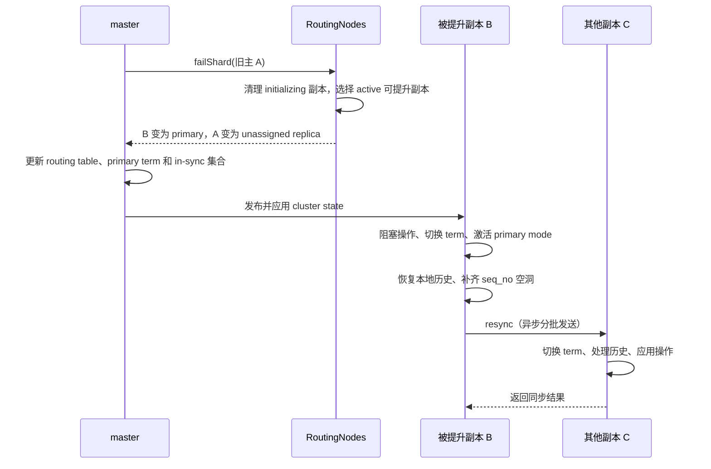

# 副本分片提升为主分片：从故障路由到历史收敛

## 1. 提升解决什么问题

一个 replication group 的主分片故障后，master 需要选出可接替的副本；被选节点则必须停止沿用旧主的执行语义，进入新的 primary term，整理本地历史并同步其他副本。这是两个相互衔接的阶段：**路由中的 `primary=true` 是角色决定，数据节点取得 primary mode 并完成任期切换才建立本地执行条件。**

主线入口如下。这里讨论普通可提升副本的故障切换，主分片 relocation 仅作边界对照。

对应代码：`server/src/main/java/org/elasticsearch/cluster/routing/RoutingNodes.java:551`、`server/src/main/java/org/elasticsearch/indices/cluster/IndicesClusterStateService.java:746`、`server/src/main/java/org/elasticsearch/index/shard/IndexShard.java:501`。

## 2. 贯穿案例与初始条件

假设索引 `orders` 的 shard 0 有一个主分片、两个副本，三者均为普通可提升角色，allocation id 都在 in-sync 集合中。节点版本相同；本例假设 master 选中 B，不依赖相同版本候选的遍历顺序。

| 节点 | 路由角色及状态 | 本地历史（示意） |
| --- | --- | --- |
| A | primary，`STARTED` | 即将故障 |
| B | replica，`STARTED` | local checkpoint=103，max seq_no=105，缺少 104 |
| C | replica，`STARTED` | 有可能包含不同于 B 的旧任期尾部历史 |

原 primary term=7，B 最后已知 global checkpoint=100；因此 101 以上需要考虑重新同步。所有数值均为示意，不是默认值或测试运行结果。local checkpoint=103 表示 103 及以前没有空洞，并不排斥已经收到 105。

## 3. 故障怎样进入 master 分配逻辑

### 3.1 节点离开与单个 shard 失败是两个入口

节点离开由 `NodeLeftExecutor` 移除节点后调用 `AllocationService.disassociateDeadNodes`。后者遍历已经不在存活数据节点集合中的 routing node，为其 shard 构造 `NODE_LEFT` 或 `NODE_RESTARTING` 信息，再逐个调用 `RoutingNodes.failShard`。

定位：`server/src/main/java/org/elasticsearch/cluster/coordination/NodeLeftExecutor.java:96`、`server/src/main/java/org/elasticsearch/cluster/routing/allocation/AllocationService.java:562`。

单个 shard 故障则经 `ShardStateAction` 的失败任务处理进入 `AllocationService.applyFailedShards`。它按 allocation id 重新解析当前路由，避免批处理前面的一次失败已经改变后续 shard 的状态；若要求 mark stale，还会登记移除 allocation id，然后进入同一个 `failShard`。

定位：`server/src/main/java/org/elasticsearch/cluster/action/shard/ShardStateAction.java:397`、`server/src/main/java/org/elasticsearch/cluster/routing/allocation/AllocationService.java:191`。

节点离开流程虽然会记录 delayed 标记，但 `failShard` 内部直接尝试提升活动副本。不能把延迟重新分配等同于“必须等超时才选新主”。

### 3.2 为什么先清理 initializing 副本

`failShard` 发现失败对象为 primary 后，先对同组 `initializing` 副本递归执行失败处理。这些副本仍处于恢复中，不能直接接替旧主；代码注释还明确指出，该顺序用于避免让 `RoutingNodes` 进入不一致状态。

若副本正在 relocation，初始化中的目标也会被处理，源端取消 relocation 并回到可提升的 `STARTED` 状态。因此 `promoteReplicaToPrimary` 会断言候选已经是 `started()`。

定位：`RoutingNodes.java:575`、`RoutingNodes.java:701`。

## 4. 候选选择：不是比较谁的 seq_no 最大

`unassignPrimaryAndPromoteActiveReplicaIfExists` 调用 `activePromotableReplicaWithHighestVersion`，过滤条件是：

1. 不是 primary，且 `active()`。
2. 对应 routing node 存在。
3. shard 的 role 满足 `isPromotableToPrimary()`。
4. 在候选中按 `DiscoveryNode.getVersion()` 取最大值；处理节点信息为 null 的情况。

这里的最高版本是 **Elasticsearch 节点版本**，不是文档版本、primary term 或 checkpoint。该方法没有比较 local checkpoint，也没有现场向各副本收集最大 seq_no。其注释明确关联滚动升级中副本可能比原主版本更旧的场景；相同版本时没有额外的 checkpoint 排序规则。

定位：`server/src/main/java/org/elasticsearch/cluster/routing/RoutingNodes.java:375`、`server/src/main/java/org/elasticsearch/cluster/routing/ShardRouting.java:930`。

候选方法本身也没有逐个查询 in-sync 集合。不能据此推导“任意磁盘副本都能提升”：这里选的是当前路由中的活动、可提升副本，in-sync 集合由分片启动、失败及 stale 移除等流程另行维护。离线存储恢复不是这条即时提升路径。

如果没有合格副本，旧主转为 unassigned primary，不能凭空产生一个活动主分片。该分支还会将残余不可提升副本转为 unassigned，原因记作 `UNPROMOTABLE_REPLICA`，后续交给分配和恢复流程。

定位：`RoutingNodes.java:667`、`server/src/main/java/org/elasticsearch/cluster/routing/allocation/IndexMetadataUpdater.java:65`。

## 5. master 改变哪些状态

选中 B 后，旧主 A 经 `movePrimaryToUnassignedAndDemoteToReplica` 转为未分配副本；B 经 `moveActiveReplicaToPrimary` 生成新的 `ShardRouting`。新对象保留节点、allocation id 和路由状态，修改 primary 标志。因此 B 不需要先回到 `INITIALIZING` 再做一次完整 peer recovery。

定位：`RoutingNodes.java:695`、`RoutingNodes.java:747`、`ShardRouting.java:628`。

primary term 的增加不能简单归因于 `replicaPromoted` 回调：活动主分片失败时，`IndexMetadataUpdater.shardFailed` 调用 `increasePrimaryTerm`；应用元数据更新时才执行 `withIncrementedPrimaryTerm`。更新标志是布尔值，因此同一轮更新内多次通知不会逐次累加任期。

定位：`server/src/main/java/org/elasticsearch/cluster/routing/allocation/IndexMetadataUpdater.java:83`、`:123`、`:322`。

| 对象 | 故障前 | master 生成的新状态 |
| --- | --- | --- |
| A 的路由槽位 | primary，`STARTED` | replica，`UNASSIGNED`（后续可能重新分配） |
| B 的路由 | replica，`STARTED` | primary，`STARTED`，allocation id 不变 |
| primary term | 7 | 8 |

in-sync 集合另行合并 added/removed allocation id；故障并不一概等于永久删除旧主的 id。尤其没有活动副本时，代码保留第一个失败主分片的 allocation id，避免丢掉最后的有效恢复依据。

定位：`IndexMetadataUpdater.java:185`、`:223`。

## 6. B 收到 cluster state：角色和执行状态如何衔接

`IndicesClusterStateService.updateShard` 从新状态读取 primary term、in-sync ids 和 shard routing table，调用 `IndexShard.updateShardState`，并传入 `primaryReplicaSyncer::resync`。

`updateShardState` 校验 shard id 和 allocation id，禁止同一个本地 primary 直接降为 replica；对于新 primary，先将 master 的复制组信息传给 `ReplicationTracker.updateFromMaster`。本例的 term 从 7 增加到 8，进入提升分支。

定位：`IndicesClusterStateService.java:746`、`IndexShard.java:501`、`:580`。

### 6.1 先挡住操作，再切换执行任期

`bumpPrimaryTerm` 通过 `asyncBlockOperations` 阻塞操作，并等待已有许可释放。`pendingPrimaryTerm` 表示准备进入的任期，`operationPrimaryTerm` 表示执行层已经进入的任期，两者过渡期间可以不同。

回调取得独占条件后等待 `termUpdated`，再设置 operation term、执行提升动作。提升回调还等待 `shardStateUpdated`，确保外层已经发布本地的新路由。外层最后设置 `this.shardRouting` 并释放 latch，避免异步回调在角色信息尚未更新时继续。

定位：`IndexShard.java:617`、`:622`、`:692`、`:3729`。

这解释了为什么仅观察 routing 的 primary 标志不足以判断本地切换已经完成：中间仍可能处于操作许可阻塞阶段。

### 6.2 激活 primary mode，并修整本地历史

持有阻塞条件时按顺序执行：

1. `activatePrimaryMode(getLocalCheckpoint())`：设置 primary mode，用本地 checkpoint 初始化自身进度，并计算主端 global checkpoint。
2. `ensurePeerRecoveryRetentionLeasesExist()`：确保后续 peer recovery 所需租约。
3. `restoreLocalHistoryFromTranslog`：恢复可能在之前一次任期切换中从 Lucene 回滚、但仍保存在 translog 的本地操作。
4. `rollTranslogGeneration()`：滚动日志代；注释说明这不是避免序列号冲突所必需，而是便于理解任期与 translog generation 的关系。
5. `fillSeqNoGaps(newPrimaryTerm)`：为历史空洞填入当前任期的 no-op。
6. 更新自身 local checkpoint，启动 `primaryReplicaSyncer`。

定位：`IndexShard.java:635`、`server/src/main/java/org/elasticsearch/index/seqno/ReplicationTracker.java:1148`。

本例 B 的空洞 104 被补齐；假设没有并发新增操作、105 已处理完成，则 local checkpoint 可以推进到 105。填 no-op 不会凭空恢复缺失的业务写入内容。恢复 translog 那一步则专门覆盖连续两次故障提升的风险：前一次当副本时回滚的操作，不能在本次成为主分片时直接遗忘。

## 7. resync：让其他副本接受新主历史

### 7.1 从 global checkpoint 之后开始分批发送

`PrimaryReplicaSyncer.resync` 取 `getLastKnownGlobalCheckpoint()+1` 为起点，记录主端 `maxSeqNo`，创建 changes snapshot。案例中起点为 101；这个起点取的是调用当时的 checkpoint，若它在提升过程中推进，实际起点也会变化。

它还携带新主的 allocation id、pending primary term 和最大已见 auto-id timestamp。第一条消息携带 `trimAboveSeqNo=maxSeqNo`，后续消息使用未赋值哨兵；即使没有待发送操作，也需要考虑首条裁剪通知。

定位：`server/src/main/java/org/elasticsearch/index/shard/PrimaryReplicaSyncer.java:73`、`:132`、`:344`。

### 7.2 C 先进入新任期，再执行同步操作

副本操作许可逻辑收到较大 primary term 时，同样阻塞操作并切换任期。若当前 global checkpoint 小于 max seq_no，会执行 `resetEngineToGlobalCheckpoint`；否则滚动 translog generation。这样先整理可能分歧的未安全尾部，再接受新主复制的历史。

旧于当前 operation term 的请求会被拒绝；这属于任期隔离的一部分，不能扩写为“旧主一失联就立即在本地停止所有执行”。

定位：`IndexShard.java:3870`、`:3902`。

`TransportResyncReplicationAction.performOnReplica` 更新 auto-id timestamp，以 `REPLICA` origin 应用操作；需要 mapping 时抛出可重试异常。若携带裁剪上界，则调用 `trimOperationOfPreviousPrimaryTerms`，针对旧任期历史裁剪，不是无条件删除所有超出上界的新任期操作。

定位：`server/src/main/java/org/elasticsearch/action/resync/TransportResyncReplicationAction.java:156`。

### 7.3 异步完成与失败清理

启动 resync 后，提升阶段独占许可随 `bumpPrimaryTerm` 回调退出而释放，并不一直等待网络同步完成。因此不能把“resync 全部结束”写成所有新写入恢复的必要前提。

`primaryReplicaResyncInProgress` 在同步期间维持为 true，阻止 primary relocation handoff。成功回调清除此标志；失败回调也清除标志，对尚未关闭的 shard 执行 `failShard`，而不是保留一个同步失败但继续静默服务的本地主分片。同步 snapshot 在成功或失败路径都会关闭；任期切换本身异常也会失败分片。

定位：`IndexShard.java:665`、`:882`、`:3729`、`PrimaryReplicaSyncer.java:109`。

## 8. 主要边界

- **只有 initializing 副本**：先失败恢复中的副本，没有活动候选就保留 unassigned primary，等待恢复。
- **副本正在 relocation**：目标初始化被清理后，源副本可取消 relocation 再参与提升；不能把未恢复完成的目标当成现成新主。
- **主分片 relocation**：属于有计划的主权移交，不是本章 term 增加后恢复历史并 resync 的故障提升分支。`updateShardState` 明确区分 relocation target 和普通恢复 primary；已交出 primary mode 的源分片若再收到不安全路由变化，会失败以避免双主风险。见 `IndexShard.java:535`。
- **旧主重新加入**：master 路由中的旧主槽位降级，不等于允许存活的同一个 `IndexShard` 原地降级；`updateShardState` 对该操作有显式拒绝。重新加入需依照新路由及恢复生命周期处理。
- **DCDR**：当前 `IndexShard` 有 `isRemoteRecovery()` 相关状态检查豁免。本章案例限定普通副本；这些豁免不能推出 DCDR 远端恢复与普通 peer recovery 的完整行为一致。见 `IndexShard.java:551`、`:699`。

## 9. 对照测试与验证边界

以下是源码中的测试阅读入口，本次未执行 Gradle 测试：

| 测试 | 对照机制 |
| --- | --- |
| `FailedShardsRoutingTests.testFailPrimaryStartedCheckReplicaElected` | 活动主分片失败后的候选与路由变化 |
| `IndexShardTests.testPrimaryPromotionDelaysOperations` | 提升时延迟操作 |
| `IndexShardTests.testPublishingOrderOnPromotion` | 提升中的状态发布顺序 |
| `IndexShardTests.testPrimaryFillsSeqNoGapsOnPromotion` | 序列号空洞填补 |
| `IndexShardTests.testPrimaryPromotionRollsGeneration` | translog generation 滚动 |
| `IndexShardTests.testRestoreLocalHistoryFromTranslogOnPromotion` | 从 translog 恢复本地历史 |
| `IndexShardTests.testRollbackReplicaEngineOnPromotion` | 任期变化中的副本历史处理 |

定位：`server/src/test/java/org/elasticsearch/cluster/routing/allocation/FailedShardsRoutingTests.java:165`；`server/src/test/java/org/elasticsearch/index/shard/IndexShardTests.java:440`、`:552`、`:592`、`:627`、`:1273`、`:1330`。

## 10. 心智模型与推荐阅读顺序

把提升看作 **master 确定接班人 → 发布新任期 → 数据节点隔离旧操作 → 整理本地历史 → 异步收敛副本历史**。路由、任期、primary mode 与历史同步分别解决不同问题，不能只用一个 `primary` 标志概括。

推荐依次阅读 `NodeLeftExecutor` / `ShardStateAction` → `AllocationService` → `RoutingNodes.failShard` 与候选方法 → `IndexMetadataUpdater` → `IndicesClusterStateService.updateShard` → `IndexShard.updateShardState` / `bumpPrimaryTerm` → `ReplicationTracker.activatePrimaryMode` → `PrimaryReplicaSyncer` → `TransportResyncReplicationAction.performOnReplica`，最后用上述测试核对边界。
