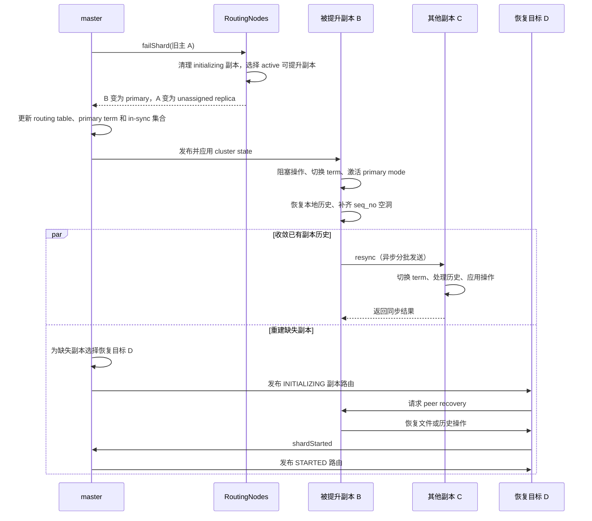
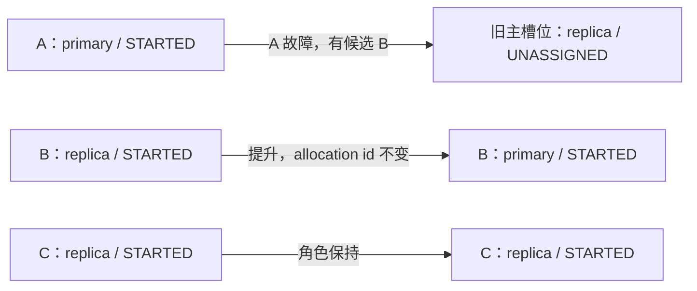
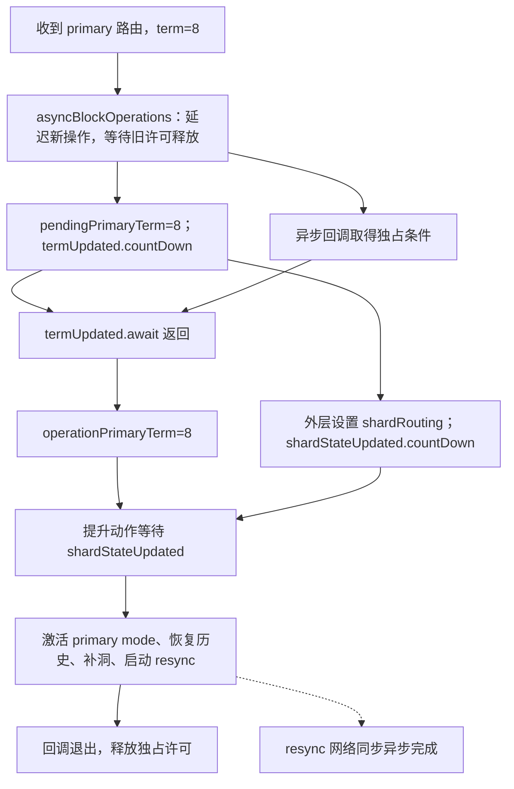
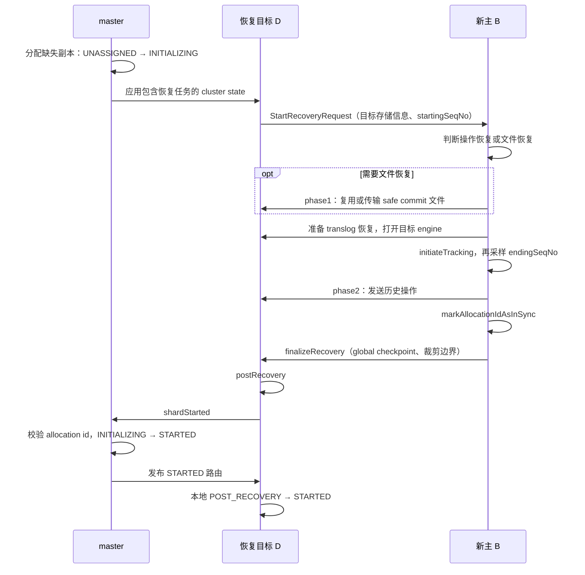
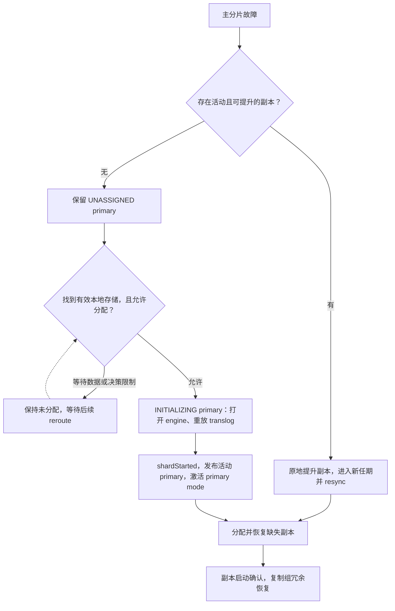

# 主分片从故障到恢复：副本提升、历史收敛与复制组重建

## 1. 从恢复主服务到恢复副本冗余

一个 replication group 的主分片故障后，master 需要选出可接替的副本；被选节点则必须停止沿用旧主的执行语义，进入新的 primary term，整理本地历史并同步其他副本。这是两个相互衔接的阶段：**路由中的 `primary=true` 是角色决定，数据节点取得 primary mode 并完成任期切换才建立本地执行条件。**

本文跟踪普通主副本复制组从故障检测到重新具备主副本的完整主线，并展开没有活动副本时的本地存储恢复分支。主分片 relocation、快照恢复和 DCDR 远端恢复作为边界说明。

“恢复”有两个完成点：新主完成本地接管后可以处理新任期操作；缺失副本补齐并启动后才恢复预期冗余。下面先看新主接管，随后继续跟踪副本重建。



图中两条收敛路径可以交叠执行：缺失副本的分配恢复不以所有 `resync` 消息结束为统一起点。

对应代码：`server/src/main/java/org/elasticsearch/cluster/routing/RoutingNodes.java:551`、`server/src/main/java/org/elasticsearch/indices/cluster/IndicesClusterStateService.java:746`、`server/src/main/java/org/elasticsearch/index/shard/IndexShard.java:501`。

## 2. 贯穿案例与初始条件

假设索引 `orders` 的 shard 0 有一个主分片、两个副本，三者均为普通可提升角色，allocation id 都在 in-sync 集合中。节点版本相同；本例假设 master 选中 B，不依赖相同版本候选的遍历顺序。

| 节点 | 路由角色及状态 | 本地历史（示意） |
| --- | --- | --- |
| A | primary，`STARTED` | 即将故障 |
| B | replica，`STARTED` | local checkpoint=103，max seq_no=105，缺少 104 |
| C | replica，`STARTED` | 有可能包含不同于 B 的旧任期尾部历史 |

原 primary term=7，B 最后已知 global checkpoint=100；因此 101 以上需要考虑重新同步。所有数值均为示意，不是默认值或测试运行结果。local checkpoint=103 表示 103 及以前没有空洞，并不排斥已经收到 105。

## 3. 故障怎样进入 master 分配逻辑

### 3.1 从检测故障到提交 master 任务

**节点故障**：master 的 `FollowersChecker` 对 follower 检查失败后，经 `failNode` 在协调线程执行故障回调。`Coordinator` 将此回调绑定到 `removeNode`；只有当前模式为 `LEADER` 才提交 `NodeLeftExecutor.Task`。检查失败、连接断开与节点落后等不同检测原因可以进入节点移除链路，不能把某一次请求超时直接等同于主分片已经完成切换。

源码：`server/src/main/java/org/elasticsearch/cluster/coordination/Coordinator.java:361`（节选）。

```java
private void removeNode(DiscoveryNode discoveryNode, String reason) {
    synchronized (mutex) {
        if (mode == Mode.LEADER) {
            var task = new NodeLeftExecutor.Task(discoveryNode, reason, () -> joinReasonService.onNodeRemoved(discoveryNode, reason));
            nodeLeftQueue.submitTask("node-left", task, null);
        }
    }
}
```

关键是 `mode == Mode.LEADER`：master 负责修改全局路由，持有副本的节点不会自行通过本地超时宣布自己成为新主。故障检查回调定位于 `FollowersChecker.java:425`，绑定定位于 `Coordinator.java:286`。

**分片故障**：`IndexShard` 的失败回调由 `IndicesClusterStateService.FailedShardHandler` 消费，异步进入 `failAndRemoveShard`，移除本地失败实例并上报。`sendFailShard` 先写入失败缓存，再调用 `ShardStateAction.localShardFailed`，避免后续状态应用立即反复创建同一个已失败路由。

源码：`server/src/main/java/org/elasticsearch/indices/cluster/IndicesClusterStateService.java:917`（节选）。

```java
failedShardsCache.put(shardRouting.shardId(), shardRouting);
shardStateAction.localShardFailed(shardRouting, message, failure, ActionListener.noop(), state);
```

本地失败上报携带 shard id 和 allocation id，primary term 字段为 `0L`，表示分片报告自身失败；主端因复制失败上报其他副本时，则携带自己的任期。见 `ShardStateAction.java:224`、`:177`。

### 3.2 master 为什么还要校验失败消息

失败消息可能在网络中滞留。`ShardFailedClusterStateTaskExecutor.execute` 对带非零任期的复制失败报告，比较请求任期和当前索引任期；不匹配则以 `NoLongerPrimaryShardException` 结束该任务，避免旧主的延迟失败报告误伤新复制组。

源码：`server/src/main/java/org/elasticsearch/cluster/action/shard/ShardStateAction.java:333`（节选）。

```java
if (entry.primaryTerm > 0) {
    long currentPrimaryTerm = indexMetadata.primaryTerm(entry.getShardId().id());
    if (currentPrimaryTerm != entry.primaryTerm) {
        // ... 以 NoLongerPrimaryShardException 结束该任务，然后 continue
    }
}
```

这里仅摘录判断入口；分支内构造异常并 `continue`。随后按 allocation id 查找 routing：有匹配路由则加入失败列表；没有路由、但属于当前任期上报且 id 还在 in-sync 集合时，仅标记 stale；其他已过期消息可按成功忽略。定位：`ShardStateAction.java:368`。这些检查发生在真正进入 `AllocationService.applyFailedShards` 之前。

### 3.3 节点离开与单个 shard 失败是两个入口

节点离开由 `NodeLeftExecutor` 移除节点后调用 `AllocationService.disassociateDeadNodes`。后者遍历已经不在存活数据节点集合中的 routing node，为其 shard 构造 `NODE_LEFT` 或 `NODE_RESTARTING` 信息，再逐个调用 `RoutingNodes.failShard`。

定位：`server/src/main/java/org/elasticsearch/cluster/coordination/NodeLeftExecutor.java:96`、`server/src/main/java/org/elasticsearch/cluster/routing/allocation/AllocationService.java:562`。

单个 shard 故障则经 `ShardStateAction` 的失败任务处理进入 `AllocationService.applyFailedShards`。它按 allocation id 重新解析当前路由，避免批处理前面的一次失败已经改变后续 shard 的状态；若要求 mark stale，还会登记移除 allocation id，然后进入同一个 `failShard`。

定位：`server/src/main/java/org/elasticsearch/cluster/action/shard/ShardStateAction.java:397`、`server/src/main/java/org/elasticsearch/cluster/routing/allocation/AllocationService.java:191`。

源码：`cluster/routing/allocation/AllocationService.java:243`（节选）。

```java
if (failedShardEntry.markAsStale()) {
    allocation.removeAllocationId(failedShard);
}
logger.warn(() -> "failing shard [" + failedShardEntry + "]", failedShardEntry.failure());
allocation.routingNodes().failShard(logger, failedShard, unassignedInfo, allocation.changes());
```

这里把 stale 处理和路由失败放在同一轮分配变更中。节点离开分支也汇入 `RoutingNodes.failShard`，并在需要时继续 reroute，见 `AllocationService.java:276`。

节点离开流程虽然会记录 delayed 标记，但 `failShard` 内部直接尝试提升活动副本。不能把延迟重新分配等同于“必须等超时才选新主”。

### 3.4 为什么先清理 initializing 副本

`failShard` 发现失败对象为 primary 后，先对同组 `initializing` 副本递归执行失败处理。这些副本仍处于恢复中，不能直接接替旧主；代码注释还明确指出，该顺序用于避免让 `RoutingNodes` 进入不一致状态。

若副本正在 relocation，初始化中的目标也会被处理，源端取消 relocation 并回到可提升的 `STARTED` 状态。因此 `promoteReplicaToPrimary` 会断言候选已经是 `started()`。

定位：`RoutingNodes.java:575`、`RoutingNodes.java:701`。

源码：`cluster/routing/RoutingNodes.java:580`（节选）。

```java
if (routing.primary() == false && routing.initializing()) {
    // re-resolve replica as earlier iteration could have changed source/target of replica relocation
    ShardRouting replicaShard = getByAllocationId(routing.shardId(), routing.allocationId().getId());
    assert replicaShard != null : "failed to re-resolve " + routing + " when failing replicas";
    // ... 构造 primaryFailedUnassignedInfo
    failShard(logger, replicaShard, primaryFailedUnassignedInfo, routingChangesObserver);
}
```

该分支接下来构造原因是 `PRIMARY_FAILED` 的 `UnassignedInfo`，递归调用 `failShard`；省略的是原因对象的参数构造，而不是另一次候选选择。

## 4. 候选选择：不是比较谁的 seq_no 最大

`unassignPrimaryAndPromoteActiveReplicaIfExists` 调用 `activePromotableReplicaWithHighestVersion`，过滤条件是：

1. 不是 primary，且 `active()`。
2. 对应 routing node 存在。
3. shard 的 role 满足 `isPromotableToPrimary()`。
4. 在候选中按 `DiscoveryNode.getVersion()` 取最大值；处理节点信息为 null 的情况。

这里的最高版本是 **Elasticsearch 节点版本**，不是文档版本、primary term 或 checkpoint。该方法没有比较 local checkpoint，也没有现场向各副本收集最大 seq_no。其注释明确关联滚动升级中副本可能比原主版本更旧的场景；相同版本时没有额外的 checkpoint 排序规则。

定位：`server/src/main/java/org/elasticsearch/cluster/routing/RoutingNodes.java:375`、`server/src/main/java/org/elasticsearch/cluster/routing/ShardRouting.java:930`。

下面摘录候选方法的返回表达式（`RoutingNodes.java:381`）。沿过滤条件向下读，最后的比较器明确落在 `DiscoveryNode.getVersion` 上：

```java
return assignedShards(shardId).stream()
    .filter(shr -> shr.primary() == false && shr.active())
    .filter(shr -> node(shr.currentNodeId()) != null)
    .filter(ShardRouting::isPromotableToPrimary)
    .max(
        Comparator.comparing(
            shr -> node(shr.currentNodeId()).node(),
            Comparator.nullsFirst(Comparator.comparing(DiscoveryNode::getVersion))
        )
    )
    .orElse(null);
```

对贯穿案例而言，B、C 都通过前三道过滤，且节点版本相同；仅凭这里的代码不能断言 B 比 C 的数据更新。B 被选中后，数据正确性仍要由后面的任期隔离和历史收敛保证。

候选方法本身也没有逐个查询 in-sync 集合。不能据此推导“任意磁盘副本都能提升”：这里选的是当前路由中的活动、可提升副本，in-sync 集合由分片启动、失败及 stale 移除等流程另行维护。离线存储恢复不是这条即时提升路径。

如果没有合格副本，旧主转为 unassigned primary，不能凭空产生一个活动主分片。该分支还会将残余不可提升副本转为 unassigned，原因记作 `UNPROMOTABLE_REPLICA`，后续交给分配和恢复流程。

定位：`RoutingNodes.java:667`、`server/src/main/java/org/elasticsearch/cluster/routing/allocation/IndexMetadataUpdater.java:65`。

## 5. master 改变哪些状态

选中 B 后，旧主 A 经 `movePrimaryToUnassignedAndDemoteToReplica` 转为未分配副本；B 经 `moveActiveReplicaToPrimary` 生成新的 `ShardRouting`。新对象保留节点、allocation id 和路由状态，修改 primary 标志。因此 B 不需要先回到 `INITIALIZING` 再做一次完整 peer recovery。

定位：`RoutingNodes.java:695`、`RoutingNodes.java:747`、`ShardRouting.java:628`。

有候选时，路由层真正执行的是下面两步（`RoutingNodes.java:696`）：

```java
movePrimaryToUnassignedAndDemoteToReplica(failedPrimary, unassignedInfo);
promoteReplicaToPrimary(replicaToPromote, routingChangesObserver);
```

第一步腾出旧主的角色，第二步把 B 的活动副本路由替换为主分片路由。下面的图只表示 master 生成的路由状态；B 本地的执行切换还没有画入其中。



图中没有给 B 增加 `INITIALIZING` 阶段：它已经是活动副本，接下来要做的是切换执行任期与修整历史。

primary term 的增加不能简单归因于 `replicaPromoted` 回调：活动主分片失败时，`IndexMetadataUpdater.shardFailed` 调用 `increasePrimaryTerm`；应用元数据更新时才执行 `withIncrementedPrimaryTerm`。更新标志是布尔值，因此同一轮更新内多次通知不会逐次累加任期。

定位：`server/src/main/java/org/elasticsearch/cluster/routing/allocation/IndexMetadataUpdater.java:83`、`:123`、`:322`。

把“登记任期变化”与“写入元数据”放在一起看更清楚。以下分别摘自 `IndexMetadataUpdater.java:91`、`:123`，中间流程省略：

```java
increasePrimaryTerm(failedShard.shardId());
```

```java
updatedIndexMetadata = updates.increaseTerm
    ? updatedIndexMetadata.withIncrementedPrimaryTerm(shardId.id())
    : updatedIndexMetadata;
```

因此，案例中的 `7 → 8` 与活动主分片失败相关；不能把增加任期理解为任意一次路由角色修改都会触发。

| 对象 | 故障前 | master 生成的新状态 |
| --- | --- | --- |
| A 的路由槽位 | primary，`STARTED` | replica，`UNASSIGNED`（后续可能重新分配） |
| B 的路由 | replica，`STARTED` | primary，`STARTED`，allocation id 不变 |
| primary term | 7 | 8 |

in-sync 集合另行合并 added/removed allocation id；故障并不一概等于永久删除旧主的 id。尤其没有活动副本时，代码保留第一个失败主分片的 allocation id，避免丢掉最后的有效恢复依据。

定位：`IndexMetadataUpdater.java:185`、`:223`。

### 5.1 路由和任期如何一起进入新 cluster state

`AllocationService` 根据变更后的 `RoutingNodes` 生成 `RoutingTable`，再将 routing observer 收集的变化应用到 metadata，最后把两者写入同一个新状态。这样发布的是彼此匹配的路由与任期，而不是先广播新主角色、再单独广播任期。

源码：`server/src/main/java/org/elasticsearch/cluster/routing/allocation/AllocationService.java:159`（节选）。

```java
final RoutingTable newRoutingTable = RoutingTable.of(oldRoutingTable.version(), newRoutingNodes);
final Metadata newMetadata = allocation.updateMetadataWithRoutingChanges(newRoutingTable);
assert newRoutingTable.validate(newMetadata); // validates the routing table is coherent with the cluster state metadata

final ClusterState.Builder newStateBuilder = ClusterState.builder(oldState).routingTable(newRoutingTable).metadata(newMetadata);
```

分配任务返回新状态后，由 `MasterService` 进入发布。其 `publish` 方法调用已配置的 `clusterStatePublisher.publish`；发布与应用存在异步过程，因此各数据节点不会在路由对象生成的一瞬间同时切换角色。

源码：`server/src/main/java/org/elasticsearch/cluster/service/MasterService.java:475`（节选）。

```java
clusterStatePublisher.publish(
    clusterStatePublicationEvent,
    // ... 发布完成回调、ackListener
);
```

上面省略发布完成与确认回调参数，发布调用入口见 `MasterService.java:353`。以下继续看新状态到达数据节点后的应用。

## 6. B 收到 cluster state：角色和执行状态如何衔接

`IndicesClusterStateService.updateShard` 从新状态读取 primary term、in-sync ids 和 shard routing table，调用 `IndexShard.updateShardState`，并传入 `primaryReplicaSyncer::resync`。

`updateShardState` 校验 shard id 和 allocation id，禁止同一个本地 primary 直接降为 replica；对于新 primary，先将 master 的复制组信息传给 `ReplicationTracker.updateFromMaster`。本例的 term 从 7 增加到 8，进入提升分支。

定位：`IndicesClusterStateService.java:746`、`IndexShard.java:501`、`:580`。

源码：`indices/cluster/IndicesClusterStateService.java:762`（节选）。

```java
shard.updateShardState(
    shardRouting,
    primaryTerm,
    primaryReplicaSyncer::resync,
    clusterState.version(),
    inSyncIds,
    indexShardRoutingTable
);
```

`primaryReplicaSyncer::resync` 在这里被作为回调传入；是否调用它由 `IndexShard` 的任期切换分支决定。

### 6.1 先挡住操作，再切换执行任期

`bumpPrimaryTerm` 通过 `asyncBlockOperations` 阻塞操作，并等待已有许可释放。`pendingPrimaryTerm` 表示准备进入的任期，`operationPrimaryTerm` 表示执行层已经进入的任期，两者过渡期间可以不同。

回调取得独占条件后等待 `termUpdated`，再设置 operation term、执行提升动作。提升回调还等待 `shardStateUpdated`，确保外层已经发布本地的新路由。外层最后设置 `this.shardRouting` 并释放 latch，避免异步回调在角色信息尚未更新时继续。

定位：`IndexShard.java:617`、`:622`、`:692`、`:3729`。

下面是 `bumpPrimaryTerm` 成功回调中的关键顺序（`IndexShard.java:3763`）：

```java
termUpdated.await();
// indexShardOperationPermits doesn't guarantee that async submissions are executed
// in the order submitted. We need to guard against another term bump
if (getOperationPrimaryTerm() < newPrimaryTerm) {
    replicationTracker.setOperationPrimaryTerm(newPrimaryTerm);
    onBlocked.run();
}
```

方法尾部则先记录准备进入的任期，再解除回调的等待（`IndexShard.java:3785`）：

```java
pendingPrimaryTerm = newPrimaryTerm;
termUpdated.countDown();
```

`onBlocked.run()` 对应提升时传入的动作；它的第一步还有 `shardStateUpdated.await()`。两个 latch 分别保证“新任期已经记录”和“本地新路由已经设置”。图中箭头表示必须先满足的条件，线程的具体调度顺序不固定：



| 观察时点 | `pendingPrimaryTerm` | `operationPrimaryTerm` | 操作条件 |
| --- | --- | --- | --- |
| 切换前 | 7 | 7 | 按旧副本语义执行 |
| 新任期已登记、回调尚未更新执行任期 | 8 | 7 | 新操作延迟，旧许可排空 |
| 执行提升动作 | 8 | 8 | 独占条件下整理状态 |
| 提升回调退出 | 8 | 8 | 许可恢复，resync 可能仍在进行 |

中间两行可能非常短暂；它们解释的是源码允许的过渡状态，并不是每次都能从外部稳定观测到的运行阶段。

这解释了为什么仅观察 routing 的 primary 标志不足以判断本地切换已经完成：中间仍可能处于操作许可阻塞阶段。

### 6.2 激活 primary mode，并修整本地历史

持有阻塞条件时按顺序执行：

1. `activatePrimaryMode(getLocalCheckpoint())`：设置 primary mode，用本地 checkpoint 初始化自身进度，并计算主端 global checkpoint。
2. `ensurePeerRecoveryRetentionLeasesExist()`：确保后续 peer recovery 所需租约。
3. `restoreLocalHistoryFromTranslog`：恢复可能在之前一次任期切换中从 Lucene 回滚、但仍保存在 translog 的本地操作。
4. `rollTranslogGeneration()`：滚动日志代；注释说明这不是避免序列号冲突所必需，而是便于理解任期与 translog generation 的关系。
5. `fillSeqNoGaps(newPrimaryTerm)`：为历史空洞填入当前任期的 no-op。
6. 更新自身 local checkpoint，启动 `primaryReplicaSyncer`。

定位：`IndexShard.java:635`、`server/src/main/java/org/elasticsearch/index/seqno/ReplicationTracker.java:1148`。

历史处理的核心代码如下（`IndexShard.java:646`，省略中间解释性注释）：

```java
final Engine engine = getEngine();
engine.restoreLocalHistoryFromTranslog(
    (resettingEngine, snapshot) -> runTranslogRecovery(
        resettingEngine,
        snapshot,
        Engine.Operation.Origin.LOCAL_RESET,
        () -> {}
    )
);
// ... 省略关于 translog generation 的解释性注释
engine.rollTranslogGeneration();
engine.fillSeqNoGaps(newPrimaryTerm);
replicationTracker.updateLocalCheckpoint(currentRouting.allocationId().getId(), getLocalCheckpoint());
```

对 B 来说，可以把变化按序列号画成一行：

| 阶段 | 101 | 102 | 103 | 104 | 105 | local checkpoint |
| --- | --- | --- | --- | --- | --- | --- |
| 提升前 | 已处理 | 已处理 | 已处理 | 空洞 | 已处理 | 103 |
| 恢复历史后仍存在该空洞时 | 已处理 | 已处理 | 已处理 | 空洞 | 已处理 | 103 |
| `fillSeqNoGaps(8)` 后 | 已处理 | 已处理 | 已处理 | term=8 的 no-op | 已处理 | 可推进至 105 |

这里假设 translog 恢复没有找回 104；如果恢复步骤已经补回该序号，就无需再为它填 no-op。

本例 B 的空洞 104 被补齐；假设没有并发新增操作、105 已处理完成，则 local checkpoint 可以推进到 105。填 no-op 不会凭空恢复缺失的业务写入内容。恢复 translog 那一步则专门覆盖连续两次故障提升的风险：前一次当副本时回滚的操作，不能在本次成为主分片时直接遗忘。

## 7. resync：让其他副本接受新主历史

### 7.1 从 global checkpoint 之后开始分批发送

`PrimaryReplicaSyncer.resync` 取 `getLastKnownGlobalCheckpoint()+1` 为起点，记录主端 `maxSeqNo`，创建 changes snapshot。案例中起点为 101；这个起点取的是调用当时的 checkpoint，若它在提升过程中推进，实际起点也会变化。

它还携带新主的 allocation id、pending primary term 和最大已见 auto-id timestamp。第一条消息携带 `trimAboveSeqNo=maxSeqNo`，后续消息使用未赋值哨兵；即使没有待发送操作，也需要考虑首条裁剪通知。

定位：`server/src/main/java/org/elasticsearch/index/shard/PrimaryReplicaSyncer.java:73`、`:132`、`:344`。

同步起点和快照来自同一次 `resync` 调用。以下摘自 `PrimaryReplicaSyncer.java:76`、`:83`，省略断言和局部变量：

```java
final long startingSeqNo = indexShard.getLastKnownGlobalCheckpoint() + 1;
final long maxSeqNo = indexShard.seqNoStats().getMaxSeqNo();
// ...
snapshot = indexShard.newChangesSnapshot("resync", startingSeqNo, Long.MAX_VALUE, false, false, true);
```

发送侧决定首批裁剪边界的代码（`PrimaryReplicaSyncer.java:344`）：

```java
final long trimmedAboveSeqNo = firstMessage.get() ? maxSeqNo : SequenceNumbers.UNASSIGNED_SEQ_NO;
// have to send sync request even in case of there are no operations to sync - have to sync trimmedAboveSeqNo at least
if (operations.isEmpty() == false || trimmedAboveSeqNo != SequenceNumbers.UNASSIGNED_SEQ_NO) {
    task.setPhase("sending_ops");
    // ... 构造请求并发送
}
```

如果调用时 B 的 global checkpoint 仍为 100、max seq_no 为 105，那么发送范围从 101 开始，首批同时携带裁剪上界 105。后续即使新任期写入产生了 106，也不能把这个上界解释为“删除所有大于 105 的操作”：裁剪方法针对的是旧任期历史。

### 7.2 C 先进入新任期，再执行同步操作

副本操作许可逻辑收到较大 primary term 时，同样阻塞操作并切换任期。若当前 global checkpoint 小于 max seq_no，会执行 `resetEngineToGlobalCheckpoint`；否则滚动 translog generation。这样先整理可能分歧的未安全尾部，再接受新主复制的历史。

旧于当前 operation term 的请求会被拒绝；这属于任期隔离的一部分，不能扩写为“旧主一失联就立即在本地停止所有执行”。

定位：`IndexShard.java:3870`、`:3902`。

收到新任期的副本，在阻塞回调中根据安全进度选择如何处理尾部历史（`IndexShard.java:3912`）：

```java
if (currentGlobalCheckpoint < maxSeqNo) {
    resetEngineToGlobalCheckpoint();
} else {
    getEngine().rollTranslogGeneration();
}
```

这与 B 的提升动作形成配合：B 恢复自己的本地历史并确立新主历史，C 在接收新任期操作时整理可能分歧的尾部，再接收 B 的同步内容。两边不能只做一次角色标志翻转。

`TransportResyncReplicationAction.performOnReplica` 更新 auto-id timestamp，以 `REPLICA` origin 应用操作；需要 mapping 时抛出可重试异常。若携带裁剪上界，则调用 `trimOperationOfPreviousPrimaryTerms`，针对旧任期历史裁剪，不是无条件删除所有超出上界的新任期操作。

定位：`server/src/main/java/org/elasticsearch/action/resync/TransportResyncReplicationAction.java:156`。

### 7.3 异步完成与失败清理

启动 resync 后，提升阶段独占许可随 `bumpPrimaryTerm` 回调退出而释放，并不一直等待网络同步完成。因此不能把“resync 全部结束”写成所有新写入恢复的必要前提。

`primaryReplicaResyncInProgress` 在同步期间维持为 true，阻止 primary relocation handoff。成功回调清除此标志；失败回调也清除标志，对尚未关闭的 shard 执行 `failShard`，而不是保留一个同步失败但继续静默服务的本地主分片。同步 snapshot 在成功或失败路径都会关闭；任期切换本身异常也会失败分片。

定位：`IndexShard.java:665`、`:882`、`:3729`、`PrimaryReplicaSyncer.java:109`。

## 8. 新主接管之后：补齐缺失副本

A 故障、B 提升后，复制组仍缺一个副本。接下来假设 master 将这个槽位分配到 D；D 可以是新节点，也可以是重新加入的旧节点 A。恢复始终以新主 B 的权威历史为准，旧节点磁盘数据只决定能否复用文件和操作，不会使其自动恢复原主身份。



### 8.1 master 分配副本：先决定目标，再恢复数据

`AllocationService.reroute` 先尝试已有分片分配，再执行 shard allocator。使用 desired balance 时，`DesiredBalanceReconciler` 对目标节点执行 `canAllocate`；决策为 `YES` 才真正初始化该副本。空间不足、分配过滤、同一 shard 已在节点上或恢复限流，都可能让这个阶段继续等待。定位：`AllocationService.java:529`、`DesiredBalanceReconciler.java:310`。

源码：`server/src/main/java/org/elasticsearch/cluster/routing/allocation/allocator/DesiredBalanceReconciler.java:323`（节选）。

```java
routingNodes.initializeShard(shard, nodeId, null, shardSize, allocation.changes());
```

使用 balanced allocator 时也汇入 `RoutingNodes.initializeShard`，见 `BalancedShardsAllocator.java:1145`。本章不展开平衡算法全部策略；恢复链路的关键结果是目标 D 获得 `INITIALIZING` 副本路由，而不是已经成为活动副本。

### 8.2 D 如何找到 B，并启动 peer recovery

D 应用新状态时，`IndicesClusterStateService.createShard` 为 `PEER` 恢复选择源节点。普通副本的源是当前活动主分片 B；若主分片未活动或源节点不可见，则暂不创建。定位：`IndicesClusterStateService.java:567`、`:809`。

`IndicesService.createShard` 创建实例并调用 `IndexShard.startRecovery`。不同 recovery source 在此分流：

源码：`server/src/main/java/org/elasticsearch/index/shard/IndexShard.java:3392`（节选）。

```java
switch (recoveryState.getRecoverySource().getType()) {
    case EMPTY_STORE, EXISTING_STORE -> executeRecovery("from store", recoveryState, recoveryListener, this::recoverFromStore);
    case PEER -> {
        try {
            markAsRecovering("from " + recoveryState.getSourceNode(), recoveryState);
            recoveryTargetService.startRecovery(this, recoveryState.getSourceNode(), clusterStateVersion, recoveryListener);
```

这里只摘录本地存储和 peer 两条分支的入口，省略后续异常处理及闭合括号。目标端 `PeerRecoveryTargetService.doRecovery` 准备存储元数据、恢复起点等信息，发送恢复请求；源端进入 `RecoverySourceHandler.recoverToTarget`。调用定位：`IndicesService.java:881`、`PeerRecoveryTargetService.java:275`、`:363`。

### 8.3 选择按操作恢复，还是先恢复文件

“旧主重新加入”并不意味着一定要重传全部文件。源端根据目标提供的恢复起点、history 是否相同、主端历史是否完整，以及 retention lease 是否覆盖起点来选择路径：

源码：`server/src/main/java/org/elasticsearch/indices/recovery/RecoverySourceHandler.java:214`（节选）。

```java
final boolean isSequenceNumberBasedRecovery = request.startingSeqNo() != SequenceNumbers.UNASSIGNED_SEQ_NO
    && isTargetSameHistory()
    && shard.hasCompleteHistoryOperations("peer-recovery", request.startingSeqNo())
    && ((retentionLease == null && shard.useRetentionLeasesInPeerRecovery() == false)
        || (retentionLease != null && retentionLease.retainingSequenceNumber() <= request.startingSeqNo()));
```

满足条件时按序列号恢复，跳过文件阶段；否则获取 safe commit 进入 `phase1`，比较文件元数据，复用可复用文件并传输所需文件，然后恢复 safe commit 之后的操作。不是每次文件恢复都无差别复制所有文件。定位：`RecoverySourceHandler.java:250`、`:303`、`:533`。

源码：`indices/recovery/RecoverySourceHandler.java:303`（节选）。

```java
phase1(safeCommitRef.getIndexCommit(), startingSeqNo, () -> estimateNumOps, sendFileStep);
```

文件路径的 `startingSeqNo` 取 safe commit 的 local checkpoint 加一（`RecoverySourceHandler.java:283`）。文件提供一致的基础，后续历史重放负责补齐该基础之后的写入。

### 8.4 恢复期间新写入怎样避免漏掉

文件阶段结束后，源端先调用 `prepareTargetForTranslog`，待目标 engine 可接受操作，再将 D 加入复制跟踪。关键顺序是 **先 `initiateTracking`，再采样 `endingSeqNo`**：

源码：`server/src/main/java/org/elasticsearch/indices/recovery/RecoverySourceHandler.java:328`（节选）。

```java
runUnderPrimaryPermit(
    () -> shard.initiateTracking(request.targetAllocationId()),
    shard,
    cancellableThreads,
    ActionListener.wrap(ignored -> {
        final long endingSeqNo = shard.seqNoStats().getMaxSeqNo();
        // ... 创建历史快照并执行 phase2
    }, onFailure)
);
```

此处省略后面的快照构造和 `phase2` 调用。源码注释说明，进入跟踪后新的主端写入也会复制到 D；采样之前的历史由 phase2 覆盖，之后的写入由正常复制继续覆盖，从而衔接恢复流和实时写入。`initiateTracking` 还不等于“D 已同步完成”。定位：`RecoverySourceHandler.java:320`、`:352`。

源码：`indices/recovery/RecoverySourceHandler.java:352`（节选）。

```java
phase2(
    startingSeqNo,
    endingSeqNo,
    phase2Snapshot,
    maxSeenAutoIdTimestamp,
    maxSeqNoOfUpdatesOrDeletes,
    retentionLeases,
    mappingVersionOnPrimary,
    sendSnapshotStep
);
```

`phase2Snapshot` 从恢复起点创建，`endingSeqNo` 界定本次历史同步需要覆盖的尾部；租约、自动 id 时间戳和更新/删除序列号等随恢复传给目标。

### 8.5 先进入主端同步集合，再完成恢复确认

phase2 返回目标 checkpoint 后，`finalizeRecovery` 在 primary permit 下调用 `markAllocationIdAsInSync`，随后发送 finalize 请求：

源码：`server/src/main/java/org/elasticsearch/indices/recovery/RecoverySourceHandler.java:1285`（节选）。

```java
final SubscribableListener<Void> markInSyncStep = new SubscribableListener<>();
runUnderPrimaryPermit(
    () -> cancellableThreads.execute(() -> shard.markAllocationIdAsInSync(request.targetAllocationId(), targetLocalCheckpoint)),
    shard,
    cancellableThreads,
    markInSyncStep
);

final SubscribableListener<Long> finalizeListener = new SubscribableListener<>();
markInSyncStep.addListener(listener.delegateFailureAndWrap((l, ignored) -> {
    final long globalCheckpoint = shard.getLastKnownGlobalCheckpoint(); // this global checkpoint is persisted in finalizeRecovery
    cancellableThreads.checkForCancel();
    recoveryTarget.finalizeRecovery(globalCheckpoint, trimAboveSeqNo, finalizeListener.map(ignored2 -> globalCheckpoint));
}));
```

主端 `ReplicationTracker` 内的 in-sync 状态和 master `IndexMetadata` 的 in-sync 集合是不同层次：前者在恢复 finalize 阶段更新，后者在 master 接受 shard started、应用 routing observer 变更时更新。不能把一次本地 `markAllocationIdAsInSync` 当成 master 已经发布 `STARTED`。

源码：`index/seqno/ReplicationTracker.java:1331`（节选）。

```java
if (cps.localCheckpoint < getGlobalCheckpoint()) {
    pendingInSync.add(allocationId);
    // ... 等待进度推进并处理 pendingInSync 的清理
} else {
    cps.inSync = true;
    updateReplicationGroupAndNotify();
    // ... 更新 global checkpoint
}
```

这里省略等待循环与清理细节。目标进度尚未达到 global checkpoint 时，先加入 `pendingInSync` 并等待追赶；进度满足后才能成为 in-sync。否则把落后的目标直接视为同步完成，会破坏安全进度的含义。

目标恢复响应成功后，由 `RecoveriesCollection.markRecoveryAsDone` 移除恢复记录并调用 `RecoveryTarget.markAsDone`，后者执行 `postRecovery`，再通知 `RecoveryListener.onRecoveryDone` 上报：

源码：`server/src/main/java/org/elasticsearch/indices/cluster/IndicesClusterStateService.java:860`（节选）。

```java
shardStateAction.shardStarted(
    shardRouting,
    primaryTerm,
    "after " + state.getRecoverySource(),
    timestampMillisFieldRange,
    ActionListener.noop()
);
```

定位：`PeerRecoveryTargetService.java:732`、`RecoveriesCollection.java:218`、`RecoveryTarget.java:320`。master 的 started executor 按 allocation id 匹配路由，忽略已过期或重复消息；对 primary 的 started 消息还核对任期。随后调用 `AllocationService.applyStartedShards`：

源码：`server/src/main/java/org/elasticsearch/cluster/action/shard/ShardStateAction.java:689`（节选）。

```java
maybeUpdatedState = allocationService.applyStartedShards(initialState, shardRoutingsToBeApplied);
```

分配层将目标路由转为 `STARTED`，`IndexMetadataUpdater.shardStarted` 记录其 allocation id，新的 cluster state 发布后，D 的 `IndexShard.updateShardState` 才把本地 `POST_RECOVERY` 转为 `STARTED`。定位：`AllocationService.java:603`、`IndexMetadataUpdater.java:65`、`IndexShard.java:535`。

到这里，案例的最终状态是 B 为主、C 与 D 为副本，三者路由均为 `STARTED`。这表示本复制组恢复了预期冗余；集群是否整体 green 还取决于其他 shard。

恢复异常通过 `RecoveryListener.onRecoveryFailure` → `handleRecoveryFailure` → `failAndRemoveShard` 清理目标，并根据 `sendShardFailure` 决定是否通知 master。后续是否重试及何时重试，仍受分配决策和失败重试限制影响，不能假设每次失败都会立即无限重试。定位：`IndicesClusterStateService.java:871`。

## 9. 没有活动副本：从本地存储恢复主分片

### 9.1 找不到候选时为什么不新建空主分片

假设 A、B、C 都离线。`RoutingNodes` 没有活动候选，只保留未分配主分片；master 随后的 reroute 会尝试已有数据恢复。`PrimaryShardAllocator` 异步收集节点的 shard 存储信息；未拿到结果时返回 `FETCHING_SHARD_DATA`。

已有数据的普通主分片根据 `inSyncAllocationIds` 筛选可用存储。关键过滤如下；`matchAnyShard` 用于其他恢复情形，不代表普通已有存储恢复可以随意绕过 in-sync：

源码：`server/src/main/java/org/elasticsearch/gateway/PrimaryShardAllocator.java:351`（节选）。

```java
if (matchAnyShard || inSyncAllocationIds.contains(nodeShardState.allocationId())) {
    nodeShardStates.add(nodeShardState);
}
```

若普通已有数据恢复没有候选，则返回 `NO_VALID_SHARD_COPY`；可以等拥有有效副本的节点重新加入，再触发 reroute。即使找到了有效存储，分配决策器仍可能拒绝或限流。定位：`PrimaryShardAllocator.java:88`、`:101`、`:125`。

这就是“没有可提升副本”和“数据已彻底丢失”的区别：前者只是没有在线活动副本，后续仍可能从有效存储恢复；如果所有有效副本都不可用，正常自动恢复链路会停在未分配状态。强制 stale/empty primary 属于显式人工恢复操作，本章不把它当成正常无损恢复路径。

### 9.2 有效存储被分配后，怎样成为可用主分片

分配结果将 primary 路由设为 `INITIALIZING`，数据节点创建 shard，经 `IndexShard.startRecovery` 的 `EXISTING_STORE` 分支进入 `StoreRecovery.internalRecoverFromStore`。它准备恢复状态、检查 store 损坏标志并读取最近提交；预期存在存储却读不到时会失败，而不是静默创建空索引。定位：`StoreRecovery.java:411`、`:429`。

读取提交及恢复准备之后，核心收尾是：

源码：`server/src/main/java/org/elasticsearch/index/shard/StoreRecovery.java:485`（节选）。

```java
indexShard.openEngineAndRecoverFromTranslog();
indexShard.getEngine().fillSeqNoGaps(indexShard.getPendingPrimaryTerm());
indexShard.finalizeRecovery();
indexShard.postRecovery("post recovery from shard_store", l);
```

本地存储恢复先打开 engine 并重放 translog、补齐序列号空洞，再 finalize 和 postRecovery；成功后走相同的 `shardStarted` 上报闭环。master 接受启动并发布活动 primary 路由后，数据节点才激活 primary mode：

源码：`server/src/main/java/org/elasticsearch/index/shard/IndexShard.java:579`（节选）。

```java
if (currentRouting.initializing() && currentRouting.isRelocationTarget() == false && newRouting.active()) {
    // the master started a recovering primary, activate primary mode.
    replicationTracker.activatePrimaryMode(getLocalCheckpoint());
    ensurePeerRecoveryRetentionLeasesExist();
}
```

这个分支与活动副本提升不同：本地实例本来就是正在恢复的 primary，完成启动后激活 primary mode，不再重复执行“副本提升的新任期 + resync”分支。缺失副本随后按第 8 节继续补齐。



## 10. 主要边界

- **只有 initializing 副本**：先失败恢复中的副本，没有活动候选就保留 unassigned primary，等待恢复。
- **副本正在 relocation**：目标初始化被清理后，源副本可取消 relocation 再参与提升；不能把未恢复完成的目标当成现成新主。
- **主分片 relocation**：属于有计划的主权移交，不是本章 term 增加后恢复历史并 resync 的故障提升分支。`updateShardState` 明确区分 relocation target 和普通恢复 primary；已交出 primary mode 的源分片若再收到不安全路由变化，会失败以避免双主风险。见 `IndexShard.java:535`。
- **旧主重新加入**：master 路由中的旧主槽位降级，不等于允许存活的同一个 `IndexShard` 原地降级；`updateShardState` 对该操作有显式拒绝。重新加入需依照新路由及恢复生命周期处理。
- **DCDR**：当前 `IndexShard` 有 `isRemoteRecovery()` 相关状态检查豁免。本章案例限定普通副本；这些豁免不能推出 DCDR 远端恢复与普通 peer recovery 的完整行为一致。见 `IndexShard.java:551`、`:699`。

## 11. 对照测试与验证边界

以下是源码中的测试阅读入口，本次未执行 Gradle 测试：

| 测试 | 对照机制 |
| --- | --- |
| `FailedShardsRoutingTests.testFailPrimaryStartedCheckReplicaElected` | 活动主分片失败后的候选与路由变化 |
| `IndexShardTests.testPrimaryPromotionDelaysOperations` | 提升时延迟操作 |
| `IndexShardTests.testPublishingOrderOnPromotion` | 提升中的状态发布顺序 |
| `IndexShardTests.testPrimaryFillsSeqNoGapsOnPromotion` | 序列号空洞填补 |
| `IndexShardTests.testPrimaryPromotionRollsGeneration` | translog generation 滚动 |
| `IndexShardTests.testRestoreLocalHistoryFromTranslogOnPromotion` | 从 translog 恢复本地历史 |
| `IndexShardTests.testRollbackReplicaEngineOnPromotion` | 任期变化中的副本历史处理 |

定位：`server/src/test/java/org/elasticsearch/cluster/routing/allocation/FailedShardsRoutingTests.java:165`；`server/src/test/java/org/elasticsearch/index/shard/IndexShardTests.java:440`、`:552`、`:592`、`:627`、`:1273`、`:1330`。

补充恢复链路的测试阅读入口：`PrimaryShardAllocatorTests.testNoAsyncFetchData`（等待存储信息）、`testNoAllocationFound`、`testNoMatchingAllocationIdFound`（无候选或 allocation id 不匹配），见 `server/src/test/java/org/elasticsearch/gateway/PrimaryShardAllocatorTests.java:96`、`:113`、`:131`；文件与历史发送见 `server/src/test/java/org/elasticsearch/indices/recovery/RecoverySourceHandlerTests.java:171` 的 `testSendFiles` 和 `:258` 的 `testSendSnapshotSendsOps`。这些是对照入口，不代表本次已运行验证。

## 12. 心智模型与推荐阅读顺序

把完整恢复看作 **发现并上报故障 → master 确定接班人或等待有效存储 → 发布路由与任期 → 数据节点建立主端执行条件 → 收敛历史 → 补齐副本并确认启动**。路由、任期、primary mode 与历史同步分别解决不同问题，不能只用一个 `primary` 标志概括。

推荐依次阅读 `NodeLeftExecutor` / `ShardStateAction` → `AllocationService` → `RoutingNodes.failShard` 与候选方法 → `IndexMetadataUpdater` → `IndicesClusterStateService.updateShard` → `IndexShard.updateShardState` / `bumpPrimaryTerm` → `ReplicationTracker.activatePrimaryMode` → `PrimaryReplicaSyncer` → `TransportResyncReplicationAction.performOnReplica`，最后用上述测试核对边界。

完整恢复部分接着阅读 `DesiredBalanceReconciler` → `IndicesClusterStateService.createShard` → `IndexShard.startRecovery` → `PeerRecoveryTargetService` → `RecoverySourceHandler` → `RecoveryTarget.markAsDone` → `ShardStateAction` 的 started executor；无活动副本分支另读 `PrimaryShardAllocator` → `StoreRecovery`。
