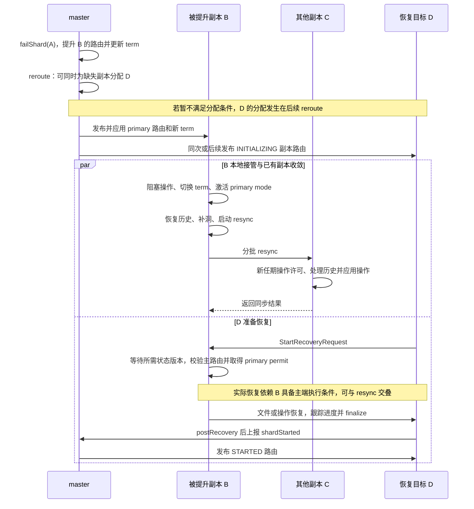
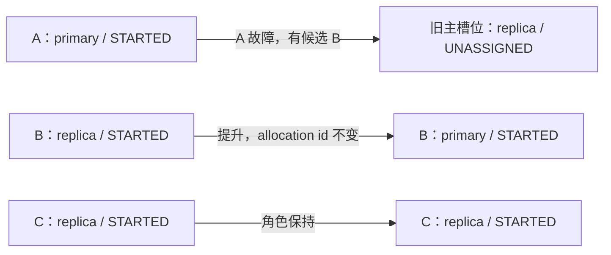
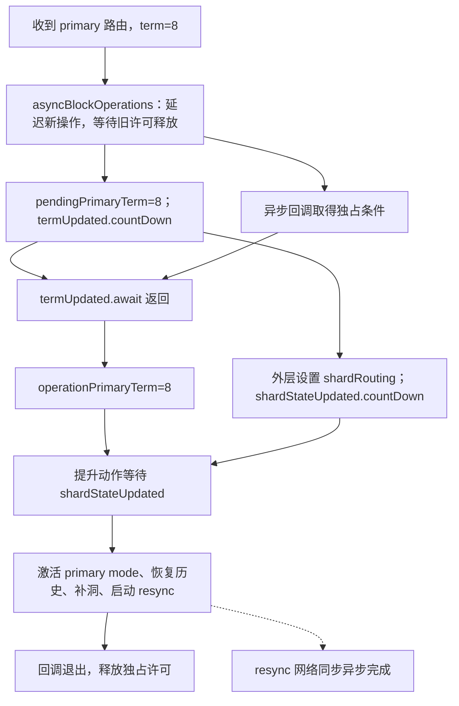
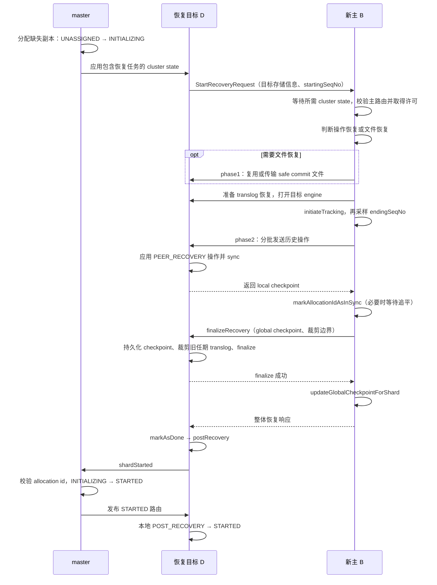
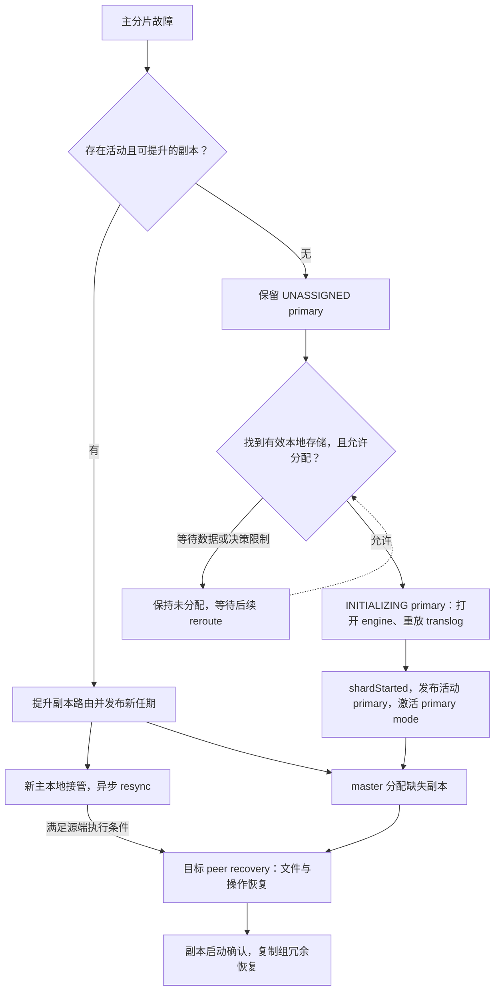

# 主分片从故障到恢复：副本提升、历史收敛与复制组重建

## 1. 从恢复主服务到恢复副本冗余

一个 replication group 的主分片故障后，master 需要选出可接替的副本；被选节点则必须停止沿用旧主的执行语义，进入新的 primary term，整理本地历史并同步其他副本。这是两个相互衔接的阶段：**路由中的 `primary=true` 是角色决定，数据节点取得 primary mode 并完成任期切换才建立本地执行条件。**

本文跟踪普通主副本复制组从故障检测到重新具备主副本的完整主线，并展开没有活动副本时的本地存储恢复分支。主分片 relocation、快照恢复和 DCDR 远端恢复作为边界说明。

“恢复”有两个完成点：新主完成本地接管后可以处理新任期操作；缺失副本补齐并启动后才恢复预期冗余。下面先看新主接管，随后继续跟踪副本重建。



图中区分了“master 分配路由”和“数据节点执行恢复”：前者可早于 B 的本地接管完成；后者需满足状态版本、主路由及 primary permit 等条件。缺失副本恢复不以所有 `resync` 消息结束为统一起点。

对应代码：`server/src/main/java/org/elasticsearch/cluster/routing/RoutingNodes.java:551`、`server/src/main/java/org/elasticsearch/indices/cluster/IndicesClusterStateService.java:746`、`server/src/main/java/org/elasticsearch/index/shard/IndexShard.java:501`。

## 2. 贯穿案例与初始条件

假设索引 `orders` 的 shard 0 有一个主分片、两个副本，三者均为普通可提升角色，allocation id 都在 in-sync 集合中。节点版本相同；本例假设 master 选中 B，不依赖相同版本候选的遍历顺序。

| 节点 | 路由角色及状态 | 本地历史（示意） |
| --- | --- | --- |
| A | primary，`STARTED` | 即将故障 |
| B | replica，`STARTED` | local checkpoint=103，max seq_no=105，缺少 104 |
| C | replica，`STARTED` | 有可能包含不同于 B 的旧任期尾部历史 |

原 primary term=7，B 最后已知 global checkpoint=100；因此 101 以上需要考虑重新同步。所有数值均为示意，不是默认值或测试运行结果。local checkpoint=103 表示 103 及以前没有空洞，并不排斥已经收到 105。

## 3. 故障怎样进入 master 分配逻辑

### 3.1 从检测故障到提交 master 任务

**节点故障**：master 的 `FollowersChecker` 对 follower 检查失败后，经 `failNode` 在协调线程执行故障回调。`Coordinator` 将此回调绑定到 `removeNode`；只有当前模式为 `LEADER` 才提交 `NodeLeftExecutor.Task`。检查失败、连接断开与节点落后等不同检测原因可以进入节点移除链路，不能把某一次请求超时直接等同于主分片已经完成切换。

源码：`server/src/main/java/org/elasticsearch/cluster/coordination/Coordinator.java:361`（节选）。

```java
private void removeNode(DiscoveryNode discoveryNode, String reason) {
    synchronized (mutex) {
        if (mode == Mode.LEADER) {
            var task = new NodeLeftExecutor.Task(discoveryNode, reason, () -> joinReasonService.onNodeRemoved(discoveryNode, reason));
            nodeLeftQueue.submitTask("node-left", task, null);
        }
    }
}
```

关键是 `mode == Mode.LEADER`：master 负责修改全局路由，持有副本的节点不会自行通过本地超时宣布自己成为新主。故障检查回调定位于 `FollowersChecker.java:425`，绑定定位于 `Coordinator.java:286`。

**分片故障**：`IndexShard` 的失败回调由 `IndicesClusterStateService.FailedShardHandler` 消费，异步进入 `failAndRemoveShard`，移除本地失败实例并上报。`sendFailShard` 先写入失败缓存，再调用 `ShardStateAction.localShardFailed`，避免后续状态应用立即反复创建同一个已失败路由。

源码：`server/src/main/java/org/elasticsearch/indices/cluster/IndicesClusterStateService.java:917`（节选）。

```java
failedShardsCache.put(shardRouting.shardId(), shardRouting);
shardStateAction.localShardFailed(shardRouting, message, failure, ActionListener.noop(), state);
```

本地失败上报携带 shard id 和 allocation id，primary term 字段为 `0L`，表示分片报告自身失败；主端因复制失败上报其他副本时，则携带自己的任期。见 `ShardStateAction.java:224`、`:177`。

`localShardFailed` 随后进入 `sendShardAction`：从当前状态取 master，已知 master 时发 transport 请求，未知 master 时用 `ClusterStateObserver` 等待新状态再重试。

源码：`cluster/action/shard/ShardStateAction.java:114`（节选）。

```java
private void sendShardAction(
    final String actionName,
    final ClusterState currentState,
    final TransportRequest request,
    final ActionListener<Void> listener
) {
    ClusterStateObserver observer = new ClusterStateObserver(currentState, clusterService, null, logger, threadPool.getThreadContext());
    DiscoveryNode masterNode = currentState.nodes().getMasterNode();
    if (masterNode == null) {
        logger.warn("no master known for action [{}] for shard entry [{}]", actionName, request);
        waitForNewMasterAndRetry(actionName, observer, request, listener);
    } else {
        logger.debug("sending [{}] to [{}] for shard entry [{}]", actionName, masterNode.getId(), request);
        transportService.sendRequest(
            masterNode,
            actionName,
            request,
            TransportResponseHandler.empty(TransportResponseHandler.TRANSPORT_WORKER, listener.delegateResponse((l, exp) -> {
                if (isMasterChannelException(exp)) {
                    waitForNewMasterAndRetry(actionName, observer, request, listener);
                } else {
                    logger.warn(
                        () -> format(
                            "unexpected failure while sending request [%s]" + " to [%s] for shard entry [%s]",
                            actionName,
                            masterNode,
                            request
                        ),
                        exp
                    );
                    listener.onFailure(
                        exp instanceof RemoteTransportException
                            ? (exp.getCause() instanceof Exception cause ? cause : new ElasticsearchException(exp.getCause()))
                            : exp
                    );
                }
            }))
        );
    }
}
```

此处保留完整发送方法和响应回调。`isMasterChannelException` 将以下异常视为需要等待 master 的情况：`NotMasterException`、`ConnectTransportException`、`FailedToCommitClusterStateException`；其他异常交给调用者。等待并非“把所有失败都无限重试”，也不会在没有 master 时本地修改主路由。

接收端由 `ShardFailedTransportHandler.messageReceived` 将消息提交到 master 任务队列：

源码：`cluster/action/shard/ShardStateAction.java:286`（节选）。

```java
public void messageReceived(FailedShardEntry request, TransportChannel channel, Task task) {
    logger.debug(() -> format("%s received shard failed for [%s]", request.getShardId(), request), request.failure);
    taskQueue.submitTask(
        TASK_SOURCE,
        new FailedShardUpdateTask(request, new ChannelActionListener<>(channel).map(ignored -> TransportResponse.Empty.INSTANCE)),
        null
    );
}
```

发送、接收与执行器之间的完整关系为 `localShardFailed` → `sendShardAction` → `ShardFailedTransportHandler` → `ShardFailedClusterStateTaskExecutor.execute` → `AllocationService.applyFailedShards`。transport handler 的注册见 `ShardStateAction.java:106`。

### 3.2 master 为什么还要校验失败消息

失败消息可能在网络中滞留。`ShardFailedClusterStateTaskExecutor.execute` 对带非零任期的复制失败报告，比较请求任期和当前索引任期；不匹配则以 `NoLongerPrimaryShardException` 结束该任务，避免旧主的延迟失败报告误伤新复制组。

源码：`server/src/main/java/org/elasticsearch/cluster/action/shard/ShardStateAction.java:333`（节选）。

```java
if (entry.primaryTerm > 0) {
    long currentPrimaryTerm = indexMetadata.primaryTerm(entry.getShardId().id());
    if (currentPrimaryTerm != entry.primaryTerm) {
        assert currentPrimaryTerm > entry.primaryTerm
            : "received a primary term with a higher term than in the "
                + "current cluster state (received ["
                + entry.primaryTerm
                + "] but current is ["
                + currentPrimaryTerm
                + "])";
        logger.debug(
            "{} failing shard failed task [{}] (primary term {} does not match current term {})",
            entry.getShardId(),
            entry,
            entry.primaryTerm,
            indexMetadata.primaryTerm(entry.getShardId().id())
        );
        taskContext.onFailure(
            new NoLongerPrimaryShardException(
                entry.getShardId(),
                "primary term ["
                    + entry.primaryTerm
                    + "] did not match current primary term ["
                    + currentPrimaryTerm
                    + "]"
            )
        );
        continue;
    }
}
```

任期不符会通知失败并 `continue`，本条旧报告不会继续修改路由。随后按 allocation id 查找 routing：有匹配路由则加入失败列表；没有路由、但属于当前任期上报且 id 还在 in-sync 集合时，仅标记 stale；其他已过期消息可按成功忽略。定位：`ShardStateAction.java:368`。这些检查发生在真正进入 `AllocationService.applyFailedShards` 之前。

### 3.3 节点离开与单个 shard 失败是两个入口

节点离开由 `NodeLeftExecutor` 移除节点后调用 `AllocationService.disassociateDeadNodes`。后者遍历已经不在存活数据节点集合中的 routing node，为其 shard 构造 `NODE_LEFT` 或 `NODE_RESTARTING` 信息，再逐个调用 `RoutingNodes.failShard`。

定位：`server/src/main/java/org/elasticsearch/cluster/coordination/NodeLeftExecutor.java:96`、`server/src/main/java/org/elasticsearch/cluster/routing/allocation/AllocationService.java:562`。

单个 shard 故障则经 `ShardStateAction` 的失败任务处理进入 `AllocationService.applyFailedShards`。它按 allocation id 重新解析当前路由，避免批处理前面的一次失败已经改变后续 shard 的状态；若要求 mark stale，还会登记移除 allocation id，然后进入同一个 `failShard`。

定位：`server/src/main/java/org/elasticsearch/cluster/action/shard/ShardStateAction.java:397`、`server/src/main/java/org/elasticsearch/cluster/routing/allocation/AllocationService.java:191`。

源码：`cluster/routing/allocation/AllocationService.java:243`（节选）。

```java
if (failedShardEntry.markAsStale()) {
    allocation.removeAllocationId(failedShard);
}
logger.warn(() -> "failing shard [" + failedShardEntry + "]", failedShardEntry.failure());
allocation.routingNodes().failShard(logger, failedShard, unassignedInfo, allocation.changes());
```

这里把 stale 处理和路由失败放在同一轮分配变更中。节点离开分支也汇入 `RoutingNodes.failShard`，并在需要时继续 reroute，见 `AllocationService.java:276`。

节点离开流程虽然会记录 delayed 标记，但 `failShard` 内部直接尝试提升活动副本。不能把延迟重新分配等同于“必须等超时才选新主”。

### 3.4 为什么先清理 initializing 副本

`failShard` 发现失败对象为 primary 后，先对同组 `initializing` 副本递归执行失败处理。这些副本仍处于恢复中，不能直接接替旧主；代码注释还明确指出，该顺序用于避免让 `RoutingNodes` 进入不一致状态。

若副本正在 relocation，初始化中的目标也会被处理，源端取消 relocation 并回到可提升的 `STARTED` 状态。因此 `promoteReplicaToPrimary` 会断言候选已经是 `started()`。

定位：`RoutingNodes.java:575`、`RoutingNodes.java:701`。

源码：`cluster/routing/RoutingNodes.java:580`（节选）。

```java
if (routing.primary() == false && routing.initializing()) {
    // re-resolve replica as earlier iteration could have changed source/target of replica relocation
    ShardRouting replicaShard = getByAllocationId(routing.shardId(), routing.allocationId().getId());
    assert replicaShard != null : "failed to re-resolve " + routing + " when failing replicas";
    // ... 构造 primaryFailedUnassignedInfo
    failShard(logger, replicaShard, primaryFailedUnassignedInfo, routingChangesObserver);
}
```

该分支接下来构造原因是 `PRIMARY_FAILED` 的 `UnassignedInfo`，递归调用 `failShard`；省略的是原因对象的参数构造，而不是另一次候选选择。

## 4. 候选选择：不是比较谁的 seq_no 最大

`unassignPrimaryAndPromoteActiveReplicaIfExists` 调用 `activePromotableReplicaWithHighestVersion`，过滤条件是：

1. 不是 primary，且 `active()`。
2. 对应 routing node 存在。
3. shard 的 role 满足 `isPromotableToPrimary()`。
4. 在候选中按 `DiscoveryNode.getVersion()` 取最大值；处理节点信息为 null 的情况。

这里的最高版本是 **Elasticsearch 节点版本**，不是文档版本、primary term 或 checkpoint。该方法没有比较 local checkpoint，也没有现场向各副本收集最大 seq_no。其注释明确关联滚动升级中副本可能比原主版本更旧的场景；相同版本时没有额外的 checkpoint 排序规则。

定位：`server/src/main/java/org/elasticsearch/cluster/routing/RoutingNodes.java:375`、`server/src/main/java/org/elasticsearch/cluster/routing/ShardRouting.java:930`。

下面摘录候选方法的返回表达式（`RoutingNodes.java:381`）。沿过滤条件向下读，最后的比较器明确落在 `DiscoveryNode.getVersion` 上：

```java
return assignedShards(shardId).stream()
    .filter(shr -> shr.primary() == false && shr.active())
    .filter(shr -> node(shr.currentNodeId()) != null)
    .filter(ShardRouting::isPromotableToPrimary)
    .max(
        Comparator.comparing(
            shr -> node(shr.currentNodeId()).node(),
            Comparator.nullsFirst(Comparator.comparing(DiscoveryNode::getVersion))
        )
    )
    .orElse(null);
```

对贯穿案例而言，B、C 都通过前三道过滤，且节点版本相同；仅凭这里的代码不能断言 B 比 C 的数据更新。B 被选中后，数据正确性仍要由后面的任期隔离和历史收敛保证。

候选方法本身也没有逐个查询 in-sync 集合。不能据此推导“任意磁盘副本都能提升”：这里选的是当前路由中的活动、可提升副本，in-sync 集合由分片启动、失败及 stale 移除等流程另行维护。离线存储恢复不是这条即时提升路径。

如果没有合格副本，旧主转为 unassigned primary，不能凭空产生一个活动主分片。该分支还会将残余不可提升副本转为 unassigned，原因记作 `UNPROMOTABLE_REPLICA`，后续交给分配和恢复流程。

定位：`RoutingNodes.java:667`、`server/src/main/java/org/elasticsearch/cluster/routing/allocation/IndexMetadataUpdater.java:65`。

## 5. master 改变哪些状态

选中 B 后，旧主 A 经 `movePrimaryToUnassignedAndDemoteToReplica` 转为未分配副本；B 经 `moveActiveReplicaToPrimary` 生成新的 `ShardRouting`。新对象保留节点、allocation id 和路由状态，修改 primary 标志。因此 B 不需要先回到 `INITIALIZING` 再做一次完整 peer recovery。

定位：`RoutingNodes.java:695`、`RoutingNodes.java:747`、`ShardRouting.java:628`。

有候选时，路由层真正执行的是下面两步（`RoutingNodes.java:696`）：

```java
movePrimaryToUnassignedAndDemoteToReplica(failedPrimary, unassignedInfo);
promoteReplicaToPrimary(replicaToPromote, routingChangesObserver);
```

第一步腾出旧主的角色，第二步把 B 的活动副本路由替换为主分片路由。下面的图只表示 master 生成的路由状态；B 本地的执行切换还没有画入其中。



图中没有给 B 增加 `INITIALIZING` 阶段：它已经是活动副本，接下来要做的是切换执行任期与修整历史。

primary term 的增加不能简单归因于 `replicaPromoted` 回调：活动主分片失败时，`IndexMetadataUpdater.shardFailed` 调用 `increasePrimaryTerm`；应用元数据更新时才执行 `withIncrementedPrimaryTerm`。更新标志是布尔值，因此同一轮更新内多次通知不会逐次累加任期。

定位：`server/src/main/java/org/elasticsearch/cluster/routing/allocation/IndexMetadataUpdater.java:83`、`:123`、`:322`。

把“登记任期变化”与“写入元数据”放在一起看更清楚。以下分别摘自 `IndexMetadataUpdater.java:91`、`:123`，中间流程省略：

```java
increasePrimaryTerm(failedShard.shardId());
```

```java
updatedIndexMetadata = updates.increaseTerm
    ? updatedIndexMetadata.withIncrementedPrimaryTerm(shardId.id())
    : updatedIndexMetadata;
```

因此，案例中的 `7 → 8` 与活动主分片失败相关；不能把增加任期理解为任意一次路由角色修改都会触发。

| 对象 | 故障前 | master 生成的新状态 |
| --- | --- | --- |
| A 的路由槽位 | primary，`STARTED` | replica，`UNASSIGNED`（后续可能重新分配） |
| B 的路由 | replica，`STARTED` | primary，`STARTED`，allocation id 不变 |
| primary term | 7 | 8 |

in-sync 集合另行合并 added/removed allocation id；故障并不一概等于永久删除旧主的 id。尤其没有活动副本时，代码保留第一个失败主分片的 allocation id，避免丢掉最后的有效恢复依据。

定位：`IndexMetadataUpdater.java:185`、`:223`。

### 5.1 路由和任期如何一起进入新 cluster state

`AllocationService` 根据变更后的 `RoutingNodes` 生成 `RoutingTable`，再将 routing observer 收集的变化应用到 metadata，最后把两者写入同一个新状态。这样发布的是彼此匹配的路由与任期，而不是先广播新主角色、再单独广播任期。

源码：`server/src/main/java/org/elasticsearch/cluster/routing/allocation/AllocationService.java:159`（节选）。

```java
final RoutingTable newRoutingTable = RoutingTable.of(oldRoutingTable.version(), newRoutingNodes);
final Metadata newMetadata = allocation.updateMetadataWithRoutingChanges(newRoutingTable);
assert newRoutingTable.validate(newMetadata); // validates the routing table is coherent with the cluster state metadata

final ClusterState.Builder newStateBuilder = ClusterState.builder(oldState).routingTable(newRoutingTable).metadata(newMetadata);
```

分配任务返回新状态后，由 `MasterService` 进入发布。其 `publish` 方法调用已配置的 `clusterStatePublisher.publish`；发布与应用存在异步过程，因此各数据节点不会在路由对象生成的一瞬间同时切换角色。

源码：`server/src/main/java/org/elasticsearch/cluster/service/MasterService.java:470`（节选）。

```java
protected void publish(
    ClusterStatePublicationEvent clusterStatePublicationEvent,
    ClusterStatePublisher.AckListener ackListener,
    ActionListener<Void> publicationListener
) {
    clusterStatePublisher.publish(
        clusterStatePublicationEvent,
        // Fork the completion of publicationListener back onto the master service thread, mainly for legacy reasons; note that this
        // might be rejected if the MasterService shut down mid-publication. The master service thread remains idle until this listener
        // is completed at the end of the publication, at which point the publicationListener performs various bits of cleanup and then
        // picks up the next waiting task.
        new ThreadedActionListener<>(
            threadPoolExecutor,
            new ContextPreservingActionListener<>(threadPool.getThreadContext().newRestorableContext(false), publicationListener)
        ),
        ackListener
    );
}
```

其中完成回调切回 master service 线程，确认回调由 `ackListener` 接收；发布调用入口见 `MasterService.java:353`。以下继续看新状态到达数据节点后的应用。

## 6. B 收到 cluster state：角色和执行状态如何衔接

cluster state 应用入口是 `IndicesClusterStateService.applyClusterState`。通过生命周期及状态持久化检查后，它按以下顺序处理本地实例：

源码：`indices/cluster/IndicesClusterStateService.java:247`（节选）。

```java
updateFailedShardsCache(state);

deleteIndices(event); // also deletes shards of deleted indices

removeIndicesAndShards(event); // also removes shards of removed indices

updateIndices(event); // can also fail shards, but these are then guaranteed to be in failedShardsCache

createIndicesAndUpdateShards(state);
```

顺序解决了旧实例清理与新实例创建的衔接：先更新失败缓存并移除不再匹配的 shard，再创建或更新当前路由需要的 shard。

旧主 A 重新加入时，`removeIndicesAndShards` 会检查“本地实例”和“master 新路由”是否仍代表同一次分配。allocation id 不匹配会移除旧实例；即使 id 相同，当前实例仍是 active、但新路由要求 `INITIALIZING`，也会先移除再恢复：

源码：`indices/cluster/IndicesClusterStateService.java:415`（节选）。

```java
ShardRouting currentRoutingEntry = shard.routingEntry();
ShardId shardId = currentRoutingEntry.shardId();
ShardRouting newShardRouting = localRoutingNode.getByShardId(shardId);
if (newShardRouting == null) {
    // we can just remove the shard without cleaning it locally, since we will clean it in IndicesStore
    // once all shards are allocated
    logger.debug("{} removing shard (not allocated)", shardId);
    indexService.removeShard(shardId.id(), "removing shard (not allocated)");
} else if (newShardRouting.isSameAllocation(currentRoutingEntry) == false) {
    logger.debug(
        "{} removing shard (stale allocation id, stale {}, new {})",
        shardId,
        currentRoutingEntry,
        newShardRouting
    );
    indexService.removeShard(shardId.id(), "removing shard (stale copy)");
} else if (newShardRouting.initializing() && currentRoutingEntry.active()) {
    // this can happen if the node was isolated/gc-ed, rejoins the cluster and a new shard with the same allocation id
    // is assigned to it. Batch cluster state processing or if shard fetching completes before the node gets a new
    // cluster state may result in a new shard being initialized while having the same allocation id as the currently
    // started shard.
    logger.debug("{} removing shard (not active, current {}, new {})", shardId, currentRoutingEntry, newShardRouting);
    indexService.removeShard(shardId.id(), "removing shard (stale copy)");
}
```

这段摘录展示未分配到本节点、allocation id 改变和活动实例重新初始化三种清理条件，后续还有其他恢复边界。移除这里的内存实例不等于立即删除磁盘数据，源码注释明确保留数据供安全清理或后续复用。随后重新创建的副本才沿 peer recovery 接受 B 的历史，而不是让存活的原 primary `IndexShard` 直接降级。

`IndicesClusterStateService.updateShard` 从新状态读取 primary term、in-sync ids 和 shard routing table，调用 `IndexShard.updateShardState`，并传入 `primaryReplicaSyncer::resync`。

`updateShardState` 校验 shard id 和 allocation id，禁止同一个本地 primary 直接降为 replica；对于新 primary，先将 master 的复制组信息传给 `ReplicationTracker.updateFromMaster`。本例的 term 从 7 增加到 8，进入提升分支。

定位：`IndicesClusterStateService.java:746`、`IndexShard.java:501`、`:580`。

源码：`indices/cluster/IndicesClusterStateService.java:762`（节选）。

```java
shard.updateShardState(
    shardRouting,
    primaryTerm,
    primaryReplicaSyncer::resync,
    clusterState.version(),
    inSyncIds,
    indexShardRoutingTable
);
```

`primaryReplicaSyncer::resync` 在这里被作为回调传入；是否调用它由 `IndexShard` 的任期切换分支决定。

### 6.1 先挡住操作，再切换执行任期

`bumpPrimaryTerm` 通过 `asyncBlockOperations` 阻塞操作，并等待已有许可释放。`pendingPrimaryTerm` 表示准备进入的任期，`operationPrimaryTerm` 表示执行层已经进入的任期，两者过渡期间可以不同。

回调取得独占条件后等待 `termUpdated`，再设置 operation term、执行提升动作。提升回调还等待 `shardStateUpdated`，确保外层已经发布本地的新路由。外层最后设置 `this.shardRouting` 并释放 latch，避免异步回调在角色信息尚未更新时继续。

定位：`IndexShard.java:617`、`:622`、`:692`、`:3729`。

下面是 `bumpPrimaryTerm` 成功回调中的关键顺序（`IndexShard.java:3763`）：

```java
termUpdated.await();
// indexShardOperationPermits doesn't guarantee that async submissions are executed
// in the order submitted. We need to guard against another term bump
if (getOperationPrimaryTerm() < newPrimaryTerm) {
    replicationTracker.setOperationPrimaryTerm(newPrimaryTerm);
    onBlocked.run();
}
```

方法尾部则先记录准备进入的任期，再解除回调的等待（`IndexShard.java:3785`）：

```java
pendingPrimaryTerm = newPrimaryTerm;
termUpdated.countDown();
```

`onBlocked.run()` 对应提升时传入的动作；它的第一步还有 `shardStateUpdated.await()`。两个 latch 分别保证“新任期已经记录”和“本地新路由已经设置”。图中箭头表示必须先满足的条件，线程的具体调度顺序不固定：



| 观察时点 | `pendingPrimaryTerm` | `operationPrimaryTerm` | 操作条件 |
| --- | --- | --- | --- |
| 切换前 | 7 | 7 | 按旧副本语义执行 |
| 新任期已登记、回调尚未更新执行任期 | 8 | 7 | 新操作延迟，旧许可排空 |
| 执行提升动作 | 8 | 8 | 独占条件下整理状态 |
| 提升回调退出 | 8 | 8 | 许可恢复，resync 可能仍在进行 |

中间两行可能非常短暂；它们解释的是源码允许的过渡状态，并不是每次都能从外部稳定观测到的运行阶段。

这解释了为什么仅观察 routing 的 primary 标志不足以判断本地切换已经完成：中间仍可能处于操作许可阻塞阶段。

### 6.2 激活 primary mode，并修整本地历史

持有阻塞条件时按顺序执行：

1. `activatePrimaryMode(getLocalCheckpoint())`：设置 primary mode，用本地 checkpoint 初始化自身进度，并计算主端 global checkpoint。
2. `ensurePeerRecoveryRetentionLeasesExist()`：确保后续 peer recovery 所需租约。
3. `restoreLocalHistoryFromTranslog`：恢复可能在之前一次任期切换中从 Lucene 回滚、但仍保存在 translog 的本地操作。
4. `rollTranslogGeneration()`：滚动日志代；注释说明这不是避免序列号冲突所必需，而是便于理解任期与 translog generation 的关系。
5. `fillSeqNoGaps(newPrimaryTerm)`：为历史空洞填入当前任期的 no-op。
6. 更新自身 local checkpoint，启动 `primaryReplicaSyncer`。

定位：`IndexShard.java:635`、`server/src/main/java/org/elasticsearch/index/seqno/ReplicationTracker.java:1148`。

历史处理的核心代码如下（`IndexShard.java:646`，省略中间解释性注释）：

```java
final Engine engine = getEngine();
engine.restoreLocalHistoryFromTranslog(
    (resettingEngine, snapshot) -> runTranslogRecovery(
        resettingEngine,
        snapshot,
        Engine.Operation.Origin.LOCAL_RESET,
        () -> {}
    )
);
// ... 省略关于 translog generation 的解释性注释
engine.rollTranslogGeneration();
engine.fillSeqNoGaps(newPrimaryTerm);
replicationTracker.updateLocalCheckpoint(currentRouting.allocationId().getId(), getLocalCheckpoint());
```

对 B 来说，可以把变化按序列号画成一行：

| 阶段 | 101 | 102 | 103 | 104 | 105 | local checkpoint |
| --- | --- | --- | --- | --- | --- | --- |
| 提升前 | 已处理 | 已处理 | 已处理 | 空洞 | 已处理 | 103 |
| 恢复历史后仍存在该空洞时 | 已处理 | 已处理 | 已处理 | 空洞 | 已处理 | 103 |
| `fillSeqNoGaps(8)` 后 | 已处理 | 已处理 | 已处理 | term=8 的 no-op | 已处理 | 可推进至 105 |

这里假设 translog 恢复没有找回 104；如果恢复步骤已经补回该序号，就无需再为它填 no-op。

本例 B 的空洞 104 被补齐；假设没有并发新增操作、105 已处理完成，则 local checkpoint 可以推进到 105。填 no-op 不会凭空恢复缺失的业务写入内容。恢复 translog 那一步则专门覆盖连续两次故障提升的风险：前一次当副本时回滚的操作，不能在本次成为主分片时直接遗忘。

## 7. resync：让其他副本接受新主历史

### 7.1 从 global checkpoint 之后开始分批发送

`PrimaryReplicaSyncer.resync` 取 `getLastKnownGlobalCheckpoint()+1` 为起点，记录主端 `maxSeqNo`，创建 changes snapshot。案例中起点为 101；这个起点取的是调用当时的 checkpoint，若它在提升过程中推进，实际起点也会变化。

它还携带新主的 allocation id、pending primary term 和最大已见 auto-id timestamp。第一条消息携带 `trimAboveSeqNo=maxSeqNo`，后续消息使用未赋值哨兵；即使没有待发送操作，也需要考虑首条裁剪通知。

定位：`server/src/main/java/org/elasticsearch/index/shard/PrimaryReplicaSyncer.java:73`、`:132`、`:344`。

同步起点和快照来自同一次 `resync` 调用。以下摘自 `PrimaryReplicaSyncer.java:76`、`:83`，省略断言和局部变量：

```java
final long startingSeqNo = indexShard.getLastKnownGlobalCheckpoint() + 1;
final long maxSeqNo = indexShard.seqNoStats().getMaxSeqNo();
// ...
snapshot = indexShard.newChangesSnapshot("resync", startingSeqNo, Long.MAX_VALUE, false, false, true);
```

发送侧决定首批裁剪边界的代码（`PrimaryReplicaSyncer.java:344`）：

```java
final long trimmedAboveSeqNo = firstMessage.get() ? maxSeqNo : SequenceNumbers.UNASSIGNED_SEQ_NO;
// have to send sync request even in case of there are no operations to sync - have to sync trimmedAboveSeqNo at least
if (operations.isEmpty() == false || trimmedAboveSeqNo != SequenceNumbers.UNASSIGNED_SEQ_NO) {
    task.setPhase("sending_ops");
    // ... 构造请求并发送
}
```

如果调用时 B 的 global checkpoint 仍为 100（例如 C 的已知进度尚未推进）、max seq_no 为 105，那么发送范围从 101 开始，首批同时携带裁剪上界 105。后续即使新任期写入产生了 106，也不能把这个上界解释为“删除所有大于 105 的操作”：裁剪方法针对的是旧任期 translog 操作。

### 7.2 C 先进入新任期，再执行同步操作

副本操作许可逻辑收到较大 primary term 时，同样阻塞操作并切换任期。若当前 global checkpoint 小于 max seq_no，会执行 `resetEngineToGlobalCheckpoint`；否则滚动 translog generation。这样先整理可能分歧的未安全尾部，再接受新主复制的历史。

旧于当前 operation term 的请求会被拒绝；这属于任期隔离的一部分，不能扩写为“旧主一失联就立即在本地停止所有执行”。

定位：`IndexShard.java:3870`、`:3902`。

收到新任期的副本，在阻塞回调中根据安全进度选择如何处理尾部历史（`IndexShard.java:3912`）：

```java
if (currentGlobalCheckpoint < maxSeqNo) {
    resetEngineToGlobalCheckpoint();
} else {
    getEngine().rollTranslogGeneration();
}
```

这与 B 的提升动作形成配合：B 恢复自己的本地历史并确立新主历史，C 在接收新任期操作时整理可能分歧的尾部，再接收 B 的同步内容。两边不能只做一次角色标志翻转。

`TransportResyncReplicationAction.performOnReplica` 更新 auto-id timestamp，以 `REPLICA` origin 应用操作；需要 mapping 时抛出可重试异常。若携带裁剪上界，则调用 `trimOperationOfPreviousPrimaryTerms`，针对旧任期的 translog 操作裁剪，不是无条件删除所有超出上界的新任期操作。

定位：`server/src/main/java/org/elasticsearch/action/resync/TransportResyncReplicationAction.java:156`。

源码：`action/resync/TransportResyncReplicationAction.java:170`（节选）。

```java
for (Translog.Operation operation : request.getOperations()) {
    final Engine.Result operationResult = replica.applyTranslogOperation(operation, Engine.Operation.Origin.REPLICA);
    if (operationResult.getResultType() == Engine.Result.Type.MAPPING_UPDATE_REQUIRED) {
        throw new TransportReplicationAction.RetryOnReplicaException(
            replica.shardId(),
            "Mappings are not available on the replica yet, triggered update: " + operationResult.getRequiredMappingUpdate()
        );
    }
    location = syncOperationResultOrThrow(operationResult, location);
}
if (request.getTrimAboveSeqNo() != SequenceNumbers.UNASSIGNED_SEQ_NO) {
    replica.trimOperationOfPreviousPrimaryTerms(request.getTrimAboveSeqNo());
}
return location;
```

这里的应用 origin 是 `REPLICA`；mapping 未就绪可触发副本重试。`trimOperationOfPreviousPrimaryTerms` 最终调用 engine 的 `trimOperationsFromTranslog(getOperationPrimaryTerm(), aboveSeqNo)`，裁剪对象是旧任期的 **translog 操作**，不是直接按这个阈值删除 Lucene 文档。Lucene 可见历史的回退由任期切换时的 `resetEngineToGlobalCheckpoint` 负责。定位：`IndexShard.java:2022`、`:4312`，`InternalEngine.java:2471`。

### 7.3 异步完成与两层失败处理

启动 resync 后，提升阶段独占许可随 `bumpPrimaryTerm` 回调退出而释放，不会一直等待网络同步完成。`primaryReplicaResyncInProgress` 在此期间保持为 true，阻止 primary relocation handoff。

必须区分两个层次的失败。

**单个副本执行 resync 失败**：`ResyncActionReplicasProxy.failShardIfNeeded` 将该副本上报为失败，但参数 `markAsStale=false`：

源码：`action/resync/TransportResyncReplicationAction.java:239`（节选）。

```java
shardStateAction.remoteShardFailed(
    replica.shardId(),
    replica.allocationId().getId(),
    primaryTerm,
    false,
    message,
    exception,
    listener
);
```

参数 `false` 表示这条 resync 失败上报本身不要求把副本标记为 stale。源码注释说明，这是为了避免集群重启期间将这些副本标记为 stale，同时仍强制要求重新同步。该副本后续可能重新分配恢复，不能假设整个复制组都同步成功。

`sync` 的响应监听器会记录 shard failures，随后仍调用 `listener.onResponse(response)`：

源码：`action/resync/TransportResyncReplicationAction.java:208`（节选）。

```java
public void handleResponse(ResyncReplicationResponse response) {
    final ReplicationResponse.ShardInfo.Failure[] failures = response.getShardInfo().getFailures();
    // noinspection ForLoopReplaceableByForEach
    for (int i = 0; i < failures.length; i++) {
        final ReplicationResponse.ShardInfo.Failure f = failures[i];
        logger.info(
            () -> format("%s primary-replica resync to replica on node [%s] failed", f.fullShardId(), f.nodeId()),
            f.getCause()
        );
    }
    listener.onResponse(response);
}
```

因此，“收到带副本失败的响应”与“整个 resync 任务抛出异常”不是同一个结果。

**整个同步任务失败**：异常传播至 `IndexShard` 的提升回调时，先清除进行中标志；未关闭的本地新主执行 `failShard`。成功也会清除标志：

源码：`index/shard/IndexShard.java:665`（节选）。

```java
public void onResponse(ResyncTask resyncTask) {
    logger.info("primary-replica resync completed with {} operations", resyncTask.getResyncedOperations());
    boolean resyncCompleted = primaryReplicaResyncInProgress.compareAndSet(true, false);
    assert resyncCompleted : "primary-replica resync finished but was not started";
}

@Override
public void onFailure(Exception e) {
    boolean resyncCompleted = primaryReplicaResyncInProgress.compareAndSet(true, false);
    assert resyncCompleted : "primary-replica resync finished but was not started";
    if (state == IndexShardState.CLOSED) {
        // ignore, shutting down
    } else {
        try {
            failShard("exception during primary-replica resync", e);
        } catch (AlreadyClosedException ace) {
            // okay, the index was deleted
        }
    }
}
```

上面保留成功和失败回调的完整分支。任务成功或失败都会关闭 changes snapshot；任期切换本身的异常也会导致本地分片失败。定位：`PrimaryReplicaSyncer.java:109`、`IndexShard.java:3729`。

## 8. 新主接管之后：补齐缺失副本

A 故障、B 提升后，复制组仍缺一个副本。接下来假设 master 将这个槽位分配到 D；D 可以是新节点，也可以是重新加入的旧节点 A。恢复始终以新主 B 的权威历史为准，旧节点磁盘数据只决定能否复用文件和操作，不会使其自动恢复原主身份。



### 8.1 master 分配副本：先决定目标，再恢复数据

`AllocationService.reroute` 先尝试已有分片分配，再执行 shard allocator。使用 desired balance 时，`DesiredBalanceReconciler` 对目标节点执行 `canAllocate`；决策为 `YES` 才真正初始化该副本。空间不足、分配过滤、同一 shard 已在节点上或恢复限流，都可能让这个阶段继续等待。定位：`AllocationService.java:529`、`DesiredBalanceReconciler.java:310`。

源码：`server/src/main/java/org/elasticsearch/cluster/routing/allocation/allocator/DesiredBalanceReconciler.java:318`（节选）。

```java
final var decision = allocation.deciders().canAllocate(shard, routingNode, allocation);
switch (decision.type()) {
    case YES -> {
        logger.debug("Assigning shard [{}] to {} [{}]", shard, nodeIdsIterator.source, nodeId);
        long shardSize = getExpectedShardSize(shard, ShardRouting.UNAVAILABLE_EXPECTED_SHARD_SIZE, allocation);
        routingNodes.initializeShard(shard, nodeId, null, shardSize, allocation.changes());
        // ... 其余决策分支和统计更新
    }
}
```

使用 balanced allocator 时也汇入 `RoutingNodes.initializeShard`，见 `BalancedShardsAllocator.java:1145`。本章不展开平衡算法全部策略；恢复链路的关键结果是目标 D 获得 `INITIALIZING` 副本路由，而不是已经成为活动副本。

### 8.2 D 如何找到 B，并启动 peer recovery

D 应用新状态时，`IndicesClusterStateService.createShard` 为 `PEER` 恢复选择源节点。普通副本的源是当前活动主分片 B；若主分片未活动或源节点不可见，则暂不创建。定位：`IndicesClusterStateService.java:567`、`:809`。

`IndicesService.createShard` 创建实例并调用 `IndexShard.startRecovery`。不同 recovery source 在此分流：

源码：`server/src/main/java/org/elasticsearch/index/shard/IndexShard.java:3392`（节选）。

```java
switch (recoveryState.getRecoverySource().getType()) {
    case EMPTY_STORE, EXISTING_STORE -> executeRecovery("from store", recoveryState, recoveryListener, this::recoverFromStore);
    case PEER -> {
        try {
            markAsRecovering("from " + recoveryState.getSourceNode(), recoveryState);
            recoveryTargetService.startRecovery(this, recoveryState.getSourceNode(), clusterStateVersion, recoveryListener);
        } catch (Exception e) {
            failShard("corrupted preexisting index", e);
            recoveryListener.onRecoveryFailure(new RecoveryFailedException(recoveryState, null, e), true);
        }
    }
    // ... SNAPSHOT 等其他恢复来源
}
```

这里只摘录本地存储和 peer 两条分支，保留 peer 启动异常后的失败上报。目标端 `PeerRecoveryTargetService.doRecovery` 准备存储元数据、恢复起点等信息，发送恢复请求；源端进入 `RecoverySourceHandler.recoverToTarget`。调用定位：`IndicesService.java:881`、`PeerRecoveryTargetService.java:275`、`:363`。

目标发请求之前，还会尝试用本地安全历史推进恢复起点。`doRecovery` 在准备索引恢复后调用 `recoverLocallyUpToGlobalCheckpoint`，然后将其结果放入请求：

源码：`indices/recovery/PeerRecoveryTargetService.java:391`（节选）。

```java
final long startingSeqNo = indexShard.recoverLocallyUpToGlobalCheckpoint();
assert startingSeqNo == UNASSIGNED_SEQ_NO || recoveryTarget.state().getStage() == RecoveryState.Stage.TRANSLOG
    : "unexpected recovery stage [" + recoveryTarget.state().getStage() + "] starting seqno [ " + startingSeqNo + "]";
final var startRequest = getStartRecoveryRequest(logger, clusterService.localNode(), recoveryTarget, startingSeqNo);
return new StartRecoveryRequestToSend(startRequest, PeerRecoverySourceService.Actions.START_RECOVERY, startRequest);
```

`startingSeqNo` 是目标建议的操作恢复起点，可能是 `UNASSIGNED_SEQ_NO`；它不是无条件等于当前内存 local checkpoint 加一。源端还必须检查 history 和保留范围，才决定能否采用操作恢复。连接断开后的重新建立恢复请求另走 `REESTABLISH_RECOVERY` 分支，见 `PeerRecoveryTargetService.java:396`。

### 8.2.1 B 接收恢复请求：先追上状态，再校验主端身份

`PeerRecoverySourceService` 注册 `START_RECOVERY` 请求处理器。它先通过 `PeerRecoverySourceClusterStateDelay.ensureClusterStateVersion` 等待请求所需的 cluster state 版本，再进入 `recoverWithFreshClusterState`，避免目标已经收到新路由、源节点还没应用相应状态。

源码：`indices/recovery/PeerRecoverySourceService.java:157`（节选）。

```java
private void recoverWithFreshClusterState(StartRecoveryRequest request, Task task, ActionListener<RecoveryResponse> listener) {
    final IndexService indexService = indicesService.indexServiceSafe(request.shardId().getIndex());
    final IndexShard shard = indexService.getShard(request.shardId().id());

    final ShardRouting routingEntry = shard.routingEntry();

    if (routingEntry.primary() == false || routingEntry.active() == false) {
        throw new DelayRecoveryException("source shard [" + routingEntry + "] is not an active primary");
    }

    if (request.isPrimaryRelocation()
```

主路由尚未活动会抛出 `DelayRecoveryException`。校验通过后创建 handler，真正进入源端恢复流程，并把移除恢复记录挂到最终回调：

源码：`indices/recovery/PeerRecoverySourceService.java:177`（节选）。

```java
RecoverySourceHandler handler = ongoingRecoveries.addNewRecovery(request, task, shard);
logger.trace(
    "[{}][{}] starting recovery to {}",
    request.shardId().getIndex().getName(),
    request.shardId().id(),
    request.targetNode()
);
handler.recoverToTarget(ActionListener.runAfter(listener, () -> ongoingRecoveries.remove(shard, handler)));
```

路由检查仍不等于可以跳过本地提升阶段：恢复链路中的 `runUnderPrimaryPermit` 要取得操作许可，`IndexShard.wrapPrimaryOperationPermitListener` 随后验证 primary mode。提升阻塞期间许可会延迟；不能在只有 `primary=true`、尚无主端执行条件时直接恢复数据。见 `IndexShard.java:3680`。

源码：`index/shard/IndexShard.java:3680`（节选）。

```java
private ActionListener<Releasable> wrapPrimaryOperationPermitListener(final ActionListener<Releasable> listener) {
    return listener.delegateFailure((l, r) -> {
        if (isPrimaryMode()) {
            l.onResponse(r);
        } else {
            r.close();
            l.onFailure(new ShardNotInPrimaryModeException(shardId, state));
        }
    });
}
```

若取得许可后发现不再处于 primary mode，会先释放许可再返回 `ShardNotInPrimaryModeException`，避免旧主身份继续执行恢复动作。

### 8.3 选择按操作恢复，还是先恢复文件

“旧主重新加入”并不意味着一定要重传全部文件。源端根据目标提供的恢复起点、history 是否相同、主端历史是否完整，以及 retention lease 是否覆盖起点来选择路径：

源码：`server/src/main/java/org/elasticsearch/indices/recovery/RecoverySourceHandler.java:214`（节选）。

```java
final boolean isSequenceNumberBasedRecovery = request.startingSeqNo() != SequenceNumbers.UNASSIGNED_SEQ_NO
    && isTargetSameHistory()
    && shard.hasCompleteHistoryOperations("peer-recovery", request.startingSeqNo())
    && ((retentionLease == null && shard.useRetentionLeasesInPeerRecovery() == false)
        || (retentionLease != null && retentionLease.retainingSequenceNumber() <= request.startingSeqNo()));
```

满足条件时按序列号恢复，跳过文件阶段；否则获取 safe commit 进入 `phase1`，比较文件元数据，复用可复用文件并传输所需文件，然后恢复 safe commit 之后的操作。不是每次文件恢复都无差别复制所有文件。定位：`RecoverySourceHandler.java:250`、`:303`、`:533`。

源码：`indices/recovery/RecoverySourceHandler.java:741`（节选）。

```java
.<Void>andThen((sendFilesListener, filesFailedToRecoverFromSnapshot) -> {
    final List<StoreFileMetadata> filesToRecoverFromSource;
    if (filesFailedToRecoverFromSnapshot.isEmpty()) {
        filesToRecoverFromSource = shardRecoveryPlan.getSourceFilesToRecover();
    } else {
        filesToRecoverFromSource = concatLists(
            shardRecoveryPlan.getSourceFilesToRecover(),
            filesFailedToRecoverFromSnapshot
        );
    }

    sendFiles(
        store,
        filesToRecoverFromSource.toArray(new StoreFileMetadata[0]),
        shardRecoveryPlan::getTranslogOps,
        sendFilesListener
    );
})
// create a retention lease
.<RetentionLease>andThen(
    (createRetentionLeaseListener, ignored) -> createRetentionLease(
        shardRecoveryPlan.getStartingSeqNo(),
        createRetentionLeaseListener
    )
)
// run cleanFiles, renaming temp files, removing surplus ones, creating an empty translog and so on
.<Void>andThen((finalRecoveryPlanListener, retentionLease) -> {
    final Store.MetadataSnapshot recoverySourceMetadata = shardRecoveryPlan.getSourceMetadataSnapshot();
    final long lastKnownGlobalCheckpoint = shard.getLastKnownGlobalCheckpoint();
    assert retentionLease == null || retentionLease.retainingSequenceNumber() - 1 <= lastKnownGlobalCheckpoint
        : retentionLease + " vs " + lastKnownGlobalCheckpoint;
    // Establishes new empty translog on the replica with global checkpoint set to lastKnownGlobalCheckpoint. We want
    // the commit we just copied to be a safe commit on the replica, so why not set the global checkpoint on the replica
    // to the max seqno of this commit? Because (in rare corner cases) this commit might not be a safe commit here on
    // the primary, and in these cases the max seqno would be too high to be valid as a global checkpoint.
    cleanFiles(store, recoverySourceMetadata, () -> translogOps, lastKnownGlobalCheckpoint, finalRecoveryPlanListener);
})
```

文件路径的 `startingSeqNo` 取 safe commit 的 local checkpoint 加一（`RecoverySourceHandler.java:283`）。文件提供一致的基础，后续历史重放负责补齐该基础之后的写入。

上面摘录的是 `FileBasedRecoveryContext` 中“传文件 → 建 retention lease → cleanFiles”的连续执行片段。`filesToRecoverFromSource` 已由恢复计划筛选；传输后的 `cleanFiles` 负责临时文件更名、去除多余文件和建立恢复需要的 translog 基础，然后才能进入 engine 准备阶段。没有展示的前半段还支持从快照获取文件及回退；本例不依赖那条可选路径。

### 8.4 恢复期间新写入怎样避免漏掉

文件阶段结束后，源端先调用 `prepareTargetForTranslog`，待目标 engine 可接受操作，再将 D 加入复制跟踪。关键顺序是 **先 `initiateTracking`，再采样 `endingSeqNo`**：

源码：`server/src/main/java/org/elasticsearch/indices/recovery/RecoverySourceHandler.java:328`（节选）。

```java
runUnderPrimaryPermit(
    () -> shard.initiateTracking(request.targetAllocationId()),
    shard,
    cancellableThreads,
    ActionListener.wrap(ignored -> {
        final long endingSeqNo = shard.seqNoStats().getMaxSeqNo();
        // ... 创建历史快照并执行 phase2
    }, onFailure)
);
```

此处省略后面的快照构造和 `phase2` 调用。源码注释说明，进入跟踪后新的主端写入也会复制到 D；采样之前的历史由 phase2 覆盖，之后的写入由正常复制继续覆盖，从而衔接恢复流和实时写入。`initiateTracking` 还不等于“D 已同步完成”。定位：`RecoverySourceHandler.java:320`、`:352`。

源码：`indices/recovery/RecoverySourceHandler.java:352`（节选）。

```java
phase2(
    startingSeqNo,
    endingSeqNo,
    phase2Snapshot,
    maxSeenAutoIdTimestamp,
    maxSeqNoOfUpdatesOrDeletes,
    retentionLeases,
    mappingVersionOnPrimary,
    sendSnapshotStep
);
```

`phase2Snapshot` 从恢复起点创建，`endingSeqNo` 界定本次历史同步需要覆盖的尾部；租约、自动 id 时间戳和更新/删除序列号等随恢复传给目标。

`phase2` 创建 `OperationBatchSender`。它从 snapshot 按批读取操作，跳过恢复范围之外的序号，再调用目标端 `indexTranslogOperations`；收到目标 checkpoint 后更新源端记录：

源码：`indices/recovery/RecoverySourceHandler.java:1222`（节选）。

```java
while ((operation = snapshot.next()) != null) {
    if (shard.state() == IndexShardState.CLOSED) {
        throw new IndexShardClosedException(request.shardId());
    }
    final long seqNo = operation.seqNo();
    if (seqNo < startingSeqNo || seqNo > endingSeqNo) {
        skippedOps.incrementAndGet();
        continue;
    }
    ops.add(operation);
    batchSizeInBytes += operation.estimateSize();
    sentOps.incrementAndGet();

    // check if this request is past bytes threshold, and if so, send it off
    if (batchSizeInBytes >= chunkSizeInBytes) {
        break;
    }
}
lastBatchCount = ops.size();
return new OperationChunkRequest(ops, operation == null);
```

源码：`indices/recovery/RecoverySourceHandler.java:1245`（节选）。

```java
protected void executeChunkRequest(OperationChunkRequest request, ActionListener<Void> listener) {
    cancellableThreads.checkForCancel();
    recoveryTarget.indexTranslogOperations(
        request.operations,
        snapshot.totalOperations(),
        maxSeenAutoIdTimestamp,
        maxSeqNoOfUpdatesOrDeletes,
        retentionLeases,
        mappingVersion,
        listener.safeMap(newCheckpoint -> {
            targetLocalCheckpoint.accumulateAndGet(newCheckpoint, SequenceNumbers::max);
            return null;
        })
    );
}
```

目标返回的不是“收到消息”的确认，而是处理后本地 checkpoint；后面的 in-sync 判断以这个进度为输入。

### 8.4.1 D 接收操作：打开 engine、应用历史并持久化

源端的 `prepareTargetForTranslog` 经目标端进入以下实现。文件恢复已建立基础；操作恢复也会在这里完成 engine 准备：

源码：`indices/recovery/RecoveryTarget.java:374`（节选）。

```java
public void prepareForTranslogOperations(int totalTranslogOps, ActionListener<Void> listener) {
    ActionListener.completeWith(listener, () -> {
        state().getIndex().setFileDetailsComplete(); // ops-based recoveries don't send the file details
        state().getTranslog().totalOperations(totalTranslogOps);
        indexShard().openEngineAndSkipTranslogRecovery();
        return null;
    });
}
```

目标端 `indexTranslogOperations` 要求本地仍处于 `RECOVERING`，先同步自动 id 时间戳、更新/删除序列号与租约，再逐条以 `PEER_RECOVERY` origin 应用历史。下面保留操作应用、失败处理及返回进度的连续片段：

源码：`indices/recovery/RecoveryTarget.java:456`（节选）。

```java
for (Translog.Operation operation : operations) {
    if (indexShard().getOperationPrimaryTerm() < operation.primaryTerm()) {
        // dcdr remote recovery
        operation.primaryTerm(indexShard().getOperationPrimaryTerm());
    }
    Engine.Result result = indexShard().applyTranslogOperation(operation, Engine.Operation.Origin.PEER_RECOVERY);
    if (result.getResultType() == Engine.Result.Type.MAPPING_UPDATE_REQUIRED) {
        throw new MapperException("mapping updates are not allowed [" + operation + "]");
    }
    if (result.getFailure() != null) {
        if (Assertions.ENABLED && result.getFailure() instanceof MapperException == false) {
            throw new AssertionError("unexpected failure while replicating translog entry", result.getFailure());
        }
        ExceptionsHelper.reThrowIfNotNull(result.getFailure());
    }
}
// update stats only after all operations completed (to ensure that mapping updates don't mess with stats)
translog.incrementRecoveredOperations(operations.size());
indexShard().sync();
// roll over / flush / trim if needed
indexShard().afterWriteOperation();
return indexShard().getLocalCheckpoint();
```

其中修改操作任期的条件分支是当前仓库的 DCDR 定制，代码按原样保留；普通恢复案例不据此推导跨机房语义。对本文主线，关键结果是操作应用成功后执行 `sync()`，再返回 local checkpoint，源端据此继续 finalize。

### 8.5 先进入主端同步集合，再完成恢复确认

phase2 返回目标 checkpoint 后，`finalizeRecovery` 在 primary permit 下调用 `markAllocationIdAsInSync`，随后发送 finalize 请求：

源码：`server/src/main/java/org/elasticsearch/indices/recovery/RecoverySourceHandler.java:1285`（节选）。

```java
final SubscribableListener<Void> markInSyncStep = new SubscribableListener<>();
runUnderPrimaryPermit(
    () -> cancellableThreads.execute(() -> shard.markAllocationIdAsInSync(request.targetAllocationId(), targetLocalCheckpoint)),
    shard,
    cancellableThreads,
    markInSyncStep
);

final SubscribableListener<Long> finalizeListener = new SubscribableListener<>();
markInSyncStep.addListener(listener.delegateFailureAndWrap((l, ignored) -> {
    final long globalCheckpoint = shard.getLastKnownGlobalCheckpoint(); // this global checkpoint is persisted in finalizeRecovery
    cancellableThreads.checkForCancel();
    recoveryTarget.finalizeRecovery(globalCheckpoint, trimAboveSeqNo, finalizeListener.map(ignored2 -> globalCheckpoint));
}));
```

主端 `ReplicationTracker` 内的 in-sync 状态和 master `IndexMetadata` 的 in-sync 集合是不同层次：前者在恢复 finalize 阶段更新，后者在 master 接受 shard started、应用 routing observer 变更时更新。不能把一次本地 `markAllocationIdAsInSync` 当成 master 已经发布 `STARTED`。

源码：`index/seqno/ReplicationTracker.java:1331`（节选）。

```java
if (cps.localCheckpoint < getGlobalCheckpoint()) {
    pendingInSync.add(allocationId);
    try {
        while (true) {
            if (pendingInSync.contains(allocationId)) {
                waitForLocalCheckpointToAdvance();
            } else {
                break;
            }
        }
    } finally {
        pendingInSync.remove(allocationId);
    }
} else {
    cps.inSync = true;
    updateReplicationGroupAndNotify();
    logger.trace("marked [{}] as in-sync", allocationId);
    updateGlobalCheckpointOnPrimary();
}
```

目标进度尚未达到 global checkpoint 时，加入 `pendingInSync` 并等待。并发正常复制返回的 checkpoint 经 `updateLocalCheckpoint` 推进进度，下面的分支才设置 in-sync 并唤醒等待者：

源码：`index/seqno/ReplicationTracker.java:1389`（节选）。

```java
boolean increasedLocalCheckpoint = updateLocalCheckpoint(allocationId, cps, localCheckpoint);
boolean pending = pendingInSync.contains(allocationId);
if (pending && cps.localCheckpoint >= getGlobalCheckpoint()) {
    pendingInSync.remove(allocationId);
    pending = false;
    cps.inSync = true;
    updateReplicationGroupAndNotify();
    logger.trace("marked [{}] as in-sync", allocationId);
    notifyAllWaiters();
}
if (increasedLocalCheckpoint && pending == false) {
    updateGlobalCheckpointOnPrimary();
}
```

这两段一起解释等待如何结束：不是进入 `markAllocationIdAsInSync` 就立即完成同步。若副本移除或恢复失败，还需要结合上游失败处理理解退出，不能把等待循环单独解释成永久阻塞。

目标端的完成步骤分为 finalize 与 postRecovery 两段。首先执行 `RecoveryTarget.finalizeRecovery`：

源码：`indices/recovery/RecoveryTarget.java:384`（节选）。

```java
public void finalizeRecovery(final long globalCheckpoint, final long trimAboveSeqNo, ActionListener<Void> listener) {
    ActionListener.completeWith(listener, () -> {
        indexShard.updateGlobalCheckpointOnReplica(globalCheckpoint, "finalizing recovery");
        // Persist the global checkpoint.
        indexShard.sync();
        indexShard.persistRetentionLeases();
        if (trimAboveSeqNo != SequenceNumbers.UNASSIGNED_SEQ_NO) {
            // We should erase all translog operations above trimAboveSeqNo as we have received either the same or a newer copy
            // from the recovery source in phase2. Rolling a new translog generation is not strictly required here for we won't
            // trim the current generation. It's merely to satisfy the assumption that the current generation does not have any
            // operation that would be trimmed (see TranslogWriter#assertNoSeqAbove). This assumption does not hold for peer
            // recovery because we could have received operations above startingSeqNo from the previous primary terms.
            indexShard.rollTranslogGeneration();
            // the flush or translog generation threshold can be reached after we roll a new translog
            indexShard.afterWriteOperation();
            indexShard.trimOperationOfPreviousPrimaryTerms(trimAboveSeqNo);
        }
        if (hasUncommittedOperations()) {
            indexShard.flush(new FlushRequest().force(true).waitIfOngoing(true));
        }
        indexShard.finalizeRecovery();
        return null;
    });
}
```

它持久化 global checkpoint 和 retention leases，必要时滚动并裁剪旧任期 translog、执行 flush，再完成本地 finalize。源端收到 finalize 响应后，还在 primary permit 下通过 `updateGlobalCheckpointForShard` 记录目标已持久化的 checkpoint，然后结束普通副本恢复；primary relocation 另有主权移交分支。见 `RecoverySourceHandler.java:1300`。

目标收到整个恢复响应后，经 `markRecoveryAsDone` 到达 `markAsDone`。它以一次性完成标志保护清理，`postRecovery` 成功才通知上层；失败仍走 recovery failure：

源码：`indices/recovery/RecoveryTarget.java:320`（节选）。

```java
public void markAsDone() {
    if (finished.compareAndSet(false, true)) {
        assert multiFileWriter.tempFileNames.isEmpty() : "not all temporary files are renamed";
        indexShard.postRecovery("peer recovery done", ActionListener.runBefore(new ActionListener<>() {
            @Override
            public void onResponse(Void unused) {
                listener.onRecoveryDone(state(), indexShard.getTimestampRange());
            }

            @Override
            public void onFailure(Exception e) {
                logger.debug("recovery failed after being marked as done", e);
                notifyListener(new RecoveryFailedException(state(), "Recovery failed on post recovery step", e), true);
            }
        }, this::decRef));
    }
}
```

这里的 `postRecovery` 建立本地 `POST_RECOVERY` 状态，后面的上报调用是：

源码：`server/src/main/java/org/elasticsearch/indices/cluster/IndicesClusterStateService.java:860`（节选）。

```java
shardStateAction.shardStarted(
    shardRouting,
    primaryTerm,
    "after " + state.getRecoverySource(),
    timestampMillisFieldRange,
    ActionListener.noop()
);
```

定位：`PeerRecoveryTargetService.java:732`、`RecoveriesCollection.java:218`、`RecoveryTarget.java:320`。master 的 started executor 按 allocation id 匹配路由，忽略已过期或重复消息；对 primary 的 started 消息还核对任期。随后调用 `AllocationService.applyStartedShards`：

源码：`cluster/routing/allocation/AllocationService.java:139`（节选）。

```java
RoutingAllocation allocation = createRoutingAllocation(clusterState, currentNanoTime());
// as starting a primary relocation target can reinitialize replica shards, start replicas first
startedShards = new ArrayList<>(startedShards);
startedShards.sort(Comparator.comparing(ShardRouting::primary));
applyStartedShards(allocation, startedShards);
for (final ExistingShardsAllocator allocator : existingShardsAllocators.values()) {
    allocator.applyStartedShards(startedShards, allocation);
}
```

分配层将目标路由转为 `STARTED`，`IndexMetadataUpdater.shardStarted` 记录其 allocation id，新的 cluster state 发布后，D 的 `IndexShard.updateShardState` 才把本地 `POST_RECOVERY` 转为 `STARTED`。定位：`AllocationService.java:603`、`IndexMetadataUpdater.java:65`、`IndexShard.java:535`。

源码：`cluster/routing/allocation/AllocationService.java:612`（节选）。

```java
long expectedShardSize = routingAllocation.metadata().getIndexSafe(startedShard.index()).isSearchableSnapshot()
    ? startedShard.getExpectedShardSize()
    : ShardRouting.UNAVAILABLE_EXPECTED_SHARD_SIZE;
routingNodes.startShard(logger, startedShard, routingAllocation.changes(), expectedShardSize);
```

源码：`cluster/routing/allocation/IndexMetadataUpdater.java:65`（节选）。

```java
public void shardStarted(ShardRouting initializingShard, ShardRouting startedShard) {
    assert Objects.equals(initializingShard.allocationId().getId(), startedShard.allocationId().getId())
        : "initializingShard.allocationId ["
            + initializingShard.allocationId().getId()
            + "] and startedShard.allocationId ["
            + startedShard.allocationId().getId()
            + "] have to have the same";
    if (startedShard.isPromotableToPrimary()) {
        Updates updates = changes(startedShard.shardId());
        updates.addedAllocationIds.add(startedShard.allocationId().getId());
        if (startedShard.primary()
            // started shard has to have null recoverySource; have to pick up recoverySource from its initializing state
            && (initializingShard.recoverySource() == RecoverySource.ExistingStoreRecoverySource.FORCE_STALE_PRIMARY_INSTANCE)) {
            updates.removedAllocationIds.add(RecoverySource.ExistingStoreRecoverySource.FORCED_ALLOCATION_ID);
        }
    }
}
```

第二段保留完整 `shardStarted` 回调：普通可提升副本登记加入 allocation id，强制 stale primary 还要移除临时的强制分配标记。该 metadata 更新与主端 `ReplicationTracker` 的状态变化属于不同时间点，不能合并为一次更新。

到这里，案例的最终状态是 B 为主、C 与 D 为副本，三者路由均为 `STARTED`。这表示本复制组恢复了预期冗余；集群是否整体 green 还取决于其他 shard。

沿同一案例，各层状态的完成点如下。表格按依赖排列，master 分配 D 与 B 本地提升可交叠：

| 完成点 | master 路由 / metadata | B 的执行状态 | D 的本地状态 |
| --- | --- | --- | --- |
| 故障处理及分配 | B 为 primary、term=8；若允许，D 已是 `INITIALIZING` | 可能尚未应用新状态 | 可能尚未创建 |
| B 完成本地提升 | B 路由仍为 `STARTED` | primary mode、operation term=8；resync 可仍在进行 | 准备或执行 `RECOVERING` |
| D 追平并 finalize | D 路由仍可为 `INITIALIZING` | tracker 已将 D 纳入 in-sync | 完成 finalize，随后 `POST_RECOVERY` |
| master 接受 started | D 为 `STARTED`，metadata 登记其 id | 应用新状态后更新复制组信息 | 等待或应用最终路由 |
| D 应用最终状态 | D 为 `STARTED` | 正常主端执行 | 本地 `STARTED` |

表格假设恢复成功且期间没有再次故障；若 D 是重新加入的旧 A，其磁盘文件是否复用不改变这些完成点。

恢复异常通过 `RecoveryListener.onRecoveryFailure` → `handleRecoveryFailure` → `failAndRemoveShard` 清理目标，并根据 `sendShardFailure` 决定是否通知 master。后续是否重试及何时重试，仍受分配决策和失败重试限制影响，不能假设每次失败都会立即无限重试。定位：`IndicesClusterStateService.java:871`。

## 9. 没有活动副本：从本地存储恢复主分片

### 9.1 找不到候选时为什么不新建空主分片

假设 A、B、C 都离线。`RoutingNodes` 没有活动候选，只保留未分配主分片；master 随后的 reroute 会尝试已有数据恢复。`PrimaryShardAllocator` 异步收集节点的 shard 存储信息；未拿到结果时返回 `FETCHING_SHARD_DATA`。

已有数据的普通主分片根据 `inSyncAllocationIds` 筛选可用存储。关键过滤如下；`matchAnyShard` 用于其他恢复情形，不代表普通已有存储恢复可以随意绕过 in-sync：

源码：`server/src/main/java/org/elasticsearch/gateway/PrimaryShardAllocator.java:351`（节选）。

```java
if (matchAnyShard || inSyncAllocationIds.contains(nodeShardState.allocationId())) {
    nodeShardStates.add(nodeShardState);
}
```

若普通已有数据恢复没有候选，则返回 `NO_VALID_SHARD_COPY`；可以等拥有有效副本的节点重新加入，再触发 reroute。即使找到了有效存储，分配决策器仍可能拒绝或限流。定位：`PrimaryShardAllocator.java:88`、`:101`、`:125`。

这就是“没有可提升副本”和“数据已彻底丢失”的区别：前者只是没有在线活动副本，后续仍可能从有效存储恢复；如果所有有效副本都不可用，正常自动恢复链路会停在未分配状态。强制 stale/empty primary 属于显式人工恢复操作，本章不把它当成正常无损恢复路径。

### 9.2 有效存储被分配后，怎样成为可用主分片

`PrimaryShardAllocator.makeAllocationDecision` 只产生决策。真正将主分片初始化的是 `BaseGatewayShardAllocator.allocateUnassigned`：

源码：`gateway/BaseGatewayShardAllocator.java:50`（节选）。

```java
final AllocateUnassignedDecision allocateUnassignedDecision = makeAllocationDecision(shardRouting, allocation, logger);

if (allocateUnassignedDecision.isDecisionTaken() == false) {
    // no decision was taken by this allocator
    return;
}

if (allocateUnassignedDecision.getAllocationDecision() == AllocationDecision.YES) {
    unassignedAllocationHandler.initialize(
        allocateUnassignedDecision.getTargetNode().getId(),
        allocateUnassignedDecision.getAllocationId(),
        getExpectedShardSize(shardRouting, allocation),
        allocation.changes()
    );
} else {
    unassignedAllocationHandler.removeAndIgnore(allocateUnassignedDecision.getAllocationStatus(), allocation.changes());
}
```

这里既保留目标节点，也把选中的 allocation id 传给初始化处理器；没有接管该 shard 时直接返回，作出拒绝或等待决策时转入 `removeAndIgnore`，不会错误地创建空 primary。

分配结果将 primary 路由设为 `INITIALIZING`，数据节点创建 shard，经 `IndexShard.startRecovery` 的 `EXISTING_STORE` 分支进入 `StoreRecovery.internalRecoverFromStore`。它准备恢复状态、检查 store 损坏标志并读取最近提交；预期存在存储却读不到时会失败，而不是静默创建空索引。定位：`StoreRecovery.java:411`、`:429`。

读取提交及恢复准备之后，核心收尾是：

源码：`server/src/main/java/org/elasticsearch/index/shard/StoreRecovery.java:485`（节选）。

```java
indexShard.openEngineAndRecoverFromTranslog();
indexShard.getEngine().fillSeqNoGaps(indexShard.getPendingPrimaryTerm());
indexShard.finalizeRecovery();
indexShard.postRecovery("post recovery from shard_store", l);
```

本地存储恢复先打开 engine 并重放 translog、补齐序列号空洞，再 finalize 和 postRecovery；成功后走相同的 `shardStarted` 上报闭环。master 接受启动并发布活动 primary 路由后，数据节点才激活 primary mode：

源码：`server/src/main/java/org/elasticsearch/index/shard/IndexShard.java:579`（节选）。

```java
if (currentRouting.initializing() && currentRouting.isRelocationTarget() == false && newRouting.active()) {
    // the master started a recovering primary, activate primary mode.
    replicationTracker.activatePrimaryMode(getLocalCheckpoint());
    ensurePeerRecoveryRetentionLeasesExist();
}
```

这个分支与活动副本提升不同：本地实例本来就是正在恢复的 primary，完成启动后激活 primary mode，不再重复执行“副本提升的新任期 + resync”分支。缺失副本随后按第 8 节继续补齐。



## 10. 主要边界

- **只有 initializing 副本**：先失败恢复中的副本，没有活动候选就保留 unassigned primary，等待恢复。
- **副本正在 relocation**：目标初始化被清理后，源副本可取消 relocation 再参与提升；不能把未恢复完成的目标当成现成新主。
- **主分片 relocation**：属于有计划的主权移交，不是本章 term 增加后恢复历史并 resync 的故障提升分支。`updateShardState` 明确区分 relocation target 和普通恢复 primary；已交出 primary mode 的源分片若再收到不安全路由变化，会失败以避免双主风险。见 `IndexShard.java:535`。
- **旧主重新加入**：master 路由中的旧主槽位降级，不等于允许存活的同一个 `IndexShard` 原地降级；`updateShardState` 对该操作有显式拒绝。重新加入需依照新路由及恢复生命周期处理。
- **DCDR**：当前 `IndexShard` 有 `isRemoteRecovery()` 相关状态检查豁免。本章案例限定普通副本；这些豁免不能推出 DCDR 远端恢复与普通 peer recovery 的完整行为一致。见 `IndexShard.java:551`、`:699`。

## 11. 对照测试与验证边界

以下是源码中的测试阅读入口，本次未执行 Gradle 测试：

| 测试 | 对照机制 |
| --- | --- |
| `FailedShardsRoutingTests.testFailPrimaryStartedCheckReplicaElected` | 活动主分片失败后的候选与路由变化 |
| `IndexShardTests.testPrimaryPromotionDelaysOperations` | 提升时延迟操作 |
| `IndexShardTests.testPublishingOrderOnPromotion` | 提升中的状态发布顺序 |
| `IndexShardTests.testPrimaryFillsSeqNoGapsOnPromotion` | 序列号空洞填补 |
| `IndexShardTests.testPrimaryPromotionRollsGeneration` | translog generation 滚动 |
| `IndexShardTests.testRestoreLocalHistoryFromTranslogOnPromotion` | 从 translog 恢复本地历史 |
| `IndexShardTests.testRollbackReplicaEngineOnPromotion` | 任期变化中的副本历史处理 |

定位：`server/src/test/java/org/elasticsearch/cluster/routing/allocation/FailedShardsRoutingTests.java:165`；`server/src/test/java/org/elasticsearch/index/shard/IndexShardTests.java:440`、`:552`、`:592`、`:627`、`:1273`、`:1330`。

补充恢复链路的测试阅读入口：`PrimaryShardAllocatorTests.testNoAsyncFetchData`（等待存储信息）、`testNoAllocationFound`、`testNoMatchingAllocationIdFound`（无候选或 allocation id 不匹配），见 `server/src/test/java/org/elasticsearch/gateway/PrimaryShardAllocatorTests.java:96`、`:113`、`:131`；文件与历史发送见 `server/src/test/java/org/elasticsearch/indices/recovery/RecoverySourceHandlerTests.java:171` 的 `testSendFiles` 和 `:258` 的 `testSendSnapshotSendsOps`。这些是对照入口，不代表本次已运行验证。

## 12. 心智模型与推荐阅读顺序

把完整恢复看作 **发现并上报故障 → master 确定接班人或等待有效存储 → 发布路由与任期 → 数据节点建立主端执行条件 → 收敛历史 → 补齐副本并确认启动**。路由、任期、primary mode 与历史同步分别解决不同问题，不能只用一个 `primary` 标志概括。

推荐依次阅读 `NodeLeftExecutor` / `ShardStateAction` → `AllocationService` → `RoutingNodes.failShard` 与候选方法 → `IndexMetadataUpdater` → `IndicesClusterStateService.updateShard` → `IndexShard.updateShardState` / `bumpPrimaryTerm` → `ReplicationTracker.activatePrimaryMode` → `PrimaryReplicaSyncer` → `TransportResyncReplicationAction.performOnReplica`，最后用上述测试核对边界。

完整恢复部分接着阅读 `DesiredBalanceReconciler` → `IndicesClusterStateService.createShard` → `IndexShard.startRecovery` → `PeerRecoveryTargetService` → `PeerRecoverySourceService` → `RecoverySourceHandler` → `RecoveryTarget.markAsDone` → `ShardStateAction` 的 started executor；无活动副本分支另读 `PrimaryShardAllocator` → `StoreRecovery`。
