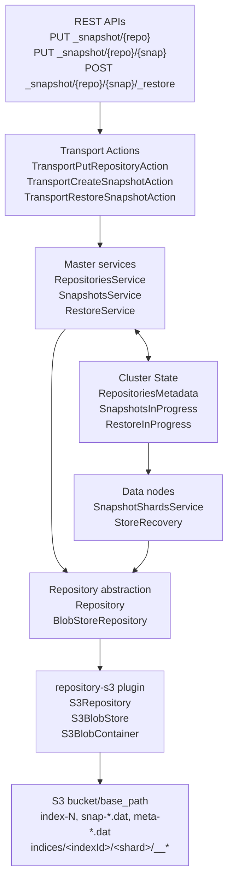
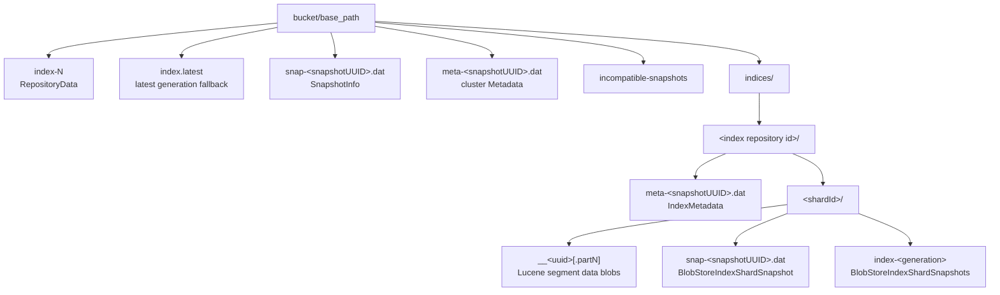
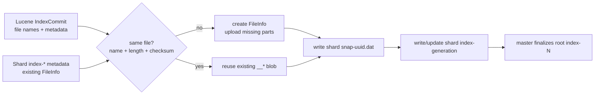
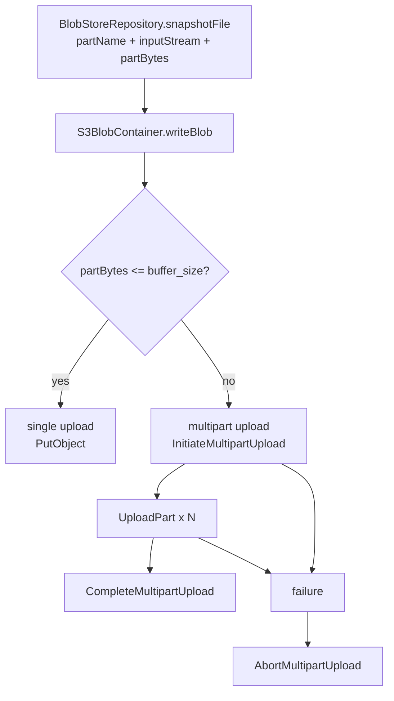
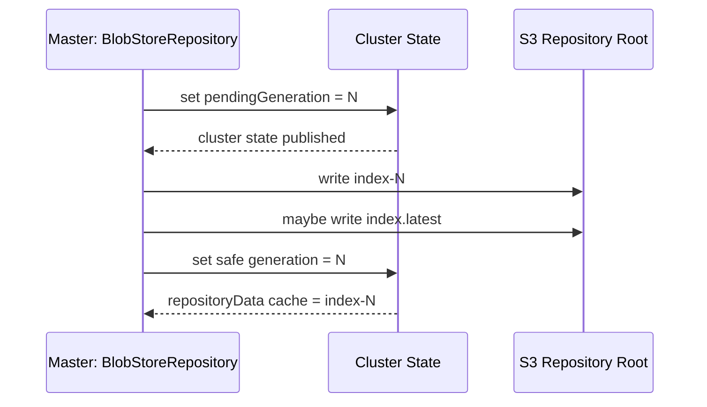

# 社区 Elasticsearch 基于 S3 冷备的源码跟踪

本文跟踪的是 Elasticsearch 社区源码里的 S3 Snapshot/Restore 实现。这里的“冷备”不是额外的复制进程，也不是把节点数据目录直接拷到 S3，而是：

1. 通过 `repository-s3` 插件把 S3 bucket 暴露成一个 `Repository`。
2. 创建 snapshot 时，Master 负责编排和提交元数据，持有 primary shard 的数据节点负责把 Lucene segment 增量写入 S3。
3. 恢复 snapshot 时，Master 读取仓库元数据并创建恢复任务，分片恢复流程再从 S3 拉取缺失或变化的 segment 文件。
4. 通过只追加新对象、根元数据 `index-N` 代际提交、集群状态中的 `generation/pendingGeneration` 来规避对象存储没有本地文件系统式原子覆盖的问题。

## 0. 源码入口地图

| 模块 | 文件 | 作用 |
| --- | --- | --- |
| REST 入口 | `server/src/main/java/org/elasticsearch/rest/action/admin/cluster/RestPutRepositoryAction.java` | `PUT/POST /_snapshot/{repository}` 注册仓库 |
| REST 入口 | `server/src/main/java/org/elasticsearch/rest/action/admin/cluster/RestCreateSnapshotAction.java` | `PUT/POST /_snapshot/{repository}/{snapshot}` 创建快照 |
| REST 入口 | `server/src/main/java/org/elasticsearch/rest/action/admin/cluster/RestRestoreSnapshotAction.java` | `POST /_snapshot/{repository}/{snapshot}/_restore` 恢复快照 |
| 仓库管理 | `server/src/main/java/org/elasticsearch/repositories/RepositoriesService.java` | 注册、验证、创建、关闭 repository 实例 |
| 快照控制面 | `server/src/main/java/org/elasticsearch/snapshots/SnapshotsService.java` | Master 上的 snapshot 生命周期编排 |
| 快照数据面 | `server/src/main/java/org/elasticsearch/snapshots/SnapshotShardsService.java` | 数据节点按集群状态启动 primary shard 快照 |
| Repository 抽象 | `server/src/main/java/org/elasticsearch/repositories/Repository.java` | `snapshotShard`、`finalizeSnapshot`、`restoreShard` 等接口 |
| BlobStore 通用实现 | `server/src/main/java/org/elasticsearch/repositories/blobstore/BlobStoreRepository.java` | 增量分片快照、元数据提交、恢复文件 |
| BlobStore 设计说明 | `server/src/main/java/org/elasticsearch/repositories/blobstore/package-info.java` | snapshot 仓库布局、写入协议、删除协议 |
| S3 插件 | `modules/repository-s3/src/main/java/org/elasticsearch/repositories/s3/S3RepositoryPlugin.java` | 注册 `type=s3` 的 repository factory |
| S3 Repository | `modules/repository-s3/src/main/java/org/elasticsearch/repositories/s3/S3Repository.java` | 解析 S3 repository 配置并创建 `S3BlobStore` |
| S3 客户端 | `modules/repository-s3/src/main/java/org/elasticsearch/repositories/s3/S3Service.java` | AWS S3 client 缓存、鉴权、endpoint/region/proxy 配置 |
| S3 BlobStore | `modules/repository-s3/src/main/java/org/elasticsearch/repositories/s3/S3BlobStore.java` | bucket 级封装、批量删除、创建 container |
| S3 Container | `modules/repository-s3/src/main/java/org/elasticsearch/repositories/s3/S3BlobContainer.java` | S3 对象读、写、list、multipart upload |
| S3 读取重试 | `modules/repository-s3/src/main/java/org/elasticsearch/repositories/s3/S3RetryingInputStream.java` | `GetObject` 中断后的 range resume |
| 恢复控制面 | `server/src/main/java/org/elasticsearch/snapshots/RestoreService.java` | `RestoreInProgress`、路由表、恢复元数据 |
| 恢复数据面 | `server/src/main/java/org/elasticsearch/index/shard/StoreRecovery.java` | 分片从 repository 恢复到本地 store |
| 恢复文件 diff | `server/src/main/java/org/elasticsearch/repositories/blobstore/FileRestoreContext.java` | 比较本地 store 与 snapshot 文件，下载缺失文件 |

## 1. 总体架构



核心分工：

- Master 节点处理 repository 注册、snapshot/restore 编排、全局元数据和最终提交。
- 数据节点只对本节点持有的 primary shard 执行分片级快照，读取 Lucene `IndexCommit`，把新增 segment 文件写到 S3。
- S3 插件只实现通用 `BlobStore` 能力，`BlobStoreRepository` 才是 snapshot 元数据协议和增量算法的主体。
- snapshot 的“可见性”由根目录的 `index-N` 元数据决定。分片数据可以先写入，只有 Master 最终写入新的 `index-N` 后，这个 snapshot 才被仓库正式引用。

## 2. S3 Repository 注册链路

### 2.1 REST 到 Transport Action

`RestPutRepositoryAction` 暴露：

- `POST /_snapshot/{repository}`
- `PUT /_snapshot/{repository}`

源码位置：`RestPutRepositoryAction.java:35-67`。

它从 request body 解析 repository 配置，设置 `verify`、`master_timeout`、`timeout` 后调用：

```text
client.admin().cluster().putRepository(...)
```

Transport 层进入 `TransportPutRepositoryAction.masterOperation`，核心调用在 `TransportPutRepositoryAction.java:66-72`：

```text
repositoriesService.registerRepository(request, listener)
```

### 2.2 RepositoriesService 发布 RepositoryMetadata

`RepositoriesService.registerRepository` 的关键步骤：

| 源码位置 | 逻辑 |
| --- | --- |
| `RepositoriesService.java:145-155` | 校验 repository name，并预先确认可创建 |
| `RepositoriesService.java:160-213` | 如果 `verify=true`，在集群状态发布并收到 ack 后执行仓库验证，再读取 `RepositoryData` 更新 repository UUID |
| `RepositoriesService.java:218-243` | 提交 cluster state update task |
| `RepositoriesService.java:277-329` | `RegisterRepositoryTask` 把 repository type/settings 写入 `RepositoriesMetadata` |
| `RepositoriesService.java:340-345` | 在 master 上实例化 repository 做创建前校验 |
| `RepositoriesService.java:494-533` | verify 流程：start verification、通知节点 verify、end verification |
| `RepositoriesService.java:548-620` | `applyClusterState` 根据 metadata 变化创建或关闭本节点 repository 实例 |

注册 repository 的本质是把如下信息写入集群状态：

```text
RepositoriesMetadata
  -> RepositoryMetadata
       -> name = s3_repo
       -> type = s3
       -> settings = bucket/base_path/client/chunk_size/...
```

### 2.3 S3RepositoryPlugin 提供 type=s3 的工厂

`S3RepositoryPlugin` 是 `repository-s3` 插件入口：

| 源码位置 | 逻辑 |
| --- | --- |
| `S3RepositoryPlugin.java:42` | 类实现 `RepositoryPlugin` 与 `ReloadablePlugin` |
| `S3RepositoryPlugin.java:75-83` | `createRepository(...)` 创建 `S3Repository` |
| `S3RepositoryPlugin.java:86-90` | `createComponents(...)` 创建并加载 `S3Service` |
| `S3RepositoryPlugin.java:98-108` | `getRepositories(...)` 把 `S3Repository.TYPE` 映射到 factory |
| `S3RepositoryPlugin.java:112-135` | 暴露 client/repository 相关 settings |
| `S3RepositoryPlugin.java:139-143` | 支持 reload secure settings 并清理 client cache |
| `S3RepositoryPlugin.java:146-148` | 插件关闭时关闭 `S3Service` |

这里的关键常量是 `S3Repository.TYPE = "s3"`，见 `S3Repository.java:67`。用户配置：

```json
{
  "type": "s3",
  "settings": {
    "bucket": "my-bucket",
    "base_path": "es/prod",
    "client": "default"
  }
}
```

最终会落到 `S3RepositoryPlugin.getRepositories()` 注册的 factory。

## 3. S3 Repository 与客户端初始化

### 3.1 S3Repository 是 BlobStoreRepository 的一种

`S3Repository` 源码位置：`modules/repository-s3/src/main/java/org/elasticsearch/repositories/s3/S3Repository.java`。

关键点：

| 源码位置 | 逻辑 |
| --- | --- |
| `S3Repository.java:63` | `S3Repository extends MeteredBlobStoreRepository` |
| `S3Repository.java:67` | `TYPE = "s3"` |
| `S3Repository.java:86` | `bucket` setting |
| `S3Repository.java:92` | `server_side_encryption` setting |
| `S3Repository.java:97-114` | S3 单对象、multipart、part size 上限约束 |
| `S3Repository.java:122-127` | `buffer_size` setting，决定单次缓冲和 multipart part 大小 |
| `S3Repository.java:132-137` | `chunk_size` setting，决定 Lucene 大文件被 ES 切成多少仓库 blob part |
| `S3Repository.java:140-143` | `storage_class` setting |
| `S3Repository.java:149` | `canned_acl` setting |
| `S3Repository.java:151` | `client` setting |
| `S3Repository.java:164-169` | `cooldown_period`，用于旧元数据格式与对象存储一致性保护 |
| `S3Repository.java:201-219` | 构造函数把 `base_path` 和 location 传给父类 |
| `S3Repository.java:224-227` | 校验 bucket |
| `S3Repository.java:229-245` | 校验 `chunk_size >= buffer_size` |
| `S3Repository.java:399-413` | `createBlobStore()` 创建 `S3BlobStore` |
| `S3Repository.java:421-424` | `chunkSize()` 返回仓库级 chunk size |

`chunk_size` 与 `buffer_size` 的区别：

- `chunk_size` 是 `BlobStoreRepository` 把一个 Lucene 文件拆成多个仓库 blob 的大小。例如大 segment 文件可以拆成 `__uuid.part0`、`__uuid.part1`。
- `buffer_size` 是 S3 上传时每个 upload part 的缓冲大小。`S3BlobContainer.writeBlob()` 会用它判断单对象上传还是 multipart upload。
- 源码要求 `chunk_size >= buffer_size`，否则一个 ES 层面的 blob part 可能小于 S3 multipart 的最小可用缓冲，见 `S3Repository.java:229-245`。

### 3.2 S3Service 负责 AWS client 缓存与鉴权

`S3Service` 源码位置：`modules/repository-s3/src/main/java/org/elasticsearch/repositories/s3/S3Service.java`。

关键点：

| 源码位置 | 逻辑 |
| --- | --- |
| `S3Service.java:55` | `S3Service implements Closeable` |
| `S3Service.java:72-86` | 用 `S3ClientSettings` 缓存 `AmazonS3Reference` |
| `S3Service.java:110-118` | reload secure settings 后刷新并清空 cache |
| `S3Service.java:124-142` | `client(RepositoryMetadata)` 返回带引用计数的 client |
| `S3Service.java:150-177` | 合并全局 client settings 与 repository metadata |
| `S3Service.java:180-210` | 构造 AWS client，设置 credentials、endpoint、region、path-style、chunked encoding |
| `S3Service.java:213-238` | 设置 protocol、proxy、signer、retry、socket timeout 等 ClientConfiguration |
| `S3Service.java:241-266` | credentials 选择：显式 key、web identity、instance profile |
| `S3Service.java:268-279` | repository 不再使用时释放 cached client |
| `S3Service.java:281-285` | close 时释放所有 client |

所以 S3 仓库不是每次读写都 new 一个 AWS client，而是按有效 settings 缓存，repository 实例引用它。

## 4. 仓库对象布局

`server/src/main/java/org/elasticsearch/repositories/blobstore/package-info.java:31-76` 描述了 BlobStore repository 的对象布局。S3 只是这个布局的一种落地介质。



核心对象：

| 对象 | 含义 |
| --- | --- |
| `index-N` | 根仓库元数据，记录所有 snapshot、index、shard generation，是 snapshot 可见性的提交点 |
| `snap-<snapshotUUID>.dat` | 根目录 snapshot 信息，包含 snapshot 结果、失败分片、开始结束时间等 |
| `meta-<snapshotUUID>.dat` | 根目录集群 metadata |
| `indices/<indexRepoId>/meta-<snapshotUUID>.dat` | 某个 index 在该 snapshot 中的 metadata |
| `indices/<indexRepoId>/<shardId>/__*` | 分片 Lucene 文件内容，支持分 part |
| `indices/<indexRepoId>/<shardId>/snap-<snapshotUUID>.dat` | 某个 shard 在该 snapshot 中引用了哪些 `__*` 文件 |
| `indices/<indexRepoId>/<shardId>/index-*` | shard 级 snapshot 列表和 generation |

这个布局有两个关键设计：

1. 数据对象基本不可变。新增 snapshot 复用旧的 `__*` blob，缺什么补什么。
2. 新 snapshot 是否“生效”不由数据 blob 是否存在决定，而由根 `index-N` 是否引用它决定。

## 5. 创建 Snapshot 的控制面

### 5.1 REST 到 SnapshotsService

`RestCreateSnapshotAction` 暴露：

- `PUT /_snapshot/{repository}/{snapshot}`
- `POST /_snapshot/{repository}/{snapshot}`

源码位置：`RestCreateSnapshotAction.java:31-50`。

它构造 `CreateSnapshotRequest`，解析 body，处理 `wait_for_completion`，然后调用：

```text
client.admin().cluster().createSnapshot(...)
```

`TransportCreateSnapshotAction.masterOperation` 中：

- `wait_for_completion=true` 时调用 `snapshotsService.executeSnapshot`
- 否则调用 `snapshotsService.createSnapshot`

源码位置：`TransportCreateSnapshotAction.java:62-72`。

### 5.2 SnapshotsService 创建 SnapshotId 并写入集群状态

`SnapshotsService` 的关键入口：

| 源码位置 | 逻辑 |
| --- | --- |
| `SnapshotsService.java:250-252` | `executeSnapshot` = 创建 snapshot + 注册完成监听 |
| `SnapshotsService.java:263-275` | `createSnapshot` 校验 repository/snapshot，创建 `SnapshotId` UUID，拒绝只读仓库 |
| `SnapshotsService.java:285-294` | 读取 `RepositoryData` 后提交 `CreateSnapshotTask` |

`server/src/main/java/org/elasticsearch/snapshots/package-info.java:24-53` 给出了创建 snapshot 的完整设计：

1. Master 根据请求和当前 routing table 确定每个 shard 的 primary 分配。
2. Master 写入 `SnapshotsInProgress.Entry` 到 cluster state。
3. 各数据节点收到 cluster state 变化后，只有持有 primary shard 的节点执行本地分片快照。
4. 数据节点完成后向 Master 汇报 shard 级 SUCCESS/FAILED。
5. 所有 shard 完成后，Master 调用 repository 的 `finalizeSnapshot` 写入最终元数据。
6. Master 从 cluster state 移除该 `SnapshotsInProgress.Entry`。

整体时序：

```mermaid
sequenceDiagram
  participant C as Client
  participant M as Master: SnapshotsService
  participant CS as Cluster State
  participant D as Primary Data Node: SnapshotShardsService
  participant R as BlobStoreRepository
  participant S as S3BlobContainer/S3

  C->>M: PUT _snapshot/s3_repo/snap_1
  M->>R: getRepositoryData()
  M->>CS: add SnapshotsInProgress.Entry
  CS-->>D: clusterChanged()
  D->>D: acquireIndexCommitForSnapshot()
  D->>R: snapshotShard(SnapshotShardContext)
  R->>S: read shard index-* metadata
  R->>R: compare Lucene commit files with existing FileInfo
  R->>S: upload missing __* segment blobs
  R->>S: write shard snap-&lt;uuid&gt;.dat and index-&lt;generation&gt;
  D->>M: UpdateIndexShardSnapshotStatusRequest
  M->>R: finalizeSnapshot(FinalizeSnapshotContext)
  R->>S: write meta-*.dat, snap-*.dat, root index-N
  M->>CS: remove SnapshotsInProgress.Entry
```

## 6. 创建 Snapshot 的数据面

### 6.1 SnapshotShardsService 在数据节点启动分片快照

数据节点的入口是 `SnapshotShardsService.clusterChanged`：

| 源码位置 | 逻辑 |
| --- | --- |
| `SnapshotShardsService.java:130-160` | 监听 `SnapshotsInProgress`，处理新增、更新、取消 |
| `SnapshotShardsService.java:226-240` | 如果 snapshot 是 `STARTED` 且有 `INIT` shard，则尝试启动本地分片快照 |
| `SnapshotShardsService.java:263-304` | `startNewShardSnapshots` 只挑选分配到本节点的 primary shard，并提交到 `SNAPSHOT` 线程池 |
| `SnapshotShardsService.java:306-349` | 任务成功则通知 Master 成功，失败则通知失败 |
| `SnapshotShardsService.java:379-425` | `snapshot(...)` 校验 primary、不在 relocation/recovery，获取 `SnapshotIndexCommit`，调用 `repository.snapshotShard(...)` |

为什么只备 primary shard：

- Lucene segment 在 primary/replica 上逻辑等价，snapshot 只需要每个 shard 一份一致的 `IndexCommit`。
- `SnapshotIndexCommit` 固定住一个可读提交点，避免快照过程中 segment 被 merge/delete 影响。
- 副本不参与上传可以减少重复 IO。

### 6.2 BlobStoreRepository 做增量分片快照

`Repository` 接口定义了分工：

| 源码位置 | 逻辑 |
| --- | --- |
| `Repository.java:36-48` | 注释说明 data nodes 调 `snapshotShard`，Master 调 `finalizeSnapshot` |
| `Repository.java:131` | `getRepositoryData(...)` |
| `Repository.java:140` | `finalizeSnapshot(...)` |
| `Repository.java:217` | `snapshotShard(SnapshotShardContext)` |
| `Repository.java:230-237` | `restoreShard(...)` |

`BlobStoreRepository.snapshotShard` 只是入队，真正逻辑在 `doSnapshotShard`：

| 源码位置 | 逻辑 |
| --- | --- |
| `BlobStoreRepository.java:2965-2967` | `snapshotShard(...)` 提交到 shard snapshot task runner |
| `BlobStoreRepository.java:2969-3251` | `doSnapshotShard(...)` 主流程 |
| `BlobStoreRepository.java:2979-3002` | 根据 shard generation 读取已有 `index-*` shard 元数据 |
| `BlobStoreRepository.java:3004-3009` | 检查同名 snapshot 是否已存在 |
| `BlobStoreRepository.java:3010-3020` | 如果 `SegmentInfos` 的 state identifier 完全匹配，可复用已有文件列表 |
| `BlobStoreRepository.java:3031-3085` | 读取当前 `IndexCommit` 文件元数据，与历史 snapshot 文件比较，构造缺失文件的 `FileInfo` |
| `BlobStoreRepository.java:3094-3100` | 更新状态，记录增量文件数/大小与总文件数/大小 |
| `BlobStoreRepository.java:3103-3126` | 支持 shard generation 时，先写新的 shard `index-<uuid>`，失败时不会被根元数据引用 |
| `BlobStoreRepository.java:3191-3230` | 所有数据文件完成后写 shard `snap-<snapshotUUID>.dat`，并返回 `ShardSnapshotResult` |
| `BlobStoreRepository.java:3231-3241` | 失败时清理本次新写但未被引用的数据 blob |
| `BlobStoreRepository.java:3243-3247` | 如果没有增量文件则跳过上传，否则调用 `snapshotFiles` |

增量判断可以概括为：



### 6.3 单个 Lucene 文件如何写到 S3

`BlobStoreRepository.snapshotFile` 是单文件上传入口：

| 源码位置 | 逻辑 |
| --- | --- |
| `BlobStoreRepository.java:3698-3709` | 打开本地 Lucene 文件的 verifying input |
| `BlobStoreRepository.java:3710-3732` | 按 `fileInfo.numberOfParts()` 循环，每一 part 包一层 snapshot 限速和 abort 检查 |
| `BlobStoreRepository.java:3733-3736` | 调用 `shardContainer.writeBlob(OperationPurpose.SNAPSHOT_DATA, partName, inputStream, partBytes, false)` |
| `BlobStoreRepository.java:3746-3747` | 上传后校验 input 并更新已处理文件大小 |

这里的 `partName` 是 `FileInfo.partName(i)`，通常会落成 shard 目录下的 `__<uuid>` 或 `__<uuid>.partN`。

换句话说，ES 层先把 Lucene 文件切成仓库 blob part，再由 S3 层决定每个 blob part 是一次 `PutObject` 还是一次 multipart upload。

## 7. S3 BlobStore 读写实现

### 7.1 S3BlobStore：bucket 级封装

`S3BlobStore` 源码位置：`modules/repository-s3/src/main/java/org/elasticsearch/repositories/s3/S3BlobStore.java`。

关键点：

| 源码位置 | 逻辑 |
| --- | --- |
| `S3BlobStore.java:64` | 实现 `BlobStore` |
| `S3BlobStore.java:70` | S3 bulk delete 一批最多 1000 个对象 |
| `S3BlobStore.java:107-143` | 保存 bucket、buffer、ACL、storage class、metrics、retry stats |
| `S3BlobStore.java:270-272` | 从 `S3Service` 获取 client reference |
| `S3BlobStore.java:294-297` | `blobContainer(BlobPath)` 创建 `S3BlobContainer` |
| `S3BlobStore.java:300-327` | 批量删除 blob，按 1000 分批调用 S3 delete objects |
| `S3BlobStore.java:329-359` | 构造具体 S3 bulk delete request |

### 7.2 S3BlobContainer：对象读写、list、delete

`S3BlobContainer` 是 S3 对象操作的核心：

| 源码位置 | 逻辑 |
| --- | --- |
| `S3BlobContainer.java:78` | 继承 `AbstractBlobContainer` |
| `S3BlobContainer.java:85-89` | `BlobPath` 转成 S3 object key prefix |
| `S3BlobContainer.java:91-98` | `blobExists(...)` 调用 S3 `doesObjectExist` |
| `S3BlobContainer.java:100-118` | `readBlob(...)` 返回 `S3RetryingInputStream`，支持 range |
| `S3BlobContainer.java:126-142` | `writeBlob(...)` 根据大小选择 single upload 或 multipart upload |
| `S3BlobContainer.java:144-226` | metadata blob 写入支持 `ChunkedBlobOutputStream` 和 multipart |
| `S3BlobContainer.java:257-268` | initiate multipart upload，设置 storage class、ACL、server-side encryption |
| `S3BlobContainer.java:270-273` | multipart threshold 是 `bufferSizeInBytes` |
| `S3BlobContainer.java:282-318` | 删除整个 container：按 prefix list 后分批删除 |
| `S3BlobContainer.java:326-344` | list blobs |
| `S3BlobContainer.java:347-368` | list child containers，用 delimiter `/` |
| `S3BlobContainer.java:370-394` | 分页 list object |
| `S3BlobContainer.java:403-406` | `buildKey(blobName)` = `keyPath + blobName` |
| `S3BlobContainer.java:411-442` | single upload 用 `putObject` |
| `S3BlobContainer.java:447-524` | multipart upload：initiate、upload parts、complete，异常时 abort |
| `S3BlobContainer.java:527-538` | 校验 multipart 总大小范围 |
| `S3BlobContainer.java:549-566` | 计算 multipart part 数 |

写入决策：



### 7.3 S3 读取重试

`S3RetryingInputStream` 解决的是读 S3 对象中途失败的问题：

| 源码位置 | 逻辑 |
| --- | --- |
| `S3RetryingInputStream.java:33-39` | 类注释说明 AWS SDK 不会在下载中断后自动从断点继续，ES 自己包装重试 |
| `S3RetryingInputStream.java:83-104` | `openStream()` 构造 `GetObjectRequest`，设置 `Range(start+currentOffset, end)` |
| `S3RetryingInputStream.java:125-159` | `read(...)` 捕获 IOException 后调用 reopen |
| `S3RetryingInputStream.java:168-208` | retry 逻辑：超过最大次数失败；如果已经读到有效进展，则不计入最大失败次数 |
| `S3RetryingInputStream.java:210-235` | close 时如果未读完则 abort underlying stream |

恢复时，`BlobStoreRepository.restoreShard` 会从 `S3BlobContainer.readBlob` 获取这个 stream，因此 S3 网络抖动可以通过 range resume 减少从头读整个大对象的概率。

## 8. 元数据提交与一致性保护

### 8.1 RepositoryData 的读取

`package-info.java:78-110` 描述了读取仓库元数据的流程：

1. 优先 list 根目录下所有 `index-*`。
2. 选择最大的 generation。
3. 读取对应 `index-N`。
4. 如果没有 `index-*`，在部分场景回退到 `index.latest`。
5. 都不存在时认为仓库为空。

对应实现：

| 源码位置 | 逻辑 |
| --- | --- |
| `BlobStoreRepository.java:2033-2075` | `getRepositoryData(...)`，Master 侧读取并缓存 |
| `BlobStoreRepository.java:2429-2454` | 根据指定 generation 读取 `index-N` JSON |
| `BlobStoreRepository.java:2889-2932` | `latestIndexBlobId()` 通过 list `index-*` 找最大代际，必要时回退 `index.latest` |

### 8.2 RepositoryData 的写入协议

`package-info.java:112-141` 解释了为什么要有 `generation` 和 `pendingGeneration`：

- 对象存储不应依赖“覆盖已有对象”的原子语义。
- 同一个仓库不能让两个 Master/finalization 同时写同一个 `index-N`。
- 新的 generation 必须单调前进，写过的 `index-N` 不复用。

`BlobStoreRepository.writeIndexGen(...)` 是核心实现：

| 源码位置 | 逻辑 |
| --- | --- |
| `BlobStoreRepository.java:2502-2733` | 写入新的 root `index-N` |
| `BlobStoreRepository.java:2509-2526` | 校验当前 generation 是否等于预期 generation |
| `BlobStoreRepository.java:2528-2602` | Step 1：先在 cluster state 设置新的 pending generation |
| `BlobStoreRepository.java:2558-2560` | 注释明确说明该设计用于规避 S3 这类仓库的覆盖一致性问题 |
| `BlobStoreRepository.java:2606-2670` | Step 2：写新的 `index-N` blob，必要时写 `index.latest` |
| `BlobStoreRepository.java:2671-2731` | Step 3：更新 cluster state safe generation，并刷新 repository data cache |
| `BlobStoreRepository.java:2750-2772` | `maybeWriteIndexLatest` |

提交流程可以看成三阶段：



这就是 S3 冷备实现里最重要的提交点：

- shard 数据 blob 先写，不代表 snapshot 对外可见。
- root `snap-*.dat`、`meta-*.dat` 先写，也不代表最终成功。
- 只有新的 `index-N` 成功写入并进入 safe generation，仓库才认为 snapshot 已提交。

### 8.3 finalizeSnapshot 写最终元数据

`BlobStoreRepository.finalizeSnapshot(...)` 在 Master 上执行：

| 源码位置 | 逻辑 |
| --- | --- |
| `BlobStoreRepository.java:1546-1713` | `finalizeSnapshot(...)` 主流程 |
| `BlobStoreRepository.java:1575-1583` | 获取当前 `RepositoryData` |
| `BlobStoreRepository.java:1585-1662` | 写缺失的 metadata |
| `BlobStoreRepository.java:1617-1624` | 写 global metadata |
| `BlobStoreRepository.java:1626-1648` | 写 index metadata |
| `BlobStoreRepository.java:1651-1657` | 写 root `SnapshotInfo` blob |
| `BlobStoreRepository.java:1665-1692` | 调 `writeIndexGen(existingRepositoryData.addSnapshot(...))` 提交新的 root generation |
| `BlobStoreRepository.java:1696-1705` | 成功后清理旧 metadata |
| `BlobStoreRepository.java:1708-1713` | 异常转成 `SnapshotException` |

`S3Repository` 还针对旧 metadata 格式包了一层 cooldown：

| 源码位置 | 逻辑 |
| --- | --- |
| `S3Repository.java:286-313` | `finalizeSnapshot(...)` 在必要时用 cooldown 包装 context |
| `S3Repository.java:316-345` | 删除 listener 也带弱一致保护/cooldown |

这说明 S3 repository 的一致性保护分两层：

1. 通用层：`BlobStoreRepository` 的代际元数据提交协议。
2. S3 层：针对旧格式或删除场景额外等待，避免 list/read 观察到短暂不一致。

## 9. 恢复 Snapshot 的源码链路

### 9.1 REST 到 RestoreService

`RestRestoreSnapshotAction` 暴露：

- `POST /_snapshot/{repository}/{snapshot}/_restore`

源码位置：`RestRestoreSnapshotAction.java:30-49`。

Transport 入口是 `TransportRestoreSnapshotAction`：

| 源码位置 | 逻辑 |
| --- | --- |
| `TransportRestoreSnapshotAction.java:29` | Master node action |
| `TransportRestoreSnapshotAction.java:56-64` | 恢复可能修改 metadata 与 index 写入，因此检查 `METADATA_WRITE` 和 `WRITE` block |
| `TransportRestoreSnapshotAction.java:68-85` | 调用 `restoreService.restoreSnapshot(...)`，`wait_for_completion=true` 时注册完成监听 |

### 9.2 RestoreService 读取仓库元数据并创建恢复任务

`RestoreService` 类注释已经把恢复流程讲得很清楚：

| 源码位置 | 逻辑 |
| --- | --- |
| `RestoreService.java:120-138` | 类注释：读取 snapshot/metadata，写 `RestoreInProgress`，通过普通 recovery 恢复 shard，完成后移除记录 |
| `RestoreService.java:230-300` | `restoreSnapshot(...)`：刷新 repository UUID、读取 `RepositoryData`、找到 `SnapshotId`、读取 `SnapshotInfo` |
| `RestoreService.java:316-330` | `startRestore(...)`：校验 snapshot 可恢复，并准备提交 cluster state update |

恢复流程：

```mermaid
sequenceDiagram
  participant C as Client
  participant M as Master: RestoreService
  participant CS as Cluster State
  participant D as Data Node: StoreRecovery
  participant R as BlobStoreRepository
  participant S as S3BlobContainer/S3

  C->>M: POST _snapshot/s3_repo/snap_1/_restore
  M->>R: getRepositoryData()
  M->>R: getSnapshotInfo(snapshotId)
  M->>CS: create RestoreInProgress + routing recovery source
  CS-->>D: shard recovery starts
  D->>R: restoreShard(store, snapshotId, indexId, shardId)
  R->>S: read shard snap-&lt;uuid&gt;.dat
  R->>D: compare local Store.MetadataSnapshot with snapshot files
  D->>S: read missing/different __* blob parts
  S-->>D: S3RetryingInputStream with range retry
  D->>D: verify, sync, cleanup extra local files
  D->>CS: recovery complete
```

### 9.3 数据节点 StoreRecovery 调 repository.restoreShard

`StoreRecovery` 在分片恢复时根据 `RecoverySource.SnapshotRecoverySource` 走 repository 恢复：

| 源码位置 | 逻辑 |
| --- | --- |
| `StoreRecovery.java:535-548` | 准备恢复，处理 snapshot shard id |
| `StoreRecovery.java:549-564` | 必要时读取 `RepositoryData` 解析 `IndexId` |
| `StoreRecovery.java:567-577` | 调用 `repository.restoreShard(...)` |
| `StoreRecovery.java:580-590` | 文件恢复后 bootstrap store、打开 engine、finalize recovery |

`BlobStoreRepository.restoreShard(...)` 是 repository 侧核心：

| 源码位置 | 逻辑 |
| --- | --- |
| `BlobStoreRepository.java:3302-3440` | `restoreShard(...)` 主流程 |
| `BlobStoreRepository.java:3330-3344` | 构造 `SnapshotFiles`，初始化 restore 统计 |
| `BlobStoreRepository.java:3399` | 对每个需要恢复的 part 调 `container.readBlob(OperationPurpose.SNAPSHOT_DATA, fileInfo.partName(slice))` |
| `BlobStoreRepository.java:3439` | 调用 `FileRestoreContext.restore(...)` |

`FileRestoreContext` 负责精确判断哪些文件要下载：

| 源码位置 | 逻辑 |
| --- | --- |
| `FileRestoreContext.java:35-40` | 类注释：从 snapshot 恢复 Lucene 文件 |
| `FileRestoreContext.java:67-179` | `restore(...)` 主流程 |
| `FileRestoreContext.java:78-98` | 读取本地 store metadata，失败则视为空 |
| `FileRestoreContext.java:99-106` | 从 snapshot file infos 构造源 metadata |
| `FileRestoreContext.java:113-135` | `sourceMetadata.recoveryDiff(recoveryTargetMetadata)`，相同文件复用，不同/缺失文件下载 |
| `FileRestoreContext.java:145-160` | 删除本地已有但内容不同的同名物理文件 |
| `FileRestoreContext.java:162-170` | 调用子类实现的 `restoreFiles(...)` 下载文件 |
| `FileRestoreContext.java:181-202` | 删除本地 store 中 snapshot 不需要的多余文件 |

恢复也是增量的：如果本地 store 中已有与 snapshot 相同的 segment，就不下载；只下载 missing/different 文件。

## 10. 删除 Snapshot 与仓库清理

删除流程不是本文重点，但它解释了为什么数据 blob 可以复用。

`package-info.java:190-220` 描述了删除 snapshot 的高层协议：

1. 删除根目录 `snap-<snapshotUUID>.dat` 和 `meta-<snapshotUUID>.dat`。
2. 删除每个 index 的 `meta-<snapshotUUID>.dat`。
3. 更新 shard 级 snapshot 列表，移除被删 snapshot。
4. 找出不再被任何 snapshot 引用的 `__*` 数据 blob。
5. 写新的 root `index-N`。
6. 删除未引用的旧数据 blob 和旧 metadata。

由于 snapshot 是增量复用的，删除一个 snapshot 不能简单删除它曾经上传过的所有 `__*` blob，必须先检查其他 snapshot 是否还引用这些 blob。

S3 批量删除由 `S3BlobStore.deleteBlobsIgnoringIfNotExists` 处理，源码在 `S3BlobStore.java:300-327`，按 `MAX_BULK_DELETES=1000` 分批。

## 11. 并发、失败与限速

### 11.1 Snapshot 并发

`server/src/main/java/org/elasticsearch/snapshots/package-info.java:126-161` 说明了并发规则：

- 不同 repository 的操作可以相互独立。
- 同一个 repository 上的 finalization/delete 会序列化，避免同时提交 root `index-N`。
- 多个 snapshot 的 shard 数据上传可以并发。
- 同一个 shard 的多个 snapshot 会排队，避免同一 shard 的本地文件快照互相干扰。

### 11.2 失败处理

关键失败保护：

| 场景 | 处理 |
| --- | --- |
| 分片快照过程中 abort | `snapshotFile` 读取时检查 `IndexShardSnapshotStatus`，见 `BlobStoreRepository.java:3713-3732` |
| 分片快照失败 | 清理本次写入但未被 root 元数据引用的新 blob，见 `BlobStoreRepository.java:3231-3241` |
| S3 multipart upload 失败 | `S3BlobContainer.executeMultipartUpload` 异常路径 abort multipart，见 `S3BlobContainer.java:447-524` |
| S3 读取中断 | `S3RetryingInputStream` 用 range resume 重开 stream，见 `S3RetryingInputStream.java:83-208` |
| root 元数据提交失败 | `writeIndexGen` 没有进入 safe generation 时，新写的数据不会被仓库视作已提交 snapshot |
| restore 失败 | `StoreRecovery` 包装为 `IndexShardRestoreFailedException`，见 `StoreRecovery.java:592-598` |

### 11.3 限速

`BlobStoreRepository` 对 snapshot 与 restore 都有 rate limiting：

| 源码位置 | 逻辑 |
| --- | --- |
| `BlobStoreRepository.java:3462-3481` | restore 限速，受 repository `max_restore_bytes_per_sec` 和 recovery settings 影响 |
| `BlobStoreRepository.java:3484-3505` | snapshot 限速，受 repository `max_snapshot_bytes_per_sec` 和 recovery node bandwidth settings 影响 |
| `BlobStoreRepository.java:3714-3716` | 上传单个文件 part 时包 `maybeRateLimitSnapshots(...)` |

## 12. 一次完整调用链速查

### 12.1 注册 S3 repository

```text
REST PUT /_snapshot/s3_repo
  -> RestPutRepositoryAction.prepareRequest
  -> ClusterAdminClient.putRepository
  -> TransportPutRepositoryAction.masterOperation
  -> RepositoriesService.registerRepository
  -> RegisterRepositoryTask writes RepositoriesMetadata
  -> RepositoriesService.applyClusterState
  -> RepositoryPlugin factory
  -> S3RepositoryPlugin.createRepository
  -> new S3Repository
  -> S3Repository.createBlobStore
  -> new S3BlobStore
```

### 12.2 创建 snapshot

```text
REST PUT /_snapshot/s3_repo/snap_1
  -> RestCreateSnapshotAction.prepareRequest
  -> ClusterAdminClient.createSnapshot
  -> TransportCreateSnapshotAction.masterOperation
  -> SnapshotsService.createSnapshot / executeSnapshot
  -> getRepositoryData
  -> CreateSnapshotTask writes SnapshotsInProgress
  -> SnapshotShardsService.clusterChanged on data nodes
  -> SnapshotShardsService.snapshot
  -> Repository.snapshotShard
  -> BlobStoreRepository.doSnapshotShard
  -> BlobStoreRepository.snapshotFiles
  -> BlobStoreRepository.snapshotFile
  -> S3BlobContainer.writeBlob
  -> S3 putObject or multipart upload
  -> data node reports shard status to master
  -> SnapshotsService.endSnapshot
  -> BlobStoreRepository.finalizeSnapshot
  -> BlobStoreRepository.writeIndexGen
  -> S3 root index-N committed
```

### 12.3 恢复 snapshot

```text
REST POST /_snapshot/s3_repo/snap_1/_restore
  -> RestRestoreSnapshotAction.prepareRequest
  -> ClusterAdminClient.restoreSnapshot
  -> TransportRestoreSnapshotAction.masterOperation
  -> RestoreService.restoreSnapshot
  -> repository.getRepositoryData
  -> repository.getSnapshotInfo
  -> RestoreService.startRestore
  -> cluster state adds RestoreInProgress and recovery source
  -> StoreRecovery detects SnapshotRecoverySource
  -> Repository.restoreShard
  -> BlobStoreRepository.restoreShard
  -> FileRestoreContext.restore
  -> S3BlobContainer.readBlob
  -> S3RetryingInputStream range read
  -> local store verifies and boots shard
```

## 13. 为什么说这是“冷备”

从源码看，S3 snapshot 的冷备特征是：

- 备份结果在集群外部对象存储中，和在线 shard 分配解耦。
- snapshot 写入的是 Lucene segment 文件和 ES 元数据，不是在线 translog 复制流。
- 恢复时通过 snapshot repository 重建 index/shard，本质是一次 recovery，不是秒级故障切换。
- snapshot 是增量的，但不是持续复制。下一次 snapshot 会复用未变化的 segment，只上传新增 segment。
- 一致性边界是 Lucene `IndexCommit` 与 root `index-N`，不是操作级实时同步。

因此它适合灾备、跨集群迁移、长期归档、误删恢复；不适合作为实时双活或 RPO 极低的热备复制。

## 14. 阅读源码建议顺序

1. 先读 `server/src/main/java/org/elasticsearch/repositories/blobstore/package-info.java`，理解仓库目录布局、snapshot 写入协议、删除协议。
2. 再读 `server/src/main/java/org/elasticsearch/snapshots/package-info.java`，理解 Master 与数据节点如何通过 cluster state 协同。
3. 读 `modules/repository-s3/src/main/java/org/elasticsearch/repositories/s3/S3RepositoryPlugin.java` 和 `S3Repository.java`，确认 `type=s3` 如何接入通用 repository 框架。
4. 读 `server/src/main/java/org/elasticsearch/repositories/blobstore/BlobStoreRepository.java` 的 `doSnapshotShard`、`snapshotFile`、`finalizeSnapshot`、`writeIndexGen`、`restoreShard`。
5. 最后读 `S3BlobContainer.java` 与 `S3RetryingInputStream.java`，把抽象 blob 操作映射到 S3 API。

## 15. 核心结论

社区 ES 的 S3 冷备实现可以浓缩为一句话：

> `repository-s3` 只负责把 S3 实现成 BlobStore；真正的冷备协议由 `BlobStoreRepository` 实现：primary shard 增量上传不可变 segment blob，Master 用代际化 `index-N` 原子式提交 repository 元数据，restore 再按 snapshot 元数据从 S3 拉取缺失 segment 重建 shard。

最值得关注的源码锚点是：

- `S3RepositoryPlugin.java:98-108`：`type=s3` 的 repository factory。
- `S3Repository.java:399-413`：创建 S3 blob store。
- `S3BlobContainer.java:126-142`：S3 写 blob 的 single/multipart 分流。
- `BlobStoreRepository.java:2969-3251`：分片增量 snapshot 主逻辑。
- `BlobStoreRepository.java:3698-3736`：单个 Lucene 文件 part 写入 blob store。
- `BlobStoreRepository.java:1546-1713`：Master finalize snapshot。
- `BlobStoreRepository.java:2502-2733`：root `index-N` 代际提交。
- `RestoreService.java:230-300`：restore 请求读取 repository data 与 snapshot info。
- `BlobStoreRepository.java:3302-3440`：从 repository 恢复 shard。
- `FileRestoreContext.java:113-170`：恢复时计算本地与 snapshot 的文件 diff。
